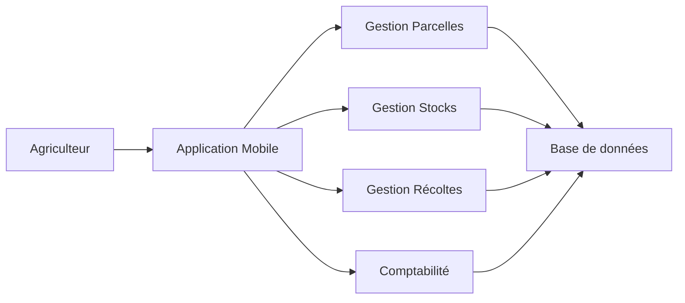
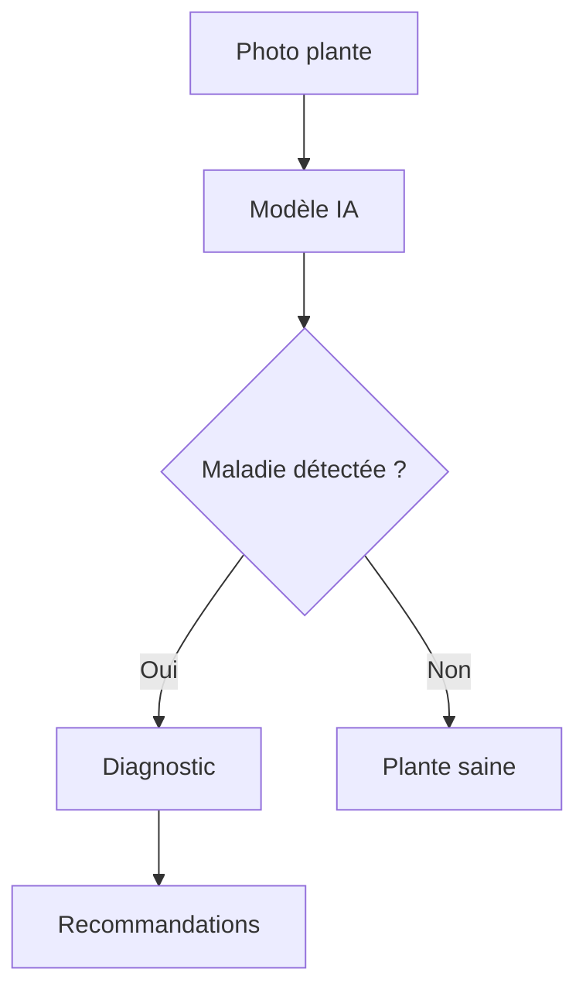
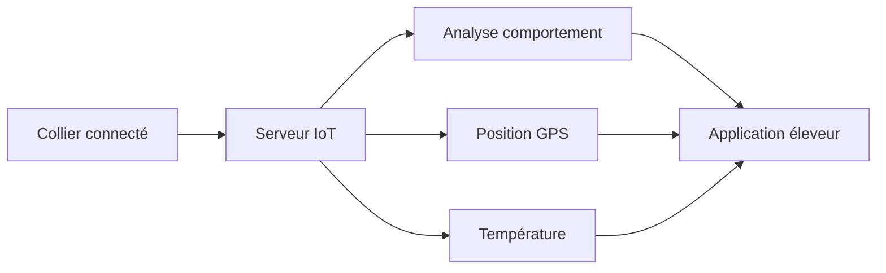
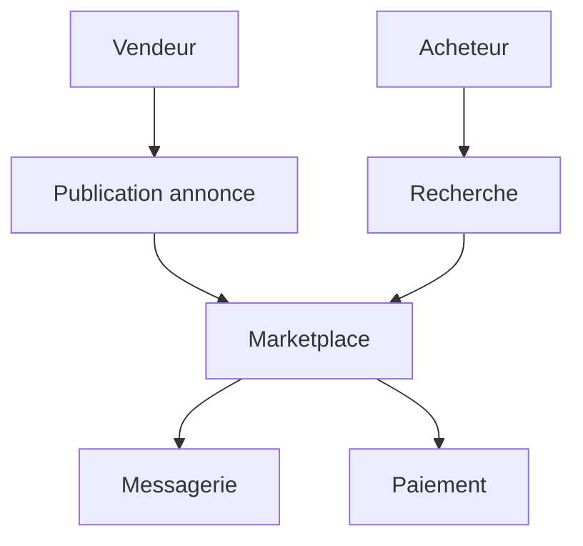
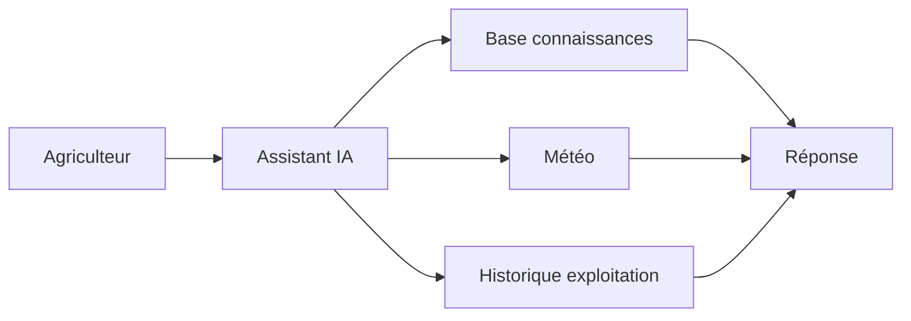
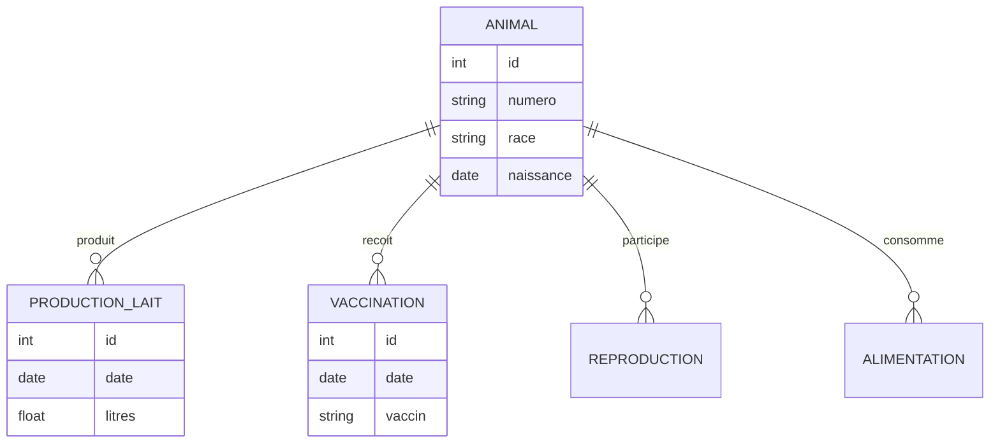
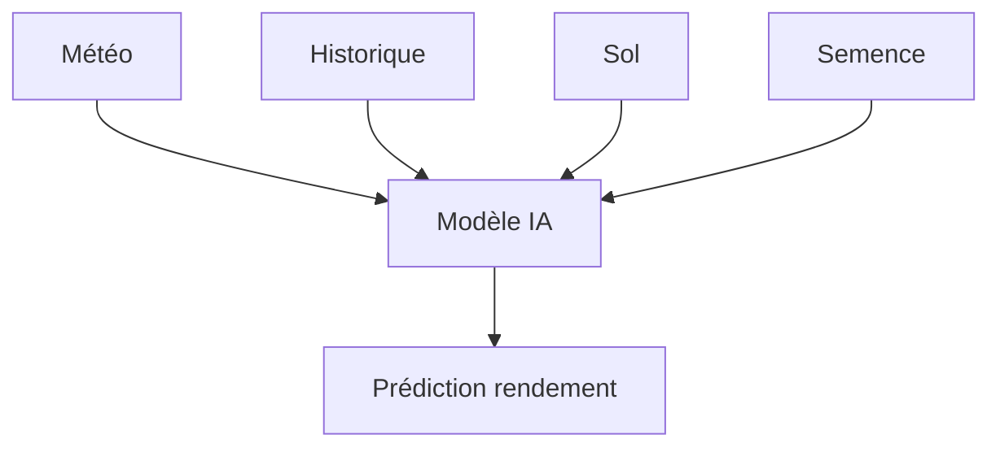
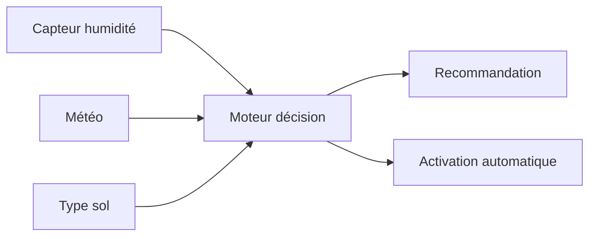
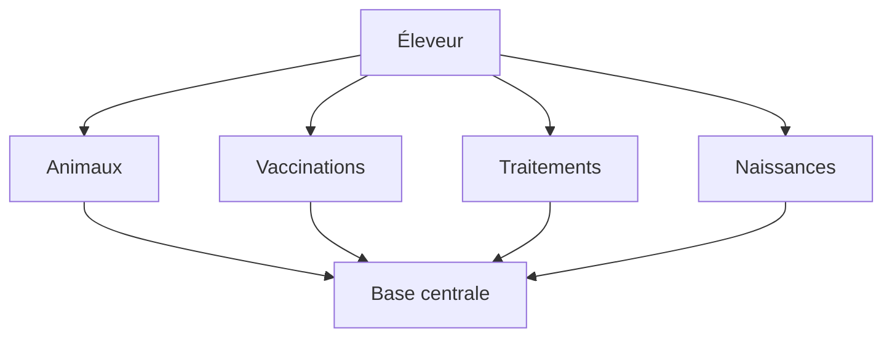
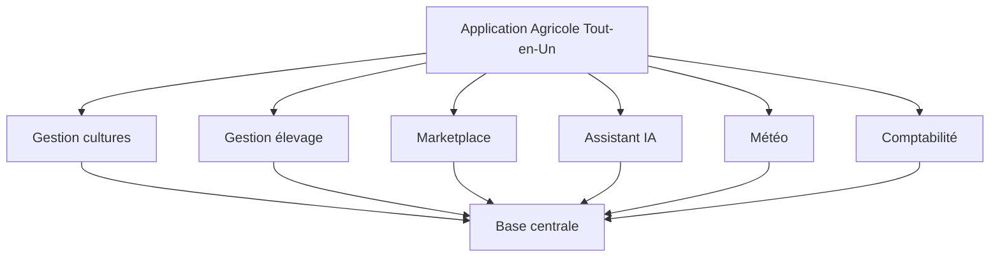

Le secteur de l'agriculture et de l'élevage est encore largement sous-numérisé dans de nombreux pays. Il existe donc beaucoup d'opportunités pour développer des applications à forte valeur ajoutée.

Voici plusieurs idées classées par niveau d'ambition et de rentabilité potentielle.

# 1. Gestion intelligente d'exploitation agricole

### Problème

Les agriculteurs utilisent souvent plusieurs cahiers, fichiers Excel et applications séparées.

### Solution

Une plateforme unique permettant de gérer :

* Parcelles
* Cultures
* Stocks
* Main d'œuvre
* Machines
* Dépenses
* Revenus

### Fonctionnalités

✅ Calendrier agricole

✅ Alertes de traitements

✅ Gestion des semis

✅ Suivi des récoltes

✅ Calcul automatique des marges

---

### Architecture



---

# 2. Détection précoce des maladies des plantes par IA

### Problème

Les maladies sont souvent détectées trop tard.

### Solution

L'agriculteur photographie une feuille.

L'IA détecte :

* maladie probable
* gravité
* traitement recommandé

---

### Fonctionnement



---

### Business Model

* Freemium
* Abonnement premium
* Vente aux coopératives

---

# 3. Surveillance des troupeaux par GPS

### Pour éleveurs bovins, ovins, caprins

Chaque animal possède :

* collier GPS
* capteur température
* capteur activité

---

### Fonctionnalités

* Position en temps réel
* Détection de fuite
* Détection de maladie
* Détection de mise bas

---

### Diagramme



---

# 4. Marketplace locale entre agriculteurs

### Concept

Un "Leboncoin agricole".

Les utilisateurs vendent :

* animaux
* fourrage
* matériel
* semences
* engrais

---

### Modules



---

# 5. Assistant agricole IA

### Concept

Un ChatGPT spécialisé agriculture.

Questions possibles :

* Quand semer le maïs ?
* Quel engrais utiliser ?
* Pourquoi mes vaches mangent moins ?
* Quel rendement attendre ?

---

### Architecture



---

# 6. Gestion complète d'élevage laitier

### Très forte demande

Suivre :

* production de lait
* santé
* reproduction
* alimentation

---

### Modèle de données



---

# 7. Plateforme de prédiction des rendements

### Objectif

Prédire les récoltes à partir :

* météo
* historique
* type de sol
* semences

---

### Flux



---

# 8. Gestion de l'irrigation intelligente

### Très recherchée

L'application décide :

* quand arroser
* combien arroser
* quelles parcelles

---

### Sources de données



---

# 9. Carnet sanitaire numérique pour élevage

### Remplacement du papier

Gestion :

* vaccins
* traitements
* naissances
* décès
* mouvements

---

### Architecture



---

# 10. Réseau social agricole

### Concept

Un Facebook spécialisé agriculture.

Les agriculteurs partagent :

* problèmes
* photos
* rendements
* techniques

---

### Fonctionnalités

* publications
* groupes
* messagerie
* petites annonces
* assistant IA intégré

---

# Projet à très fort potentiel (Startup)

Je combinerais :

```text
Gestion Exploitation
      +
Assistant IA
      +
Météo
      +
Suivi élevage
      +
Comptabilité
      +
Marketplace
```

Dans une seule plateforme SaaS.

Vision :



Ce type de solution peut être commercialisé par abonnement mensuel auprès des exploitations agricoles, coopératives, chambres d'agriculture et groupements d'éleveurs. C'est probablement l'opportunité la plus intéressante si vous cherchez un projet SaaS à long terme.
