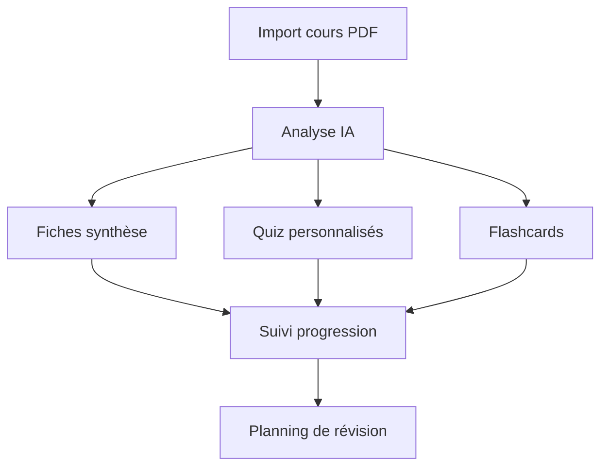
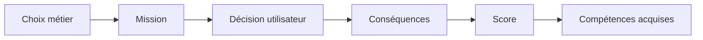
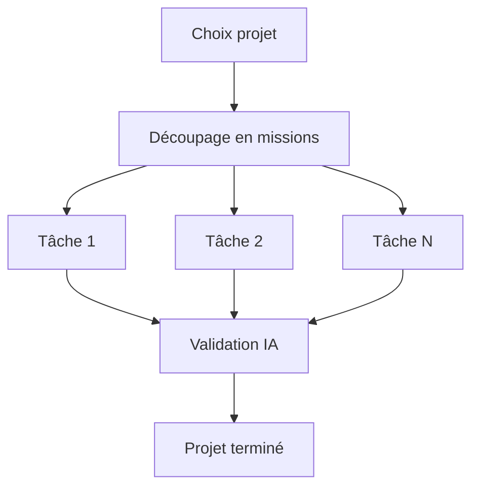
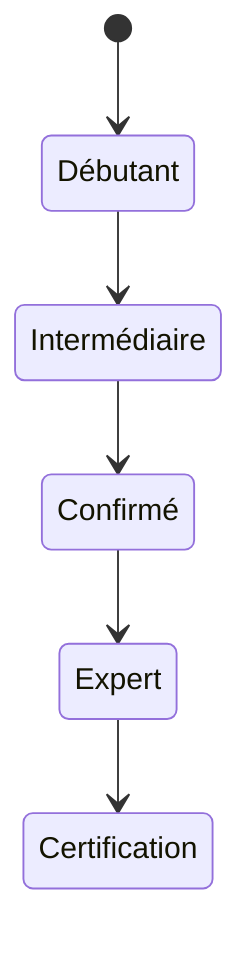
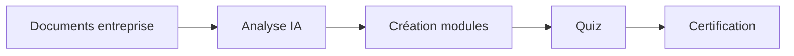
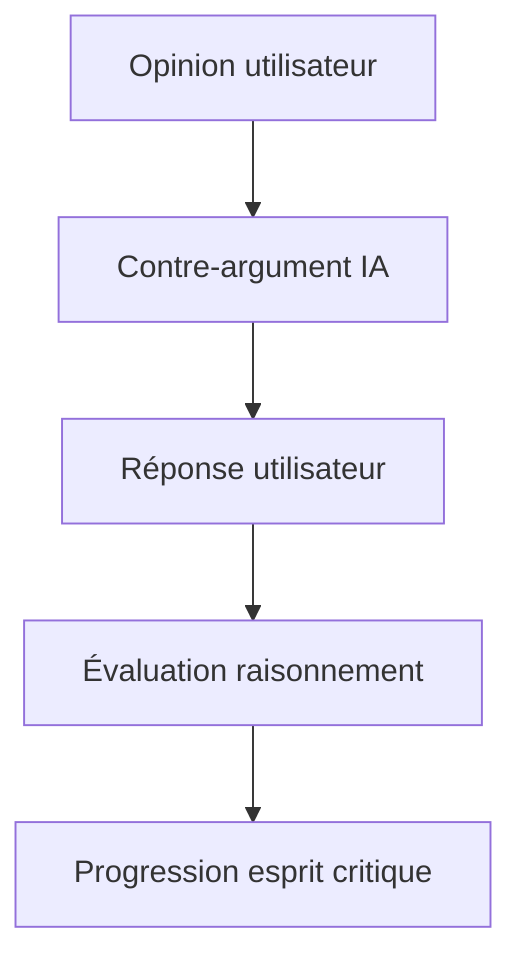
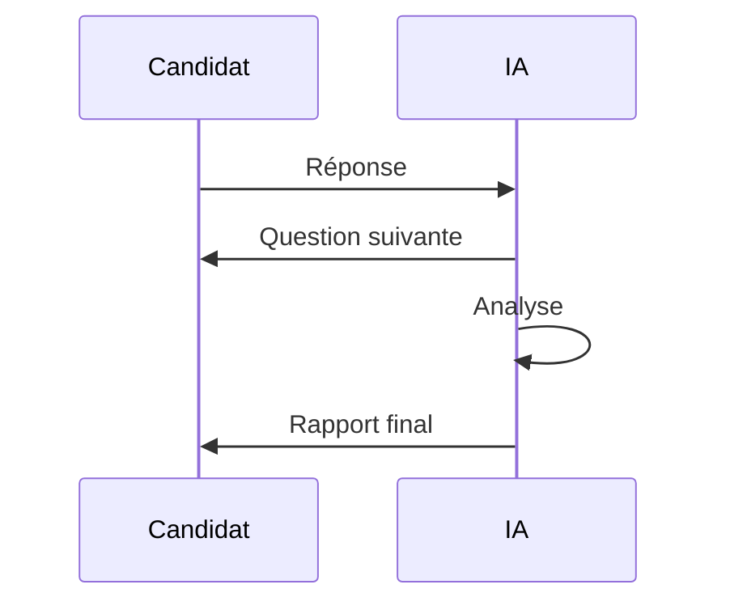
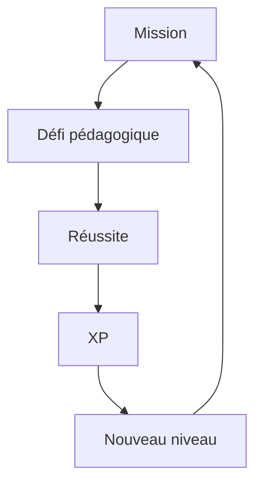
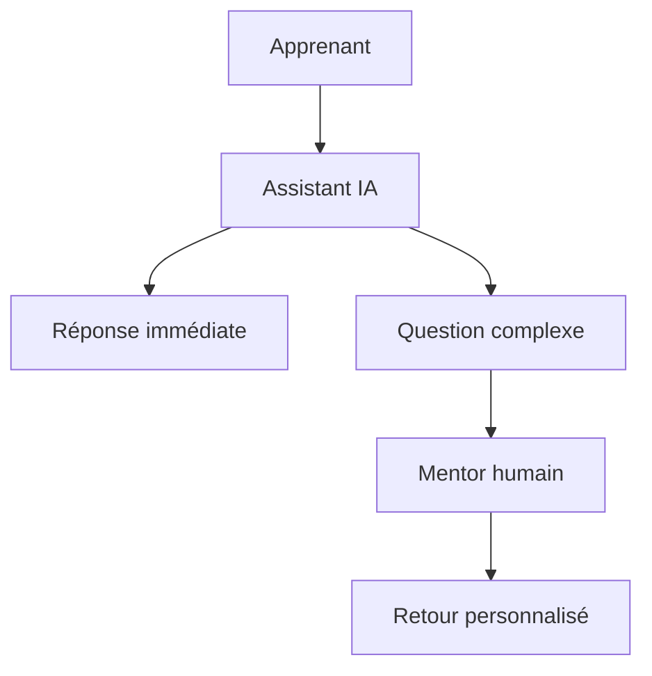
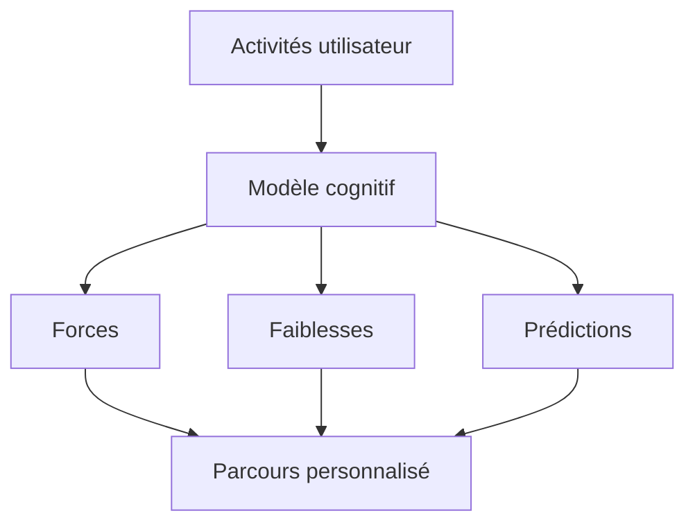

Voici plusieurs idées d'applications éducatives ou formatives avec un potentiel commercial ou pédagogique intéressant. Je les ai classées par niveau d'innovation et j'ajoute des diagrammes Mermaid pour visualiser le fonctionnement.

---

# 1. Coach IA de révision personnalisé

## Concept

L'application analyse :

* les cours de l'étudiant
* ses résultats aux quiz
* son temps de travail

Puis elle génère automatiquement :

* des fiches de révision
* des QCM
* un planning optimisé
* des rappels espacés (spaced repetition)

## Public

* Collège
* Lycée
* Université
* Formation professionnelle

## Valeur ajoutée

La plupart des applications proposent du contenu. Celle-ci construit un parcours unique pour chaque apprenant.

### Architecture

---

# 2. Simulateur de métiers en réalité virtuelle

## Concept

L'utilisateur découvre un métier par immersion :

* infirmier
* développeur
* pilote
* électricien
* technicien réseau

L'application propose des scénarios réalistes.

### Exemple

Un futur technicien réseau doit :

* diagnostiquer une panne
* identifier un switch défectueux
* reconfigurer un routeur

### Parcours

---

# 3. Application d'apprentissage par projets

## Concept

Au lieu de suivre un cours classique, l'apprenant réalise des projets.

Exemples :

* créer un site web
* lancer une boutique fictive
* développer une application mobile
* construire un robot Arduino

### Fonctionnement

---

# 4. Duolingo pour les compétences professionnelles

## Concept

Apprentissage quotidien de :

* Excel
* Power BI
* Python
* Gestion de projet
* Comptabilité
* Cybersécurité

Sous forme de micro-leçons de 5 minutes.

### Progression

---

# 5. Générateur de formations d'entreprise

## Concept

Une PME dépose :

* procédures internes
* documents RH
* manuels techniques

L'IA transforme automatiquement ces documents en :

* modules e-learning
* quiz
* vidéos explicatives
* certifications

### Pipeline

---

# 6. Application de débat intelligent

## Concept

L'apprenant choisit un sujet :

* climat
* économie
* politique
* histoire

L'IA joue l'avocat du diable et pousse à argumenter.

### Exemple

Utilisateur :

> Les voitures électriques sont la meilleure solution.

IA :

> Quels sont les impacts de l'extraction du lithium ?

### Logique

---

# 7. Simulateur d'entretien d'embauche

## Concept

L'IA joue le recruteur.

Analyse :

* voix
* vocabulaire
* langage corporel (caméra)
* confiance

Puis génère un rapport.

### Processus

---

# 8. RPG éducatif

Très fort potentiel.

## Concept

L'apprentissage est intégré dans un jeu.

Exemple :

Pour ouvrir une porte :

* résoudre une équation
* répondre à un quiz
* écrire du code

### Boucle de jeu

---

# 9. Plateforme de mentorat IA + humain

## Concept

Combiner :

* mentor humain
* assistant IA

L'IA répond instantanément.

Le mentor intervient sur les cas complexes.

### Architecture

---

# 10. Application "Learning Twin"

C'est probablement l'idée la plus innovante.

## Concept

L'application construit un jumeau numérique de l'apprenant :

* ce qu'il sait
* ce qu'il oublie
* sa vitesse d'apprentissage
* son style cognitif

L'IA prédit :

* les futures difficultés
* les risques d'échec
* les sujets à renforcer

### Vision globale

---

## Les 3 idées avec le meilleur potentiel business en 2026

1. **Learning Twin** (très innovant)
2. **Générateur automatique de formations d'entreprise**
3. **Coach IA de révision personnalisé**

Ces trois projets peuvent être construits progressivement avec des technologies actuelles (LLM, RAG, vector databases, analytics) et peuvent viser à la fois le marché B2C et B2B.

Si tu envisages de créer une startup, je peux aussi te proposer **10 idées d'applications éducatives basées sur l'IA générative qui n'existent quasiment pas encore sur le marché français**.

Potentiel estimé de différentes idées EdTech

Comparaison indicative selon la demande du marché, la scalabilité et l'intérêt des entreprises.

idee	score
Learning Twin	95
Générateur de formations IA	90
Coach IA de révision	88
Simulateur d'entretien	80
RPG éducatif	78
