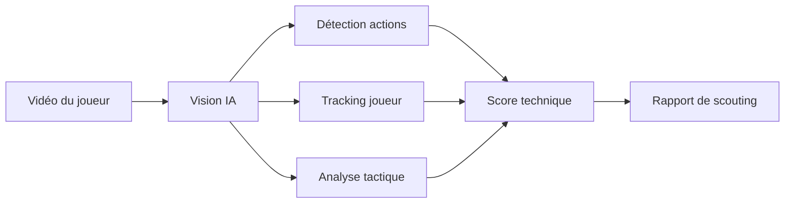
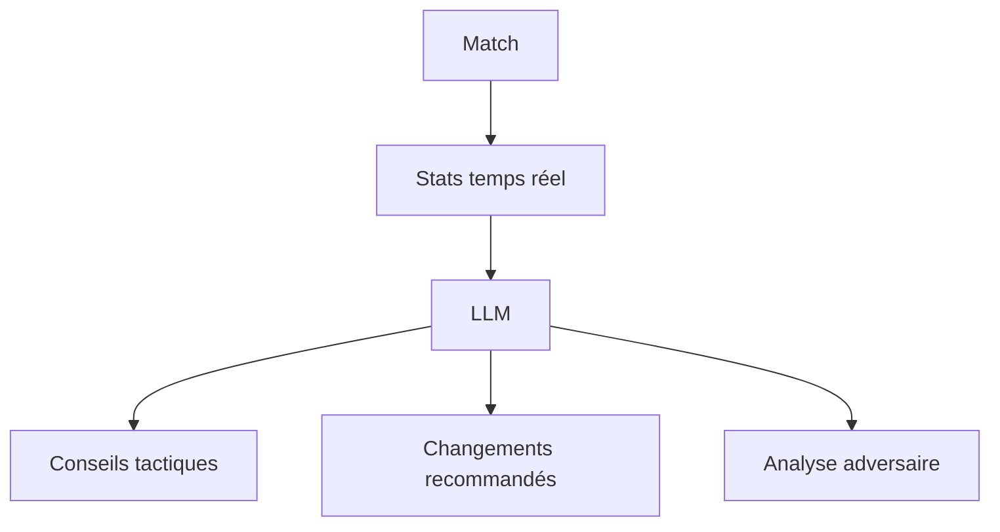
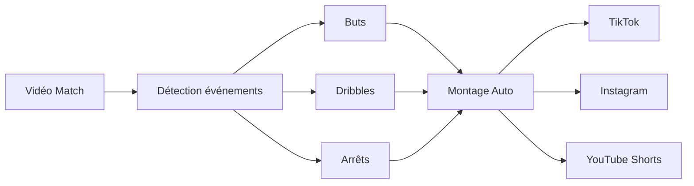
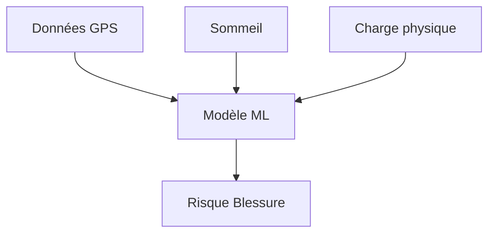
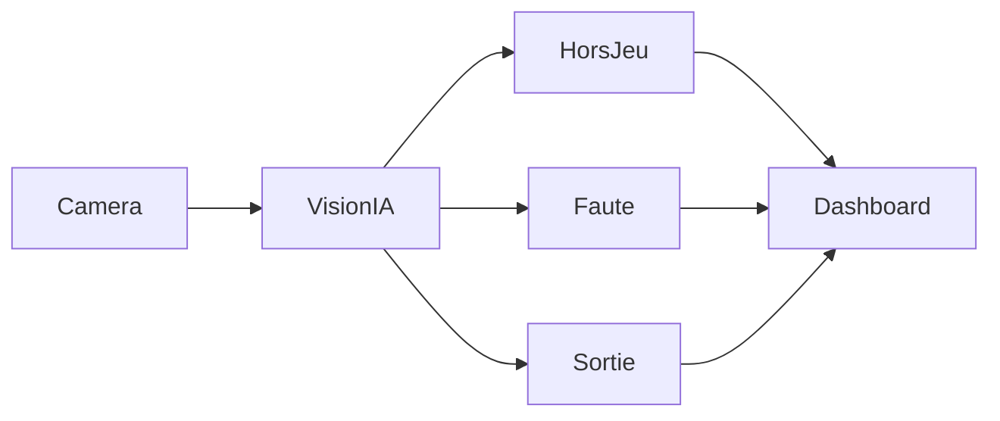
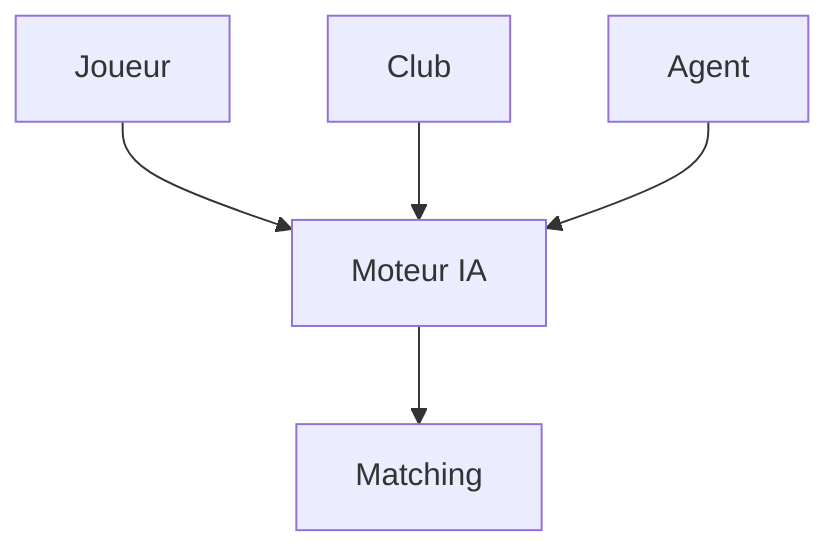
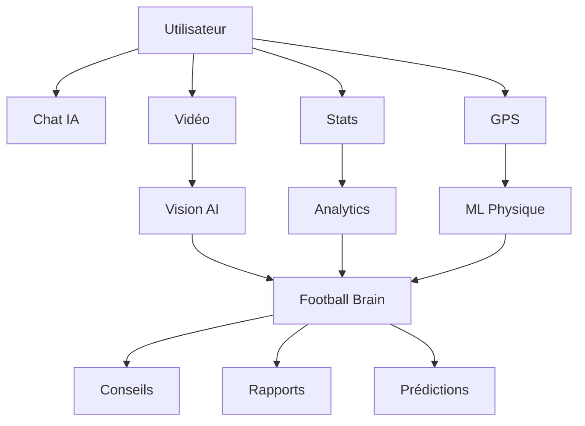

Le football est probablement l'un des meilleurs secteurs pour créer des produits IA aujourd'hui, car il combine :

* Énorme audience mondiale
* Beaucoup de données structurées
* Vidéo, image, audio et texte
* Émotions fortes (supporters, joueurs, clubs)
* Monétisation possible (B2C, B2B, SaaS)

Voici plusieurs idées classées par potentiel.

---

# 1. Scout IA pour joueurs amateurs

## Problème

Des millions de joueurs amateurs ne sont jamais repérés.

## Solution

Le joueur upload une vidéo de match.

L'IA :

* détecte les actions
* mesure vitesse
* qualité des passes
* vision du jeu
* déplacements
* compare avec des joueurs professionnels

Puis génère un rapport.

### Monétisation

* 10€ par analyse
* abonnement académies
* clubs amateurs

---

# 2. Football Manager IA en temps réel

Imagine Football Manager + ChatGPT.

L'utilisateur parle à son assistant :

> Pourquoi perd-on ?

L'IA répond :

> Le pressing adverse bloque ton milieu gauche. Passe en 4-2-3-1.

## Fonctionnement

### Public

* coachs amateurs
* eSport
* FM addicts

---

# 3. TikTok Football IA

Une application qui transforme automatiquement un match en contenu viral.

Upload :

* match complet

L'IA crée :

* highlights
* shorts
* commentaires
* voix off
* sous-titres

### Très fort potentiel business

Les clubs amateurs galèrent à produire du contenu.

---

# 4. Agent IA pour supporters

L'équivalent de ChatGPT spécialisé football.

Exemples :

> Qui est le meilleur ailier de Ligue 1 ?

> Fais-moi un onze type offensif avec 50M€

> Analyse le prochain match du PSG.

L'IA combine :

* statistiques
* news
* historique

---

# 5. IA prédictive de blessures

Pour clubs et académies.

Entrées :

* GPS
* charge d'entraînement
* sommeil
* fréquence cardiaque

Sortie :

* risque de blessure

### B2B

Très intéressant pour :

* académies
* clubs semi-pro
* centres de formation

---

# 6. Générateur de tactiques IA

Le coach décrit :

> Je joue contre une équipe qui presse haut.

L'IA génère :

* schéma tactique
* composition
* phases offensives
* phases défensives

Puis produit des animations.

---

# 7. Fantasy Football augmenté par IA

Le marché Fantasy est énorme.

L'IA :

* recommande les transferts
* explique ses choix
* détecte les joueurs sous-cotés

Exemple :

> Vends ce joueur.

Pourquoi ?

> Son xG baisse depuis 6 matchs et son temps de jeu diminue.

---

# 8. Assistant arbitre IA pour amateurs

Aujourd'hui le VAR est inaccessible aux petits clubs.

Une simple caméra + IA :

* hors-jeu
* fautes
* sorties de balle
* statistiques

---

# 9. LinkedIn du football

Très sous-exploité.

Profils :

* joueurs
* agents
* clubs
* recruteurs

L'IA :

* analyse les profils
* fait du matching

### Potentiel startup

Énorme.

Peu d'acteurs ont vraiment réussi ce modèle.

---

# 10. Coach personnel IA pour joueur amateur

L'utilisateur filme ses séances.

L'IA corrige :

* conduite de balle
* frappes
* posture
* accélération

Comme un coach privé 24h/24.

---

# 11. "FootballGPT"

Une plateforme unique regroupant :

* scouting IA
* analyse vidéo
* génération tactique
* prédictions
* agent conversationnel

Architecture :

---

# Les 3 idées avec le plus de potentiel en 2026

| Idée                               | Difficulté | Business |
| ---------------------------------- | ---------- | -------- |
| Scout IA vidéo                     | ⭐⭐⭐        | ⭐⭐⭐⭐⭐    |
| Créateur automatique de highlights | ⭐⭐         | ⭐⭐⭐⭐⭐    |
| LinkedIn du football avec IA       | ⭐⭐⭐⭐       | ⭐⭐⭐⭐⭐    |

Si ton objectif est de lancer une startup rentable rapidement avec une petite équipe, je développerais en priorité **un Scout IA pour joueurs amateurs**, car il combine :

* vision par ordinateur moderne (YOLO, RT-DETR, Gemini Vision, GPT-4o Vision)
* abonnement récurrent
* marché mondial
* peu de concurrents réellement efficaces sur le segment amateur.
