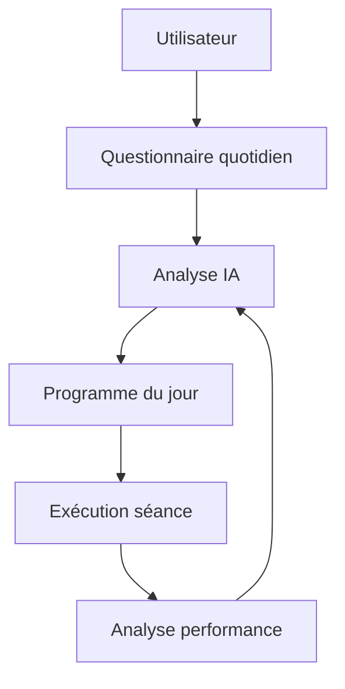
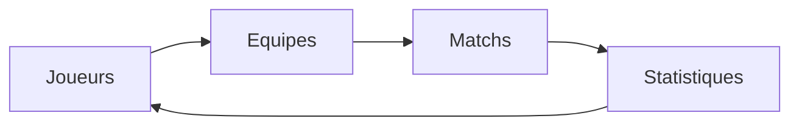
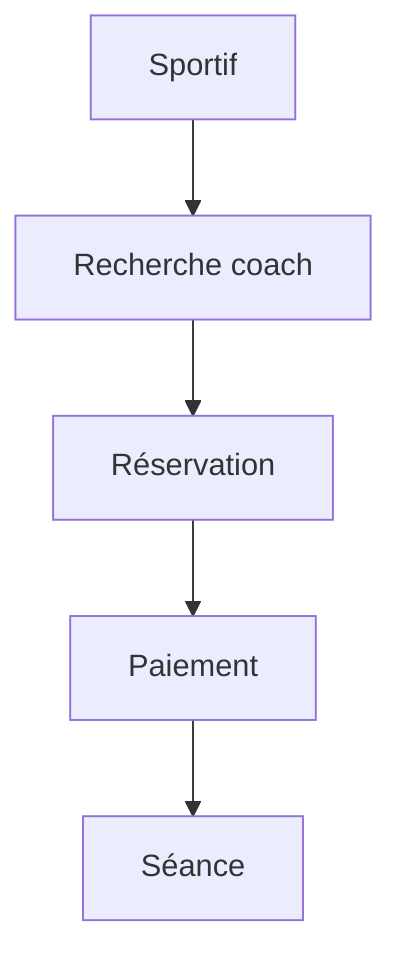
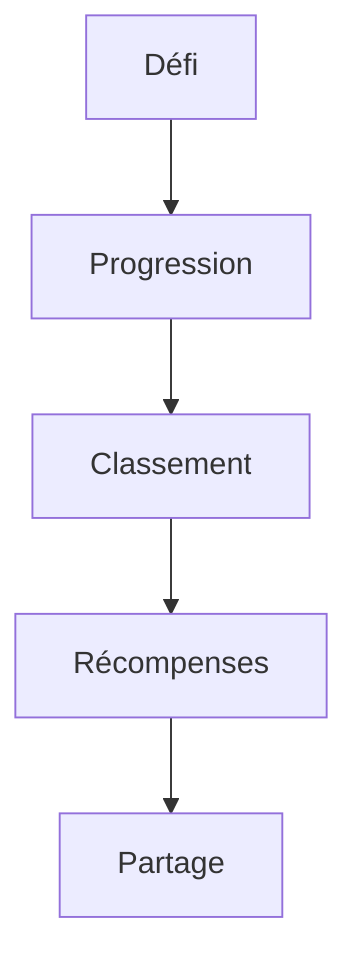
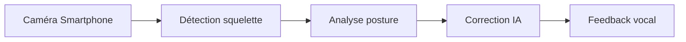
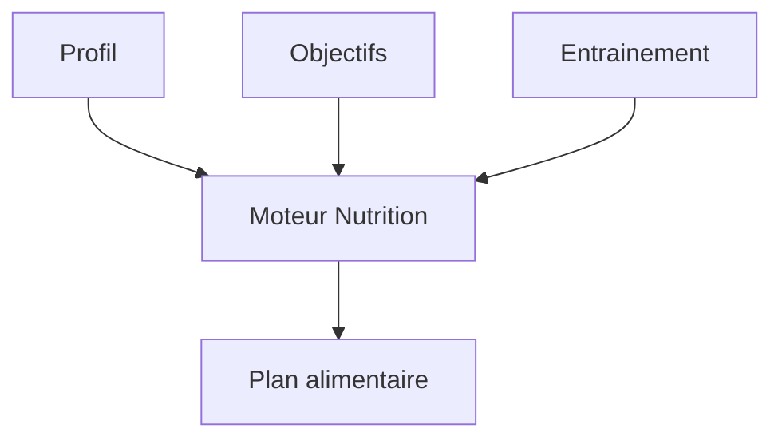
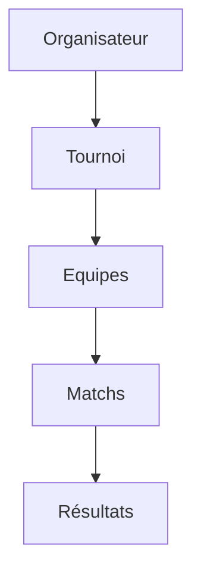
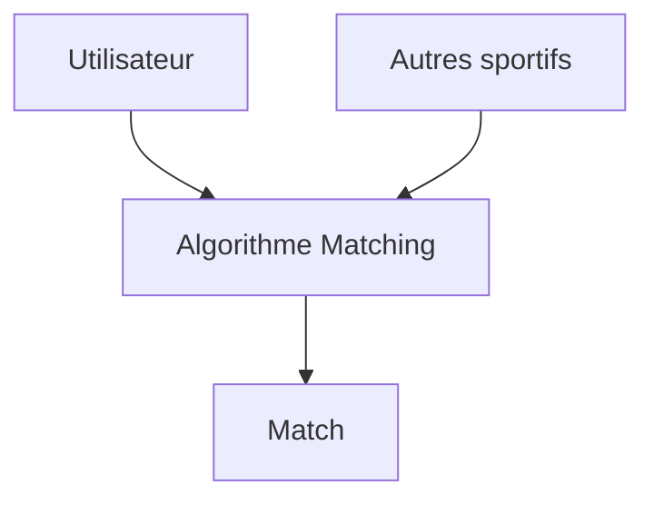
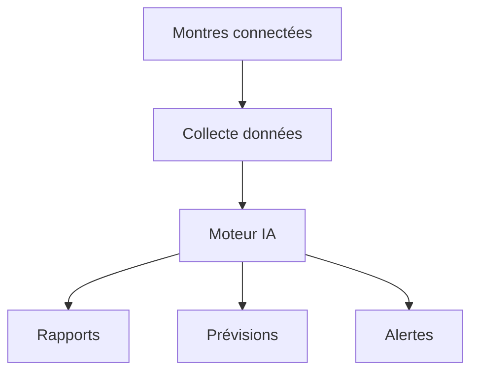
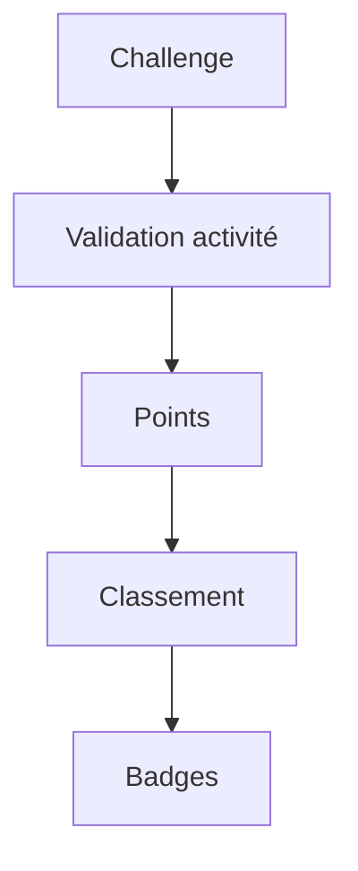

Si tu cherches une application sportive avec un vrai potentiel business, je te conseille de viser un problème précis plutôt qu'une application "tout-en-un". Voici plusieurs idées classées par niveau d'innovation.

# 1. Coach IA personnalisé pour sportifs amateurs

**Problème :**
La plupart des applications proposent des plans génériques.

**Solution :**
Une IA qui adapte chaque séance selon :

* fatigue
* sommeil
* fréquence cardiaque
* météo
* blessures récentes
* objectifs

### Fonctionnement

### Fonctionnalités premium

* Génération automatique de plans
* Détection de surentraînement
* Conseils nutrition
* Prédiction des performances

### Monétisation

* Freemium
* 9,99€/mois

---

# 2. Strava pour les sports collectifs

**Problème :**
Le football amateur, basketball amateur, rugby amateur sont peu digitalisés.

**Solution :**
Créer un réseau social dédié aux équipes amateurs.

### Fonctionnalités

* Calendrier des matchs
* Statistiques
* MVP du match
* Classements
* Recrutement de joueurs

### Architecture

### Effet viral

Chaque équipe invite ses joueurs.

---

# 3. Marketplace de coachs sportifs

**Concept**

Le "Doctolib du sport".

### Utilisateurs

* coachs
* préparateurs physiques
* nutritionnistes

### Diagramme

### Revenus

* Commission 10%
* Abonnements coachs

---

# 4. Application de défis sportifs entre amis

Très simple à lancer.

### Exemples

* 100 km ce mois-ci
* 10 000 pas par jour
* 30 pompes quotidiennes

### Gamification

### Pourquoi ça marche

Les gens restent pour la compétition sociale.

---

# 5. Détection de technique par caméra

Utiliser la vision par ordinateur.

### Cas d'usage

* Squat
* Développé couché
* Pompes
* Golf
* Tennis

### Pipeline

### Potentiel

Très forte valeur ajoutée.

---

# 6. Assistant nutrition pour sportifs

**Objectif :**
Calculer automatiquement les repas selon l'entraînement.

### Exemple

L'utilisateur indique :

* séance prévue
* poids
* objectif

L'IA génère :

* calories
* protéines
* glucides
* repas

### Modèle

---

# 7. Plateforme de tournois amateurs

Très bon potentiel local.

### Sports

* Foot
* Padel
* Basket
* Tennis

### Fonctionnalités

* Création tournoi
* Inscription équipes
* Paiement
* Gestion résultats

### Schéma

---

# 8. Application pour trouver des partenaires de sport

Un "Tinder du sport".

### Exemple

Tu veux jouer au :

* tennis
* padel
* running
* vélo

L'application trouve quelqu'un proche.

### Matching

### Business

Abonnement premium pour visibilité.

---

# 9. Analyse de performance pour coureurs

Synchronisation avec :

* Garmin
* Coros
* Polar
* Apple Watch

### IA

Analyse :

* VMA
* VO2 max
* charge d'entraînement
* risques de blessure

### Vision produit

---

# 10. Application de paris entre amis (sans argent réel)

Attention : sans mise d'argent pour éviter les contraintes réglementaires.

### Exemples

* Qui fera le plus de kilomètres ?
* Qui perdra le plus de poids ?
* Qui fera le plus de séances ?

### Gamification

---

# Mon classement des meilleures idées en 2026

### Si tu es développeur solo

Je choisirais :

1. Coach IA sportif
2. Application de matching de partenaires de sport
3. Application de défis sportifs
4. Analyse vidéo par IA

Ces projets peuvent être lancés avec un MVP en 1 à 3 mois et ont un bon potentiel de croissance.

Potentiel estimé des idées sportives

Évaluation indicative combinant potentiel business, faisabilité technique et différenciation.

idee	score
Coach IA personnalisé	95
Analyse vidéo IA	92
Marketplace coachs	88
Partenaires de sport	85
Analyse running	82
Tournois amateurs	80
Défis sportifs	78
