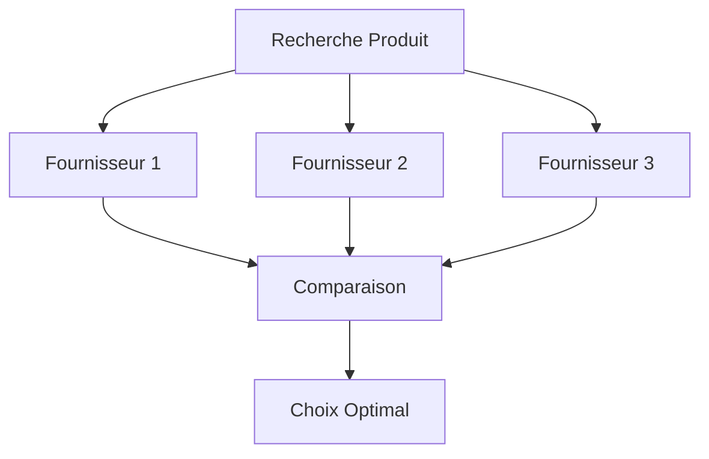
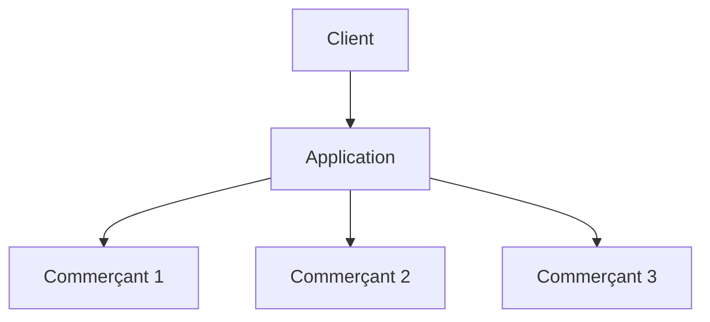
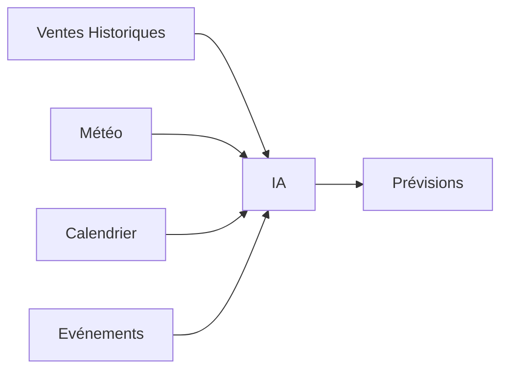
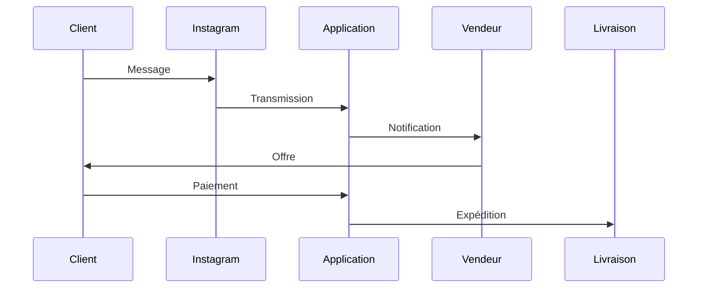

Voici plusieurs idées d'applications dans le commerce et la vente, classées par potentiel business, difficulté technique et valeur pour les utilisateurs.

# 1. CRM Commercial Intelligent pour PME

### Problème

Les petites entreprises perdent souvent des prospects faute de suivi.

### Solution

Une application qui :

* Centralise les prospects
* Automatise les relances
* Score les clients potentiels avec l'IA
* Prévoit les ventes futures

### Fonctionnalités

* Gestion des leads
* Pipeline commercial
* Relances automatiques
* Prédiction du taux de conversion
* Tableau de bord

### Architecture métier

### Modèle économique

* SaaS mensuel
* 29€ à 199€/mois

---

# 2. Comparateur de Prix B2B Local

### Problème

Les commerçants perdent du temps à chercher les meilleurs fournisseurs.

### Solution

Une plateforme qui compare automatiquement :

* Grossistes
* Fournisseurs
* Délais de livraison
* Prix

### Exemple

Un restaurateur recherche :

> Tomates bio 10kg

L'application affiche :

| Fournisseur | Prix | Livraison |
| ----------- | ---- | --------- |
| A           | 19€  | 24h       |
| B           | 17€  | 72h       |
| C           | 20€  | 12h       |

### Diagramme

---

# 3. Assistant IA pour Vendeurs en Magasin

### Problème

Les vendeurs ne connaissent pas toujours parfaitement leurs produits.

### Solution

Application mobile :

* Scan du produit
* Réponses instantanées
* Argumentaire de vente
* Produits complémentaires

### Exemple

Le vendeur scanne une télévision.

L'application suggère :

* Garantie
* Barre de son
* Support mural

### Revenus

* Licence entreprise
* Vente aux enseignes

---

# 4. Marketplace de Destockage Intelligent

### Problème

Les commerçants ont du stock dormant.

### Solution

Plateforme de revente B2B.

L'IA détecte :

* Produits à faible rotation
* Risque d'invendus
* Meilleur prix de liquidation

### Flux

---

# 5. Application de Fidélité Universelle

### Problème

Les clients possèdent trop de cartes de fidélité.

### Solution

Une seule application regroupant :

* Tous les commerces
* Cashback
* Récompenses
* Coupons

### Architecture

### Potentiel

Très fort si développée localement ville par ville.

---

# 6. Prévision des Ventes avec IA

### Problème

Les commerçants commandent souvent trop ou pas assez.

### Solution

Analyse :

* Historique des ventes
* Météo
* Saisonnalité
* Événements locaux

Puis prédiction automatique.

### Exemple

### Clients

* Boulangeries
* Restaurants
* Supermarchés
* E-commerce

---

# 7. Plateforme de Vente sur WhatsApp / Instagram

### Problème

Beaucoup de ventes commencent sur les réseaux sociaux.

### Solution

Centraliser :

* Messages
* Paiements
* Commandes
* Livraison

### Processus

---

# 8. Gestionnaire de Commissions Commerciales

### Problème

Calculer les commissions est souvent complexe.

### Solution

Application qui gère :

* Objectifs
* Primes
* Bonus
* Commissions multi-niveaux

### Clients

* Agences immobilières
* Réseaux commerciaux
* Assurances
* Courtiers

---

# 9. Analyse Concurrentielle Locale

### Problème

Les commerçants connaissent mal leur concurrence.

### Solution

L'application surveille :

* Prix concurrents
* Avis clients
* Promotions
* Réseaux sociaux

### Dashboard

---

# 10. SaaS de Négociation Assistée par IA (très innovant)

### Problème

Les commerciaux juniors négocient moins efficacement.

### Solution

L'IA écoute la réunion et suggère en direct :

* Réponses
* Objections
* Arguments
* Probabilité de signature

### Flux

---

# Les 3 idées avec le meilleur potentiel en 2026

| Rang | Idée                       | Difficulté     | Potentiel  |
| ---- | -------------------------- | -------------- | ---------- |
| 🥇   | Assistant IA pour vendeurs | Moyen          | Très élevé |
| 🥈   | Prévision des ventes IA    | Moyen          | Très élevé |
| 🥉   | CRM intelligent PME        | Faible à moyen | Très élevé |

Si tu es développeur solo ou petite équipe, je te conseillerais particulièrement un **CRM commercial IA verticalisé** (immobilier, automobile, assurance ou artisans), car il est plus simple à lancer et à monétiser rapidement qu'une marketplace ou une application grand public.

Facteurs surveillés

Exemple de répartition des données analysées pour un commerce.

categorie	importance
Prix	40
Avis	30
Promotions	20
Réseaux sociaux	10
