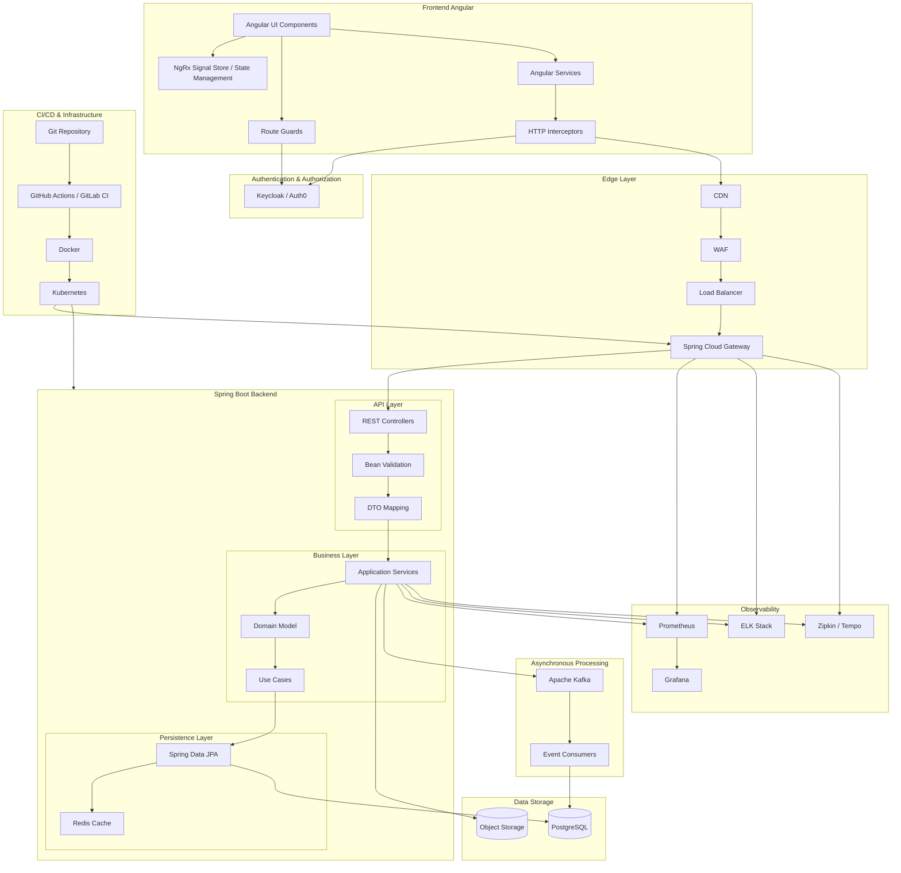

# Principes d'architecture appliqués

## Frontend Angular
- Architecture par feature modules.
- Standalone Components (Angular 17+).
- State management avec NgRx Signals ou Signal Store.
- Interceptors pour JWT, gestion erreurs et refresh token.
- Guards pour l'autorisation.

## Backend Spring Boot
- Architecture Clean Architecture / Hexagonale.
- Séparation :
  - Controller
  - Use Case
  - Domain
  - Repository
- DTO obligatoires entre API et domaine.
- Validation avec Bean Validation.

## Sécurité
- OAuth2 / OIDC.
- JWT stateless.
- Keycloak/Auth0.
- Spring Security.
- RBAC (Role Based Access Control).

## Base de données
- PostgreSQL.
- Flyway ou Liquibase pour les migrations.
- Redis pour le cache.

## Communication
- REST pour le synchrone.
- Kafka pour l'asynchrone.
- Event-driven architecture.

## Observabilité
- Actuator.
- Micrometer.
- Prometheus.
- Grafana.
- ELK.
- OpenTelemetry + Zipkin/Tempo.

## DevOps
- Docker.
- Kubernetes.
- GitHub Actions / GitLab CI.
- Déploiement Blue/Green ou Canary.
- Infrastructure as Code (Terraform recommandé).

Pour un projet d'entreprise important, je recommanderais même une version microservices complète avec BFF Angular, API Gateway, Service Discovery, Config Server et Event Sourcing.

Voici une architecture Angular + BFF + Spring Boot Microservices adaptée à une application d'entreprise moderne (banque, assurance, e-commerce, SaaS), intégrant :
- Angular SPA
- Backend For Frontend (BFF)
- API Gateway
- Service Discovery
- Config Server
- OAuth2/OIDC
- Event Sourcing
- CQRS
- Kafka
- Cache Redis
- PostgreSQL
- Observabilité complète
- Kubernetes

```mermaid
flowchart TB

%% =====================================
%% CLIENT
%% =====================================

subgraph CLIENT["Client Layer"]
    USER[Utilisateur]
    ANGULAR[Angular SPA]
end

%% =====================================
%% SECURITY
%% =====================================

subgraph SECURITY["Identity Provider"]
    KEYCLOAK[Keycloak / OAuth2 OIDC]
end

%% =====================================
%% EDGE
%% =====================================

subgraph EDGE["Edge Layer"]
    CDN[CDN]
    WAF[Web Application Firewall]
    LB[Load Balancer]
    GATEWAY[Spring Cloud Gateway]
    BFF[Backend For Frontend]
end

%% =====================================
%% PLATFORM
%% =====================================

subgraph PLATFORM["Platform Services"]
    DISCOVERY[Eureka Service Discovery]
    CONFIG[Spring Cloud Config Server]
end

%% =====================================
%% BUSINESS SERVICES
%% =====================================

subgraph MICROSERVICES["Business Microservices"]

    subgraph USERMS["User Service"]
        USER_API[REST API]
        USER_CMD[Command Handler]
        USER_QUERY[Query Handler]
    end

    subgraph ORDERMS["Order Service"]
        ORDER_API[REST API]
        ORDER_CMD[Command Handler]
        ORDER_QUERY[Query Handler]
    end

    subgraph PRODUCTMS["Product Service"]
        PRODUCT_API[REST API]
        PRODUCT_CMD[Command Handler]
        PRODUCT_QUERY[Query Handler]
    end

    subgraph PAYMENTMS["Payment Service"]
        PAYMENT_API[REST API]
        PAYMENT_CMD[Command Handler]
        PAYMENT_QUERY[Query Handler]
    end

end

%% =====================================
%% EVENT SOURCING
%% =====================================

subgraph EVENTS["Event Driven Architecture"]

    KAFKA[Apache Kafka]

    EVENTSTORE[(Event Store)]

end

%% =====================================
%% READ MODELS
%% =====================================

subgraph READMODELS["CQRS Read Models"]

    USER_READ[(User Read DB)]
    ORDER_READ[(Order Read DB)]
    PRODUCT_READ[(Product Read DB)]
    PAYMENT_READ[(Payment Read DB)]

end

%% =====================================
%% CACHE
%% =====================================

subgraph CACHE["Caching"]
    REDIS[(Redis)]
end

%% =====================================
%% STORAGE
%% =====================================

subgraph DATABASES["Persistence"]

    USER_DB[(PostgreSQL User)]
    ORDER_DB[(PostgreSQL Order)]
    PRODUCT_DB[(PostgreSQL Product)]
    PAYMENT_DB[(PostgreSQL Payment)]

end

%% =====================================
%% OBSERVABILITY
%% =====================================

subgraph OBS["Observability"]

    PROM[Prometheus]
    GRAFANA[Grafana]
    ELK[ELK Stack]
    TEMPO[Tempo / Zipkin]
end

%% =====================================
%% DEVOPS
%% =====================================

subgraph DEVOPS["CI/CD"]

    GIT[Git Repository]
    PIPELINE[GitHub Actions]
    DOCKER[Docker]
    K8S[Kubernetes]
    HELM[Helm]
end

%% =====================================
%% FLOW CLIENT
%% =====================================

USER --> ANGULAR

ANGULAR --> KEYCLOAK

ANGULAR --> CDN
CDN --> WAF
WAF --> LB
LB --> GATEWAY
GATEWAY --> BFF

%% =====================================
%% SERVICE DISCOVERY
%% =====================================

GATEWAY --> DISCOVERY
BFF --> DISCOVERY

USER_API --> DISCOVERY
ORDER_API --> DISCOVERY
PRODUCT_API --> DISCOVERY
PAYMENT_API --> DISCOVERY

CONFIG --> USER_API
CONFIG --> ORDER_API
CONFIG --> PRODUCT_API
CONFIG --> PAYMENT_API

%% =====================================
%% ROUTING
%% =====================================

BFF --> USER_API
BFF --> ORDER_API
BFF --> PRODUCT_API
BFF --> PAYMENT_API

%% =====================================
%% COMMAND SIDE
%% =====================================

USER_API --> USER_CMD
ORDER_API --> ORDER_CMD
PRODUCT_API --> PRODUCT_CMD
PAYMENT_API --> PAYMENT_CMD

USER_CMD --> EVENTSTORE
ORDER_CMD --> EVENTSTORE
PRODUCT_CMD --> EVENTSTORE
PAYMENT_CMD --> EVENTSTORE

USER_CMD --> KAFKA
ORDER_CMD --> KAFKA
PRODUCT_CMD --> KAFKA
PAYMENT_CMD --> KAFKA

%% =====================================
%% QUERY SIDE
%% =====================================

KAFKA --> USER_QUERY
KAFKA --> ORDER_QUERY
KAFKA --> PRODUCT_QUERY
KAFKA --> PAYMENT_QUERY

USER_QUERY --> USER_READ
ORDER_QUERY --> ORDER_READ
PRODUCT_QUERY --> PRODUCT_READ
PAYMENT_QUERY --> PAYMENT_READ

%% =====================================
%% CACHE
%% =====================================

USER_QUERY --> REDIS
ORDER_QUERY --> REDIS
PRODUCT_QUERY --> REDIS
PAYMENT_QUERY --> REDIS

%% =====================================
%% LEGACY STORAGE
%% =====================================

USER_CMD --> USER_DB
ORDER_CMD --> ORDER_DB
PRODUCT_CMD --> PRODUCT_DB
PAYMENT_CMD --> PAYMENT_DB

%% =====================================
%% OBSERVABILITY
%% =====================================

GATEWAY --> PROM
BFF --> PROM

USER_API --> PROM
ORDER_API --> PROM
PRODUCT_API --> PROM
PAYMENT_API --> PROM

PROM --> GRAFANA

USER_API --> ELK
ORDER_API --> ELK
PRODUCT_API --> ELK
PAYMENT_API --> ELK

USER_API --> TEMPO
ORDER_API --> TEMPO
PRODUCT_API --> TEMPO
PAYMENT_API --> TEMPO

%% =====================================
%% DEPLOYMENT
%% =====================================

GIT --> PIPELINE
PIPELINE --> DOCKER
DOCKER --> HELM
HELM --> K8S

K8S --> GATEWAY
K8S --> BFF
K8S --> MICROSERVICES
```



## Organisation des repositories

```
frontend/
 ├── angular-app

backend/
 ├── api-gateway
 ├── bff
 ├── config-server
 ├── discovery-server

 ├── user-service
 ├── order-service
 ├── product-service
 ├── payment-service

platform/
 ├── kafka
 ├── keycloak
 ├── monitoring

infra/
 ├── terraform
 ├── kubernetes
 ├── helm
```

## Bonnes pratiques clés

**Angular**
- Standalone Components
- Signals
- Feature-based architecture
- Lazy Loading
- Typed Forms
- SSR (Angular Universal) si SEO

**BFF**
- Adaptation des DTO au frontend
- Agrégation de plusieurs microservices
- Réduction du chatter réseau
- Gestion des permissions UI

**Spring Boot**
- Clean Architecture
- Hexagonal Architecture
- DTO ↔ Mapper ↔ Domain
- Validation Bean Validation
- OpenAPI / Swagger

**Event Sourcing + CQRS**
- Écriture via Commands
- Publication d'événements Kafka
- Reconstruction de l'état depuis l'Event Store
- Read Models optimisés pour les requêtes

**Observabilité**
- OpenTelemetry
- Distributed Tracing
- Logs centralisés
- Dashboards Grafana
- Alerting Prometheus

**Kubernetes**
- HPA (Horizontal Pod Autoscaler)
- Liveness / Readiness Probes
- ConfigMaps
- Secrets
- Rolling Updates
- Canary Deployment

Cette architecture correspond à ce qu'on retrouve dans de grandes plateformes cloud natives utilisant l'écosystème Spring Cloud et Angular à grande échelle.
