# Architecture des applications les plus courantes

## Introduction

La majorité des applications modernes reposent sur une architecture similaire, qu'il s'agisse de :

- Applications Web (Amazon, LinkedIn, Wikipédia)
- Réseaux sociaux (Facebook, Instagram, X)
- Applications SaaS (Salesforce, Notion)
- Applications mobiles (Uber, Spotify)
- Plateformes e-commerce
- Applications bancaires
- Solutions de streaming

Même si leur taille varie, elles utilisent généralement les mêmes briques fondamentales.

---

# 1. Architecture générale d'une application moderne

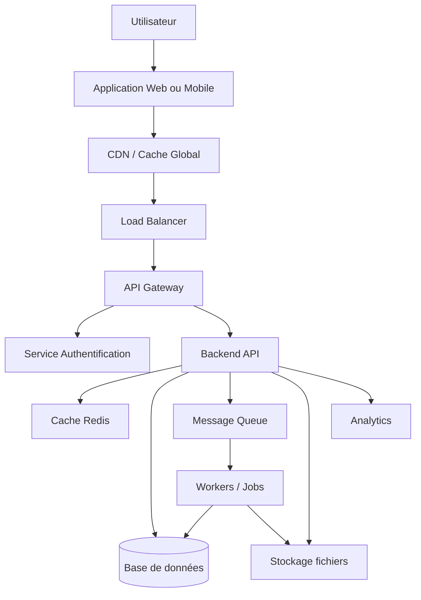

---

# 2. Rôle de chaque brique

## Utilisateur

L'utilisateur utilise :

- Un navigateur web
- Une application mobile
- Un logiciel desktop

Exemples :

- Chrome
- Firefox
- Application Uber
- Application Spotify

---

## Frontend

Le frontend représente l'interface graphique.

Technologies fréquentes :

- HTML
- CSS
- JavaScript
- React
- Angular
- Vue.js
- Flutter
- React Native

Responsabilités :

- Affichage des données
- Gestion des formulaires
- Navigation
- Expérience utilisateur

---

## CDN (Content Delivery Network)

Objectif :

Distribuer les fichiers statiques depuis le serveur le plus proche.

Contenu stocké :

- Images
- CSS
- JavaScript
- Vidéos

Exemples :

- Cloudflare
- Akamai
- CloudFront

Avantages :

- Temps de chargement réduit
- Réduction de charge serveur

---

## Load Balancer

Le Load Balancer distribue le trafic.

Sans Load Balancer :

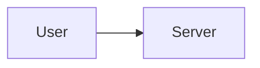

Avec Load Balancer :

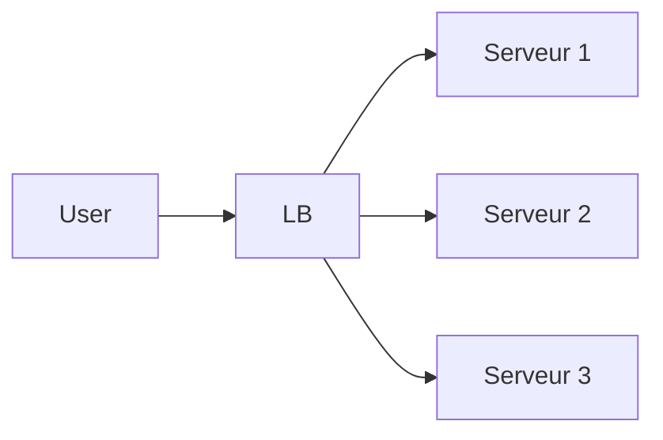

Avantages :

- Haute disponibilité
- Répartition de charge
- Tolérance aux pannes

---

## API Gateway

Point d'entrée unique.

Fonctions :

- Routage
- Sécurité
- Authentification
- Limitation de débit
- Monitoring

Exemple :

```http
GET /api/products
POST /api/orders
GET /api/users
```

L'API Gateway décide quel microservice doit répondre.

---

# 3. Authentification

Architecture typique :

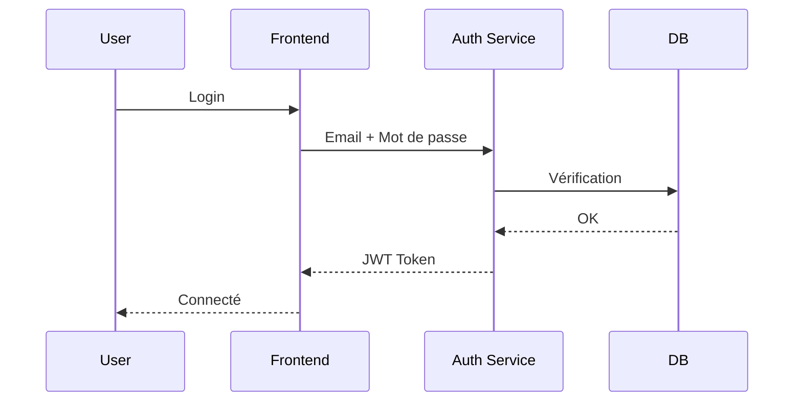

---

## Service Auth

Responsable :

- Login
- Logout
- Création de compte
- Réinitialisation mot de passe

Technologies :

- Keycloak
- Auth0
- Cognito

---

# 4. Backend

Le backend contient la logique métier.

Exemples :

- Validation commandes
- Gestion utilisateurs
- Paiements
- Calculs métiers

Technologies :

- Java Spring Boot
- .NET
- Node.js
- Go
- Python Django
- Laravel

---

## Exemple de requête

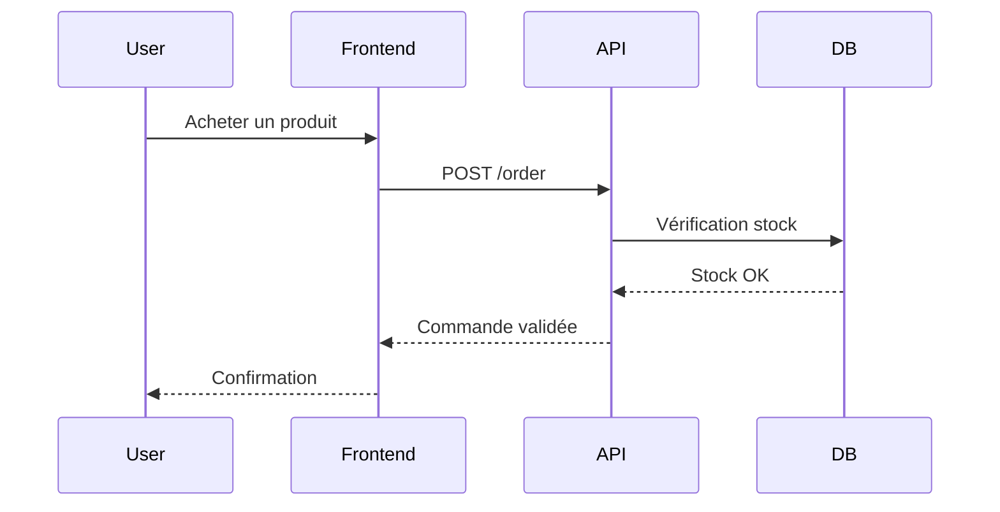

---

# 5. Base de données

La base stocke les données persistantes.

Exemples :

- Utilisateurs
- Commandes
- Produits
- Factures

---

## SQL

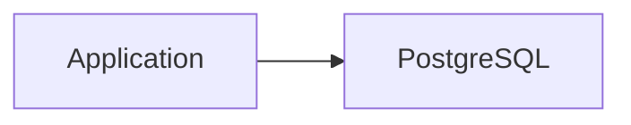

Technologies :

- PostgreSQL
- MySQL
- SQL Server
- Oracle

Avantages :

- Transactions
- Intégrité forte

---

## NoSQL

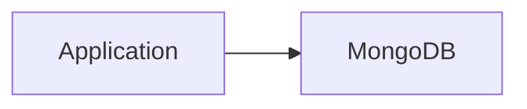

Technologies :

- MongoDB
- Cassandra
- DynamoDB

Avantages :

- Scalabilité élevée
- Schéma flexible

---

# 6. Cache

Le cache évite de solliciter constamment la base.

Sans cache :

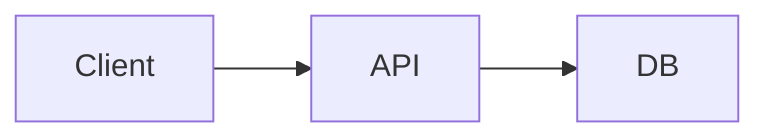

Avec cache :

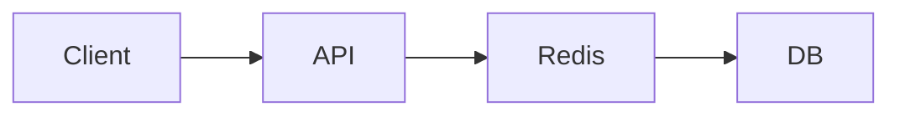

Processus :

1. Vérification du cache
2. Si présent → réponse immédiate
3. Sinon → lecture base puis mise en cache

Technologies :

- Redis
- Memcached

---

# 7. Stockage de fichiers

Les fichiers sont rarement stockés directement dans la base.

Architecture :

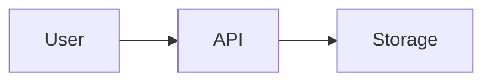

Exemples :

- Photos profil
- Documents PDF
- Vidéos

Solutions :

- Amazon S3
- Azure Blob Storage
- Google Cloud Storage

---

# 8. Files de messages (Message Queue)

Permet d'exécuter des tâches en arrière-plan.

Architecture :

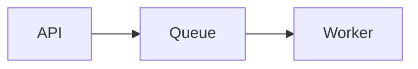

---

## Pourquoi ?

Imaginons :

- Envoi d'email
- Génération PDF
- Encodage vidéo

Ces opérations sont lentes.

Au lieu d'attendre :

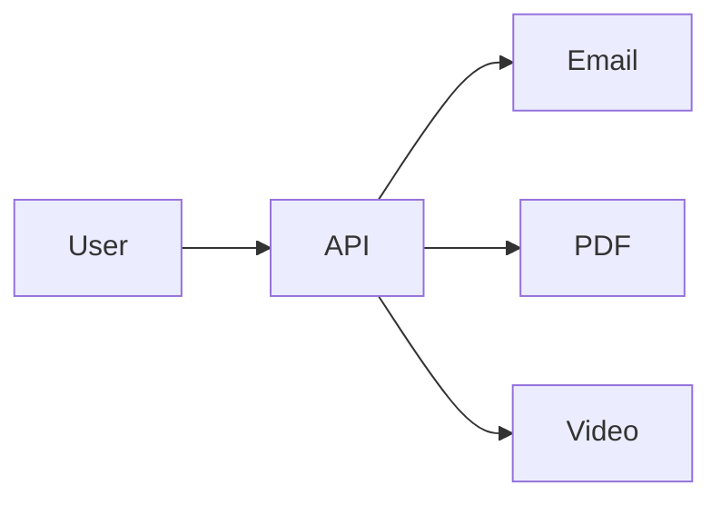

On utilise une queue :

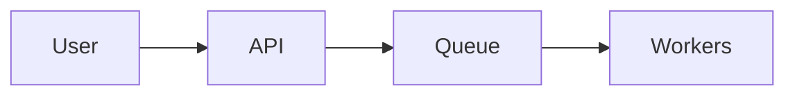

Résultat :

- Réponse instantanée
- Meilleure expérience utilisateur

---

## Technologies

- RabbitMQ
- Kafka
- SQS
- ActiveMQ

---

# 9. Workers

Les workers exécutent les tâches asynchrones.

Exemple :

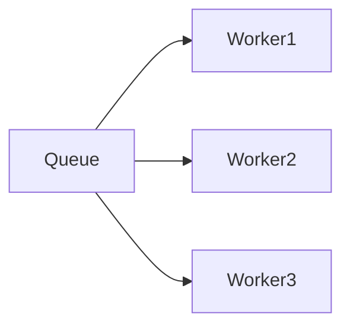

Responsabilités :

- Emails
- Facturation
- Import de données
- Traitement d'images
- IA

---

# 10. Monitoring

Le monitoring surveille l'application.

Architecture :

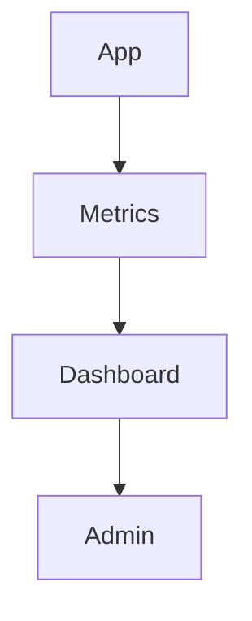

Mesures :

- CPU
- RAM
- Temps de réponse
- Erreurs
- Nombre d'utilisateurs

Outils :

- Prometheus
- Grafana
- Datadog

---

# 11. Logs

Les logs permettent de diagnostiquer les problèmes.

Architecture :

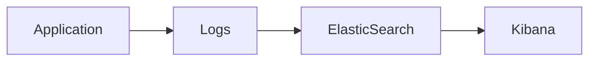

Exemple :

```text
2026-06-11 12:30:12
User 123 connected
```

---

# 12. Architecture Microservices

Les grandes entreprises découpent leur système.

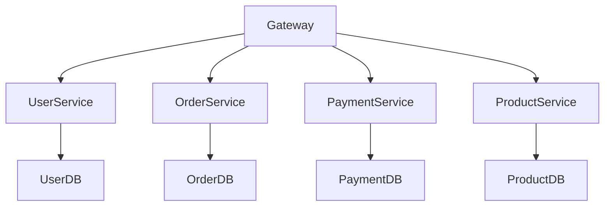

---

## Avantages

- Déploiement indépendant
- Scalabilité ciblée
- Équipes autonomes

---

## Inconvénients

- Complexité
- Monitoring plus difficile
- Communication réseau

---

# 13. Architecture d'un réseau social

Exemple type :

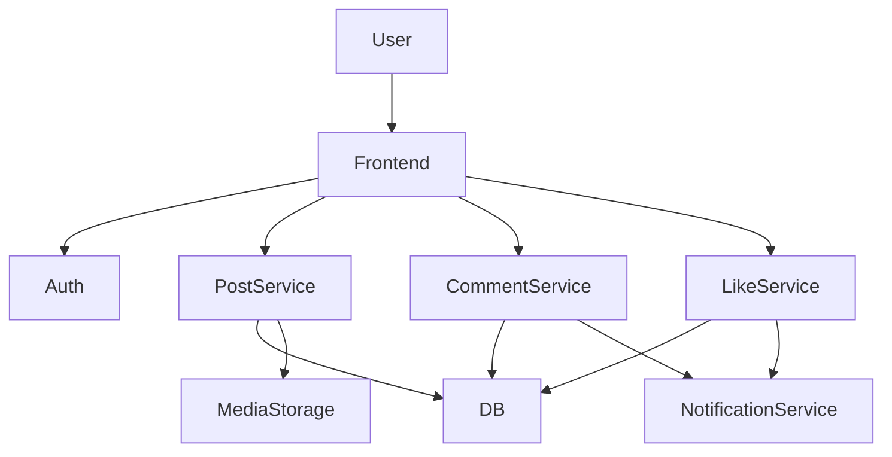

---

# 14. Architecture d'un e-commerce

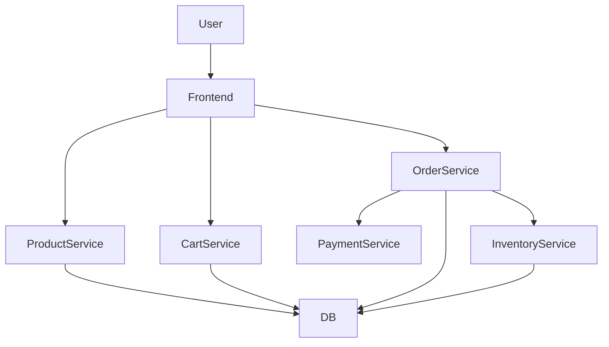

---

# 15. Architecture d'une application bancaire

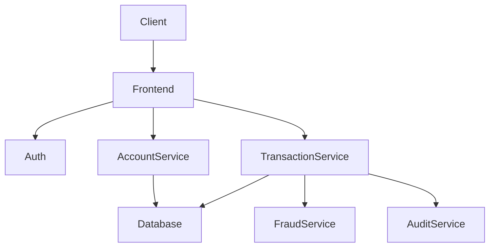

Contraintes supplémentaires :

- Chiffrement
- Audit complet
- Réplication
- Haute disponibilité

---

# 16. Architecture Cloud moderne

```mermaid
flowchart TB

Internet

CDN

WAF

LoadBalancer

Kubernetes

Microservices

Databases

Storage

Internet --> CDN

CDN --> WAF

WAF --> LoadBalancer

LoadBalancer --> Kubernetes

Kubernetes --> Microservices

Microservices --> Databases

Microservices --> Storage
```

---

## WAF (Web Application Firewall)

Protège contre :

- SQL Injection
- XSS
- Bots
- DDoS

---

## Kubernetes

Responsabilités :

- Déploiement
- Auto-scaling
- Redémarrage automatique
- Répartition de charge

---

# 17. Architecture complète d'une application moderne à grande échelle

```mermaid
flowchart TB

User

Frontend

CDN

WAF

LoadBalancer

ApiGateway

Auth

UserService
OrderService
PaymentService
NotificationService

Redis

Kafka

Workers

PostgreSQL

ObjectStorage

Monitoring

Logging

User --> Frontend

Frontend --> CDN

CDN --> WAF

WAF --> LoadBalancer

LoadBalancer --> ApiGateway

ApiGateway --> Auth

ApiGateway --> UserService
ApiGateway --> OrderService
ApiGateway --> PaymentService

UserService --> Redis
OrderService --> Redis

UserService --> PostgreSQL
OrderService --> PostgreSQL
PaymentService --> PostgreSQL

OrderService --> Kafka

Kafka --> Workers

Workers --> NotificationService

NotificationService --> ObjectStorage

UserService --> Monitoring
OrderService --> Monitoring
PaymentService --> Monitoring

UserService --> Logging
OrderService --> Logging
PaymentService --> Logging
```

---

# Conclusion

La plupart des applications modernes sont construites à partir des mêmes composants fondamentaux :

| Brique | Rôle |
|----------|----------|
| Frontend | Interface utilisateur |
| CDN | Distribution rapide des fichiers |
| Load Balancer | Répartition du trafic |
| API Gateway | Point d'entrée unique |
| Auth Service | Authentification |
| Backend | Logique métier |
| Base de données | Stockage persistant |
| Cache Redis | Accélération |
| Message Queue | Traitement asynchrone |
| Workers | Exécution de tâches |
| Object Storage | Stockage fichiers |
| Monitoring | Supervision |
| Logging | Diagnostic |
| Kubernetes | Orchestration |
| WAF | Sécurité |
| Microservices | Découpage fonctionnel |

Cette architecture constitue la base des systèmes utilisés par les grandes plateformes modernes comme les réseaux sociaux, les sites e-commerce, les applications SaaS, les plateformes de streaming et les applications bancaires.
