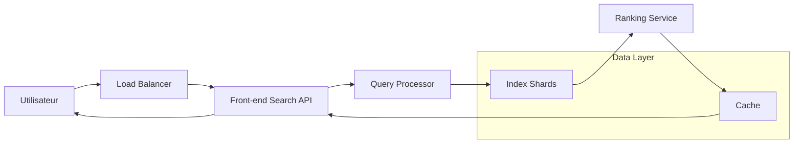
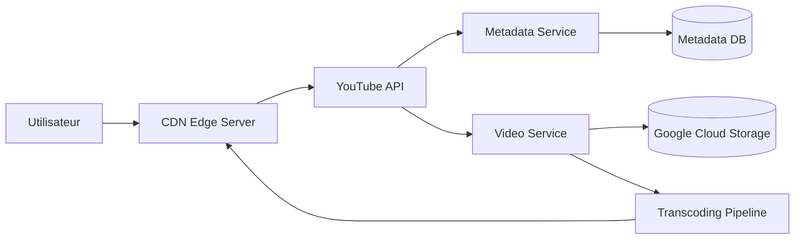
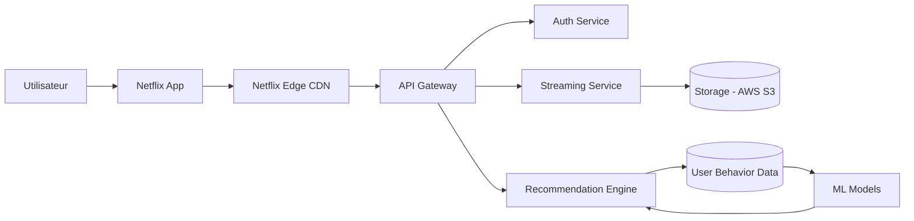
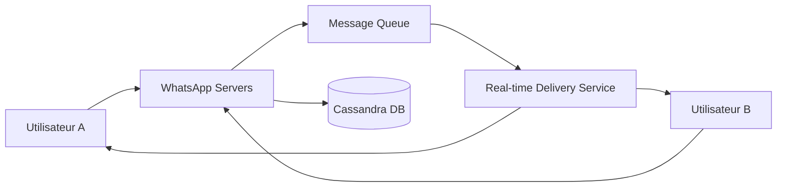
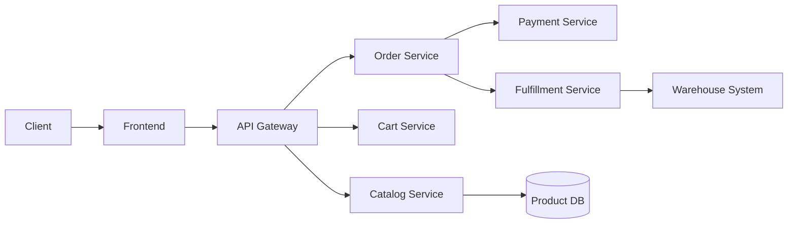

Voici des **schémas d’architecture simplifiés** des applications les plus utilisées au monde. Ce sont des **architectures typiques (pas les schémas internes exacts propriétaires)**, mais elles reflètent très bien comment ces systèmes sont généralement conçus à grande échelle.

---

# 1) Google Search (moteur de recherche)

### Technologies typiques

* **C++ / Java** : backend haute performance
* **Bigtable** : stockage distribué des index
* **Colossus (successeur de GFS)** : stockage distribué
* **TensorFlow / ML models** : ranking des résultats
* **Redis-like cache** : accélération requêtes

### Utilité

* Indexation massive du web
* Recherche ultra-rapide
* Classement intelligent via IA

---

# 2) YouTube (streaming vidéo)

### Technologies typiques

* **Google Cloud Storage** : stockage vidéos
* **CDN global (YouTube CDN)** : diffusion rapide
* **FFmpeg / encoders internes** : transcodage
* **Kubernetes** : orchestration services
* **Bigtable / Spanner** : métadonnées

### Utilité

* Streaming mondial sans latence
* Adaptation qualité vidéo (360p → 4K)
* Recommandation de contenu

---

# 3) Netflix (streaming vidéo + recommandation)

### Technologies typiques

* **AWS (S3, EC2, CloudFront)** : infrastructure principale
* **Apache Cassandra** : base distribuée
* **Kafka** : événements utilisateurs
* **Spark / Machine Learning** : recommandations
* **Node.js / Java** : backend API

### Utilité

* Streaming haute disponibilité
* Recommandations personnalisées
* Scalabilité mondiale

---

# 4) WhatsApp (messagerie instantanée)

### Technologies typiques

* **Erlang** : gestion millions de connexions simultanées
* **Cassandra** : stockage messages
* **MQ (queue distribuée)** : fiabilité livraison
* **WebSockets / TCP custom protocol** : temps réel

### Utilité

* Messagerie instantanée mondiale
* Faible latence
* Tolérance aux pannes

---

# 5) Amazon (e-commerce)

### Technologies typiques

* **Java / microservices**
* **DynamoDB** : stockage produit
* **SQS / Kafka** : communication entre services
* **AWS Lambda** : fonctions serverless
* **Elasticsearch** : recherche produits

### Utilité

* Gestion catalogue géant
* Commandes distribuées
* Logistique automatisée

---

# Résumé global (pattern commun)

Presque toutes ces apps utilisent :

* **Load Balancer** → répartit trafic
* **Microservices** → découpage fonctionnel
* **Base distribuée** → scalabilité mondiale
* **Cache (Redis-like)** → rapidité
* **CDN** → contenu proche utilisateur
* **Message queues (Kafka/SQS)** → communication asynchrone
* **Machine Learning** → personnalisation

---

Si tu veux, je peux aussi te faire :

* une **architecture “Big Tech complète unifiée” (Google + Netflix + Amazon mix)**
* ou un **schéma d’architecture moderne type startup (MVP → scale)**
* ou encore **comment construire une app comme Netflix étape par étape**
