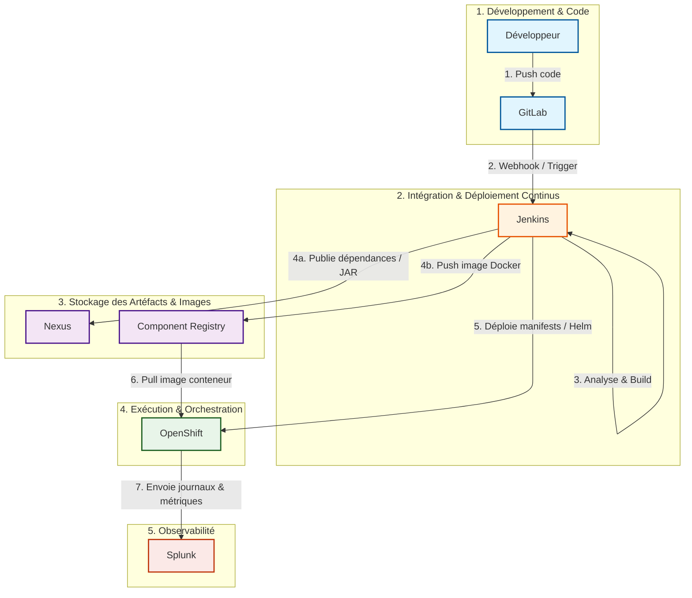
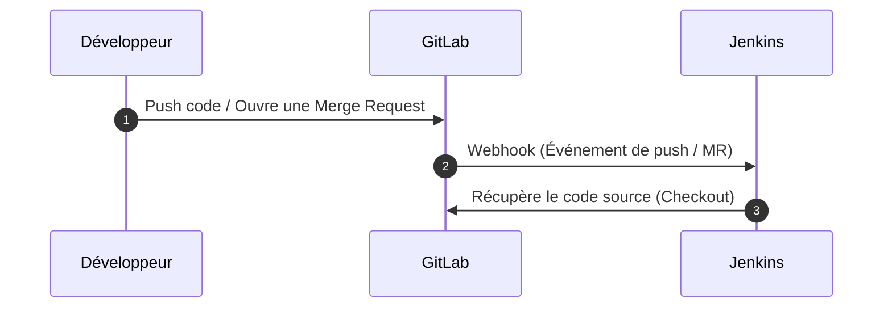
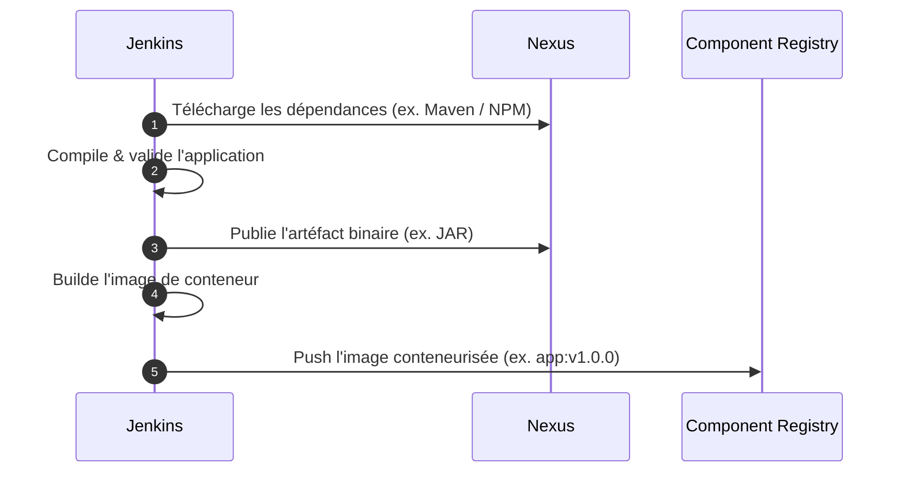
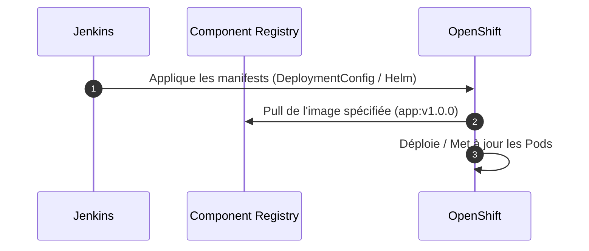

Pour orchestrer et automatiser votre chaîne de livraison (CI/CD) de bout en bout, ces outils s'articulent autour d'une architecture intégrée.

---

### Architecture globale de la chaîne CI/CD

Le schéma ci-dessous illustre le flux de travail complet, du push du code source jusqu'au déploiement et au suivi en production.

---

### Rôle détaillé de chaque outil et interactions

#### 1. GitLab — Gestion du code source & Collaboration

* **Rôle :** Héberge les dépôts Git, gère le versionnement du code, les branches et la revue de code via les Merge Requests (MR).
* **Interactions :**
* Lors d'un `git push` ou de la fusion d'une MR, GitLab émet un **Webhook** vers Jenkins pour déclencher automatiquement le pipeline d'intégration continue.

---

#### 2. Jenkins — Moteur d'orchestration CI/CD

* **Rôle :** Chef d'orchestre des builds, des tests automatisés, des analyses de qualité de code (ex. SonarQube) et du déploiement. Il exécute les scripts définis dans un `Jenkinsfile`.
* **Interactions :**
* Récupère le code sur **GitLab**.
* Télécharge les dépendances depuis **Nexus**.
* Publie les livrables binaires dans **Nexus** et les images de conteneurs dans le **Component Registry**.
* Pilote le déploiement sur **OpenShift**.

---

#### 3. Nexus — Gestionnaire d'artéfacts de build

* **Rôle :** Registre de gestion des dépendances (Maven, NPM, Gradle) et dépôt central pour les packages compilés (JAR, WAR, Zip). Il sert également de proxy/cache pour sécuriser et accélérer le téléchargement des librairies externes.
* **Interactions :**
* **Jenkins** y puise les dépendances lors de la compilation.
* **Jenkins** y dépose les artéfacts finaux versionnés.

---

#### 4. Component Registry — Registre d'images de conteneurs

* **Rôle :** Stocke, versionne et sécurise les images de conteneurs (Docker/OCI) générées durant le pipeline.
* **Interactions :**
* **Jenkins** construit l'image de l'application et la `push` dans le Component Registry.
* **OpenShift** réalise un `pull` de cette image lors de l'instanciation ou de la mise à jour d'un Pod.

---

#### 5. OpenShift — Plateforme d'orchestration de conteneurs (PaaS)

* **Rôle :** Héberge et exécute les applications conteneurisées à échelle (basé sur Kubernetes). Il gère le cycle de vie des conteneurs, le *scaling* automatique, la haute disponibilité, le réseau interne, l'exposition des routes HTTP/HTTPS et la configuration de l'infrastructure.
* **Interactions :**
* Reçoit les instructions de déploiement de **Jenkins** (`oc apply`, Helm, `oc rollout`).
* Récupère l'image depuis le **Component Registry**.
* Transmet l'ensemble de ses logs applicatifs et système à **Splunk**.

---

#### 6. Splunk — Plateforme d'observabilité et d'analyse de logs

* **Rôle :** Centralise, indexe et analyse l'ensemble des journaux d'événements (logs applicatifs, sous-jacents Kubernetes/OpenShift, audit et sécurité). Il permet la création de tableaux de bord, de recherches en temps réel et la configuration d'alertes.
* **Interactions :**
* Collecte en continu les flux de logs générés par les Pods et l'infrastructure **OpenShift** (généralement via des agents comme Fluentd, Vector ou Splunk Universal Forwarder).

---

### Synthèse des flux dans la chaîne

| Étape | Outil source | Outil cible | Nature de l'échange |
| --- | --- | --- | --- |
| **Versionnement** | Développeur | GitLab | Commit / Push du code source |
| **Déclenchement** | GitLab | Jenkins | Notification Webhook |
| **Résolution** | Jenkins | Nexus | Téléchargement des dépendances de build |
| **Stockage Binaire** | Jenkins | Nexus | Publication des artéfacts compiled |
| **Stockage Image** | Jenkins | Component Registry | Push de l'image de conteneur compilée |
| **Déploiement** | Jenkins | OpenShift | Mise à jour des manifests de déploiement |
| **Exécution** | OpenShift | Component Registry | Pull de l'image pour instanciation des Pods |
| **Supervision** | OpenShift | Splunk | Collecte et centralisation des logs d'exécution |
