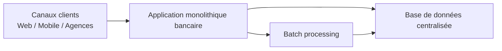
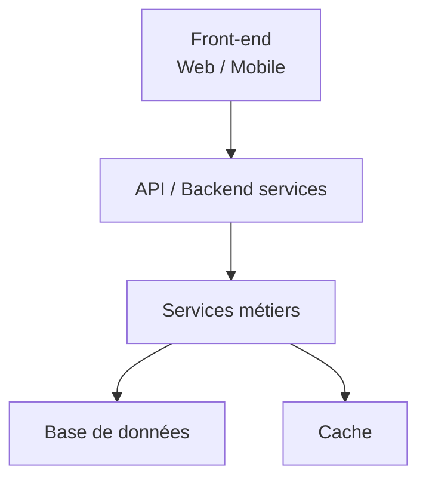
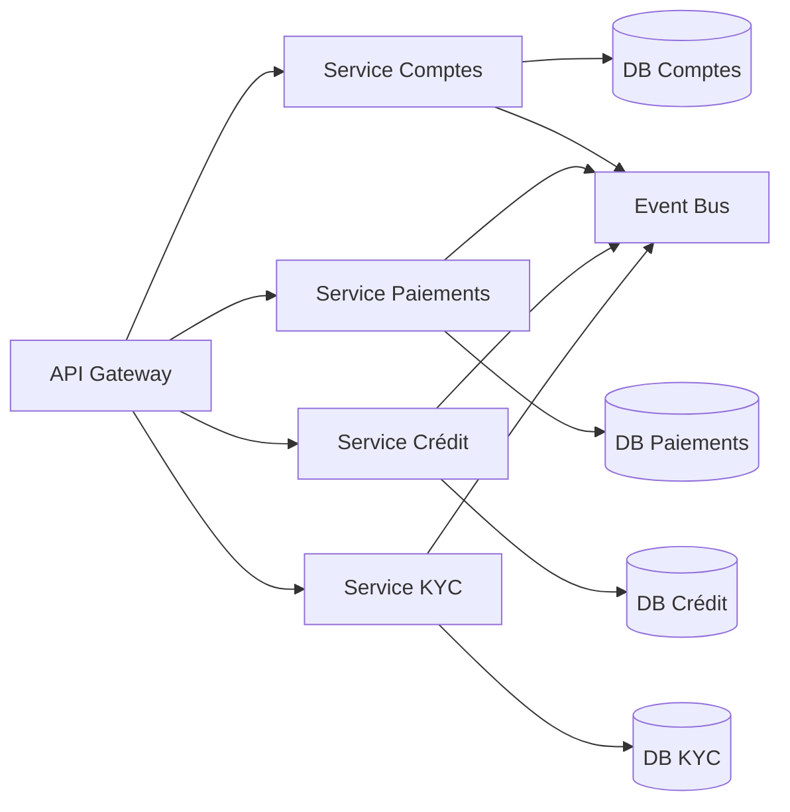
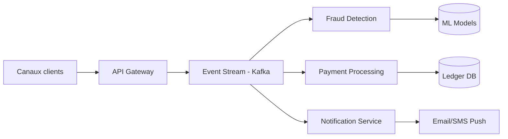
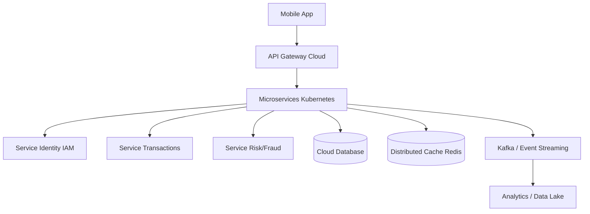

Voici plusieurs **schémas d’architecture courants dans les systèmes bancaires**, avec des diagrammes **Mermaid** et les **technologies typiquement utilisées pour chaque brique**.

---

# 1) Architecture monolithique (legacy core banking)

Très fréquent dans les banques traditionnelles historiques.

### Technologies typiques

* **Canaux clients**

  * Web : JSP / ASP.NET / AngularJS ancien
  * Mobile : apps natives iOS/Android
* **Monolithe bancaire**

  * Java EE / Spring MVC (ancien Spring)
  * COBOL (très fréquent en core banking)
  * .NET Framework
* **Base de données**

  * IBM DB2
  * Oracle Database
  * SQL Server
* **Batch**

  * Control-M
  * Autosys
  * scripts Shell / Python

👉 Avantage : robuste
👉 Inconvénient : difficile à faire évoluer

---

# 2) Architecture 3-tiers (client / métier / données)

Modèle encore très répandu dans les systèmes bancaires “modernisés”.

### Technologies typiques

**Front-end**

* Angular / React
* Flutter (mobile)
* Swift / Kotlin

**API / Backend**

* Spring Boot (Java)
* .NET Core
* Node.js (Express/NestJS)

**Services métiers**

* Java Spring services
* Microservices partiellement introduits
* Drools (moteur de règles)

**Data**

* PostgreSQL / Oracle
* Redis (cache)

---

# 3) Architecture microservices bancaire (moderne)

Très utilisée dans les néobanques et transformations digitales.

### Technologies typiques

**API Gateway**

* Kong
* Apigee
* Spring Cloud Gateway
* AWS API Gateway

**Microservices**

* Java Spring Boot
* Node.js (NestJS)
* Go (Golang)
* Python (FastAPI)

**Communication**

* REST / gRPC
* Kafka / RabbitMQ (event-driven)

**Bases de données**

* PostgreSQL (relationnel)
* MongoDB (documents)
* Cassandra (haut volume transactions)

**Observabilité**

* Prometheus + Grafana
* ELK Stack (Elasticsearch, Logstash, Kibana)
* OpenTelemetry

---

# 4) Architecture event-driven banking (temps réel)

Très utilisée pour paiements, fraude, scoring.

### Technologies typiques

**Streaming / Event bus**

* Apache Kafka
* AWS Kinesis
* RabbitMQ (moins streaming, plus messaging)

**Fraude / ML**

* Python (Scikit-learn, TensorFlow, PyTorch)
* Spark Streaming
* Flink

**Ledger / stockage critique**

* Oracle (très fréquent pour ledger bancaire)
* PostgreSQL (ACID fort)
* CockroachDB (distribué ACID)

**Notifications**

* Twilio (SMS)
* Firebase Cloud Messaging
* AWS SNS

---

# 5) Architecture cloud-native bancaire (moderne + scalable)

### Technologies typiques

**Cloud / Infra**

* AWS / Azure / Google Cloud
* Kubernetes (EKS / AKS / GKE)
* Docker

**IAM (sécurité)**

* Keycloak
* Auth0
* AWS Cognito

**Data Lake**

* Snowflake
* BigQuery
* Databricks
* S3 / Azure Data Lake

**Sécurité bancaire**

* HSM (Hardware Security Modules)
* Vault (HashiCorp)
* TLS mutual authentication

---

# Résumé rapide des architectures

| Architecture  | Usage               | Tech dominante             |
| ------------- | ------------------- | -------------------------- |
| Monolithique  | banques legacy      | COBOL, Oracle              |
| 3-tiers       | systèmes modernisés | Java, .NET                 |
| Microservices | néobanques          | Spring Boot, Kubernetes    |
| Event-driven  | paiements & fraude  | Kafka, Flink               |
| Cloud-native  | banques digitales   | AWS, Kubernetes, data lake |

---

Si tu veux, je peux aussi te faire :

* une **architecture cible complète type “banque digitale 2026”**
* un **schéma du système de paiement SEPA / SWIFT**
* ou une **architecture core banking + ledger ultra détaillée**
