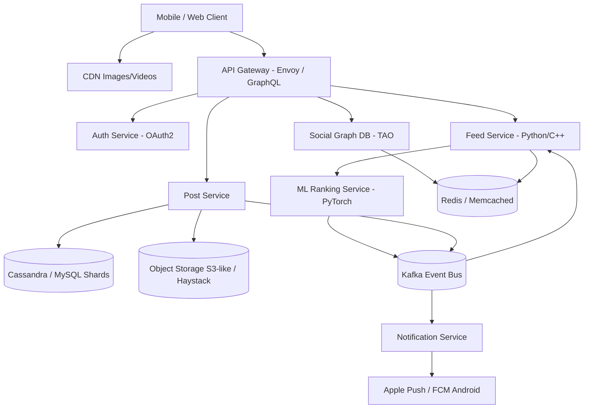
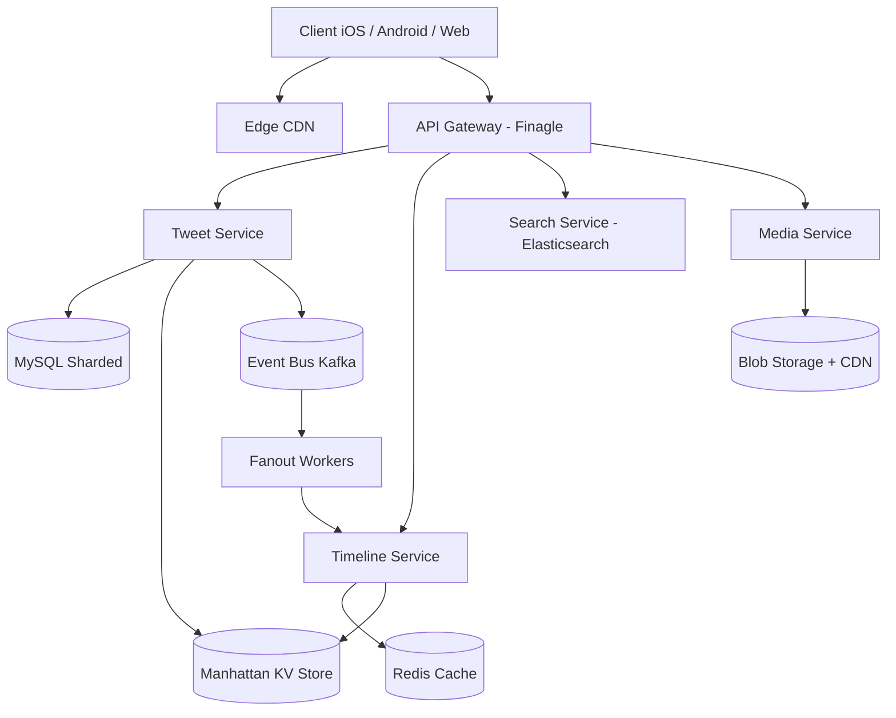
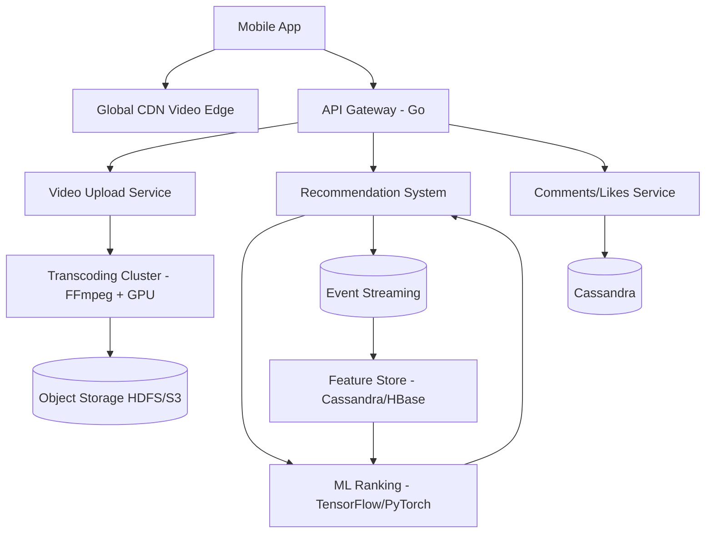
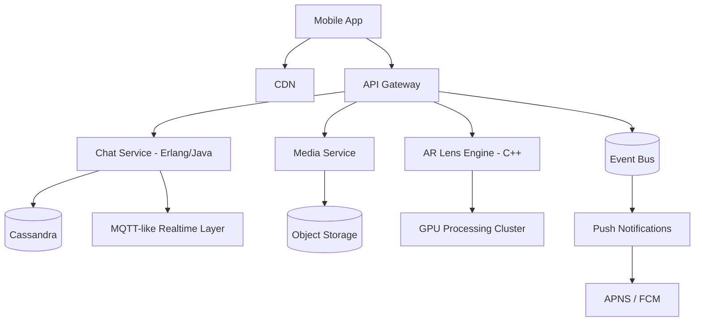
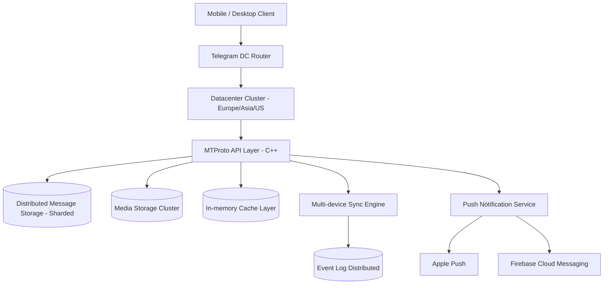
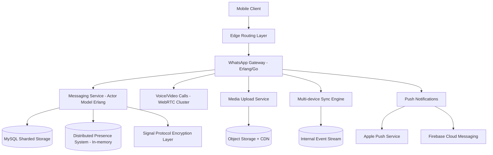

Voici une vue réaliste (mais simplifiée) des architectures utilisées par les grandes apps sociales modernes. Elles reposent presque toutes sur les mêmes **patterns** : microservices, event streaming, stockage distribué, CDN, et séparation lecture/écriture.

Je vais te détailler 4 cas représentatifs :

* Meta (Instagram / Facebook)
* X (ex Twitter)
* TikTok
* Snap Inc. (Snapchat)

Et pour chacun : schéma + briques + technos typiques.

---

# 1. Architecture type Instagram / Facebook (Meta)

### 🔧 Principe général

Architecture **microservices + event-driven + graph social + feed ranking**

### 🧱 Briques principales & technos

* Client (mobile/web) → React Native / iOS (Swift) / Android (Kotlin)
* API Gateway → Envoy / NGINX / GraphQL Gateway
* Auth → OAuth2 + internal identity service
* Feed ranking → Python / C++ services + ML (PyTorch)
* Graph social → TAO (Meta’s distributed graph DB)
* Posts storage → Cassandra / MySQL sharded
* Media storage → Haystack / object storage type S3
* Cache → Memcached / Redis
* Event streaming → Kafka
* Search → Elasticsearch
* CDN images/videos → Akamai / Cloudflare-like edge

---

### 📊 Mermaid diagram

---

# 2. Architecture X (Twitter)

### 🔧 Principe général

Très fort focus sur :

* timeline temps réel
* ingestion massive de tweets
* fan-out on write (ou hybride)

### 🧱 Briques & technos

* API → Finagle (Scala)
* Backend services → Scala / Java / Rust
* Timeline service → Manhattan (key-value store)
* Tweet storage → MySQL + Manhattan
* Event streaming → Kafka / EventBus interne
* Search → Elasticsearch
* Cache timeline → Redis
* Media → blob storage + CDN
* Ranking → ML services (LightGBM / PyTorch)

---

### 📊 Mermaid diagram

---

# 3. Architecture TikTok

### 🔧 Particularité majeure

👉 feed **100% ML-driven**
👉 ingestion vidéo + processing lourd (transcoding)

### 🧱 Briques & technos

* App → Swift / Kotlin
* API Gateway → custom gateway (Go)
* Video upload → multipart + Go services
* Transcoding → FFmpeg + distributed GPU cluster
* Storage → HDFS / S3-like object store
* Feed ranking → Deep learning (TensorFlow / PyTorch)
* Event system → Kafka / Pulsar
* Metadata DB → Cassandra / HBase
* Cache → Redis
* CDN vidéo → global edge network

---

### 📊 Mermaid diagram

---

# 4. Architecture Snapchat (Snap Inc.)

### 🔧 Particularité

* messages éphémères
* forte utilisation du mobile real-time
* AR filters (Snap Camera Engine)

### 🧱 Briques & technos

* Client → Swift / Kotlin
* Chat service → Erlang / Java
* Media pipeline → custom media servers
* AR → Lens Studio + C++ engine
* Storage → Cassandra
* Messaging → MQTT-like protocol
* Event bus → Kafka
* CDN → global edge
* Presence system → Redis / in-memory cluster

---

### 📊 Mermaid diagram

---

# 🔥 Architecture commune (pattern global)

Toutes ces apps partagent :

### 🧠 1. Microservices

* services indépendants (feed, chat, auth, media)

### ⚡ 2. Event-driven architecture

* Kafka / Pulsar / internal event bus

### 🗄 3. Base distribuée

* Cassandra / MySQL sharding / HBase / KV stores

### 🚀 4. CDN obligatoire

* vidéos/images jamais servies depuis origin

### 🤖 5. ML partout

* ranking feed
* recommendations
* anti-spam

### 📦 6. Storage spécialisé

* media ≠ metadata ≠ social graph

---

# 5. Architecture Telegram

Telegram est conçu pour être :

* ultra-distribué
* très rapide en sync multi-device
* orienté cloud (contrairement à WhatsApp historiquement)

---

## 🧱 Briques & technos

* Client mobile → Swift / Kotlin
* Backend principal → **C++ + custom MTProto protocol**
* Protocol réseau → **MTProto**
* Datacenter layer → propre infra multi-régions
* Storage messages → distributed storage (custom, shard-based)
* Cache → in-memory + Redis-like systems
* Media storage → distributed object storage (CDN interne)
* Sync multi-device → event log distribué
* Notifications → APNS / FCM
* Anti-spam → ML + heuristics

---

## 📊 Diagramme Mermaid

---

# 6. Architecture WhatsApp

WhatsApp (Meta) est basé sur :

* ultra-haute scalabilité messaging
* faible latence
* design très “Erlang actor model”
* chiffrement end-to-end systématique

---

## 🧱 Briques & technos

* Client → Swift / Kotlin
* Backend → **Erlang (core legacy), évolutions Java/Go**
* Messaging protocol → custom + Signal Protocol (E2E encryption)
* Core messaging system → actor model Erlang
* Storage → MySQL + sharding (historique), RocksDB-like systems
* Presence system → in-memory distributed state
* Media storage → object store + CDN
* Sync multi-device → event replication system
* Notifications → APNS / FCM
* Call system → WebRTC + optimized media servers

---

## 📊 Diagramme Mermaid

---

# ⚖️ Telegram vs WhatsApp (diff clé d’architecture)

## 🧠 1. Philosophie

* Telegram → “cloud messaging multi-device natif”
* WhatsApp → “mobile-first + chiffrement + simplicité”

## 🗄 2. Stockage

* Telegram → messages dans le cloud (server-side history)
* WhatsApp → historique plus “device-centric” (sync complexe ajouté après)

## 🔐 3. Sécurité

* Telegram → chiffrement E2E seulement en “Secret Chat”
* WhatsApp → E2E par défaut (Signal Protocol)

## ⚡ 4. Scalabilité

* Telegram → multi-datacenter actif/actif
* WhatsApp → énorme optimisation Erlang + sharding MySQL

---

# 🔥 Vue globale (toutes les plateformes sociales)

Si on résume toutes les apps (Meta, X, TikTok, Snapchat, Telegram, WhatsApp), on retrouve toujours :

* API Gateway (routing)
* Messaging/Event Bus (Kafka ou équivalent)
* Storage distribué (MySQL shard / Cassandra / custom KV)
* Media pipeline (upload + CDN)
* Real-time layer (WebSockets / MQTT / Erlang actors)
* ML layer (ranking/reco/anti-spam)

---

