# Réaliser les Bons Choix Architecturaux

---

# Introduction

L'architecture logicielle est l'ensemble des décisions structurelles qui définissent un système logiciel.

Elle répond à une question fondamentale :

> Comment organiser un système pour satisfaire les besoins métiers actuels tout en restant maintenable, évolutif, performant et sécurisé dans le futur ?

Un mauvais choix architectural peut entraîner :

- une dette technique importante ;
- des coûts de maintenance élevés ;
- des difficultés d'évolution ;
- des problèmes de performance ;
- des échecs de projets.

À l'inverse, une architecture adaptée permet :

- une meilleure productivité ;
- une meilleure qualité logicielle ;
- une plus grande robustesse ;
- une meilleure scalabilité.

---

# 1. Comprendre le Contexte Avant de Choisir

L'erreur la plus fréquente consiste à choisir une architecture parce qu'elle est populaire.

Le choix doit toujours partir du contexte.

## Les questions fondamentales

### Besoin métier

- Quel problème résout-on ?
- Quelle est la valeur métier ?

### Volume

- 100 utilisateurs ?
- 10 000 ?
- 10 millions ?

### Performance

- Temps réel ?
- Temps quasi-réel ?
- Traitement batch ?

### Évolutivité

- Application stable ?
- Produit en forte croissance ?

### Équipe

- Taille de l'équipe ?
- Niveau technique ?
- Expertise disponible ?

### Budget

- Startup ?
- Grand groupe ?

---

# Schéma global de décision

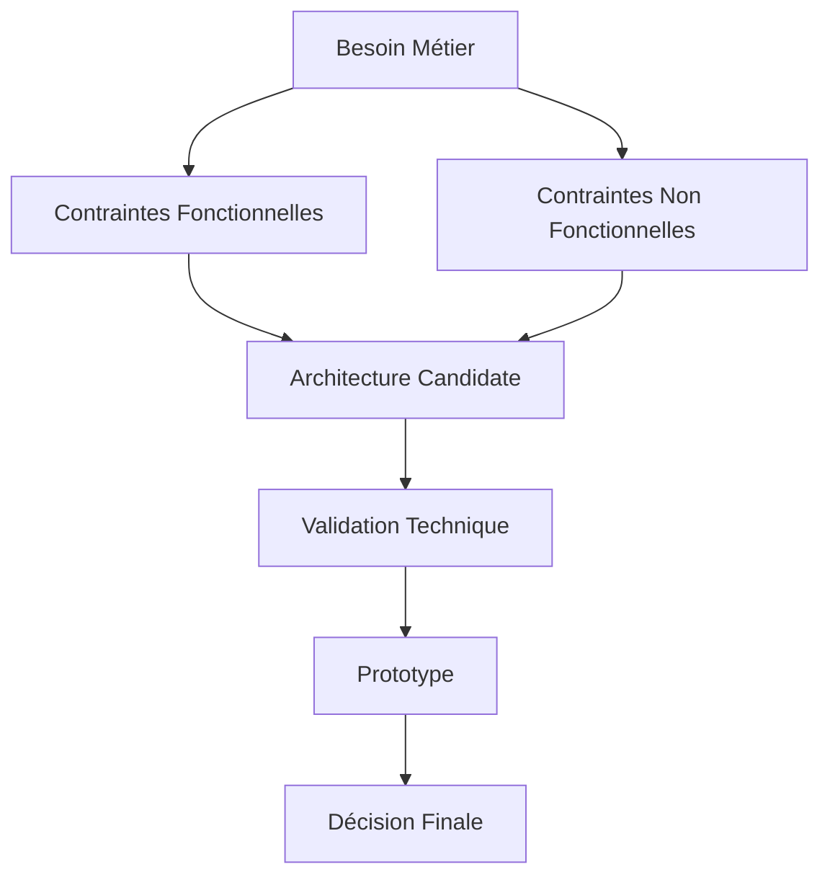

---

# 2. Les Qualités Architecturales (Quality Attributes)

Avant toute décision, il faut identifier les attributs de qualité prioritaires.

## Principaux attributs

| Attribut | Description |
|-----------|-------------|
| Performance | Temps de réponse |
| Scalabilité | Capacité à supporter la charge |
| Maintenabilité | Facilité de modification |
| Sécurité | Protection des données |
| Disponibilité | Temps de fonctionnement |
| Testabilité | Facilité de test |
| Résilience | Tolérance aux pannes |
| Portabilité | Déploiement multi-environnements |

---

## Exemple

Application bancaire :

Priorités :

```text
Sécurité      : Très élevée
Disponibilité : Très élevée
Performance   : Élevée
Portabilité   : Faible
```

Application interne RH :

```text
Sécurité      : Moyenne
Disponibilité : Moyenne
Maintenabilité: Très élevée
```

---

# 3. Les Différents Styles Architecturaux

---

# Architecture Monolithique

## Principe

Toute l'application est déployée comme une seule unité.

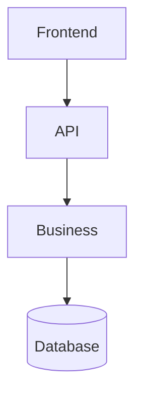

---

## Avantages

- Simple
- Peu coûteux
- Déploiement facile
- Débogage simplifié

---

## Inconvénients

- Scalabilité limitée
- Couplage fort
- Déploiements risqués

---

## Cas d'usage

- Startup
- MVP
- Produit peu complexe

---

# Architecture en Couches (Layered)

## Structure

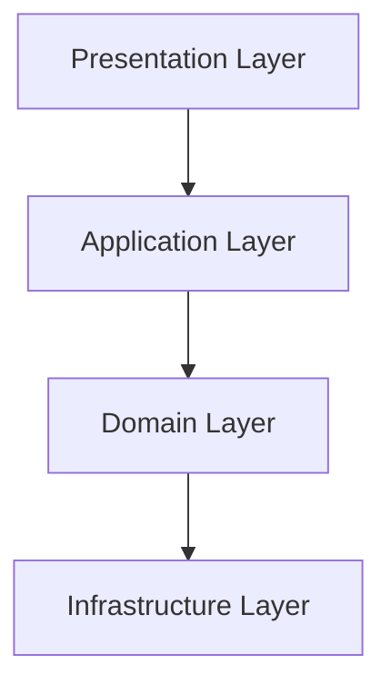

---

## Avantages

- Très compréhensible
- Maintenance simple
- Bonne séparation des responsabilités

---

## Inconvénients

- Peut devenir lente
- Risque de couches "anorexiques"

---

# Architecture Hexagonale

Alias :

- Ports & Adapters
- Clean Architecture

---

## Principe

Le métier ne dépend de rien.

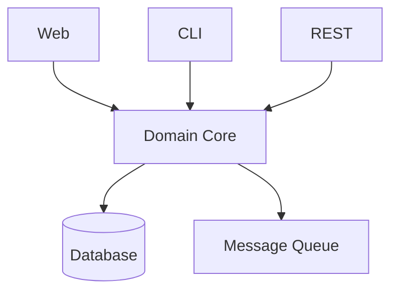

---

## Objectif

Protéger la logique métier.

---

## Avantages

- Très testable
- Très maintenable
- Forte indépendance technologique

---

## Inconvénients

- Plus complexe
- Courbe d'apprentissage

---

# Microservices

## Principe

Découper le système en services indépendants.

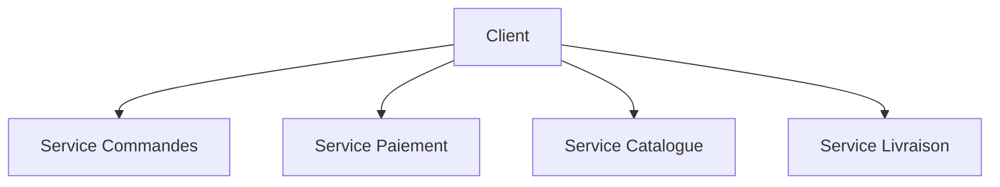

---

## Avantages

- Scalabilité indépendante
- Déploiement indépendant
- Équipes autonomes

---

## Inconvénients

- Complexité opérationnelle
- Réseau
- Monitoring
- Transactions distribuées

---

## Quand utiliser ?

Typiquement :

```text
+ de 50 développeurs
+ de 10 équipes
+ de 100 000 utilisateurs
```

---

# Event-Driven Architecture

## Principe

Communication par événements.

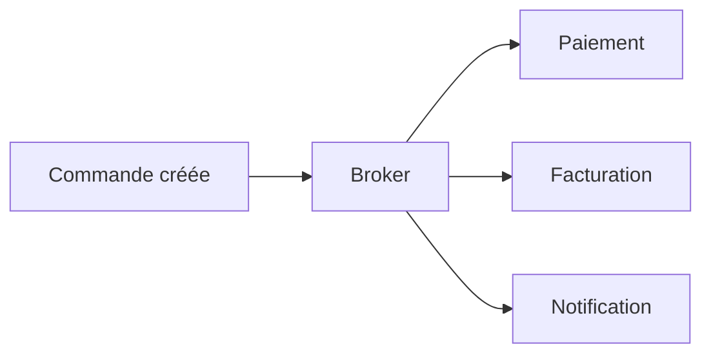

---

## Avantages

- Très découplé
- Très scalable

---

## Inconvénients

- Debug complexe
- Cohérence éventuelle

---

# CQRS

Command Query Responsibility Segregation

---

## Principe

Séparer lecture et écriture.

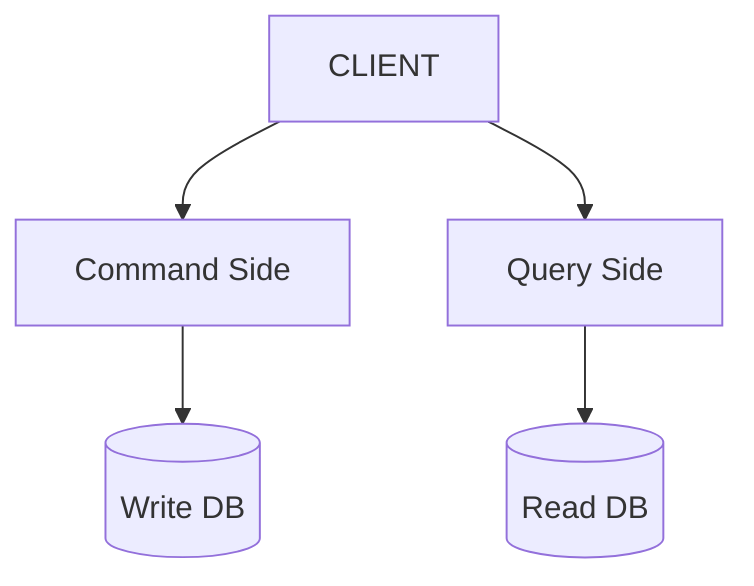

---

## Utilisation

Pertinent quand :

```text
Lecture >> Écriture
```

Exemple :

- E-commerce
- Réseaux sociaux

---

# Event Sourcing

## Principe

On stocke les événements et non l'état.

---

Au lieu de :

```json
{
  "solde": 1000
}
```

On stocke :

```json
[
  "Compte créé",
  "Dépôt 500",
  "Retrait 200",
  "Dépôt 700"
]
```

---

## Avantages

- Historique complet
- Audit

---

## Inconvénients

- Complexité importante

---

# 4. Critères de Choix Architecturaux

---

# Scalabilité

## Verticale

```text
+ CPU
+ RAM
```

---

## Horizontale

```text
Serveur 1
Serveur 2
Serveur 3
Serveur 4
```

---

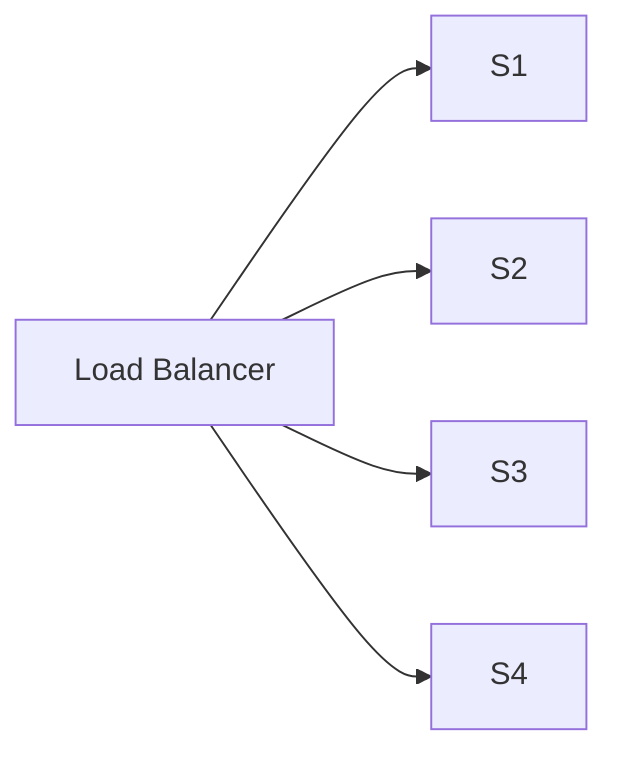

---

# Disponibilité

Mesure :

```text
99%
99.9%
99.99%
99.999%
```

---

Temps d'arrêt annuel :

| SLA | Downtime |
|------|----------|
| 99% | 3.65 jours |
| 99.9% | 8.76 h |
| 99.99% | 52 min |
| 99.999% | 5 min |

---

# Résilience

Capacité à continuer malgré une panne.

---

Pattern :

### Circuit Breaker

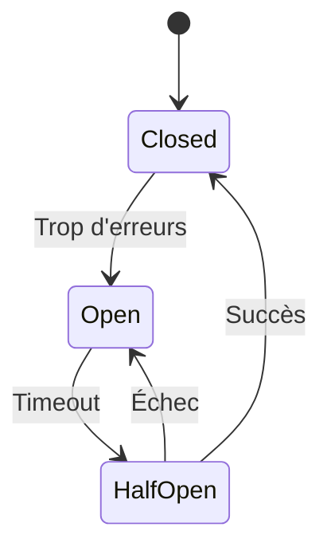

---

# Performance

Questions :

- Temps de réponse attendu ?
- Nombre de requêtes ?
- Volume de données ?

---

Solutions :

- Cache
- CDN
- Index
- Réplication

---

# Sécurité

Architecture :

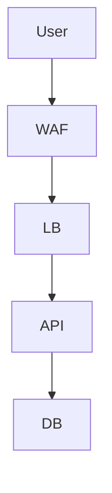

---

Couches :

- Authentification
- Autorisation
- Chiffrement
- Audit

---

# 5. Décider Grâce aux Trade-offs

Il n'existe pas d'architecture parfaite.

Toute décision est un compromis.

---

## Triangle classique

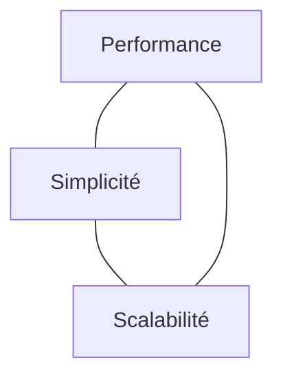

---

Améliorer un sommet dégrade souvent un autre.

---

# Exemple réel

Monolithe :

```text
Simplicité : 10/10
Scalabilité : 4/10
Complexité : 2/10
```

Microservices :

```text
Simplicité : 3/10
Scalabilité : 10/10
Complexité : 9/10
```

---

# 6. Méthode de Décision Architecturale

---

## Étape 1

Lister les exigences.

```text
Fonctionnelles
Non fonctionnelles
```

---

## Étape 2

Classer les attributs de qualité.

Exemple :

```text
1. Sécurité
2. Disponibilité
3. Scalabilité
4. Performance
5. Maintenabilité
```

---

## Étape 3

Identifier plusieurs architectures candidates.

Exemple :

```text
A : Monolithe
B : Hexagonale
C : Microservices
```

---

## Étape 4

Créer une matrice de décision.

| Critère | Poids | Monolithe | Hexagonale | Microservices |
|----------|---------|------------|------------|---------------|
| Maintenabilité | 5 | 3 | 5 | 4 |
| Scalabilité | 4 | 2 | 3 | 5 |
| Sécurité | 5 | 4 | 5 | 4 |
| Complexité | 3 | 5 | 3 | 1 |

---

## Étape 5

Faire un Proof of Concept.

Toujours valider les hypothèses critiques.

---

# 7. Anti-Patterns à Éviter

---

## Microservices prématurés

```text
5 développeurs
100 utilisateurs
50 microservices
```

Mauvaise idée.

---

## Architecture Driven by Trend

```text
On fait du Kafka
car tout le monde fait du Kafka
```

Erreur.

---

## Big Ball of Mud

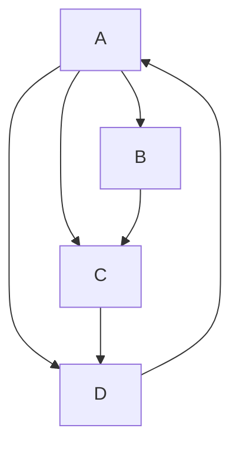

Tout dépend de tout.

---

## Base de données partagée entre microservices

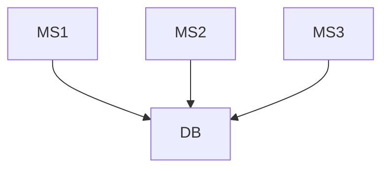

Couplage caché.

---

# 8. Architecture Évolutive Moderne

Approche recommandée aujourd'hui :

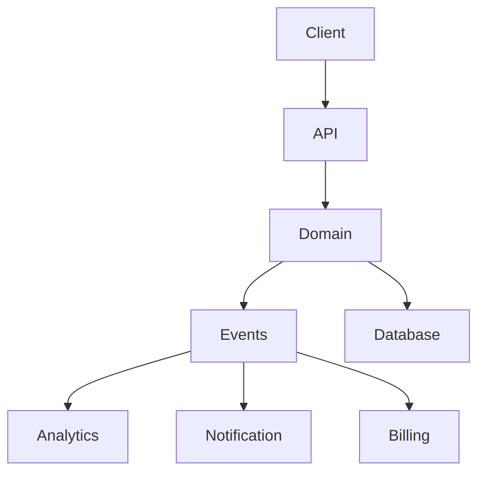

---

# Conclusion

Le bon choix architectural ne consiste pas à choisir l'architecture la plus moderne, mais celle qui répond le mieux aux contraintes du projet.

La démarche recommandée est :

1. Comprendre le besoin métier.
2. Identifier les attributs de qualité.
3. Évaluer plusieurs architectures.
4. Mesurer les compromis.
5. Valider par un prototype.
6. Favoriser la simplicité tant qu'elle répond aux besoins.

La règle d'or :

> "Choose the simplest architecture that satisfies today's requirements while leaving room for tomorrow's evolution."

En pratique :

- MVP → Monolithe modulaire.
- Produit en croissance → Hexagonale / Clean Architecture.
- Grande plateforme → Microservices.
- Très forte scalabilité → Event-Driven + CQRS.
- Besoin d'audit complet → Event Sourcing.
