# Les différents types de serveurs

Lorsque l'on développe des applications modernes, le mot **serveur** peut désigner plusieurs réalités différentes. Une application d'entreprise classique peut utiliser simultanément :

* un serveur Web
* un serveur d'applications
* un serveur de base de données
* un serveur de cache
* un serveur de messages
* un serveur de stockage
* un serveur d'authentification
* un serveur de monitoring
* etc.

Comprendre leur rôle est essentiel pour concevoir des architectures robustes et évolutives.

---

# Vue d'ensemble

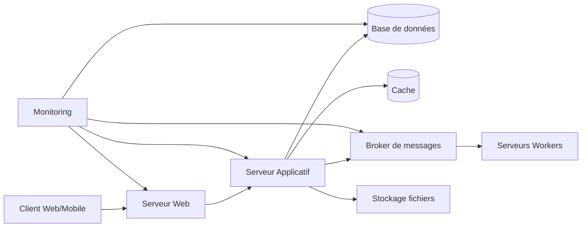

---

# 1. Serveur Web (Web Server)

## Rôle

Le serveur Web est le point d'entrée HTTP/HTTPS.

Il :

* reçoit les requêtes des utilisateurs
* sert les fichiers statiques
* redirige vers les applications backend
* gère SSL/TLS
* réalise parfois du load balancing

---

## Diagramme

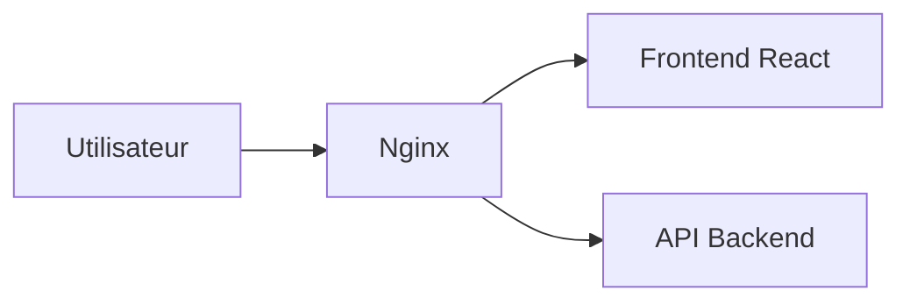

---

## Technologies les plus utilisées

| Technologie        | Popularité                        |
| ------------------ | --------------------------------- |
| Nginx              | Très élevée                       |
| Apache HTTP Server | Très élevée                       |
| Caddy              | En forte croissance               |
| IIS                | Environnement Microsoft           |
| Traefik            | Très utilisé en Docker/Kubernetes |

---

## Cas d'usage

### Site web classique

```text
Internet
    ↓
Nginx
    ↓
HTML/CSS/JS
```

---

### Reverse Proxy

```text
Internet
    ↓
Nginx
    ↓
API Java
API Node.js
API Python
```

---

## Exemple réel

Stack moderne :

```text
Nginx
  ↓
Node.js
  ↓
PostgreSQL
```

---

# 2. Serveur Applicatif (Application Server)

## Rôle

Contient la logique métier.

C'est lui qui :

* exécute le code
* valide les données
* applique les règles métier
* dialogue avec les bases de données

---

## Diagramme

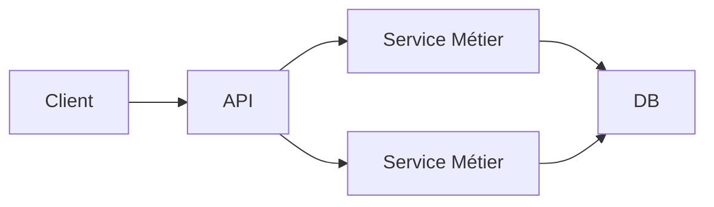

---

## Technologies populaires

### Java

* Spring Boot
* Quarkus
* Jakarta EE
* WildFly

### .NET

* ASP.NET Core

### Node.js

* Express
* NestJS
* Fastify

### Python

* Django
* Flask
* FastAPI

### Go

* Gin
* Echo
* Fiber

---

## Cas d'usage

### API REST

```http
GET /users/123
```

L'application :

1. récupère l'utilisateur
2. vérifie les droits
3. renvoie le JSON

---

### E-commerce

```text
Créer commande
Calculer TVA
Vérifier stock
Déclencher paiement
```

---

# 3. Serveur de Base de Données

## Rôle

Stocker les données persistantes.

---

## Diagramme

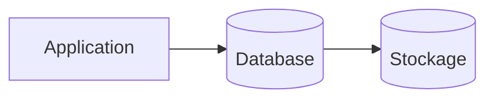

---

# Bases relationnelles

## Technologies

| Technologie     | Utilisation         |
| --------------- | ------------------- |
| PostgreSQL      | Référence actuelle  |
| MySQL           | Très répandu        |
| MariaDB         | Alternative MySQL   |
| SQL Server      | Microsoft           |
| Oracle Database | Grandes entreprises |

---

## Cas d'usage

* ERP
* CRM
* E-commerce
* Applications métier

---

# Bases NoSQL

## Technologies

| Technologie | Type       |
| ----------- | ---------- |
| MongoDB     | Document   |
| Cassandra   | Colonnes   |
| DynamoDB    | Cloud      |
| Couchbase   | Document   |
| Redis       | Clé/Valeur |

---

## Cas d'usage

* Big Data
* Catalogue produits
* Logs
* Réseaux sociaux

---

# 4. Serveur Cache

## Pourquoi ?

Accélérer les performances.

---

## Sans cache

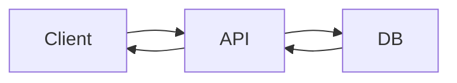

---

## Avec cache

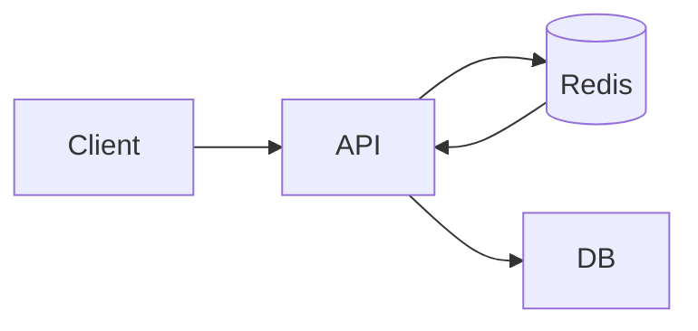

---

## Technologies

| Technologie | Popularité |
| ----------- | ---------- |
| Redis       | Leader     |
| Memcached   | Historique |
| Hazelcast   | Java       |
| Ignite      | Distribué  |

---

## Cas d'usage

### Session utilisateur

```text
Session → Redis
```

---

### Catalogue produit

```text
Produit 123
↓
Redis
↓
Réponse instantanée
```

---

# 5. Serveur de Messages (Message Broker)

## Rôle

Permettre la communication asynchrone.

---

## Diagramme

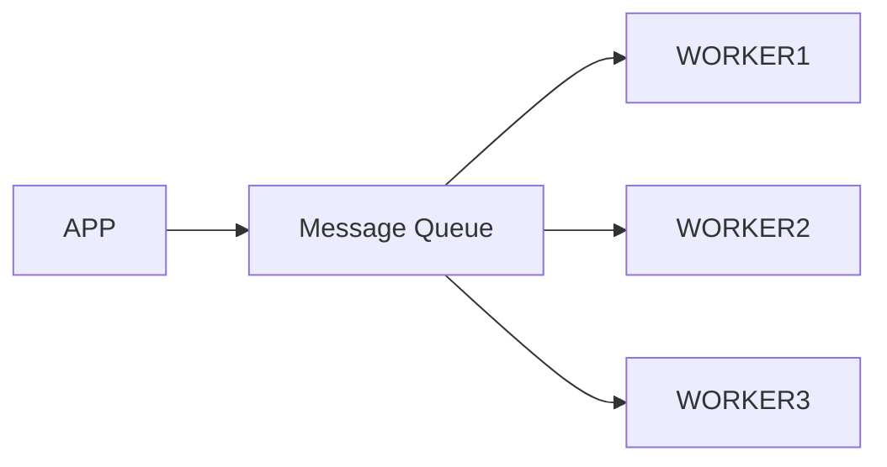

---

## Technologies

| Technologie  | Utilisation      |
| ------------ | ---------------- |
| RabbitMQ     | Très répandu     |
| Apache Kafka | Streaming massif |
| ActiveMQ     | Java             |
| NATS         | Cloud Native     |
| Amazon SQS   | AWS              |

---

## Cas d'usage

### Envoi d'emails

```text
Utilisateur crée compte
↓
Message envoyé
↓
Worker envoie email
```

---

### Traitement vidéo

```text
Upload vidéo
↓
Kafka
↓
Serveurs de conversion
```

---

# 6. Serveur Worker

## Rôle

Exécuter des tâches longues.

---

## Diagramme

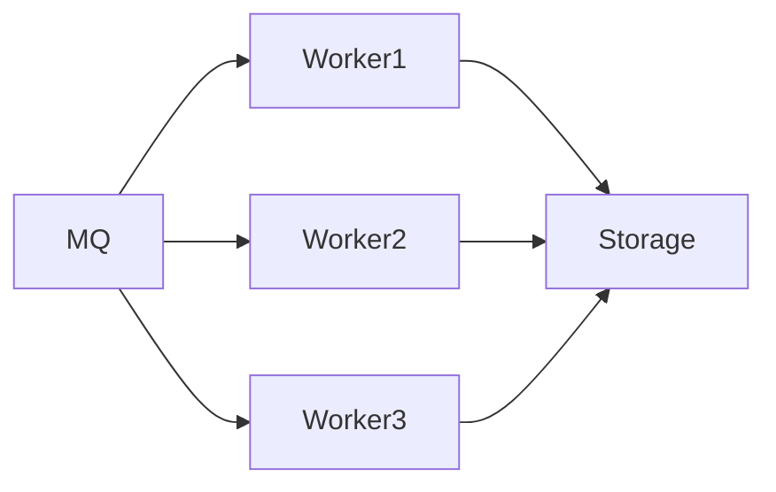

---

## Cas d'usage

* génération PDF
* export Excel
* calcul IA
* encodage vidéo
* traitement image

---

## Technologies

### Python

* Celery
* Dramatiq
* RQ

### Node.js

* BullMQ

### Java

* Spring Batch

---

# 7. Serveur de Fichiers / Stockage

## Rôle

Stocker :

* images
* vidéos
* documents
* sauvegardes

---

## Diagramme

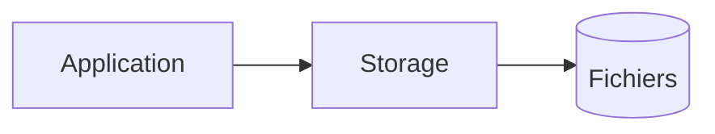

---

## Technologies

| Technologie | Type           |
| ----------- | -------------- |
| MinIO       | Object Storage |
| Ceph        | Distribué      |
| NAS         | Réseau         |
| NFS         | Partage        |
| GlusterFS   | Distribué      |

---

## Cloud

* Amazon S3
* Azure Blob Storage
* Google Cloud Storage

---

## Cas d'usage

### Réseau social

```text
Photos utilisateurs
↓
Object Storage
```

---

### GED

```text
PDF
Contrats
Factures
```

---

# 8. Serveur d'Authentification

## Rôle

Centraliser l'identité.

---

## Diagramme

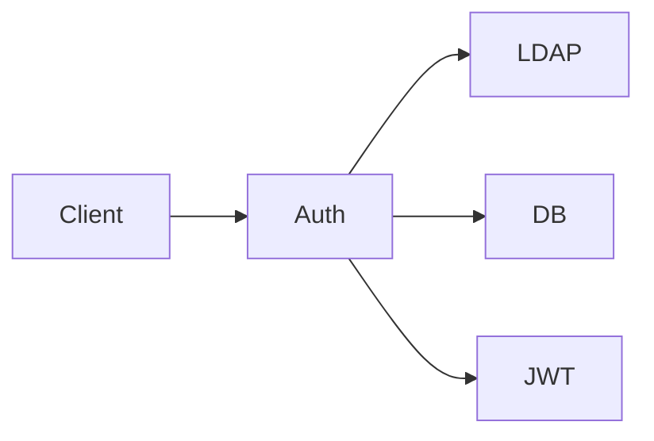

---

## Technologies

| Technologie | Utilisation         |
| ----------- | ------------------- |
| Keycloak    | Leader Open Source  |
| Auth0       | SaaS                |
| Okta        | Entreprise          |
| Azure AD    | Microsoft           |
| ForgeRock   | Grandes entreprises |

---

## Cas d'usage

### SSO

```text
Une seule connexion
↓
Accès à 20 applications
```

---

### OAuth2

```text
Login Google
Login Microsoft
```

---

# 9. Serveur DNS

## Rôle

Traduire :

```text
api.monapp.com
↓
192.168.1.10
```

---

## Diagramme

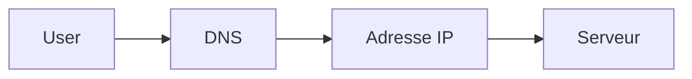

---

## Technologies

| Technologie    |
| -------------- |
| BIND           |
| PowerDNS       |
| CoreDNS        |
| Route53        |
| Cloudflare DNS |

---

## Cas d'usage

* Internet
* Kubernetes
* Cloud

---

# 10. Serveur Load Balancer

## Rôle

Répartir la charge.

---

## Diagramme

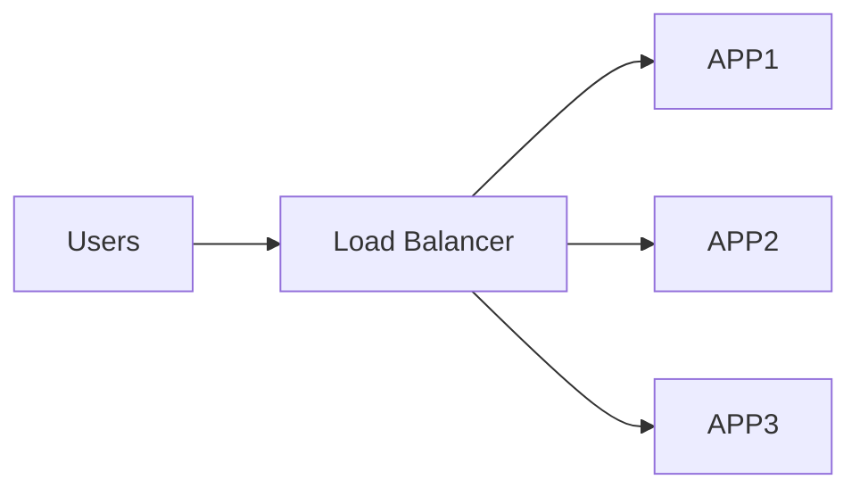

---

## Technologies

| Technologie |
| ----------- |
| HAProxy     |
| Nginx       |
| Traefik     |
| AWS ELB     |
| F5          |

---

## Cas d'usage

### Forte affluence

```text
10000 utilisateurs
↓
Répartition
↓
10 serveurs
```

---

# 11. Serveur de Monitoring

## Rôle

Surveiller :

* CPU
* RAM
* erreurs
* disponibilité
* métriques métiers

---

## Diagramme

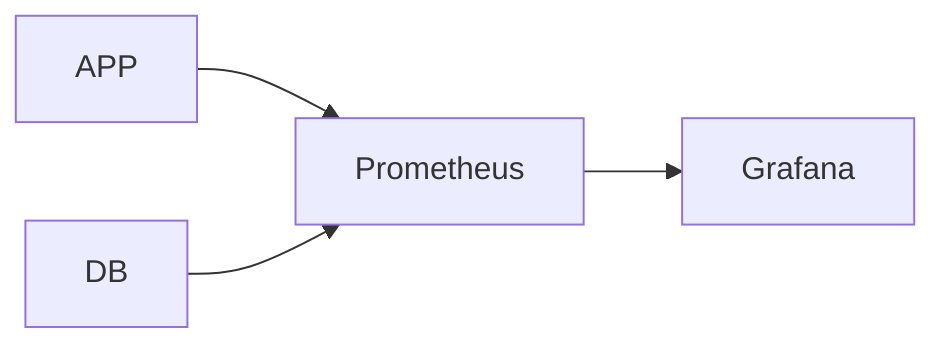

---

## Technologies

| Technologie |
| ----------- |
| Prometheus  |
| Grafana     |
| Zabbix      |
| Datadog     |
| New Relic   |

---

## Cas d'usage

### Détection panne

```text
CPU > 90%
↓
Alerte Slack
```

---

# 12. Serveur de Logs

## Rôle

Centraliser les journaux.

---

## Diagramme

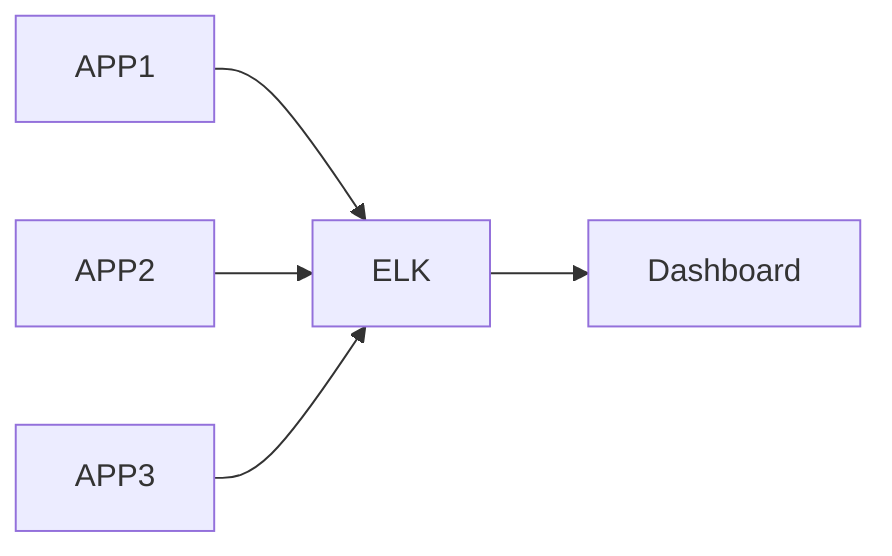

---

## Technologies

| Technologie |
| ----------- |
| ELK Stack   |
| OpenSearch  |
| Loki        |
| Splunk      |
| Graylog     |

---

## Cas d'usage

### Analyse d'erreur

```text
Erreur production
↓
Recherche centralisée
↓
Diagnostic
```

---

# 13. Serveur CI/CD

## Rôle

Automatiser :

* build
* tests
* déploiement

---

## Diagramme

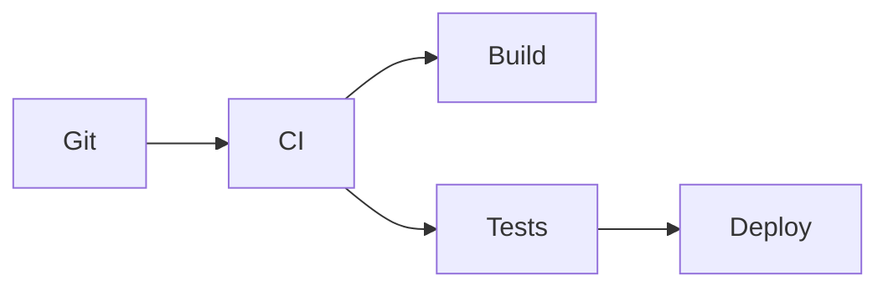

---

## Technologies

| Technologie    |
| -------------- |
| Jenkins        |
| GitLab CI      |
| GitHub Actions |
| Azure DevOps   |
| ArgoCD         |

---

## Cas d'usage

```text
Push Git
↓
Tests automatiques
↓
Déploiement production
```

---

# 14. Serveur de Conteneurs

## Rôle

Exécuter les applications dans des conteneurs.

---

## Diagramme

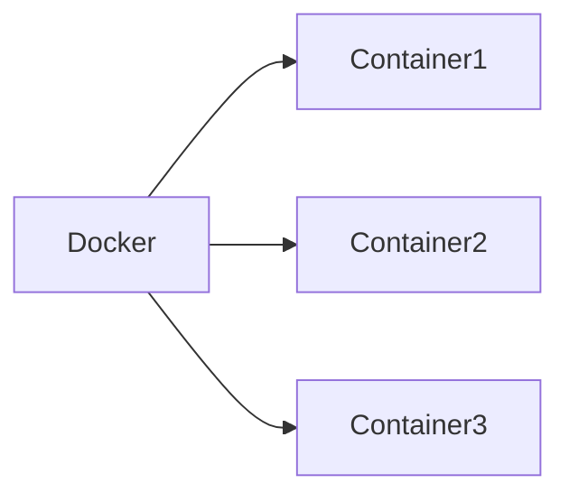

---

## Technologies

| Technologie |
| ----------- |
| Docker      |
| containerd  |
| CRI-O       |
| Podman      |

---

## Cas d'usage

### Microservices

```text
1 conteneur = 1 service
```

---

# 15. Serveur d'Orchestration

## Rôle

Gérer automatiquement :

* déploiements
* scaling
* résilience
* réseau

---

## Diagramme

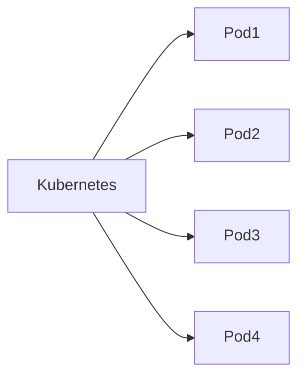

---

## Technologies

| Technologie |
| ----------- |
| Kubernetes  |
| OpenShift   |
| Rancher     |
| Nomad       |

---

## Cas d'usage

### Plateforme SaaS

```text
100 microservices
↓
Kubernetes
↓
Gestion automatique
```

---

# Architecture moderne complète

Une architecture cloud moderne ressemble souvent à ceci :

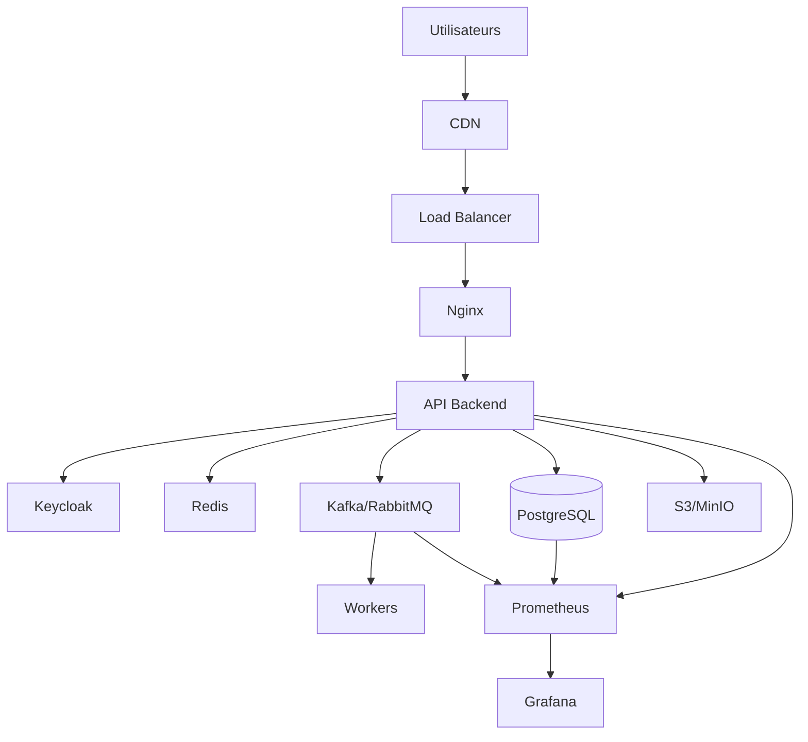

---

# Les stacks les plus répandues aujourd'hui

## Startup SaaS

```text
Nginx
Node.js (NestJS)
PostgreSQL
Redis
Docker
Kubernetes
Prometheus
Grafana
```

---

## Écosystème Java Enterprise

```text
Nginx
Spring Boot
PostgreSQL
Kafka
Redis
Keycloak
Kubernetes
```

---

## Écosystème Microsoft

```text
IIS
ASP.NET Core
SQL Server
Azure AD
Azure DevOps
AKS
```

---

# Résumé

| Type de serveur  | Produit phare                  |
| ---------------- | ------------------------------ |
| Web              | Nginx                          |
| Applicatif       | Spring Boot / ASP.NET / NestJS |
| Base de données  | PostgreSQL                     |
| Cache            | Redis                          |
| Messages         | Kafka / RabbitMQ               |
| Authentification | Keycloak                       |
| Monitoring       | Prometheus                     |
| Visualisation    | Grafana                        |
| Logs             | ELK                            |
| Conteneurs       | Docker                         |
| Orchestration    | Kubernetes                     |
| CI/CD            | GitHub Actions / GitLab CI     |
| Stockage         | S3 / MinIO                     |
| Load Balancing   | HAProxy / Nginx                |

Si l'objectif est de devenir développeur backend ou architecte logiciel, la séquence d'apprentissage la plus rentable est généralement :

1. Serveur Web (Nginx)
2. Serveur Applicatif (Spring Boot, NestJS ou ASP.NET)
3. PostgreSQL
4. Redis
5. Docker
6. RabbitMQ ou Kafka
7. Kubernetes
8. Prometheus + Grafana
9. Keycloak
10. Architecture microservices avancée.
