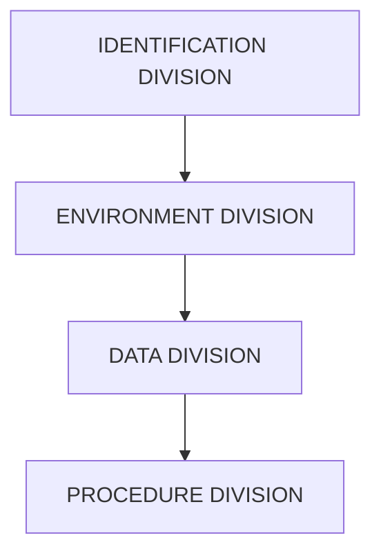
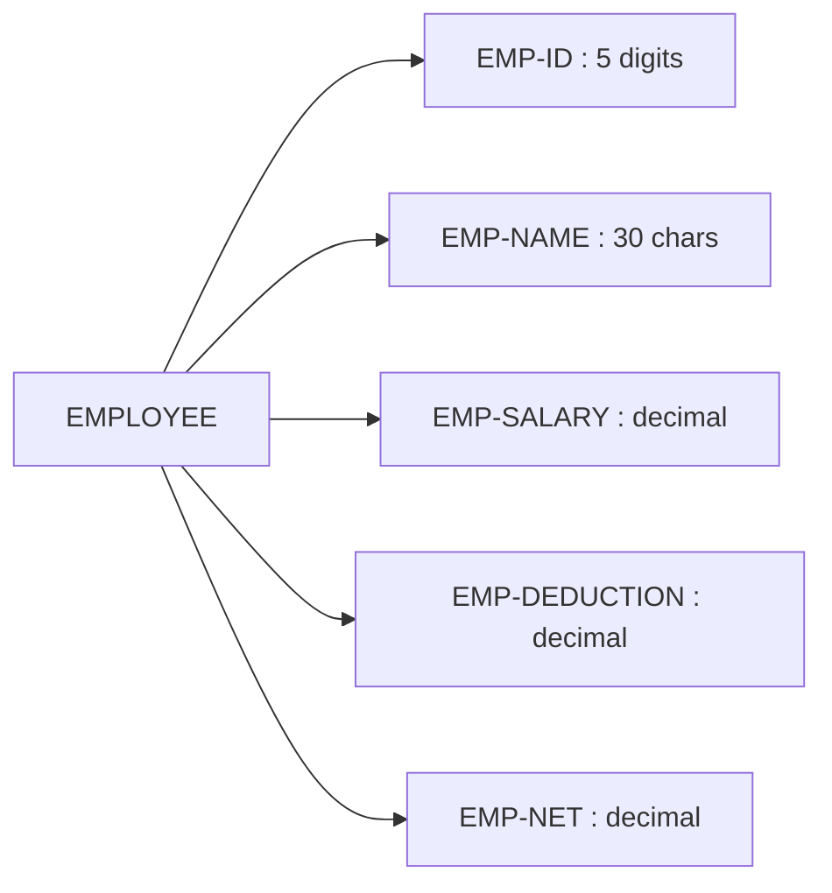
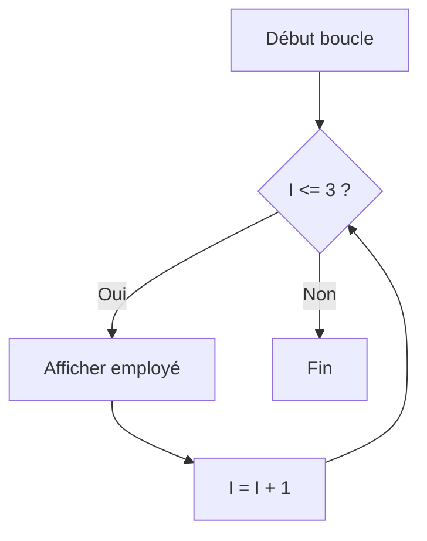
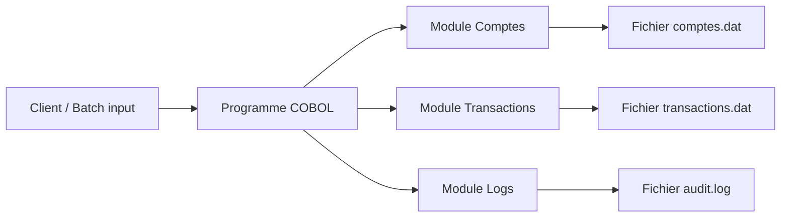
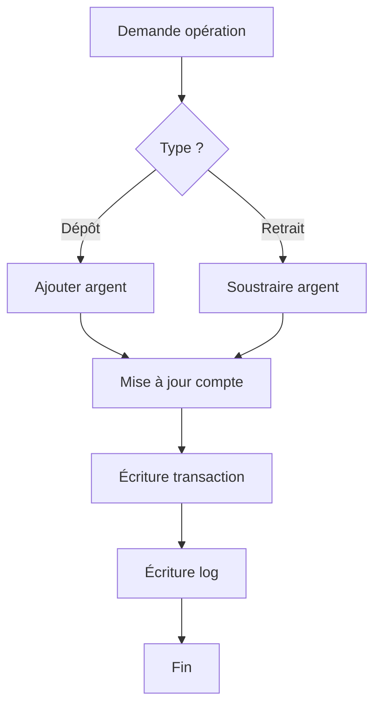
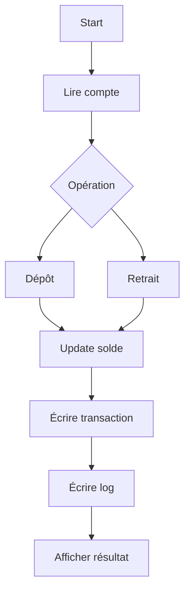

Voici un **cours magistral structuré sur COBOL**, avec un **fil rouge de projet**, des **exemples concrets**, et des **diagrammes Mermaid** pour clarifier les concepts.

---

# 🧠 Cours magistral : COBOL (Common Business-Oriented Language)

## 1. 📜 Qu’est-ce que COBOL ?

COBOL est un langage de programmation créé en **1959** pour les besoins de gestion d’entreprise :

* banques 💳
* assurances 🏦
* administrations 🏛️
* systèmes mainframe

👉 Il est encore massivement utilisé aujourd’hui dans les systèmes critiques.

### Pourquoi COBOL existe encore ?

* Fiabilité extrême
* Traitement massif de données
* Systèmes legacy très coûteux à remplacer
* Code stable depuis des décennies

---

# 🧭 2. Le projet fil rouge : un système de paie

On va construire progressivement un mini-système de paie :

### 🎯 Objectif

Un programme COBOL qui :

* lit des employés
* calcule leur salaire brut
* applique des retenues
* génère un salaire net

---

## 🧱 3. Structure d’un programme COBOL

Un programme COBOL est divisé en 4 divisions :

```cobol
IDENTIFICATION DIVISION.
PROGRAM-ID. PAYROLL.

ENVIRONMENT DIVISION.

DATA DIVISION.

PROCEDURE DIVISION.
```

### 🧠 Schéma global



---

# 🧾 4. DATA DIVISION (le cœur du programme)

C’est ici qu’on déclare les variables.

## Exemple : un employé

```cobol
DATA DIVISION.
WORKING-STORAGE SECTION.

01 EMPLOYEE.
   05 EMP-ID        PIC 9(5).
   05 EMP-NAME      PIC X(30).
   05 EMP-SALARY    PIC 9(6)V99.
   05 EMP-DEDUCTION PIC 9(6)V99.
   05 EMP-NET       PIC 9(6)V99.
```

### 🧠 Explication :

* `PIC 9` → chiffres
* `PIC X` → texte
* `V` → virgule implicite (décimales)

---

## 🧩 Visualisation mémoire



---

# ⚙️ 5. PROCEDURE DIVISION (logique métier)

C’est ici que le programme “agit”.

---

## 💰 Exemple : calcul de salaire net

```cobol
PROCEDURE DIVISION.

MAIN-PROCEDURE.

    MOVE 1001 TO EMP-ID
    MOVE "DUPONT JEAN" TO EMP-NAME
    MOVE 3000.00 TO EMP-SALARY
    MOVE 500.00 TO EMP-DEDUCTION

    COMPUTE EMP-NET = EMP-SALARY - EMP-DEDUCTION

    DISPLAY "EMPLOYE : " EMP-NAME
    DISPLAY "SALAIRE NET : " EMP-NET

    STOP RUN.
```

---

## 🧠 Explication ligne par ligne

* `MOVE` → affectation
* `COMPUTE` → calcul mathématique
* `DISPLAY` → affichage console
* `STOP RUN` → fin du programme

---

# 🔁 6. Logique métier plus réaliste (avec conditions)

Ajoutons une règle :
👉 Si salaire > 2500€, taxe supplémentaire de 10%

```cobol
IF EMP-SALARY > 2500
    COMPUTE EMP-DEDUCTION = EMP-DEDUCTION + (EMP-SALARY * 0.10)
END-IF
```

---

## 🧠 Diagramme de décision

```mermaid
flowchart TD
A[Début] --> B{Salaire > 2500 ?}
B -- Oui --> C+10% taxe
B -- Non --> D[Pas de taxe supplémentaire]
C --> E[Calcul salaire net]
D --> E
E --> F[Affichage]
```

---

# 📂 7. Version structurée complète du programme

Voici une version propre et réaliste :

```cobol
IDENTIFICATION DIVISION.
PROGRAM-ID. PAYROLL.

DATA DIVISION.
WORKING-STORAGE SECTION.

01 EMPLOYEE.
   05 EMP-ID        PIC 9(5).
   05 EMP-NAME      PIC X(30).
   05 EMP-SALARY    PIC 9(6)V99.
   05 EMP-DEDUCTION PIC 9(6)V99 VALUE 0.
   05 EMP-NET       PIC 9(6)V99.

PROCEDURE DIVISION.

MAIN.

    MOVE 1001 TO EMP-ID
    MOVE "DUPONT JEAN" TO EMP-NAME
    MOVE 3000.00 TO EMP-SALARY
    MOVE 500.00 TO EMP-DEDUCTION

    IF EMP-SALARY > 2500
        COMPUTE EMP-DEDUCTION = EMP-DEDUCTION + (EMP-SALARY * 0.10)
    END-IF

    COMPUTE EMP-NET = EMP-SALARY - EMP-DEDUCTION

    DISPLAY "EMPLOYE : " EMP-NAME
    DISPLAY "NET A PAYER : " EMP-NET

    STOP RUN.
```

---

# 📊 8. Passage à plusieurs employés (niveau intermédiaire)

On introduit une table :

```cobol
01 EMPLOYE-TABLE.
   05 EMP OCCURS 3 TIMES.
      10 ID     PIC 9(5).
      10 NOM    PIC X(20).
      10 SALAIRE PIC 9(6)V99.
```

---

## 🔁 Boucle COBOL

```cobol
PERFORM VARYING I FROM 1 BY 1 UNTIL I > 3
    DISPLAY NOM(I)
END-PERFORM
```

---

## 🧠 Diagramme boucle



---

# 🏦 9. Version projet réaliste : système de paie

On ajoute une architecture métier :

## Modules possibles :

* lecture fichier employés
* calcul salaire
* génération fiche de paie
* export fichier

---

## 🧱 Architecture globale


---

# 🧨 10. Points importants COBOL (très important)

## ✔ Avantages

* ultra stable
* très lisible métier
* parfait pour batch processing

## ❌ Inconvénients

* verbeux
* peu moderne
* faible orientation objet (hors extensions)

---

# 🧠 11. Philosophie COBOL

COBOL est un langage où :

> On décrit *ce que l’on veut faire*, pas comment le faire bas niveau.

Exemple :

```cobol
COMPUTE TOTAL = A + B
```

vs C :

```c
total = a + b;
```

---

# 🚀 12. Conclusion

Avec COBOL, tu manipules :

* des structures métiers (salaires, comptes)
* des traitements batch
* des systèmes critiques encore utilisés aujourd’hui

---

Parfait, on va construire un **projet bancaire COBOL complet et réaliste**, avec une architecture proche de ce qu’on trouve dans les systèmes mainframe.

On va faire ça proprement comme un vrai système legacy :

---

# 🏦 Projet fil rouge : Système bancaire COBOL

## 🎯 Objectif global

Créer un système capable de :

* gérer des comptes bancaires
* effectuer des dépôts / retraits
* enregistrer des transactions
* générer des logs d’audit
* calculer des soldes

---

# 🧱 1. Architecture du système

On commence par la vue globale :



👉 COBOL fonctionne souvent en **batch processing** sur fichiers.

---

# 📁 2. Modèle de données

## 💳 Structure d’un compte bancaire

```cobol
01 COMPTE.
   05 NUM-COMPTE     PIC 9(10).
   05 NOM-CLIENT     PIC X(30).
   05 SOLDE          PIC S9(8)V99.
   05 STATUT         PIC X(10).
```

### 🧠 Explication

* `S9` → nombre signé (positif / négatif)
* `V99` → décimales implicites
* `STATUT` → actif / bloqué

---

## 💸 Structure d’une transaction

```cobol
01 TRANSACTION.
   05 ID-TRANS       PIC 9(10).
   05 NUM-COMPTE     PIC 9(10).
   05 TYPE-TRANS     PIC X(10).
   05 MONTANT        PIC S9(8)V99.
   05 DATE-TRANS     PIC X(10).
```

---

## 📜 Log d’audit

```cobol
01 LOG-ENTRY.
   05 HORODATAGE     PIC X(20).
   05 ACTION         PIC X(30).
   05 DETAILS        PIC X(50).
```

---

# 🧠 3. Flux métier



---

# ⚙️ 4. Programme COBOL principal

Voici une version simplifiée mais réaliste.

---

## 🧾 Structure générale

```cobol
IDENTIFICATION DIVISION.
PROGRAM-ID. BANK-SYSTEM.

DATA DIVISION.
WORKING-STORAGE SECTION.
```

---

## 💳 Déclaration compte

```cobol
01 COMPTE.
   05 NUM-COMPTE     PIC 9(10).
   05 NOM-CLIENT     PIC X(30).
   05 SOLDE          PIC S9(8)V99 VALUE 0.
```

---

## 💸 Variables transaction

```cobol
01 TYPE-OPERATION    PIC X(10).
01 MONTANT           PIC S9(8)V99.
```

---

# 🧮 5. Initialisation (simulation d’un compte)

```cobol
PROCEDURE DIVISION.

MAIN.

    MOVE 1234567890 TO NUM-COMPTE
    MOVE "DUPONT JEAN" TO NOM-CLIENT
    MOVE 1000.00 TO SOLDE
```

---

# 💰 6. Dépôt d’argent

```cobol
    MOVE "DEPOT" TO TYPE-OPERATION
    MOVE 500.00 TO MONTANT

    COMPUTE SOLDE = SOLDE + MONTANT
```

---

# 💸 7. Retrait avec validation

```cobol
    MOVE "RETRAIT" TO TYPE-OPERATION
    MOVE 300.00 TO MONTANT

    IF SOLDE >= MONTANT
        COMPUTE SOLDE = SOLDE - MONTANT
    ELSE
        DISPLAY "FONDS INSUFFISANTS"
    END-IF
```

---

# 🧾 8. Génération transaction logique

```cobol
    DISPLAY "COMPTE : " NUM-COMPTE
    DISPLAY "CLIENT : " NOM-CLIENT
    DISPLAY "SOLDE FINAL : " SOLDE
```

---

# 📜 9. Module de log (audit simplifié)

Dans un vrai COBOL, on écrirait dans un fichier :

```cobol
OPEN OUTPUT LOG-FILE

MOVE "DEPOT 500 OK" TO LOG-LINE
WRITE LOG-LINE

CLOSE LOG-FILE
```

---

# 🧠 10. Logique complète du système



---

# 📂 11. Version simplifiée complète

```cobol
IDENTIFICATION DIVISION.
PROGRAM-ID. BANK-SYSTEM.

DATA DIVISION.
WORKING-STORAGE SECTION.

01 COMPTE.
   05 NUM-COMPTE     PIC 9(10).
   05 NOM-CLIENT     PIC X(30).
   05 SOLDE          PIC S9(8)V99 VALUE 0.

01 MONTANT           PIC S9(8)V99.

PROCEDURE DIVISION.

MAIN.

    MOVE 1234567890 TO NUM-COMPTE
    MOVE "DUPONT JEAN" TO NOM-CLIENT
    MOVE 1000.00 TO SOLDE

    DISPLAY "SOLDE INITIAL : " SOLDE

    * DEPOT
    MOVE 250.00 TO MONTANT
    COMPUTE SOLDE = SOLDE + MONTANT

    * RETRAIT
    MOVE 1200.00 TO MONTANT

    IF SOLDE >= MONTANT
        COMPUTE SOLDE = SOLDE - MONTANT
    ELSE
        DISPLAY "RETRAIT REFUSE"
    END-IF

    DISPLAY "SOLDE FINAL : " SOLDE

    STOP RUN.
```

---

# 🧩 12. Améliorations possibles (niveau pro)

## 🔥 Ce qu’on ajouterait en vrai :

* fichiers VSAM (indexés)
* gestion multi-comptes
* batch JCL (mainframe IBM)
* journalisation horodatée
* rollback transactionnel
* verrouillage concurrentiel

---

# 🧠 13. Ce que tu viens de simuler

Tu as maintenant un mini système COBOL équivalent à :

* backend bancaire simplifié
* moteur transactionnel
* système audit basique


