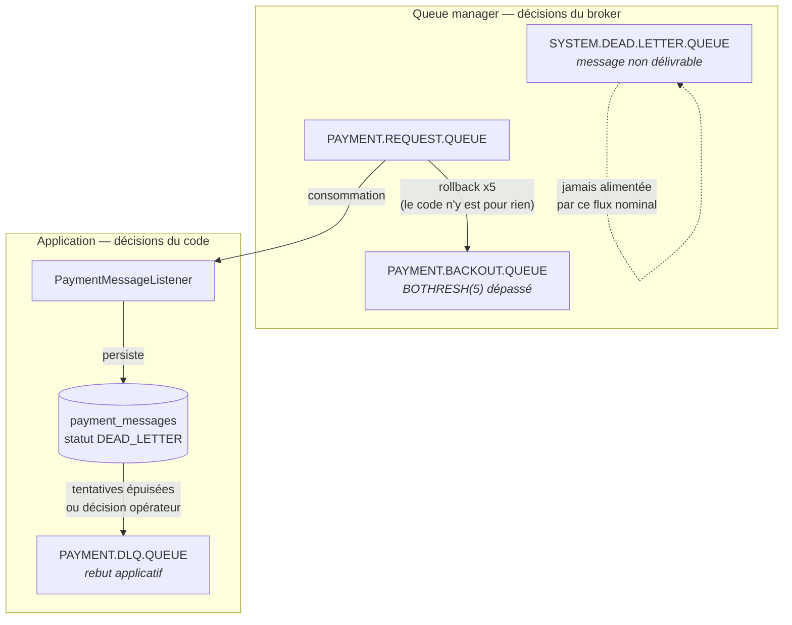
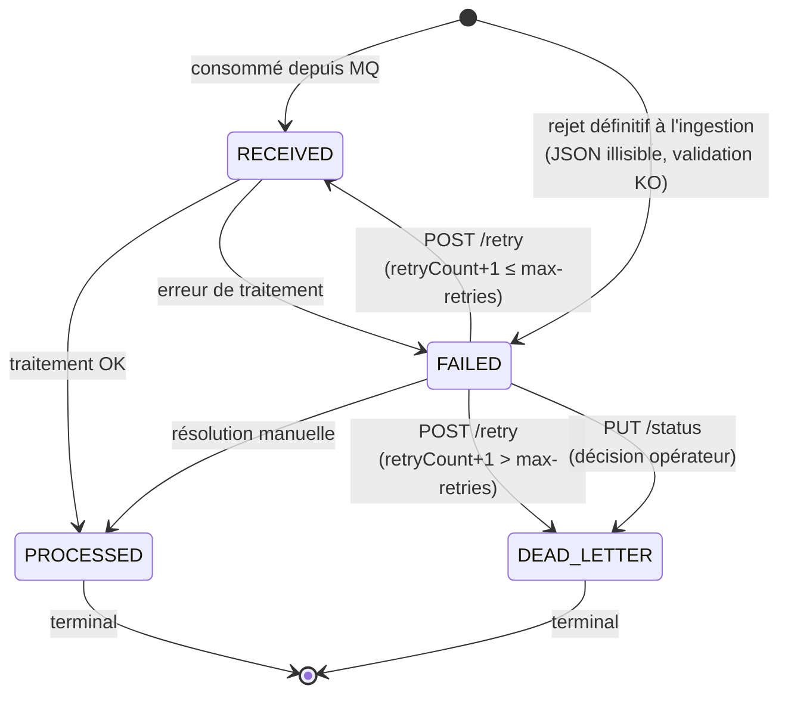
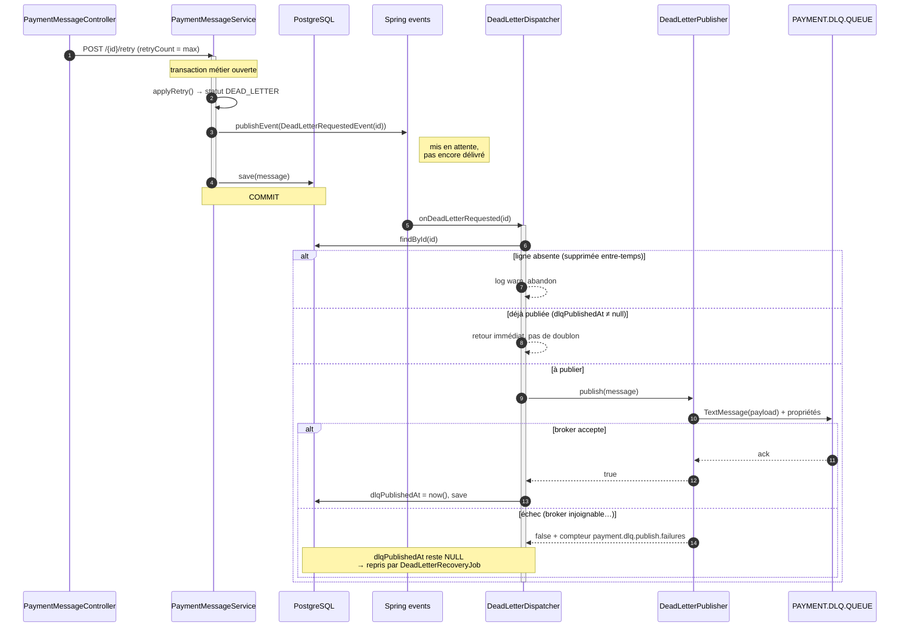
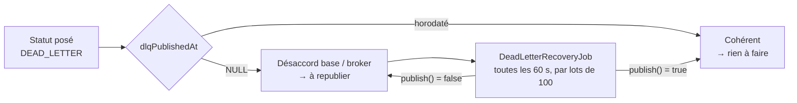
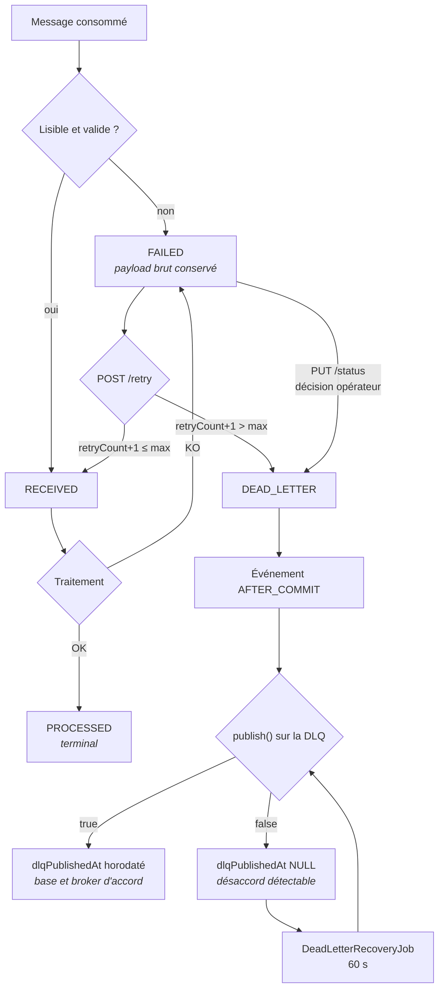

# Dead Letter Queue — rôle, implémentation, cycle de vie

Tout ce qui concerne le rebut des messages dans `payment-messages` : à quoi sert la DLQ, comment
un message y arrive, comment c'est codé, et ce que le système ne fait **pas**.

---

## 1. En une phrase

La **DLQ applicative** est la sortie de secours du flux : un message qu'on a renoncé à traiter y
est republié avec son payload brut, pour qu'il existe encore ailleurs que dans une ligne de base
marquée « abandonné ». Le statut `DEAD_LETTER` et la publication sur la file sont **deux choses
distinctes**, et tout le soin du code porte sur le fait qu'elles finissent par se rejoindre.

---

## 2. Trois « rebuts » différents — ne pas les confondre

C'est la première source de confusion sur le sujet. Il y a trois mécanismes, à trois niveaux,
avec trois responsables.

| | Backout Queue | **DLQ applicative** | DLQ système MQ |
|---|---|---|---|
| Nom | `PAYMENT.BACKOUT.QUEUE` | `PAYMENT.DLQ.QUEUE` | `SYSTEM.DEAD.LETTER.QUEUE` |
| Décidé par | le **queue manager** | l'**application** | le **queue manager** |
| Déclencheur | `BOTHRESH(5)` redélivrances du même message | tentatives de rejeu épuisées, ou décision d'un opérateur | message non délivrable (file pleine, inexistante, droits) |
| Configuré dans | `infra/mq/payment-queues.mqsc` | `ibm.mq.dlq-queue` | attribut `DEADQ` du QM |
| Le code le connaît | non | oui, c'est lui qui publie | non |
| Cas typique | la base est tombée, le message a été redélivré en boucle | un message métier invalide qu'on a rejoué 3 fois sans succès | erreur d'infrastructure ou de configuration |



**Le point à retenir** : la Backout Queue protège d'une *boucle* (un message toxique qui
saturerait les consommateurs), la DLQ applicative trace un *abandon* (on sait quoi faire du
message, on a essayé, on renonce). Un message dans la Backout Queue n'a **aucune** ligne en base
avec le statut `DEAD_LETTER` — il n'a même jamais été traité avec succès une seule fois.

---

## 3. À quoi sert réellement la DLQ applicative

Quatre raisons, dans l'ordre d'importance.

1. **Ne pas perdre le message.** La règle du projet est « zéro message perdu ». Un message
   abandonné reste en base, mais une ligne de base n'est pas un message : elle n'est pas
   consommable par une autre application, elle n'a pas de destination. La DLQ redonne au payload
   sa forme transportable.
2. **Rendre l'abandon exploitable par un tiers.** Un outil de reprise, un batch de nuit, une
   équipe de production peuvent consommer la DLQ sans toucher à la base de l'application. C'est
   la porte de sortie du système, pas un journal interne.
3. **Sortir le message du circuit nominal.** Tant qu'il est en `FAILED`, un message est candidat
   au rejeu de masse — il repart à chaque campagne, échoue à chaque fois, et pollue les
   compteurs. En `DEAD_LETTER`, il est terminal : il ne repartira plus tout seul.
4. **Garder la trace de la raison.** Le message republié porte des propriétés JMS
   (`originalMessageId`, `reference`, `retryCount`, `errorMessage`) : celui qui le récupère sait
   d'où il vient et pourquoi il est là, sans avoir à interroger la base.

---

## 4. Comment un message arrive au statut `DEAD_LETTER`

### 4.1 Le graphe des statuts

Le graphe est déclaré une seule fois, dans l'enum `PaymentMessageStatus` — c'est la référence
qui sert aussi à rejeter les changements de statut incohérents (`PUT /{id}/status` → 422).



**Deux chemins seulement mènent à `DEAD_LETTER`, et aucun n'est automatique.**

### 4.2 Chemin A — les tentatives de rejeu sont épuisées

C'est le chemin normal. Il passe par `applyRetry`, appelé aussi bien par le rejeu unitaire
(`POST /{id}/retry`) que par le rejeu de masse (`POST /batch/retry-failed`) :

```java
private void applyRetry(PaymentMessage message) {
    int attempt = message.getRetryCount() == null ? 1 : message.getRetryCount() + 1;
    message.setRetryCount(attempt);
    message.setUpdatedAt(OffsetDateTime.now());

    if (attempt > maxRetries) {
        message.setStatus(PaymentMessageStatus.DEAD_LETTER);
        message.setErrorMessage("Abandonné après " + maxRetries + " tentatives");
        requestDeadLetterPublication(message);
        return;
    }

    message.setStatus(PaymentMessageStatus.RECEIVED);
    message.setErrorMessage(null);
}
```

Avec `MQ_MAX_RETRIES=3` (valeur du `docker-compose.yaml`), la séquence vécue par un message qui
échoue systématiquement est :

| Action | `retryCount` avant | `retryCount` après | Statut résultant |
|---|:---:|:---:|---|
| échec initial | — | 0 | `FAILED` |
| 1ᵉʳ `POST /retry` | 0 | 1 | `RECEIVED` |
| échec → `FAILED`, 2ᵉ `POST /retry` | 1 | 2 | `RECEIVED` |
| échec → `FAILED`, 3ᵉ `POST /retry` | 2 | 3 | `RECEIVED` |
| échec → `FAILED`, 4ᵉ `POST /retry` | 3 | **4 > 3** | **`DEAD_LETTER`** |

Donc : **trois rejeux accordés, le quatrième acte l'abandon.** Le `retryCount` est incrémenté
*avant* le test, ce qui fait que le compteur reflète le nombre de tentatives *demandées*, pas le
nombre de tentatives réussies.

> Nuance importante : `POST /retry` n'est autorisé **que** depuis `FAILED`
> (`IllegalArgumentException` sinon). Le rejeu ne renvoie pas le message sur la file MQ — il le
> repositionne en `RECEIVED` pour qu'un traitement ultérieur le reprenne.

### 4.3 Chemin B — décision d'un opérateur

Un `PUT /{id}/status` avec `{"status": "DEAD_LETTER", "reason": "…"}` depuis un message `FAILED`.
Le motif est enregistré dans `errorMessage`, puisque la cible est un état d'échec. C'est le
chemin qu'on emprunte quand on sait dès la première analyse que le message ne passera jamais —
inutile de consommer trois rejeux pour le prouver.

Toute autre transition vers `DEAD_LETTER` est refusée : depuis `RECEIVED` ou `PROCESSED`, le
serveur répond **422** avec `from`, `to` et la liste des transitions autorisées.

### 4.4 Ce qui **ne** met **pas** un message en `DEAD_LETTER`

Point souvent mal compris, et c'est délibéré :

- **L'ingestion ne pose jamais `DEAD_LETTER`.** Le listener n'écrit que `RECEIVED` (message
  valide) ou `FAILED` (rejet définitif : JSON illisible, validation en échec). Un message
  illisible reçu pour la première fois n'est pas un abandon — c'est un échec, et il a droit à ses
  rejeux comme les autres.
- **Un dépassement de `BOTHRESH` ne pose pas `DEAD_LETTER`.** Le message part en
  `PAYMENT.BACKOUT.QUEUE` par décision du broker, sans que l'application le sache. Il n'a
  probablement même pas de ligne en base.
- **Une panne de la base ne pose pas `DEAD_LETTER`.** L'exception remonte, la session transactée
  fait un rollback, le broker redélivre. C'est une erreur transitoire, pas un abandon.

---

## 5. Implémentation

### 5.1 Les pièces

| Classe | Rôle |
|---|---|
| `service/PaymentMessageService` | pose le statut `DEAD_LETTER` et **émet un événement** (`requestDeadLetterPublication`) |
| `mq/DeadLetterRequestedEvent` | événement applicatif, ne porte que l'`id` de la ligne |
| `mq/DeadLetterDispatcher` | `@TransactionalEventListener(AFTER_COMMIT)` — publie **après** le commit et horodate |
| `mq/DeadLetterPublisher` | envoie sur la file via `JmsTemplate`, renvoie `true`/`false` |
| `mq/DeadLetterRecoveryJob` | tâche planifiée qui rattrape les publications manquées |
| `entity/PaymentMessage.dlqPublishedAt` | **le marqueur** : horodatage posé seulement sur accusé du broker |
| `repository.findByStatusAndDlqPublishedAtIsNull` | requête de reprise, servie par l'index `(status, dlq_published_at)` |

### 5.2 Le chemin nominal



### 5.3 Pourquoi publier **après** le commit, et pas pendant

C'est la décision structurante du mécanisme. Le problème de fond : **il n'y a pas de transaction
distribuée** entre PostgreSQL et IBM MQ (pas de XA). Une base et un broker ne peuvent pas
committer ensemble. Il faut donc choisir *quel* désaccord on accepte, et le rendre rattrapable.

| Stratégie | Panne possible | Résultat |
|---|---|---|
| Publier **dans** la transaction | rollback après l'envoi (contrainte violée, verrou optimiste, base coupée) | message **dans la DLQ sans ligne `DEAD_LETTER`** en base → invisible, indétectable |
| Publier **après** le commit *(retenu)* | échec de publication après le commit | ligne `DEAD_LETTER` **sans `dlqPublishedAt`** → détectable par requête, rattrapable |

Le second désaccord est le bon : il laisse une **trace en base**, donc quelque chose qu'on peut
interroger et corriger. Le premier est silencieux.

D'où l'enchaînement : `@TransactionalEventListener(phase = AFTER_COMMIT)` +
`@Transactional(REQUIRES_NEW)` sur le dispatcher — nouvelle transaction, puisque celle d'origine
est déjà terminée. Et `fallbackExecution = true`, pour que l'événement soit traité immédiatement
lorsqu'il n'y a pas de transaction du tout (tests unitaires, appel direct) au lieu d'être
silencieusement jeté.

### 5.4 `dlqPublishedAt` : le marqueur qui ferme la boucle

C'est le cœur du dispositif, et c'est ce qui en fait un **outbox** plutôt qu'un simple envoi.

- `status = DEAD_LETTER` répond à « a-t-on **décidé** d'abandonner ce message ? »
- `dlqPublishedAt` répond à « le broker a-t-il **accepté** le message ? »

Seul un `publish()` renvoyant `true` pose l'horodatage. Une ligne
`status = DEAD_LETTER AND dlq_published_at IS NULL` est donc, par construction, un désaccord
base/broker — et c'est exactement le prédicat du job de reprise, servi par l'index dédié
`idx_pm_status_dlq_published_at` (`V1__baseline_schema.sql`).



### 5.5 La reprise planifiée

```java
@Scheduled(fixedDelayString = "${ibm.mq.dlq-recovery.interval:60000}",
           initialDelayString = "${ibm.mq.dlq-recovery.initial-delay:60000}")
public void republishPending() { … service.republishPendingDeadLetters(batchSize); }
```

- Activée par défaut, coupée par `ibm.mq.dlq-recovery.enabled=false` (`@ConditionalOnProperty`) —
  c'est ce qui la rend silencieuse dans le profil de test.
- `fixedDelay` et non `fixedRate` : le délai court **après** la fin de l'exécution, deux passes ne
  peuvent pas se chevaucher si le broker est lent.
- Lots bornés (`batch-size`, 100 par défaut) : un incident qui aurait laissé 50 000 lignes en
  attente ne provoque pas un envoi massif d'un seul tenant.
- Toute exception est attrapée et journalisée : le job est périodique, l'échec est réessayé à la
  passe suivante. Une exception qui remonterait ne tuerait pas le planificateur, mais on perdrait
  la trace.

### 5.6 Ce qui est réellement publié

```java
jmsTemplate.send(deadLetterQueue, session -> {
    TextMessage jmsMessage = session.createTextMessage(message.getPayload());
    jmsMessage.setStringProperty("originalMessageId", message.getMessageId());
    jmsMessage.setStringProperty("reference", message.getReference());
    jmsMessage.setIntProperty("retryCount", requireNonNullElse(message.getRetryCount(), 0));
    if (message.getErrorMessage() != null) {
        jmsMessage.setStringProperty("errorMessage", message.getErrorMessage());
    }
    return jmsMessage;
});
```

Le **corps** est le payload brut tel qu'il est arrivé sur la file d'entrée — y compris s'il est
illisible, ce qui est précisément le cas où on en a besoin. Les métadonnées sont des **propriétés
JMS** et non des champs injectés dans le corps : le message reste identique à l'original, un
consommateur qui ignore les propriétés le retraite tel quel.

---

## 6. Configuration

| Variable | Défaut | Effet |
|---|---|---|
| `MQ_DLQ_QUEUE` | *(obligatoire)* | nom de la file de rebut applicative |
| `MQ_MAX_RETRIES` | *(obligatoire)* | nombre de rejeux accordés avant abandon |
| `MQ_DLQ_RECOVERY_ENABLED` | `true` | active la tâche de reprise |
| `MQ_DLQ_RECOVERY_INTERVAL` | `60000` ms | délai entre deux passes |
| `MQ_DLQ_RECOVERY_BATCH_SIZE` | `100` | lignes republiées par passe |

Côté broker, `infra/mq/payment-queues.mqsc` définit les trois files et le garde-fou :

```mqsc
DEFINE QLOCAL('PAYMENT.REQUEST.QUEUE') REPLACE +
       DEFPSIST(YES) + BOTHRESH(5) + BOQNAME('PAYMENT.BACKOUT.QUEUE')
DEFINE QLOCAL('PAYMENT.BACKOUT.QUEUE') REPLACE + DEFPSIST(YES)
DEFINE QLOCAL('PAYMENT.DLQ.QUEUE')     REPLACE + DEFPSIST(YES)
```

> **Piège d'exploitation** : ce script n'est joué qu'à la **création** du queue manager. Modifier
> `BOTHRESH` et redémarrer le conteneur ne change rien — il faut rejouer le script
> (`runmqsc QM1 < /etc/mqm/payment-queues.mqsc`) ou recréer le volume.

Les noms sont de la configuration, pas du code : l'instance de développement locale utilise par
exemple `DEV.QUEUE.1` / `DEV.QUEUE.2`. `GET /api/v1/config` renvoie les noms effectivement
actifs.

---

## 7. Diagnostiquer

**Voir les messages abandonnés** — filtre `DEAD_LETTER` sur `/messages`, ou :

```bash
curl -s 'http://localhost:8080/api/v1/messages?status=DEAD_LETTER&size=50'
```

**Détecter un désaccord base / broker** — la requête que fait le job, en SQL :

```sql
SELECT id, message_id, reference, retry_count, error_message, updated_at
FROM payment_messages
WHERE status = 'DEAD_LETTER' AND dlq_published_at IS NULL
ORDER BY updated_at;
```

Un résultat non vide qui **persiste** d'une minute sur l'autre signifie que la reprise ne passe
pas : broker injoignable, file inexistante, droits manquants sur `PAYMENT.DLQ.QUEUE`.

**Métriques** (`/actuator/prometheus`) :

| Métrique | Lecture |
|---|---|
| `payment_messages_dead_letter` | jauge, nombre de lignes `DEAD_LETTER` (issue du cache de stats) |
| `payment_dlq_publish_failures_total` | compteur, échecs de publication — **doit rester plat** |
| `payment_mq_listener_rollbacks_total` | rollbacks de session : c'est le signal *amont*, avant la Backout Queue |

**Profondeur des files** :

```bash
docker exec payment-mq bash -c \
  "echo 'DISPLAY QLOCAL(PAYMENT.DLQ.QUEUE) CURDEPTH' | runmqsc QM1"
docker exec payment-mq bash -c \
  "echo 'DISPLAY QLOCAL(PAYMENT.BACKOUT.QUEUE) CURDEPTH' | runmqsc QM1"
```

Une Backout Queue qui se remplit alors que la DLQ applicative reste vide décrit une panne
d'infrastructure, pas un problème de contenu des messages.

---

## 8. Limites connues

À dire avant qu'on les trouve — chacune est un choix ou une dette identifiée, pas un accident.

1. **Personne ne consomme la DLQ.** Le projet publie sur `PAYMENT.DLQ.QUEUE` et s'arrête là :
   aucun listener, aucun écran, aucune purge. La file grossit indéfiniment. C'est cohérent avec le
   périmètre (la DLQ est une sortie vers un système tiers), mais dans une vraie exploitation il
   faut un consommateur ou une politique d'expiration.
2. **La Backout Queue non plus n'est consommée par personne.** Un message qui y atterrit sort du
   système sans laisser de trace en base. C'est le trou le plus réel du dispositif « zéro message
   perdu » : il faudrait un listener de supervision sur cette file.
3. **`dlqPublishedAt` n'est pas exposé par l'API.** `PaymentMessageDto` ne le porte pas : dans
   l'interface, une ligne `DEAD_LETTER` publiée et une ligne dont la publication a échoué sont
   **indiscernables**. L'information n'existe qu'en base et dans les logs. C'est le correctif le
   moins cher à apporter.
4. **La publication est « au moins une fois ».** Dans le dispatcher, l'envoi JMS précède le `save`
   de l'horodatage, dans la même transaction de base. Si le `save` échoue après un envoi réussi,
   le job de reprise republiera : un doublon dans la DLQ. C'est le bon compromis (mieux vaut un
   doublon qu'une perte), mais le consommateur de la DLQ doit être idempotent — `originalMessageId`
   est là pour ça.
5. **`DEAD_LETTER` échappe à la purge.** La rétention (`MessageRetentionJob`) ne supprime que les
   `PROCESSED`. Les lignes abandonnées s'accumulent indéfiniment — volontaire (on ne supprime pas
   une trace d'abandon), mais à surveiller sur la durée.
6. **`SYSTEM.DEAD.LETTER.QUEUE` n'est pas supervisée.** Elle ne devrait rien recevoir dans le flux
   nominal, ce qui est exactement la raison pour laquelle un message qui y arriverait passerait
   inaperçu.
7. **Aucun délai entre les rejeux.** Les trois tentatives peuvent être consommées en quelques
   secondes par le rejeu de masse, ce qui vide le quota sans laisser à la cause le temps de
   disparaître.

---

## 9. Pistes d'évolution

- **Exposer `dlqPublishedAt`** dans le DTO de détail et l'afficher : un badge « publiée » /
  « publication en attente » sur les messages `DEAD_LETTER` (limite n° 3).
- **Listener de supervision sur la Backout Queue** : consommer `PAYMENT.BACKOUT.QUEUE` et
  persister une ligne `DEAD_LETTER` avec un motif « redélivrances épuisées », ce qui referme le
  trou n° 2.
- **Backoff exponentiel entre les rejeux** plutôt qu'un compteur nu : un référentiel indisponible
  se répare en heures, pas en secondes (limite n° 7).
- **Écran de rejeu depuis la DLQ** : consommer un message de la DLQ, le corriger, le republier sur
  la file d'entrée. C'est le pendant naturel de l'écran de simulation, qui sait déjà publier un
  payload arbitraire.
- **Alerte** sur `payment_dlq_publish_failures_total > 0` et sur la profondeur de
  `PAYMENT.BACKOUT.QUEUE`, avec notification sortante.
- **Politique d'expiration** sur la DLQ (`CAPEXPRY` côté MQ) ou consommateur d'archivage, pour
  qu'elle cesse de croître sans fin (limite n° 1).

---

## 10. Résumé



**Trois phrases à retenir**

1. `DEAD_LETTER` n'arrive que par épuisement des rejeux ou par décision explicite — jamais à
   l'ingestion, jamais automatiquement.
2. La publication se fait **après commit**, parce qu'entre les deux désaccords possibles
   base/broker, seul celui-là laisse une trace exploitable.
3. `dlqPublishedAt` est ce qui transforme un envoi optimiste en mécanisme rattrapable : sans lui,
   il n'y aurait aucun moyen de savoir ce qui n'a pas été publié.
