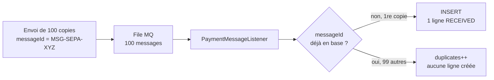
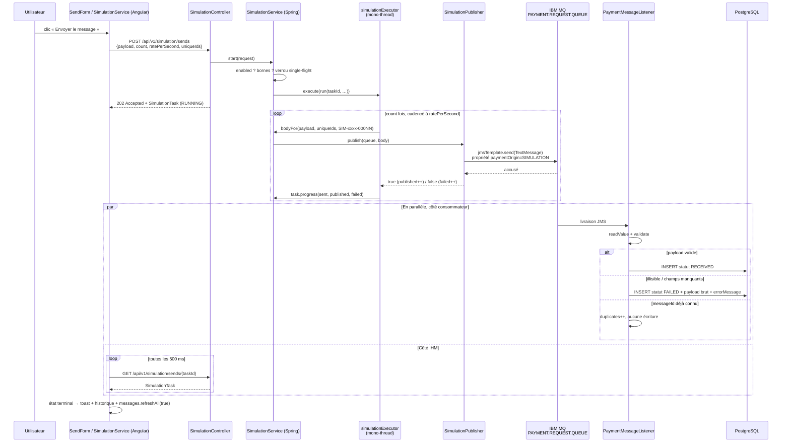
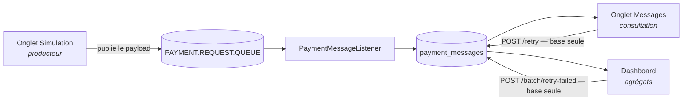

# L'onglet « Simulation d'envoi »

Route `/simulation` — `frontend/src/app/features/simulation/`, côté serveur
`/api/v1/simulation` (`SimulationController`, `SimulationService`, `SimulationPublisher`).

---

## 1. À quoi sert cet écran

Il joue le rôle des **applications de back-office** du flux réel : déposer des messages de
paiement sur la file d'entrée IBM MQ. C'est un **producteur**, pas un raccourci.

**Rien n'est court-circuité** : l'écran n'écrit **jamais** en base. Le payload est publié tel
quel sur `ibm.mq.queue` (`PAYMENT.REQUEST.QUEUE`), et le message **revient par
`PaymentMessageListener`** — même désérialisation Jackson, même validation
`jakarta.validation`, mêmes rejets, même idempotence. C'est ce qui rend l'écran utile : un
payload invalide envoyé ici produit réellement une ligne `FAILED`, comme en production.

Deux conséquences directes :

- l'écran se coupe par configuration (`app.simulation.enabled: false` → `503`), là où la file
  porte un vrai flux ;
- ce qui apparaît dans l'onglet **Messages** après un envoi est le résultat d'un vrai
  traitement, pas un affichage fabriqué par la simulation.

---

## 2. Anatomie de l'écran

```
┌──────────────────────────────────┬──────────────────────────┐
│ Formulaire (app-send-form)       │ Suivi de l'envoi         │
│  · Mode d'envoi                  │  (app-send-progress)     │
│  · File de destination (lecture) ├──────────────────────────┤
│  · Modèles de message            │ Envois de cette session  │
│  · Payload JSON + validité       │  (app-send-history)      │
│  · [bulk] nombre / débit / durée ├──────────────────────────┤
│  · Réécrire messageId            │ Ce que fait cet écran    │
│  · [Envoyer] [Réinitialiser]     │                          │
└──────────────────────────────────┴──────────────────────────┘
```

À l'ouverture, `SimulationPage.ngOnInit()` appelle `svc.loadConfig()` →
`GET /api/v1/simulation/config` qui rend :

```json
{ "enabled": true, "queue": "PAYMENT.REQUEST.QUEUE", "maxCount": 1000, "maxRate": 200 }
```

C'est de là que viennent le nom de la file affiché et les plafonds du formulaire — **rien
n'est codé en dur côté client** (les constantes `FALLBACK_MAX_COUNT = 1000` /
`FALLBACK_MAX_RATE = 200` ne servent que tant que la réponse n'est pas arrivée). Si
l'endpoint est indisponible, le nom de la file se replie sur `messages.mqConfig()?.queue`
(`GET /api/v1/config`, déjà chargé par le bandeau latéral).

### La file de destination n'est pas modifiable

C'est un champ **en lecture seule**, avec un cadenas — pas un `<select>`. L'API ne prend
aucun paramètre de destination : la file est `ibm.mq.queue`, côté serveur, point. Laisser le
client choisir aurait ouvert l'écriture sur n'importe quelle destination du gestionnaire de
files, pour un besoin inexistant — et un dépôt ailleurs ne produirait rien d'observable
puisque l'application ne consomme que cette file.

---

## 3. Les deux modes d'envoi

| | **1 message** (`single`) | **Envoi en masse** (`bulk`) |
|---|---|---|
| Corps envoyé | `count: 1`, `ratePerSecond: 1` | `count` et `ratePerSecond` saisis |
| Champs affichés | — | nombre, débit, durée estimée, plafonds |
| Bornes | — | `count ∈ [1, maxCount]`, `rate ∈ [1, maxRate]`, écrêtés à la saisie (`clamp`) puis **revérifiés par le serveur** |
| Libellé du bouton | « Envoyer le message » | « Lancer l'envoi » |

La cadence est envoyée même en mode unitaire (le serveur exige `ratePerSecond >= 1`), elle
n'a simplement aucun effet sur une seule publication.

« Durée estimée » = `count / rate`, purement indicative, calculée côté client.

L'écrêtage côté client est un confort : **l'IHM n'est pas une frontière de confiance**, le
serveur refuse de son côté tout dépassement (`400` avec le détail : « count dépasse le
plafond autorisé (1000) »).

---

## 4. Les modèles de message

`frontend/src/app/features/simulation/config/templates.ts`. Cinq modèles, dont **deux
invalides à dessein** (badge orange, avertissement affiché sous le formulaire).

| Modèle | `messageType` | Description | Valide ? |
|---|---|---|---|
| **Virement SEPA** *(par défaut)* | `SEPA_CREDIT_TRANSFER` | compte à compte, 15 750,00 EUR | ✅ |
| **Virement international** | `SWIFT_MT103` | devise étrangère, 248 900,00 USD | ✅ |
| **Prélèvement SEPA** | `SEPA_DIRECT_DEBIT` | petit montant, flux de masse, 89,90 EUR | ✅ |
| **Champs manquants** | `SEPA_CREDIT_TRANSFER` | JSON lisible mais incomplet (`reference`, `payment`, `status` absents) → **rejet à la validation** | ❌ voulu |
| **JSON illisible** | — | texte non désérialisable → **rejet à la lecture** | ❌ voulu |

Les deux modèles invalides couvrent les **deux chemins de rejet définitif** du consommateur.
Ils doivent rester envoyables : c'est pourquoi le bouton « Envoyer » n'est jamais bloqué par
un JSON invalide (seul le bouton « Formater » l'est, et le formatage ne touche pas un payload
illisible — le reformater effacerait le cas testé). L'indicateur `✓ JSON valide` /
`✗ JSON invalide` est purement informatif.

### Piège de contrat à connaître

Les modèles sont écrits contre le **contrat MQ** (`dto/mq/PaymentMessageEvent`), pas contre
le contrat REST :

- `payment.executionDate` est une `LocalDate` → `2026-07-26` ;
- `createdAt` est une `LocalDateTime` → `2026-07-26T14:32:05`, **sans décalage horaire**,
  contrairement à tous les horodatages de l'API qui sont des `OffsetDateTime`.

Champs obligatoires du contrat d'entrée : `messageId`, `messageType`, `reference`,
`payment`, `status`.

---

## 5. Le bouton « Réécrire `messageId` avant publication »

### Le problème qu'il résout

L'ingestion est **idempotente sur `messageId`** : contrainte d'unicité en base,
`PaymentMessageService.insertIfAbsent()` renvoie `false` sur un doublon, et le listener
compte alors un `payment.mq.messages.duplicates` puis acquitte le message **sans créer de
ligne**. C'est ce qui protège des redélivrances JMS (rollback de session, reprise après
incident) : le même message livré deux fois ne produit jamais deux lignes.

Or un envoi en masse publie **N copies du même payload**, donc N fois le même `messageId`.
Sans réécriture, l'ingestion ne peut pas distinguer ces copies d'une redélivrance :



Résultat sans réécriture : **1 seule ligne en base pour 100 messages publiés**. Le suivi
affichera bien « 100 publiés » (le broker les a tous acceptés) et l'onglet Messages n'en
montrera qu'un — ce n'est pas un bug, c'est l'idempotence qui fait son travail.

### Ce que fait la case (cochée par défaut)

Elle envoie `uniqueIds: true`. Côté serveur, `SimulationService.bodyFor()` réécrit le champ
avant chaque publication :

```java
JsonNode node = jsonMapper.readTree(payload);
if (!node.isObject()) return payload;          // payload illisible → part INCHANGÉ
((ObjectNode) node).put("messageId", "SIM-" + runId + "-" + "%05d".formatted(index));
return node.toString();
```

- `runId` = les 8 premiers caractères du `taskId` ; l'index est sur 5 chiffres →
  `SIM-3f8a91c2-00042`.
- **Un payload qui n'est pas un objet JSON part inchangé** : c'est exactement le cas de test
  « JSON illisible », qu'il ne faut surtout pas réparer. Même chose si `readTree` échoue.
- Décocher la case est donc utile pour **tester volontairement la déduplication**.

À noter : la réécriture ne change que `messageId`. `reference`, `transactionId` et les autres
champs restent identiques d'une copie à l'autre — seule l'unicité de `messageId` est requise.

---

## 6. Où partent les données au clic sur « Envoyer le message »

### 6.1 Vue d'ensemble



### 6.2 Étape par étape

1. **`SendFormComponent.submit()`** émet
   `{ payload, count, ratePerSecond, uniqueIds }`. Aucune destination : elle n'existe pas
   dans le contrat.
2. **`SimulationService.send()`** (Angular) : garde `if (this.running()) return;`, puis
   `POST /api/v1/simulation/sends`. Un refus (`400`, `503`) est affiché tel quel — le
   serveur seul sait quelle borne a été franchie (`err.error.detail`, `ProblemDetail`).
3. **`SimulationController.send()`** : `@Valid` sur le corps (`payload` non vide et ≤ 64 Ko,
   `count >= 1`, `ratePerSecond >= 1` ; valeurs par défaut 1 / 20 / `true` si absentes),
   répond `202 Accepted`.
4. **`SimulationService.start()`** (Spring) :
   - `app.simulation.enabled: false` → `SimulationDisabledException` → **503** ;
   - `count > maxCount` ou `rate > maxRate` → **400** ;
   - **verrou single-flight** (`AtomicBoolean`) : si un envoi est déjà en vol, la tâche en
     cours est renvoyée, aucun second envoi ne démarre. Deux envois concurrents ne
     tiendraient plus aucune des deux cadences ;
   - crée la `SimulationTask` (`RUNNING`, `total = count`), la range dans une map bornée à
     20 entrées, et délègue à `simulationExecutor` (mono-thread) ;
   - si la file de l'exécuteur est saturée, le verrou est **relâché** et la tâche marquée
     `FAILED` — sans quoi plus aucun envoi ne serait accepté jusqu'au redémarrage.
5. **Boucle de publication cadencée** (`run`) : pour chaque copie, `bodyFor(...)` puis
   `SimulationPublisher.publish(queue, body)`. L'attente entre deux envois vise
   `startedAt + index * (1 s / rate)` — échéances **absolues**, pas cumulées : sur un envoi
   long, une publication lente ne décale pas toutes les suivantes. Un échec de publication
   n'arrête pas l'envoi : il est compté (`failed++`) et la copie suivante est tentée.
6. **`SimulationPublisher.publish()`** : `jmsTemplate.send(queue, TextMessage)` avec la
   propriété JMS `paymentOrigin = SIMULATION` — visible dans les outils MQ, **pas stockée en
   base**. Compteurs Micrometer `payment.simulation.messages.published` et
   `payment.simulation.publish.failures`.
7. **`PaymentMessageListener`** consomme la file comme n'importe quel autre message :
   `RECEIVED` si valide, `FAILED` + payload brut + `errorMessage` si illisible ou invalide,
   ignoré si `messageId` déjà connu.
8. **Fin de l'envoi** côté IHM : polling arrêté, toast, ajout à l'historique, et
   `messages.refreshAll(true)` — les compteurs et agrégats des autres écrans (dashboard,
   liste) sont périmés puisque des messages viennent d'être ingérés.

### 6.3 Ce qui n'arrive **jamais**

- aucune écriture directe en base par la simulation ;
- aucun contournement de la validation ;
- aucune publication sur une autre file que `ibm.mq.queue` ;
- aucun lien avec la DLQ (elle n'est alimentée que par le dépassement de `max-retries`, voir
  `docs/Util-Rejeu.md`).

---

## 7. La carte « Suivi de l'envoi »

Alimentée par `GET /api/v1/simulation/sends/{taskId}`, interrogé **toutes les 500 ms** tant
que `state === 'RUNNING'`. L'état est **lu au serveur, pas calculé côté client** : deux
onglets ouverts voient le même envoi, et un rafraîchissement de page n'en invente pas un
second.

| Élément | Source | Signification |
|---|---|---|
| **Badge d'état** | `running` + `task.state` | `En attente` (aucun envoi) · `Envoi en cours…` (+ spinner) · `Terminé ✓` · `Terminé avec erreurs` (`failed > 0`) · `Interrompu` (`state = FAILED`) |
| **Barre de progression** | `min(100, round(sent / total × 100))` | avancement de la **publication** |
| **Légende** | `sent / total traités · destination` | ex. `42 / 100 traités · PAYMENT.REQUEST.QUEUE` |
| **Traités** | `task.sent` | copies pour lesquelles la publication a été **tentée** |
| **Publiés** | `task.published` | copies **acceptées par le broker** |
| **Échecs** | `task.failed` | publications refusées (broker indisponible, file inconnue…) |
| **Message d'erreur** | `task.error` | présent seulement si l'envoi lui-même a échoué |

**Le point le plus important**, rappelé par la note en bas de carte : ces trois compteurs
mesurent la **publication**, pas le **traitement**. `Publiés = 100` signifie « le broker a
accepté 100 messages », pas « 100 lignes en base ». Le sort applicatif — persisté `RECEIVED`,
rejeté `FAILED`, ignoré comme doublon — se lit uniquement dans l'onglet **Messages**.

Trois écarts parfaitement normaux entre « Publiés » et ce que montre la liste :

| Situation | Publiés | Lignes en base |
|---|---|---|
| Modèle valide, `uniqueIds` coché | N | N en `RECEIVED` |
| Modèle valide, `uniqueIds` **décoché** | N | **1** (les N−1 autres sont des doublons) |
| Modèle invalide | N | N en `FAILED` (avec le payload brut et le motif) |

Toujours `sent = published + failed`. `sent < total` seulement si l'envoi a été interrompu
(arrêt de l'application).

---

## 8. La carte « Envois de cette session »

Historique **local à l'onglet du navigateur**, 12 lignes au maximum, **non persisté** — la
carte l'annonce (« non conservé »). Il est alimenté à la fin de chaque envoi
(`SimulationService.remember()`), pas pendant.

Chaque ligne porte :

- une **pastille** de résultat : vert `ok` (`failed = 0`), orange `partial`
  (`failed > 0` mais `published > 0`), rouge `ko` (`state = FAILED` ou `published = 0`) ;
- un **titre** : `1 message` ou `Envoi en masse · N messages` ;
- la **destination** et l'**heure de fin** (locale) ;
- le ratio **`published / total`**.

Côté serveur, la map des tâches est bornée à **20 entrées** : les envois terminés les plus
anciens sont oubliés. Un `taskId` trop vieux répond donc `404` — l'historique de l'onglet
n'est qu'une trace d'affichage, jamais une source de vérité.

---

## 9. Configuration et garde-fous

| Propriété | Défaut | Effet |
|---|---|---|
| `app.simulation.enabled` (`SIMULATION_ENABLED`) | `true` | `false` → `503` + bandeau « Simulation désactivée » |
| `app.simulation.max-count` (`SIMULATION_MAX_COUNT`) | `1000` | plafond du nombre de copies |
| `app.simulation.max-rate` (`SIMULATION_MAX_RATE`) | `200` | plafond de la cadence (msg/s) |
| `ibm.mq.queue` (`MQ_QUEUE`) | — | **unique** destination, jamais un paramètre d'API |
| `@Size(max = 65_536)` sur `payload` | — | 64 Ko par message |
| Verrou `AtomicBoolean` | — | un seul envoi en vol à la fois |
| `MAX_TRACKED_TASKS = 20` | — | historique serveur des tâches |

---

## 10. Rapport avec les autres écrans



La distinction à retenir : **la Simulation passe par MQ, le rejeu non**. Le bouton
« Rejouer » (onglet Messages) et le bouton « Rejouer les N messages en échec » (dashboard) ne
republient rien sur la file d'entrée — ils modifient l'état d'une ligne existante (voir
`docs/Util-Rejeu.md`). La Simulation est le seul écran qui produit réellement du trafic MQ.

---

## 11. Références de code

| Élément | Fichier |
|---|---|
| Page et disposition | `frontend/src/app/features/simulation/pages/simulation/simulation.page.ts` |
| Formulaire, modes, bornes, case `uniqueIds` | `frontend/…/components/send-form/send-form.component.ts` |
| Carte « Suivi de l'envoi » | `frontend/…/components/send-progress/send-progress.component.ts` |
| Carte « Envois de cette session » | `frontend/…/components/send-history/send-history.component.ts` |
| Appels HTTP, polling 500 ms, historique | `frontend/…/services/simulation.service.ts` |
| Modèles de payload | `frontend/…/config/templates.ts` |
| Endpoints | `backend/…/controller/SimulationController.java` |
| Bornes, cadence, verrou, réécriture `messageId` | `backend/…/service/SimulationService.java` |
| État d'un envoi | `backend/…/service/SimulationTask.java` |
| Contrat de la requête | `backend/…/dto/api/SimulationSendRequest.java` |
| Publication JMS | `backend/…/mq/SimulationPublisher.java` |
| Retour par la file | `backend/…/mq/PaymentMessageListener.java` |
| Idempotence sur `messageId` | `backend/…/service/PaymentMessageService.java` (`insertIfAbsent`) |
