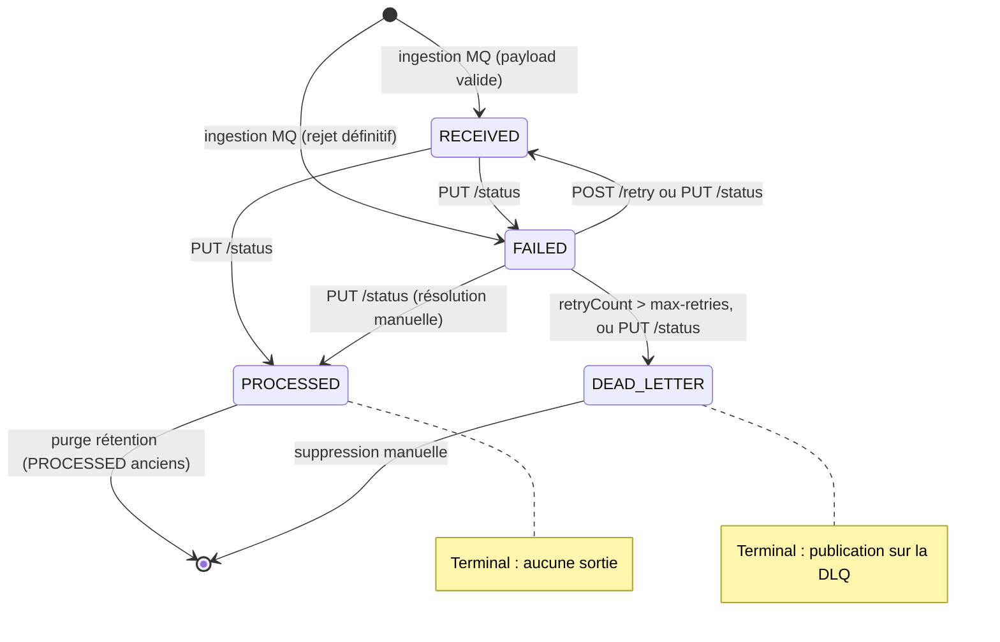
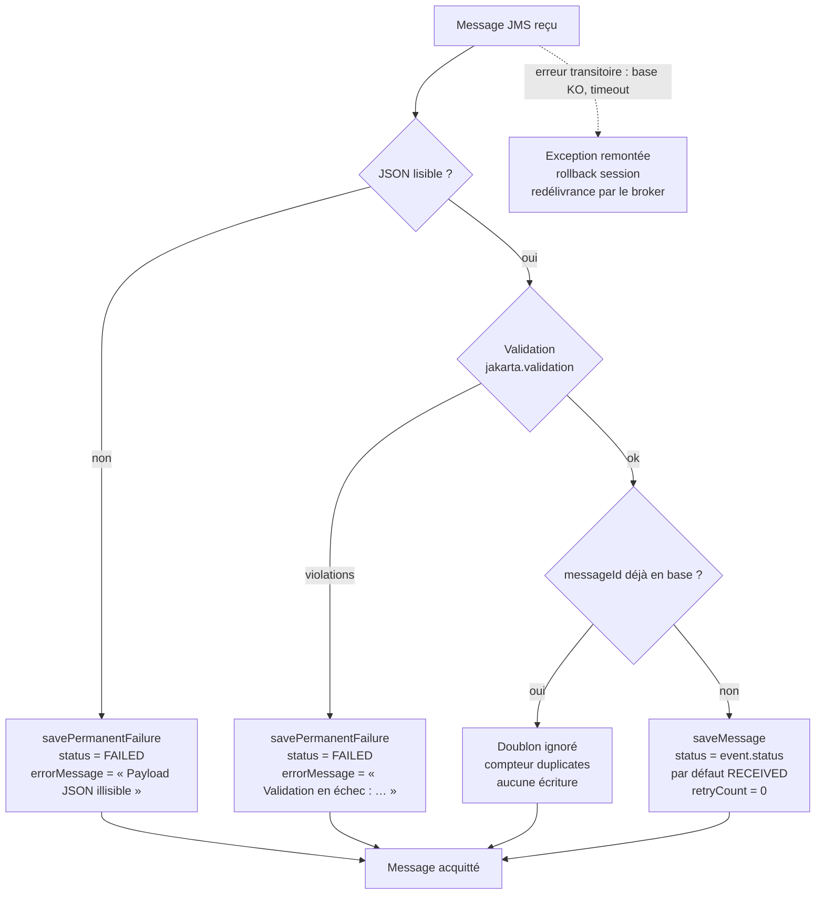
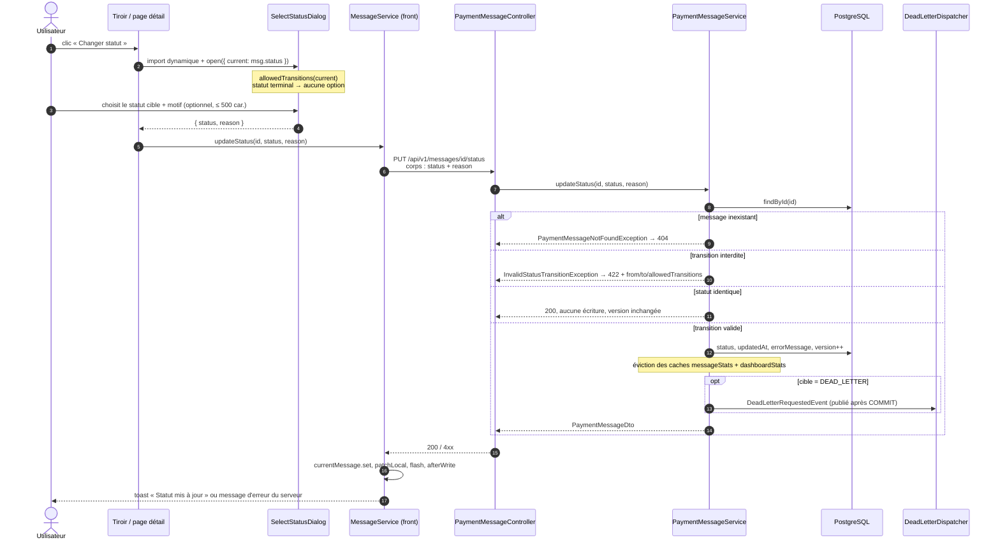
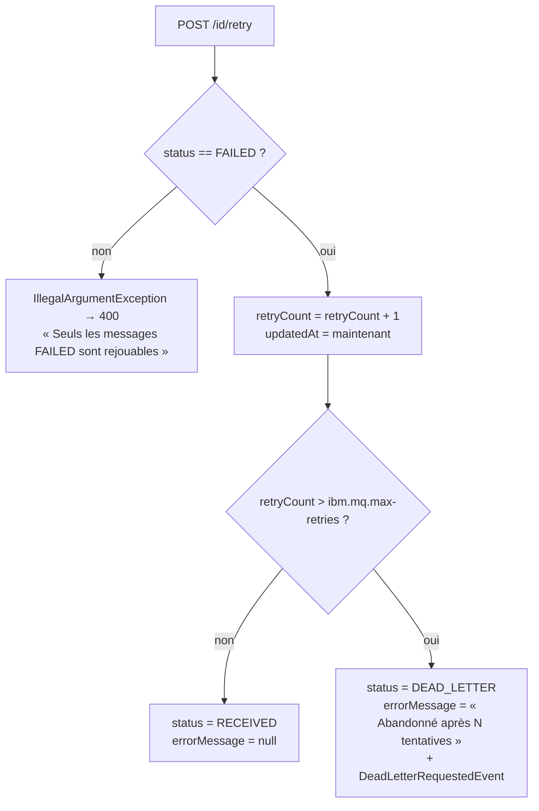
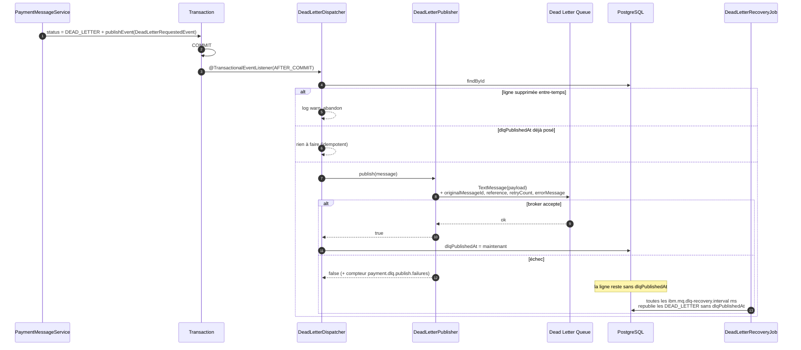

# Cycle de vie des statuts d'un message

Ce document décrit les quatre statuts visibles dans l'onglet **Messages**, la façon dont un message
passe de l'un à l'autre, ce que le backend exécute réellement à chaque transition, et ce que
déclenche exactement le bouton **« Changer statut »**.

Sources de vérité dans le code :

| Élément | Fichier |
|---|---|
| Graphe des transitions (backend) | `backend/.../entity/PaymentMessageStatus.java` |
| Logique métier (retry, updateStatus, DLQ) | `backend/.../service/PaymentMessageService.java` |
| Ingestion MQ | `backend/.../mq/PaymentMessageListener.java` |
| Publication DLQ après commit | `backend/.../mq/DeadLetterDispatcher.java`, `DeadLetterPublisher.java`, `DeadLetterRecoveryJob.java` |
| Endpoints | `backend/.../controller/PaymentMessageController.java` |
| Graphe des transitions (frontend, recopie) | `frontend/src/app/shared/config/status.config.ts` |
| Boîte de dialogue « Changer statut » | `frontend/.../pages/message-detail/select-status.dialog.ts` |

> Le graphe existe en deux exemplaires : l'enum backend fait autorité (réponse 422 en cas de
> violation), `status.config.ts` le recopie pour ne proposer que des cibles atteignables.
> **Toute modification doit être faite des deux côtés.**

---

## 1. Les quatre statuts

| Statut | Libellé IHM | Signification | Terminal ? |
|---|---|---|---|
| `RECEIVED` | Reçus | Message consommé depuis IBM MQ et persisté en base, **en attente de traitement métier**. | non |
| `PROCESSED` | Traités | Traitement terminé avec succès. | **oui** |
| `FAILED` | En échec | Erreur technique ou métier. Rejouable via `/retry`. Porte un `errorMessage`. | non |
| `DEAD_LETTER` | Dead letter | Abandonné après épuisement des tentatives ; le payload est republié sur la Dead Letter Queue. | **oui** |

« Terminal » signifie qu'aucune transition sortante n'est autorisée : un message traité ne
redevient pas en attente, et un abandon reste tracé. La reprise d'un `DEAD_LETTER` passe par la
Dead Letter Queue côté MQ, pas par un retour en base.

Colonnes concernées en base (`payment_messages`) : `status`, `retry_count`, `error_message`,
`updated_at`, `dlq_published_at`, `version`.

---

## 2. Graphe des transitions

Table équivalente (`PaymentMessageStatus.ALLOWED`) :

| Depuis | Cibles autorisées |
|---|---|
| `RECEIVED` | `PROCESSED`, `FAILED` |
| `FAILED` | `RECEIVED`, `PROCESSED`, `DEAD_LETTER` |
| `PROCESSED` | — (terminal) |
| `DEAD_LETTER` | — (terminal) |

Deux règles supplémentaires portées par `canTransitionTo` :

- **Transition neutre acceptée** : demander le statut déjà en place renvoie 200 sans écriture,
  sans incrément de `version`, sans log. Rejouer la même commande n'est pas une erreur.
- **Tout le reste est refusé en 422**, y compris `RECEIVED → DEAD_LETTER` : un message ne peut
  pas être abandonné sans qu'aucune tentative n'ait eu lieu.

**Aucune transition n'est automatique.** Le listener MQ ne pose que le statut d'entrée ; tout le
reste est piloté par les endpoints `/retry`, `/batch/retry-failed` et `/status`. Il n'existe pas
de « moteur de traitement » qui ferait passer un `RECEIVED` en `PROCESSED` tout seul.

---

## 3. Entrée dans le cycle : l'ingestion MQ

`PaymentMessageListener` consomme la file `ibm.mq.queue`, session **transactée**. Le statut initial
dépend uniquement de la validité du payload.

Points à retenir :

- **Erreur définitive** (JSON illisible, validation en échec) → ligne persistée en **`FAILED`**
  avec le payload brut et le motif, puis acquittement. Le message n'est pas perdu : il reste
  rejouable depuis l'IHM.
- **Erreur transitoire** (base indisponible…) → l'exception remonte, la session JMS effectue un
  rollback, le broker redélivre. `BOTHRESH`/`BOQNAME` sur la file bornent la redélivrance des
  messages empoisonnés.
- **Idempotence** : `saveMessage` s'appuie sur la contrainte d'unicité de `messageId`. Une
  redélivrance renvoie `false` et n'écrase rien — le statut courant en base est donc préservé,
  même si le message a déjà été rejoué manuellement entre-temps.
- **Le statut d'entrée vient du payload** : `PaymentMessageMapper.toEntity` reprend
  `event.getStatus()` et ne retombe sur `RECEIVED` que s'il est absent. Le champ est `@NotNull`
  dans le contrat MQ, donc un producteur qui envoie `"status": "PROCESSED"` crée directement une
  ligne `PROCESSED`. Les gabarits de l'onglet Simulation envoient tous `RECEIVED`.

---

## 4. Le bouton « Changer statut »

Présent à deux endroits, avec exactement le même comportement :

- le tiroir de détail de la liste (`message-drawer.component.ts`, `(changeStatus)`) ;
- la page de détail `/messages/:id` (`message-detail.page.ts`).

### 4.1 Enchaînement complet

### 4.2 Ce que fait la boîte de dialogue

- Elle n'affiche **que** les cibles autorisées depuis le statut courant (`allowedTransitions`).
  Sur un `PROCESSED` ou un `DEAD_LETTER`, la liste est vide et le texte affiché est
  *« … est un statut terminal : aucun changement n'est possible »*.
- Le champ **Motif** est optionnel, plafonné à 500 caractères (`@Size(max = 500)` côté serveur).
- Le bouton **Confirmer** reste désactivé tant qu'aucun statut n'est sélectionné ; **Annuler**
  ferme sans requête.

Le front n'est pas une frontière de confiance : il évite de faire découvrir la règle par l'erreur,
mais c'est le serveur qui tranche.

### 4.3 Ce que fait le backend (`PaymentMessageService.updateStatus`)

Dans l'ordre :

1. `findById` → 404 si absent.
2. `currentStatus.canTransitionTo(newStatus)` → 422 sinon, avec les propriétés `from`, `to`,
   `allowedTransitions` dans le `ProblemDetail` (RFC 9457).
3. Si `currentStatus == newStatus` : retour immédiat, **aucune écriture**, `version` non consommée.
4. Sinon : log `Changement de statut du message {id} : {from} -> {to} (motif : …)`.
5. Écriture de `status` et `updatedAt`.
6. Traitement du motif (`applyReason`) :
   - cible `FAILED` ou `DEAD_LETTER` → le motif est conservé dans `errorMessage` (s'il est non vide) ;
   - toute autre cible → `errorMessage` est **effacé**, pour ne pas laisser un diagnostic obsolète.
7. `repository.save` : le `@Version` de l'entité arbitre la concurrence → **409** si un autre appel
   a modifié la ligne entre-temps.
8. Éviction des caches `messageStats` et `dashboardStats` (`@CacheEvict`).
9. Si la cible est `DEAD_LETTER` : publication d'un `DeadLetterRequestedEvent`, traité **après
   commit** (cf. §6). `retryCount` n'est **pas** modifié par ce chemin.

### 4.4 Réponses possibles

| Code | Cause | Traitement côté IHM |
|---|---|---|
| 200 | Transition appliquée (ou neutre) | toast « Statut mis à jour », ligne rafraîchie |
| 400 | Corps invalide (`status` absent, motif > 500 caractères) | toast d'erreur générique |
| 404 | Message inexistant | toast d'erreur générique |
| 409 | Modification concurrente (verrou optimiste) | toast d'erreur générique ; recharger le message |
| 422 | Transition interdite | le `detail` du serveur est affiché tel quel |

### 4.5 Effets côté IHM après succès

`MessageService.updateStatus` enchaîne : `currentMessage.set(res)` (tiroir/détail à jour),
`patchLocal(res)` (ligne du tableau remplacée sans rechargement complet), `flash(res.id)`
(surbrillance ~1,3 s), puis `afterWrite()` → rechargement **silencieux** des compteurs `/stats`
(sous les filtres actifs) et, si le dashboard a déjà été ouvert, de `/stats/dashboard`. Les
pastilles de statut et la table restent donc cohérentes.

---

## 5. Les autres chemins de transition

### 5.1 Bouton « Rejouer » — `POST /{id}/retry`

À ne pas confondre avec « Changer statut » : le rejeu est la seule action qui touche à
`retryCount`, et c'est elle qui peut basculer un message en `DEAD_LETTER` **automatiquement**.

Le bouton **Rejouer** du tiroir est désactivé si le statut n'est pas `FAILED`
(`canRetry = status === FAILED`), ce qui reflète le contrôle serveur.

### 5.2 Rejeu massif — `POST /batch/retry-failed`

Même logique `applyRetry`, appliquée par lots bornés (`app.batch-retry.batch-size`) sur un
exécuteur mono-thread dédié. Réponse **202 + `taskId`**, avancement suivi via
`GET /batch/retry-failed/{taskId}` (le front interroge toutes les 500 ms). Un seul rejeu massif à
la fois. Chaque message du lot suit exactement l'arbre du §5.1 : la plupart repassent `RECEIVED`,
ceux qui dépassent le seuil partent en `DEAD_LETTER`.

### 5.3 Sorties du cycle

- `DELETE /{id}` : suppression définitive, quel que soit le statut (204).
- `MessageRetentionJob` (planifié, `app.retention.*`, **désactivé par défaut**) : purge par lots
  les messages `PROCESSED` antérieurs à `retention.processed-days`. Aucun autre statut n'est purgé.

---

## 6. Ce que `DEAD_LETTER` déclenche côté MQ

Passer en `DEAD_LETTER` ne publie **pas** en ligne. Le service émet un événement ; la publication
a lieu **après le commit** de la transaction métier.

Conséquences pratiques :

- Publier avant le commit exposait à un message en DLQ sans ligne `DEAD_LETTER` en base (rollback
  après envoi). Ce cas est éliminé.
- Le cas inverse — commit sans publication — est rattrapé par `DeadLetterRecoveryJob`, puisque
  `dlqPublishedAt` n'est posé **qu'après accusé du broker**.
- `dlqPublishedAt` est donc l'indicateur de cohérence base ↔ broker : un `DEAD_LETTER` sans cet
  horodatage est en attente de republication, pas perdu.

---

## 7. Lecture des statuts dans l'onglet Messages

- **Pastilles de compteurs** : `GET /stats` renvoie les comptages par statut **sous les filtres
  non-statut actifs** (`receivedAfter`, `type`, `q`). Un clic sur une pastille écrit `?status=`
  dans l'URL — c'est le seul filtre partageable par lien.
- **Table** : les quatre filtres sont appliqués côté serveur ; aucun filtrage client ne subsiste,
  ce qui garantit que les lignes affichées et les compteurs des pastilles ne peuvent pas diverger.
- **Couleurs** : définies dans `STATUS_META` (`status.config.ts`) et alignées sur les variables
  `--st-*` du thème.

---

## 8. Résumé : qui provoque quoi

| Transition | Déclencheur | `retryCount` | `errorMessage` | Effet MQ |
|---|---|---|---|---|
| (rien) → `RECEIVED` | ingestion d'un payload valide | 0 | — | — |
| (rien) → `FAILED` | ingestion d'un payload illisible/invalide | 0 | motif du rejet | — |
| `FAILED` → `RECEIVED` | `POST /retry`, rejeu massif, ou « Changer statut » | +1 (via retry uniquement) | effacé | — |
| `FAILED` → `DEAD_LETTER` | retry au-delà de `max-retries`, ou « Changer statut » | +1 (via retry uniquement) | « Abandonné après N tentatives » ou motif saisi | publication DLQ après commit |
| `RECEIVED` → `PROCESSED` | « Changer statut » | inchangé | effacé | — |
| `RECEIVED` → `FAILED` | « Changer statut » | inchangé | motif saisi | — |
| `FAILED` → `PROCESSED` | « Changer statut » (résolution manuelle) | inchangé | effacé | — |
| toute autre | — | refusée en **422** | — | — |
