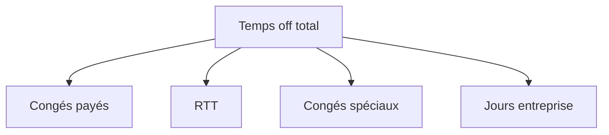
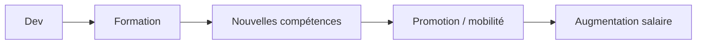
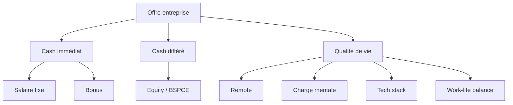

Quand tu signes dans une entreprise, la “rémunération” ne se limite pas au salaire brut. En pratique, on parle d’un **package global (Total Compensation)** qui mélange argent direct, avantages sociaux, temps, confort de travail et perspectives de gain futur.

Je te fais une vue complète structurée comme en archi produit 👇

---

# 1. Vue globale des avantages (modèle mental)

On peut représenter ça comme un système en couches :

```mermaid
flowchart TD
A[Package de rémunération total] --> B[Salaire fixe]
A --> C[Salaire variable]
A --> D[Equity / actions]
A --> E[Avantages sociaux]
A --> F[Avantages matériels]
A --> G[Avantages carrière / développement]

E --> E1[Santé: mutuelle]
E --> E2[Retraite / épargne]
E --> E3[Prévoyance]
E --> E4[Congés / RTT]

F --> F1[Remote / télétravail]
F --> F2[Matériel (PC, setup)]
F --> F3[Perks (repas, transport)]
```

---

# 2. Les grandes catégories expliquées

## A. 💰 Salaire fixe (base salary)

C’est la partie la plus simple :

* versée mensuellement
* exprimée en brut annuel en France
* base de calcul pour impôts, chômage, retraite

👉 Exemple : 55k€ brut annuel

💡 Point important dev :

* souvent négocié selon stack, séniorité, rareté (backend, cloud, data…)

---

## B. 📈 Salaire variable (bonus)

Partie dépendante de la performance :

### Types courants :

* Bonus annuel (0–20%+ du fixe)
* Bonus individuel (OKR, performance)
* Bonus entreprise (résultats globaux)
* Commission (plus commercial, mais parfois pour dev sales-oriented)


---

## C. 🧾 Equity / actions (très important en startup)

C’est une des grosses différences entre entreprises.

### Types :

* Stock Options
* RSU (Restricted Stock Units)
* BSPCE (France, startups)

### Pourquoi c’est puissant :

* tu deviens “partiellement propriétaire”
* gain potentiel si exit / IPO

👉 Exemple simple :

* 0.1% BSPCE dans une startup valorisée à 100M€
* → potentiel théorique important si croissance/exit

⚠️ mais :

* illiquide
* risque élevé

---

## D. 🏥 Avantages sociaux (très structurant en France)

### 1. Mutuelle santé

* remboursements médicaux
* souvent 50–100% prise en charge employeur

### 2. Prévoyance

* incapacité / invalidité / décès
* protection revenu

### 3. Retraite complémentaire

* cotisations obligatoires + parfois surcomplémentaire

---

## E. 🕒 Temps de travail & congés

En France, c’est un gros bloc d’avantages.

### Composants :

* Congés payés (minimum légal ~25 jours)
* RTT (si forfait jour ou 35h modulées)
* jours off supplémentaires (ancienneté, entreprise)
* congés spéciaux (parentalité, mariage, etc.)



---

## F. 🧑‍💻 Conditions de travail (très important pour dev)

### 1. Télétravail

* full remote
* hybride (2–3 jours remote)
* flex office

### 2. Matériel

* Mac / PC Linux / Windows
* écran(s), clavier, setup home office

### 3. Budget remote

* 300€–2000€ setup bureau
* internet / électricité parfois remboursés

---

## G. 🍔 Perks & avantages “confort”

Souvent sous-estimés mais impact fort :

* tickets restaurant / carte Swile
* snacks / cantine entreprise
* transport (Navigo remboursé 50–100%)
* sport (gym, salle partenaire)
* événements team building

---

## H. 📚 Formation & carrière

Très important côté dev :

* budget formation annuel (1k€ à 5k€+)
* accès conférences (Devoxx, KubeCon…)
* certifications (AWS, GCP, Kubernetes)
* mobilité interne (switch backend → platform, etc.)



---

# 3. Lecture “Fullstack mindset” (comment évaluer une offre)

Tu peux penser en 3 blocs :



---

# 4. Pièges classiques (important)

## ❌ Piège 1 : “gros salaire mais zéro avantages”

→ souvent forte pression / peu de flexibilité

## ❌ Piège 2 : equity surévaluée

→ “tu vas devenir riche” mais startup sans traction

## ❌ Piège 3 : avantages gadget

→ babyfoot ≠ compensation réelle

---

# 5. En résumé

Un package complet =

* 💰 salaire fixe (sécurité)
* 📊 variable (performance)
* 🧾 equity (long terme)
* 🏥 protection sociale (sécurité invisible mais critique)
* 🕒 temps libre (souvent sous-estimé)
* 💻 conditions de travail (impact direct dev)
* 📈 carrière (valeur future)


