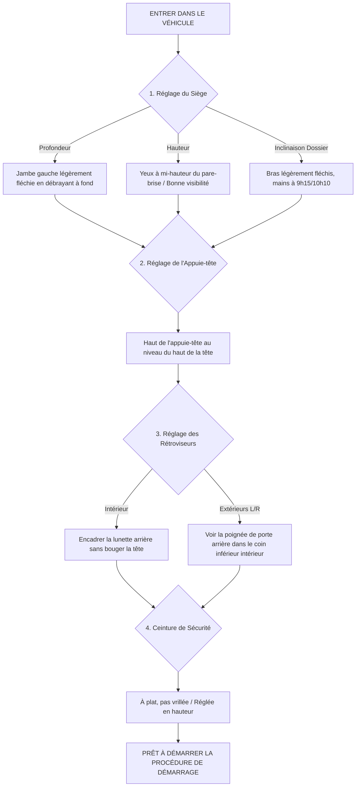
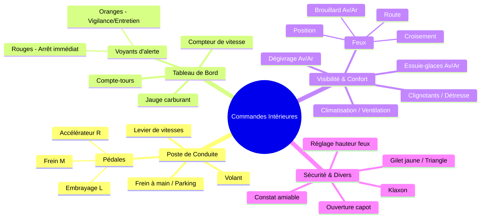

# Connaître les commandes et effectuer les vérifications intérieures/extérieures

Voici un tutoriel détaillé sur la première sous-compétence fondamentale de la conduite : **Connaître les commandes et effectuer les vérifications intérieures et extérieures**.

Ce guide est structuré pour vous aider à visualiser la logique des manipulations et des points de contrôle exigés lors de l'examen du permis de conduire (et indispensables pour votre sécurité quotidienne).

---

# Tuto : Vérifications & Prise en Main Technique du Véhicule

L'objectif de cette étape n'est pas seulement de savoir où se trouvent les boutons, mais de **comprendre comment vérifier que votre véhicule est prêt à circuler en toute sécurité**.

## Partie 1 : Logique d'Installation et Vérifications Intérieures

Avant même de démarrer, vous devez installer votre « bureau ». Une bonne installation conditionne votre confort, votre visibilité et votre réactivité.

### Le Diagramme de Flux de l'Installation

Ce diagramme montre l'ordre chronologique recommandé pour s'installer correctement. Si vous réglez le volant avant le siège, vous devrez recommencer.

### Connaître les Commandes Intérieures (Carte Mentale)

Lors de l'examen, l'inspecteur vous posera une question sur un élément intérieur. Voici une organisation mentale des commandes à maîtriser.

---

## Partie 2 : Logique des Vérifications Extérieures

Les vérifications extérieures ont pour but de s'assurer que l'« enveloppe » du véhicule est opérationnelle et légale. Lors de l'examen, vous devrez sortir du véhicule pour contrôler un point précis.

### Les 4 Piliers du Contrôle Extérieur (Infographie Mentale)

Imaginez que vous faites le tour de la voiture. Voici les quatre familles de contrôles que vous devez garder en tête.

```mermaid
graph TD
    style A fill:#f9f,stroke:#333,stroke-width:2px
    style B fill:#ccf,stroke:#333,stroke-width:1px
    style C fill:#ccf,stroke:#333,stroke-width:1px
    style D fill:#ccf,stroke:#333,stroke-width:1px
    style E fill:#ccf,stroke:#333,stroke-width:1px

    A[TOUR DU VÉHICULE] --> B[1. Éclairage & Signalisation];
    A --> C[2. État Général & Carrosserie];
    A --> D[3. Pneumatiques];
    A --> E[4. Sous le Capot Niveaux];

    B --> B1[Propreté];
    B --> B2[État optiques/ampoules];
    B --> B3[Fonctionnement feux/clignotants/détresse];

    C --> C1[Plaques immatriculation propres/lisibles];
    C --> C2[Rétroviseurs extérieurs état/fixation];
    C --> C3[Balais essuie-glaces état];
    C --> C4[Pas de dommages majeurs carrosserie];

    D --> D1[Pression aspect visuel];
    D --> D2[État flancs ni hernie, ni déchirure];
    D --> D3[Usure témoins de scupture];

    E --> E1[Niveau Huile Moteur];
    E --> E2[Niveau Liquide de Frein];
    E --> E3[Niveau Liquide de Refroidissement];
    E --> E4[Niveau Liquide Lave-glace];
    E --> E5[État/Fixation Batterie];

```

### Exemple détaillé : Vérification d'un Pneumatique

C'est une question très fréquente. Vous ne devez pas juste regarder le pneu, vous devez simuler un contrôle complet.

| Action (Ce que vous faites) | Explication (Ce que vous dites à l'inspecteur) |
| --- | --- |
| **1. Regarder le flanc.** | « Je vérifie que le flanc n'a pas de déchirure, de hernie ou de coupure. » |
| **2. Passer la main sur la bande de roulement.** | « Je vérifie que la sculpture est régulière et que je ne sens pas de corps étranger (clou, caillou). » |
| **3. Montrer un témoin d'usure.** | « Je vérifie que la hauteur de la sculpture n'atteint pas le témoin d'usure (1,6 mm minimum légal). » |
| **4. Évaluer la pression visuellement.** | « Visuellement, le pneu ne semble pas sous-gonflé. » |

---

## Résumé du Score à l'Examen

Lors de l'épreuve pratique, cette sous-compétence est évaluée via trois questions orales :

1. **Vérification technique (Intérieure ou Extérieure) :** 1 point.
2. **Sécurité Routière (Question liée à la vérification) :** 1 point.
3. **Premiers Secours (Question liée) :** 1 point.

**Total : 3 points « faciles » à obtenir** si vous avez bien bossé votre tuto !
