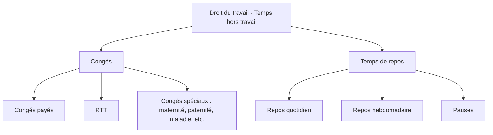
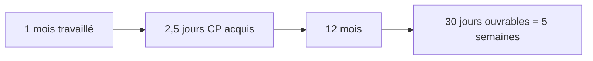
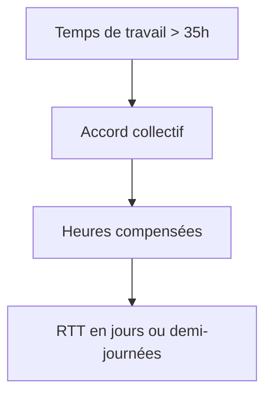
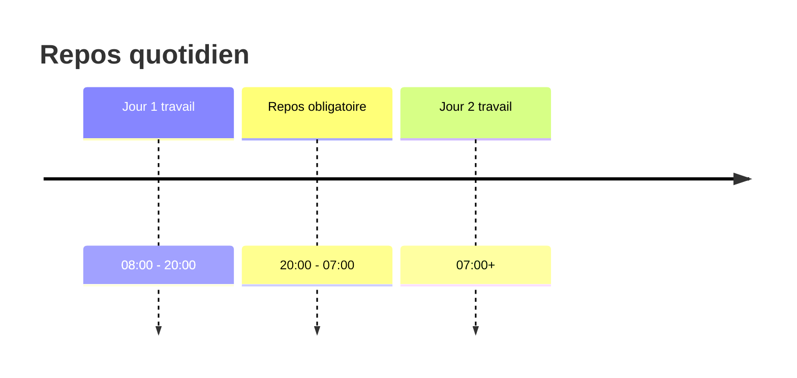
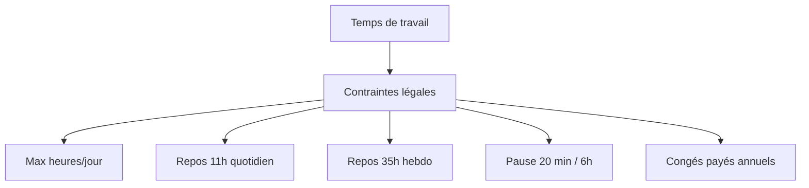
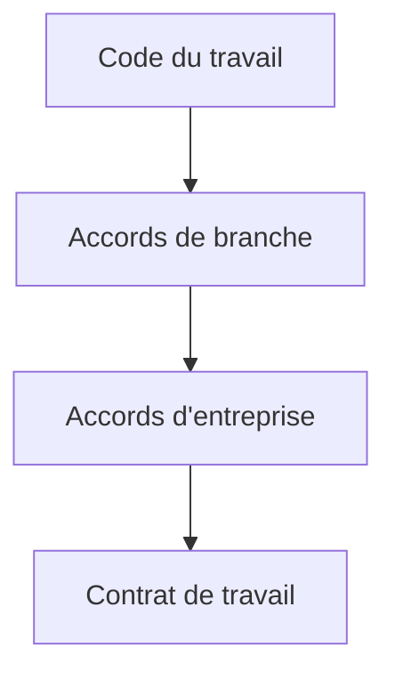

Voici une explication complète et structurée des **congés et temps de repos en droit du travail français**, avec une approche claire “dev fullstack friendly” (logique, catégories, règles, et un peu de modélisation mentale).

---

# 🧠 Vue d’ensemble

En droit du travail français, on distingue deux grandes familles :

* **Les congés** → interruptions planifiées du travail (souvent rémunérées)
* **Les temps de repos** → périodes obligatoires de récupération entre ou pendant le travail

On peut les modéliser ainsi :



---

# 🏖️ 1. Les congés

## 1.1 Congés payés (CP) — le socle

### 📌 Principe

Tout salarié acquiert des droits à congés payés dès qu’il travaille.

### 📊 Acquisition

* **2,5 jours ouvrables par mois travaillé**
* soit **30 jours ouvrables / an (5 semaines)**



### 📅 Période de référence

* Généralement : **1er juin → 31 mai**
* L’employeur fixe les dates, mais doit respecter :

  * la vie familiale
  * l’ancienneté
  * les conventions collectives

### ⚠️ Règles importantes

* Obligation de prendre au moins **12 jours consécutifs**
* Maximum souvent **24 jours consécutifs**
* Les congés ne peuvent pas être remplacés par de l’argent (sauf fin de contrat)

---

## 1.2 RTT (Réduction du Temps de Travail)

### 📌 Principe

Pour compenser les heures au-delà de 35h sans être des heures supplémentaires.

### ⚙️ Logique



### 📊 Exemple

* 39h/semaine
* 4h supplémentaires hebdo
  → compensées en jours RTT sur l’année

---

## 1.3 Congés spécifiques

### 👶 Congés familiaux

* maternité
* paternité et accueil de l’enfant
* adoption

### ⚰️ Congés pour événements familiaux

* mariage / PACS
* décès d’un proche
* naissance

### 🧠 Congé sabbatique / création d’entreprise

* suspension du contrat sous conditions d’ancienneté

### 🏥 Maladie (cas particulier)

* pas un “congé” volontaire
* mais suspension du contrat avec indemnisation sécurité sociale + complément éventuel employeur

---

# 😴 2. Les temps de repos

## 2.1 Repos quotidien

### 📌 Règle

➡️ **11 heures consécutives minimum entre deux journées de travail**



---

## 2.2 Repos hebdomadaire

### 📌 Règle

➡️ **35 heures consécutives minimum par semaine**

= 24h + 11h de repos quotidien

```mermaid
flowchart LR
A["Fin de semaine travail"] --> B["24h repos hebdo"]
B --> C["+11h repos quotidien"]
C --> D= 35h minimum]
```

### 📅 Principe

* 1 jour de repos par semaine minimum
* en pratique : dimanche, sauf dérogations

---

## 2.3 Temps de pause

### 📌 Règle

* 20 minutes minimum dès que le salarié travaille **6h consécutives**

⚠️ Ce n’est pas forcément payé sauf accord.

---

# ⚖️ 3. Articulation globale (vision système)

On peut voir ça comme un système de contraintes :



---

# 🧩 4. Point important : hiérarchie des règles

En droit du travail moderne :



👉 Pour les congés et repos :

* beaucoup de règles sont **d’ordre public (non négociables)**
* certaines modalités peuvent être adaptées par accord collectif

---

# ⚠️ 5. Cas pratiques fréquents

## 🧑‍💻 Dev fullstack (cas réel)

### Cas 1 : sprint intense

* 45h semaine → possible si compensation
* mais repos quotidien/hebdo doivent rester respectés

### Cas 2 : burnout / arrêt maladie

* suspension du contrat
* protection du salarié (interdiction de licenciement abusif lié à la maladie)

### Cas 3 : congés imposés par l’employeur

* légal, mais doit respecter délai de prévenance et règles d’équité

---

# 🧠 TL;DR mental model

* **Congés = droit à s’absenter (planifié)**
* **Repos = obligation de ne pas travailler (structure de sécurité)**
* Le système est conçu pour garantir :

  * récupération physique
  * équilibre vie pro/perso
  * limitation du temps de travail excessif

