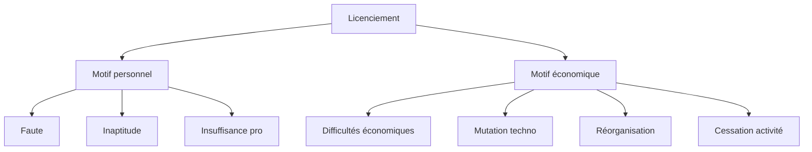
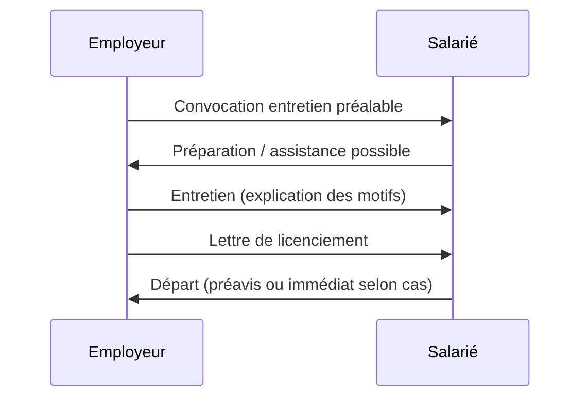
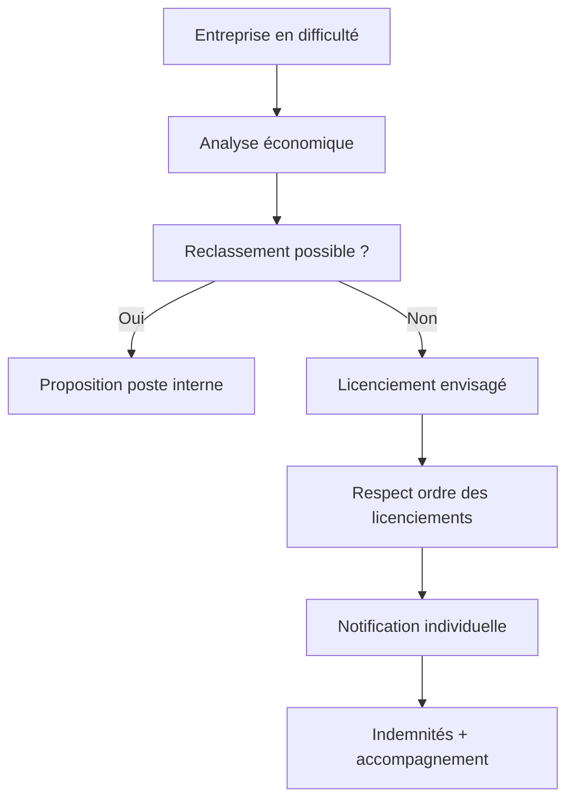
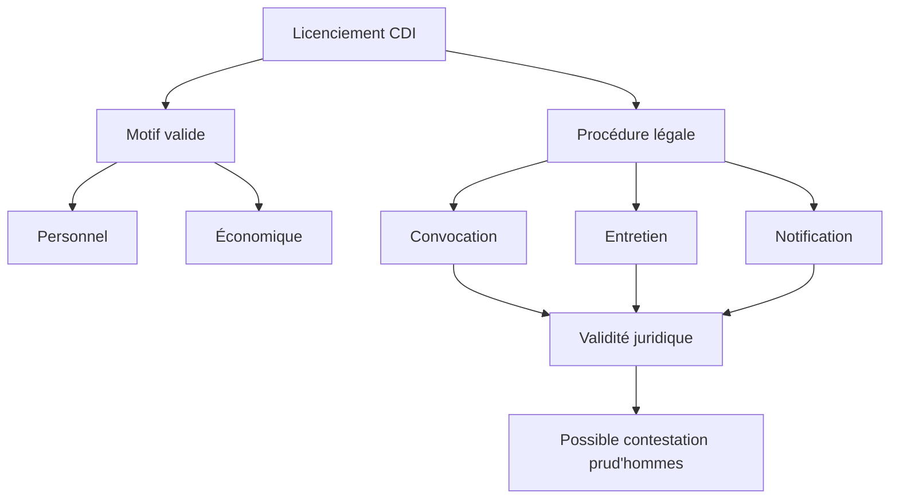

Voici une explication complète et structurée du **licenciement en droit du travail français**, avec une approche claire (type “système”) et des diagrammes Mermaid pour visualiser les mécanismes.

---

# 🧾 1. Définition du licenciement

Le **licenciement** est la **rupture du contrat de travail à durée indéterminée (CDI)** à l’initiative de l’employeur.

👉 Il doit toujours être :

* fondé sur une **cause réelle et sérieuse**
* respectueux d’une **procédure stricte**
* justifiable devant un juge en cas de contestation

📌 Référence clé : Code du travail (France)

---

# ⚖️ 2. Les grandes catégories de licenciement

## 2.1 Licenciement pour motif personnel

Il est lié au salarié lui-même.

### Exemples :

* faute (simple, grave, lourde)
* insuffisance professionnelle
* inaptitude médicale
* absences répétées perturbant l’entreprise

### Types de faute :

| Type         | Effet                                                        |
| ------------ | ------------------------------------------------------------ |
| Faute simple | licenciement + indemnités                                    |
| Faute grave  | rupture immédiate, sans préavis ni indemnité de licenciement |
| Faute lourde | faute grave + intention de nuire                             |

---

## 2.2 Licenciement pour motif économique

Il est lié à l’entreprise, pas au salarié.

### Causes possibles :

* difficultés économiques
* mutations technologiques
* réorganisation nécessaire à la compétitivité
* cessation d’activité

---

### 🧠 Vue globale (classification)



---

# 🧭 3. La procédure de licenciement (très important)

En France, la procédure est **strictement encadrée**, sinon le licenciement peut être jugé abusif.

## Étapes classiques :

### 1. Convocation à entretien préalable

* lettre recommandée ou remise en main propre
* délai minimum de 5 jours ouvrables

### 2. Entretien préalable

* explication des motifs
* salarié peut se défendre (ou être assisté)

### 3. Notification du licenciement

* lettre motivée
* envoyée après délai légal

---

## 🧩 Diagramme du processus



---

# ⏱️ 4. Préavis et indemnités

## 4.1 Préavis

Sauf faute grave/lourde :

* 1 à 3 mois en général selon ancienneté et convention collective

## 4.2 Indemnités possibles

| Type                                     | Indemnité               |
| ---------------------------------------- | ----------------------- |
| Licenciement (CDI + ancienneté ≥ 8 mois) | oui                     |
| Faute grave                              | non                     |
| Faute lourde                             | non                     |
| Indemnité compensatrice de congés payés  | oui (dans tous les cas) |

---

# 💰 5. Licenciement économique (focus important)

## Obligations de l’employeur :

* justifier la réalité économique
* tenter un reclassement interne
* respecter l’ordre des licenciements

## Dispositifs possibles :

* PSE (Plan de Sauvegarde de l’Emploi) si licenciements collectifs
* CSP (Contrat de Sécurisation Professionnelle)

---

## 📊 Logique du licenciement économique



---

# ⚠️ 6. Licenciement abusif (sans cause réelle et sérieuse)

Un licenciement peut être contesté si :

* motif non fondé
* procédure irrégulière
* discrimination
* absence de preuve

👉 Le salarié peut saisir le **Conseil de prud’hommes**

---

## 🧑‍⚖️ Issue possible du contentieux

```mermaid
flowchart TD
A[Licenciement contesté] --> B[Conseil de prud’hommes]

B --> C{Décision}
C --> D[Licenciement justifié]
C --> E[Licenciement abusif]

E --> F[Indemnités pour le salarié]
E --> G[Réintégration possible (rare)]
```

---

# 🧠 7. Droits du salarié licencié

Un salarié peut avoir droit à :

* indemnité de licenciement
* indemnité de préavis
* indemnité de congés payés
* allocation chômage (France Travail)
* accompagnement (CSP en cas économique)

---

# 🚫 8. Cas où le licenciement est interdit

On ne peut pas licencier pour :

* grossesse / maternité
* discrimination (âge, sexe, religion, etc.)
* activité syndicale
* harcèlement dénoncé

---

# 🧩 9. Vue “architecture système” (résumé global)



---

# 💡 10. Vision dev fullstack (analogie utile)

Tu peux voir le licenciement comme une **API critique avec validations obligatoires** :

* input = motif
* middleware = procédure légale
* validation layer = cause réelle et sérieuse
* output = rupture du contrat

Si une étape échoue → **exception juridique → prud’hommes**


