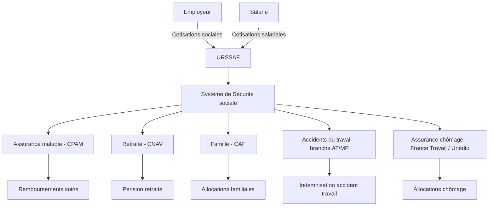
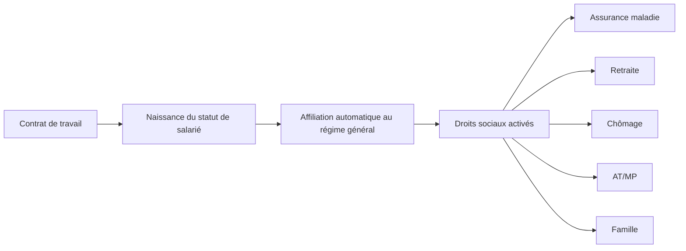
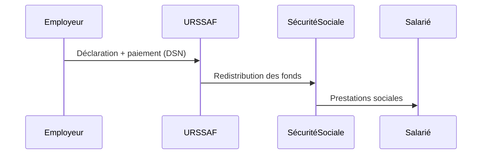
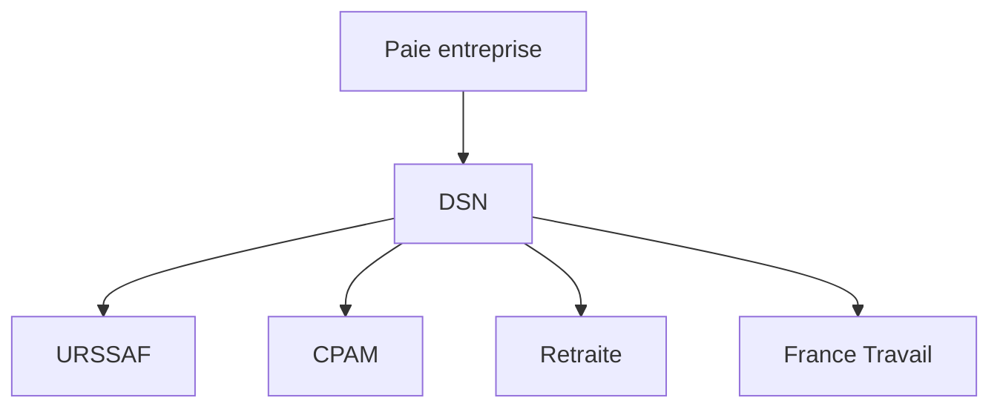
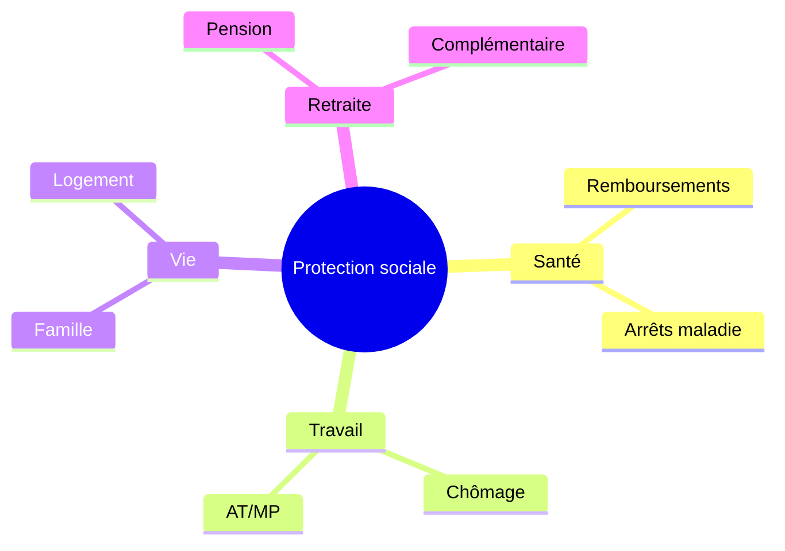

Voici une explication complète et structurée de **la protection sociale en droit du travail (contexte français)**, avec une lecture adaptée à quelqu’un de profil dev fullstack (donc orientée systèmes, flux et architecture).

---

# 1. Définition : c’est quoi la protection sociale ?

La **protection sociale** en droit du travail désigne l’ensemble des mécanismes qui permettent de **protéger les travailleurs contre les risques sociaux** liés à leur activité ou à leur vie personnelle.

Ces risques sont classiquement :

* maladie / maternité
* accident du travail / maladie professionnelle
* vieillesse (retraite)
* chômage
* famille (allocations)
* précarité / exclusion sociale

👉 En France, c’est un **système redistributif et assurantiel**, financé principalement par des **cotisations sociales** (et une part de fiscalité comme la CSG).

---

# 2. Vue “système” (vision dev / architecture)

On peut modéliser la protection sociale comme un système distribué :

* Entrées : cotisations + impôts
* Middleware : organismes sociaux
* Sorties : prestations

👉 Lecture dev :

* URSSAF = gateway de collecte
* Sécurité sociale = core backend
* CPAM/CAF/etc. = microservices spécialisés
* Prestations = réponses API vers les assurés

---

# 3. Les branches principales de la protection sociale

## 3.1 Assurance maladie

Gère :

* remboursement soins
* indemnités journalières (arrêt maladie)
* maternité/paternité

👉 acteur principal : **CPAM**

---

## 3.2 Accidents du travail / maladies professionnelles

Spécificité importante :

* responsabilité automatique de l’employeur (logique “risk system”)
* indemnisation plus favorable

---

## 3.3 Retraite

* système par répartition
* cotisations actuelles financent les retraités actuels

👉 acteurs : CNAV + caisses complémentaires (Agirc-Arrco)

---

## 3.4 Famille

* allocations familiales
* aides au logement (CAF)

---

## 3.5 Chômage

* indemnisation perte involontaire d’emploi
* gestion par **France Travail** + Unédic

---

# 4. Logique juridique : contrat de travail + protection sociale

La protection sociale est **liée au statut de salarié**.

👉 Point clé :

* pas besoin de contrat avec la Sécu
* l’affiliation est **automatique et obligatoire**

---

# 5. Financement : cotisations sociales (logique “event-driven payroll”)

## 5.1 Flux de cotisations

---

## 5.2 Composition

* cotisations patronales (majoritaires)
* cotisations salariales (prélevées sur salaire brut)
* contributions fiscales (CSG, CRDS)

👉 idée clé :

> le salaire brut est une base “API contract” sur laquelle s’appliquent des prélèvements multiples.

---

# 6. DSN : la “pipeline data” du système

En entreprise, tout passe par la **Déclaration Sociale Nominative (DSN)**.

👉 Pour un dev :

* DSN = batch mensuel/événementiel
* format structuré
* intégration critique (erreurs = impact légal + financier)

---

# 7. Obligations de l’employeur

L’employeur est un **node obligatoire du système**.

Il doit :

* déclarer les salariés
* payer les cotisations
* assurer la santé/sécurité au travail
* respecter le droit du travail (temps de travail, etc.)

👉 sinon :

* redressement URSSAF
* sanctions pénales possibles

---

# 8. Logique de droits pour le salarié

Le salarié bénéficie de droits conditionnels :

* travailler → ouvre droits sociaux
* cotiser → maintient droits
* interruption de travail → déclenche prestations

---

# 9. Vision “produit” : la protection sociale comme plateforme

On peut la voir comme une **plateforme étatique de gestion des risques humains**.

---

# 10. Points importants souvent oubliés

## 10.1 Universalité partielle

* tout le monde n’est pas couvert de la même manière
* statut (salarié, indépendant, fonctionnaire) change le régime

## 10.2 Logique contributive

* ce n’est pas une assurance privée
* pas de “compte individuel strict”

## 10.3 Redistribution

* les hauts revenus financent les plus faibles indirectement

---

# 11. Lecture critique (utile en dev / archi système)

### Avantages :

* résilience sociale
* mutualisation des risques
* couverture large

### Inconvénients :

* complexité élevée (multi-organismes)
* règles évolutives
* forte dépendance au système déclaratif (DSN)

