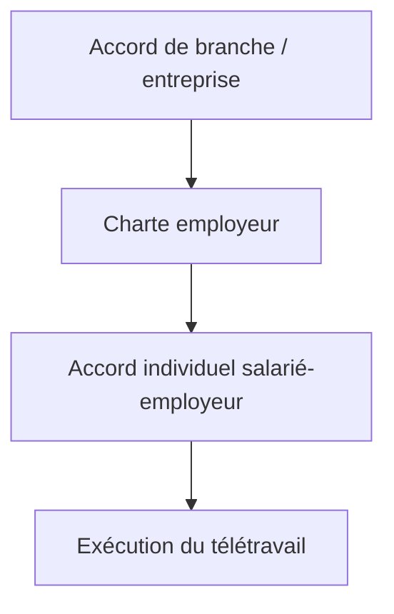
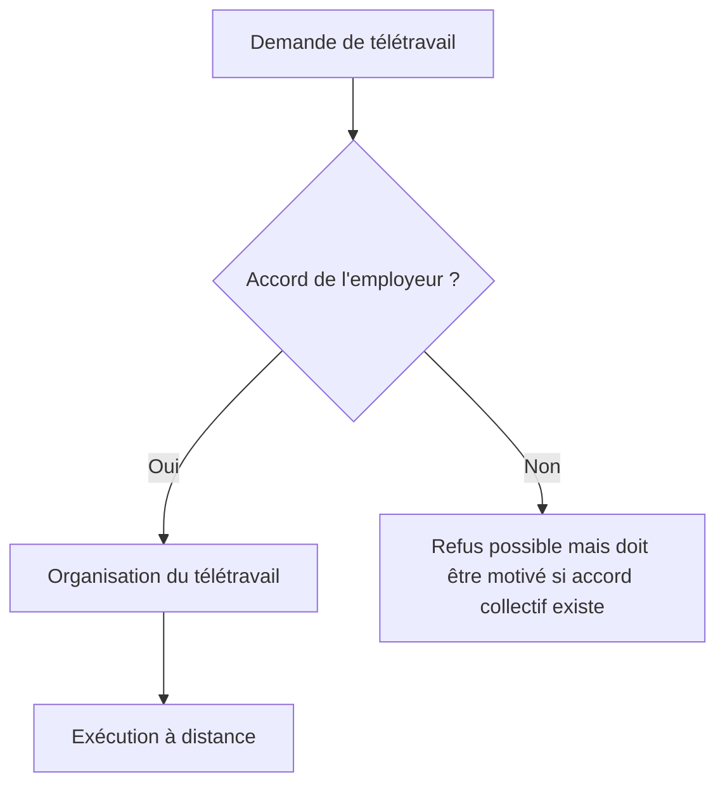
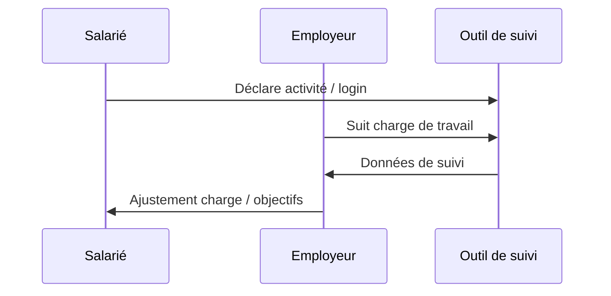
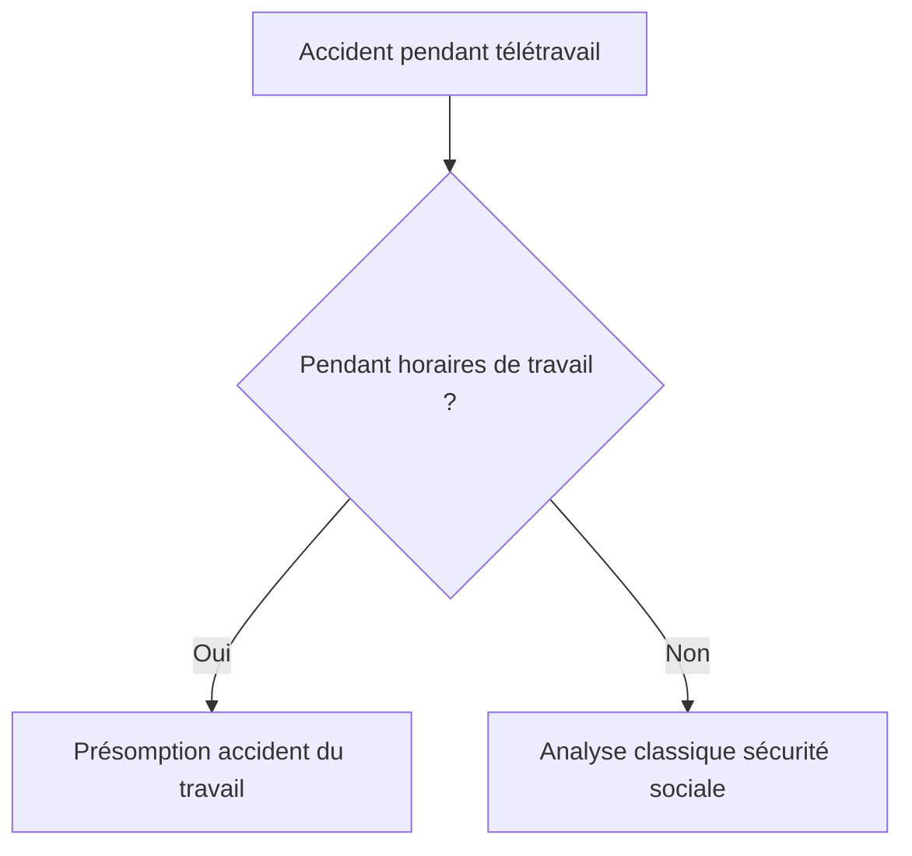
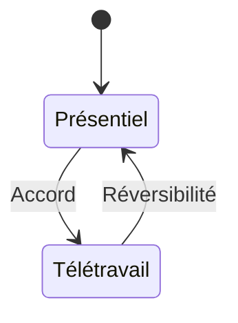
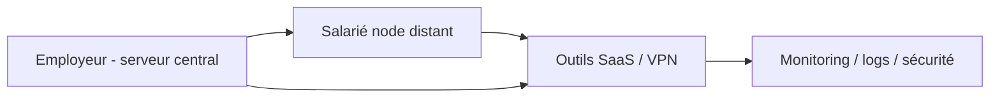

Voici une explication complète et structurée du **télétravail en droit du travail français**, avec une approche “fullstack dev friendly” + quelques diagrammes Mermaid pour visualiser les mécanismes.

---

# 🧑‍💻 1. Définition juridique du télétravail

En droit français, le télétravail est défini par le **Code du travail (article L1222-9)** :

> Toute forme d’organisation du travail dans laquelle un travail qui aurait pu être exécuté dans les locaux de l’employeur est effectué hors de ces locaux de façon volontaire, en utilisant les technologies de l’information et de la communication.

### 🧠 Traduction simple :

Le télétravail = travail possible en présentiel + exécuté à distance + volontaire + via outils numériques.

---

# ⚖️ 2. Cadre juridique (France)

Le télétravail repose principalement sur :

* 📜 **Code du travail (L1222-9 à L1222-11)**
* 🤝 **Accord collectif** (prioritaire si existant)
* 📄 Sinon : **charte de l’employeur**
* 🧾 Sinon : **accord individuel (contrat ou avenant)**

---

## 🧭 Hiérarchie des normes

👉 L’accord collectif prime toujours sur la charte ou le contrat.

---

# 📌 3. Mise en place du télétravail

## Cas 1 : Télétravail “habituel”

Il est organisé de manière régulière.

👉 Nécessite :

* Accord collectif OU charte OU accord individuel

## Cas 2 : Télétravail “occasionnel”

Ex : 1 jour/semaine ou situation ponctuelle

👉 Peut être mis en place par simple accord entre salarié et employeur.

---

## 🔁 Schéma de décision

---

# 🧑‍⚖️ 4. Droits et obligations

## 👨‍💼 Employeur

L’employeur doit :

* Fournir les moyens nécessaires (ordinateur, accès VPN…)
* Assurer la sécurité des données
* Respecter le droit à la déconnexion
* Garantir l’égalité de traitement avec les salariés sur site

---

## 👩‍💻 Salarié

Le salarié doit :

* Respecter les horaires
* Assurer la confidentialité
* Utiliser correctement les outils fournis
* Respecter les règles internes de l’entreprise

---

# ⏱️ 5. Temps de travail et contrôle

Le télétravail **ne supprime pas le droit du temps de travail**.

👉 Les règles restent identiques :

* 35h (ou forfait jour)
* Heures supplémentaires
* Repos quotidien (11h minimum)

---

## ⏱️ Schéma du cycle de travail

---

# 🏠 6. Accident du travail en télétravail

Un point très important juridiquement.

👉 Principe :
Un accident survenu pendant le télétravail est **présumé accident du travail**.

### Exemple :

* chute chez soi pendant horaires de travail
* blessure en utilisant matériel professionnel

---

## ⚖️ Schéma de présomption

---

# 💰 7. Frais professionnels

L’employeur peut devoir prendre en charge :

* Internet
* Électricité
* Équipement
* Bureau (selon politique interne)

👉 Il n’y a pas de règle unique automatique : cela dépend de l’accord collectif ou de l’entreprise.

---

# 🔐 8. Protection des données (RGPD)

Le télétravail implique des obligations fortes :

* VPN obligatoire
* chiffrement
* interdiction d’utiliser des outils personnels non sécurisés
* contrôle des accès

---

# 🚫 9. Refus du télétravail

## Cas important :

### Si le télétravail est demandé par le salarié :

L’employeur peut refuser, mais doit motiver si :

* le poste est éligible dans un accord collectif

### Si l’employeur impose :

Le salarié peut refuser si :

* le contrat ne prévoit pas de clause de mobilité/télétravail
* absence d’accord collectif applicable

---

# ⚖️ 10. Réversibilité du télétravail

Le télétravail n’est pas forcément définitif.

👉 Principe clé :
**réversibilité possible à tout moment (selon accord)**

---

## 🔄 Schéma de réversibilité

---

# 🧩 11. Vision “architecture système”

Pour un dev fullstack, on peut voir le télétravail comme un système distribué :

👉 Le salarié devient un “node remote” connecté à une infra sécurisée.

---

# 🧠 12. Points clés à retenir

* Le télétravail est **un droit encadré, pas automatique**
* Il repose sur un **accord collectif prioritaire**
* Les obligations employeur/salarié restent globalement identiques
* Le salarié reste protégé (temps de travail, accidents, égalité)
* Le cadre est très flexible mais fortement contractualisé

