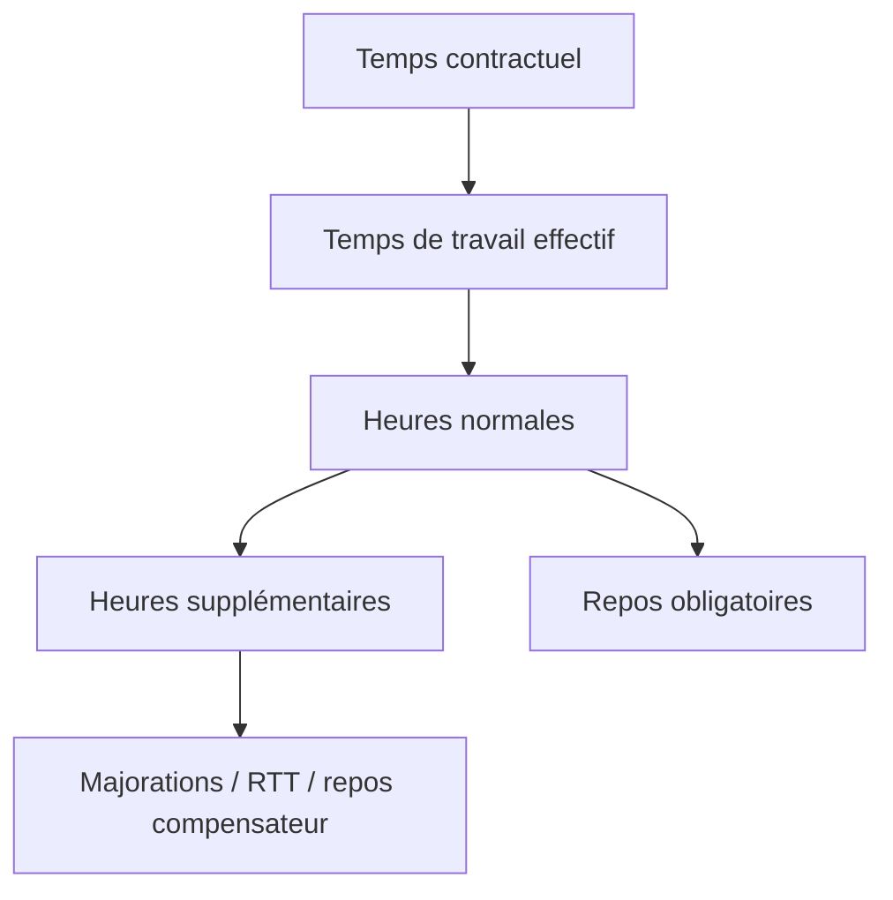
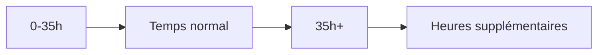
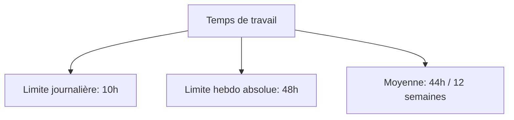
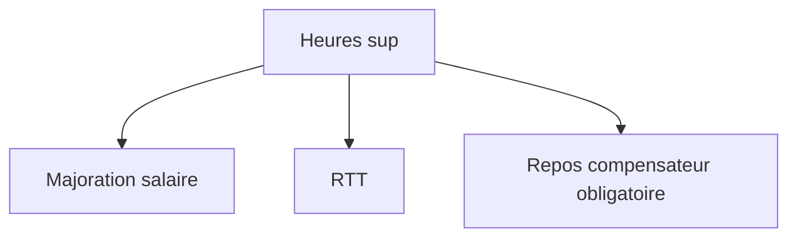
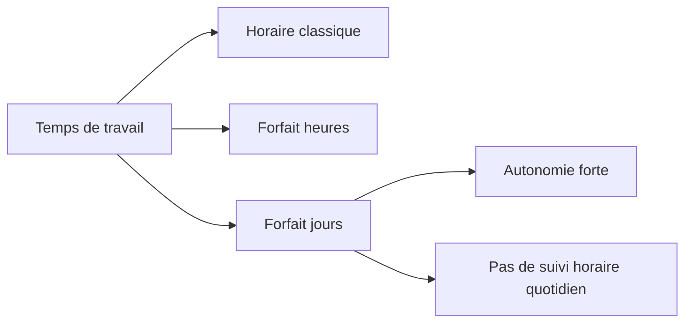
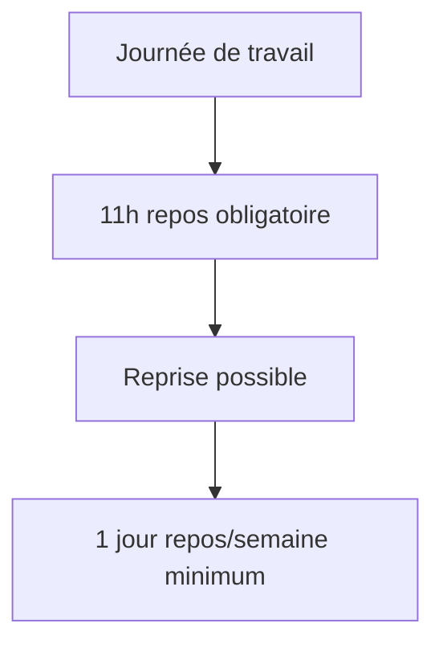
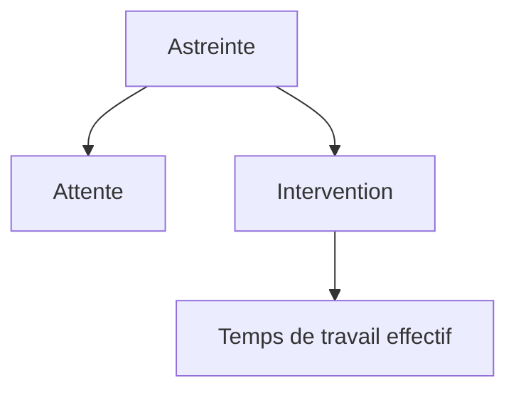
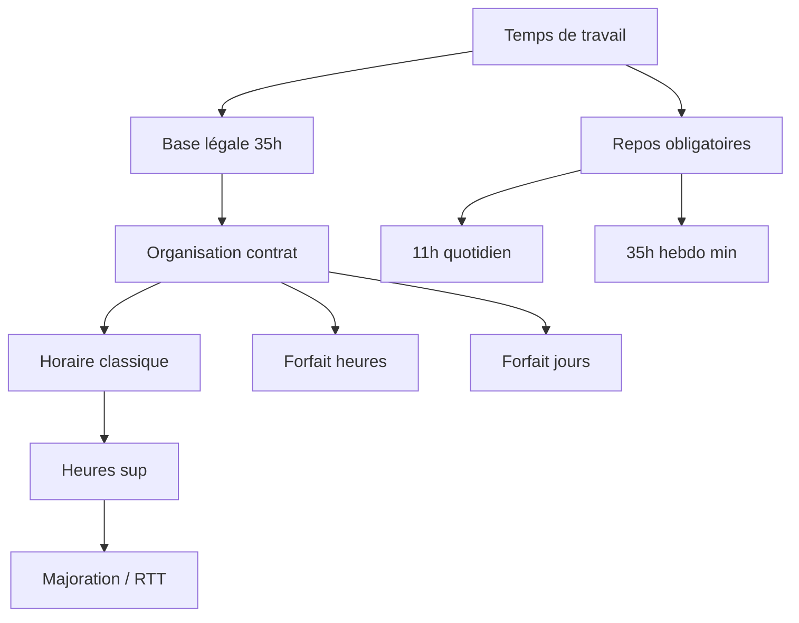

Voici une explication complète du **temps de travail en droit du travail français**, avec une approche structurée comme pour un dev fullstack (logique système + règles + exceptions + cas métier).

---

# 🧠 1. Le “modèle” du temps de travail (vision système)

En droit du travail français, le temps de travail est une **règle de calcul encadrée par le Code du travail**, avec :

* une **unité de base** (heures travaillées)
* des **limites légales**
* des **exceptions contractuelles**
* des **mécanismes de compensation (repos / majorations)**

On peut le voir comme un pipeline :

---

# ⚖️ 2. Définition clé : le temps de travail effectif

## 📌 Définition légale

Le **temps de travail effectif** est le temps pendant lequel le salarié :

* est à la disposition de l’employeur
* se conforme à ses directives
* ne peut pas vaquer librement à ses occupations

👉 C’est la “variable officielle” qui compte juridiquement.

### ❌ Exemples NON comptés :

* pause déjeuner libre
* trajet domicile → travail (sauf cas spécifiques)
* habillage (sauf contrainte particulière)

### ✅ Exemples comptés :

* production / dev / réunions
* astreinte sur site
* intervention client

---

# ⏱️ 3. La durée légale : 35 heures

## 📌 Base du système

En France :

* **35h/semaine = durée légale**
* ce n’est pas un maximum, mais une **référence de déclenchement des heures sup**

---

# 🚨 4. Les limites maximales (garde-fous)

Même si un contrat peut dépasser 35h, il existe des plafonds :

## 📊 Limites principales

* **10h par jour** (principe)
* **48h max sur une semaine isolée**
* **44h en moyenne sur 12 semaines**

👉 Ces limites sont des **contraintes de sécurité juridique + santé**

---

# 💸 5. Les heures supplémentaires

## 📌 Définition

Heures effectuées au-delà de 35h/semaine.

## 💰 Compensation

Deux modèles possibles :

### 1. Majoration salariale

* +25% (souvent de la 36e à la 43e heure)
* +50% au-delà

### 2. RTT (repos compensateur)

* remplacement des heures sup par du repos

---

# 📅 6. Organisation du temps de travail (flexibilité)

Le droit du travail n’impose pas toujours 35h “fixes”.

## 🔧 Modèles d’organisation

### 🧩 a) Forfait heures

* nombre d’heures annuel fixé
* suivi global, pas hebdomadaire strict

### 🧩 b) Forfait jours (très utilisé en tech)

* pas de comptage horaire
* comptage en jours travaillés / an (~218 jours)

⚠️ Le forfait jours impose :

* suivi de charge
* respect repos
* entretiens annuels obligatoires

---

# 😴 7. Les temps de repos obligatoires

## 🛑 Repos quotidien

* **11 heures consécutives minimum**

## 🛑 Repos hebdomadaire

* **24 heures + repos quotidien = 35h minimum**

---

# 🌙 8. Travail de nuit et cas particuliers

## 🌒 Travail de nuit

* généralement entre 21h et 6h (variable selon accords)
* majorations + protections santé

## ⚠️ Cas spécifiques :

* jeunes travailleurs (mineurs)
* astreintes
* travail dominical
* secteurs continus (hôpitaux, IT ops, industrie)

---

# 📡 9. Astreinte (cas important pour devs / IT)

## 📌 Définition

Période où le salarié :

* n’est pas sur site
* mais doit pouvoir intervenir rapidement

👉 Deux temps différents :

| Moment       | Statut           |
| ------------ | ---------------- |
| attente      | repos (souvent)  |
| intervention | temps de travail |

---

# 🧑‍💻 10. Cas concret (dev fullstack)

Exemple :

* contrat : 39h
* 35h normales
* 4h sup

### Cas A : paiement

* 4h × +25%

### Cas B : RTT

* 4h converties en repos

### Cas C : forfait jours

* pas de compteur horaire
* uniquement suivi des jours travaillés

---

# 🧩 11. Logique globale (résumé système)

---

# ⚖️ 12. Idée clé à retenir

👉 Le temps de travail en droit français n’est pas juste un compteur d’heures :

C’est un **système contraint** qui équilibre :

* productivité
* santé du salarié
* flexibilité des entreprises
* compensation financière ou en repos

