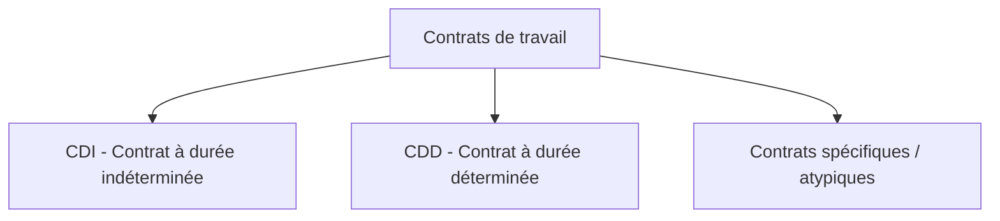
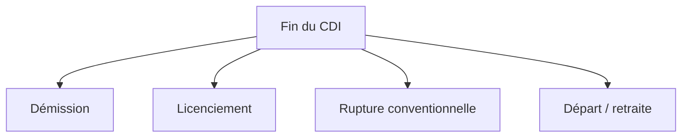
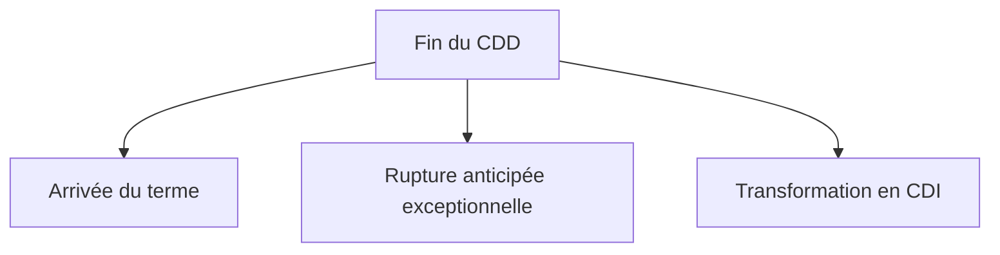
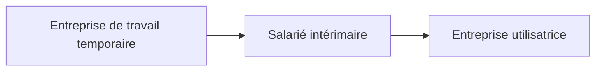
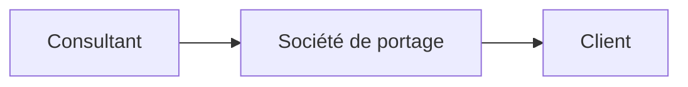
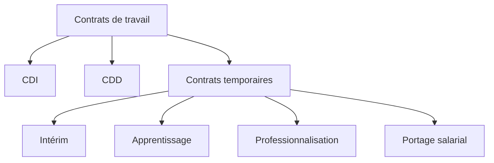
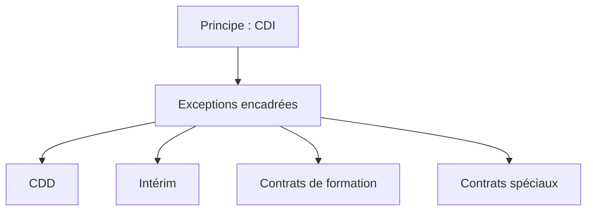
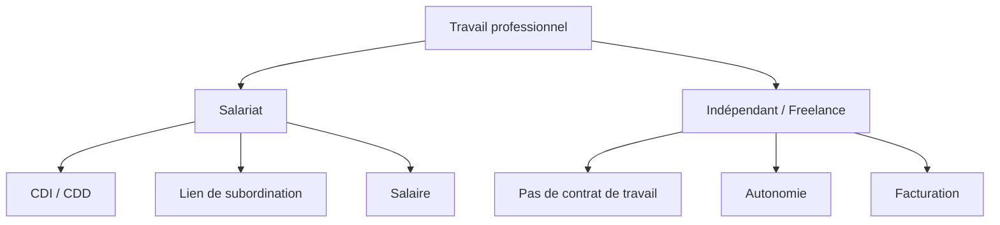

Voici une explication complète et structurée des **types de contrats en droit du travail (droit français)**, avec des schémas Mermaid pour clarifier les relations.

---

# 1. Vue d’ensemble des contrats de travail

En droit du travail, un contrat de travail est une convention par laquelle :

* une personne (le salarié) s’engage à travailler
* pour le compte d’un employeur
* sous un lien de subordination
* en échange d’une rémunération

👉 Tous les contrats de travail se regroupent en deux grandes catégories :



---

# 2. Le CDI (Contrat à Durée Indéterminée)

## Définition

Le **CDI** est le contrat de droit commun. Il n’a pas de date de fin prévue.

## Caractéristiques principales

* Pas de terme fixé
* Stabilité de l’emploi
* Rupture libre mais encadrée (démission, licenciement, rupture conventionnelle)

## Avantages

* Sécurité de l’emploi
* Accès facilité au crédit, logement, etc.
* Meilleure protection juridique

## Fin du CDI



---

# 3. Le CDD (Contrat à Durée Déterminée)

## Définition

Le **CDD** est un contrat temporaire utilisé uniquement pour des besoins précis.

## Cas autorisés (strictement encadrés)

* Remplacement d’un salarié absent
* Accroissement temporaire d’activité
* Emplois saisonniers
* Contrats d’usage (secteurs spécifiques)

## Caractéristiques

* Date de fin connue dès la signature
* Renouvelable sous conditions
* Prime de précarité (souvent 10%)

## Interdiction

❌ Il ne doit pas remplacer durablement un CDI

## Fin du CDD



---

# 4. Les contrats spécifiques (ou atypiques)

Ces contrats répondent à des situations particulières.

---

## 4.1 Le contrat d’intérim

### Définition

Le salarié travaille pour une entreprise de travail temporaire, mais est mis à disposition d’une entreprise utilisatrice.



### Particularités

* Mission temporaire
* Trois acteurs
* Souplesse maximale pour l’employeur

---

## 4.2 Le contrat d’apprentissage

### Objectif

Former un jeune à un métier tout en travaillant.

### Caractéristiques

* Alternance : école + entreprise
* Public : généralement 16–29 ans
* Diplôme à la clé

```mermaid
graph TD
A[Apprenti] --> B[Entreprise]
A --> C[Centre de formation (CFA)]
```

---

## 4.3 Le contrat de professionnalisation

### Objectif

Insertion ou reconversion professionnelle.

### Différence avec apprentissage

* Plus orienté adultes
* Formation qualifiante

---

## 4.4 Le contrat à temps partiel

### Définition

Travail inférieur à 35h/semaine (ou équivalent légal).

### Particularités

* Horaires obligatoirement précisés
* Heures complémentaires possibles

---

## 4.5 Le portage salarial

### Définition

Un professionnel autonome travaille pour des clients, mais est salarié d’une société de portage.



---

# 5. Comparaison générale des contrats



---

# 6. Tableau récapitulatif

| Type de contrat      | Durée            | Objectif               | Sécurité    |
| -------------------- | ---------------- | ---------------------- | ----------- |
| CDI                  | Illimitée        | Emploi stable          | Très élevée |
| CDD                  | Limitée          | Besoin temporaire      | Faible      |
| Intérim              | Très court terme | Remplacement / mission | Faible      |
| Apprentissage        | 1 à 3 ans        | Formation              | Moyenne     |
| Professionnalisation | 6 à 24 mois      | Insertion              | Moyenne     |
| Temps partiel        | Variable         | Travail réduit         | Variable    |

---

# 7. Logique juridique globale

Le droit du travail français repose sur un principe important :

👉 **Le CDI est la norme**
👉 Les autres contrats sont des exceptions justifiées



---

# 8. Idée clé à retenir

✔ CDI = stabilité
✔ CDD = besoin temporaire
✔ Intérim = flexibilité extrême
✔ Apprentissage / pro = formation
✔ Tous les contrats sont encadrés pour éviter les abus


---

# LE FREELANCE

## 1. Le freelance : ce n’est pas un contrat de travail

Le **freelance** (ou travailleur indépendant) n’est pas salarié.

👉 Il n’y a **pas de contrat de travail**, donc :

* pas de lien de subordination
* pas de CDI / CDD
* pas de Code du travail (sauf protections spécifiques)
* pas de salaire, mais une **facturation**

---

### Définition juridique

Un freelance est un **travailleur indépendant** qui exerce une activité pour ses clients en toute autonomie.

Il peut avoir différents statuts :

* micro-entrepreneur
* entreprise individuelle
* société (SASU, EURL…)

---

## 2. Différence fondamentale avec le salariat



---

## 3. Le critère clé : le lien de subordination

C’est LE critère juridique qui distingue salarié et freelance.

### Salarié

* ordres de l’employeur
* horaires imposés
* contrôle hiérarchique

### Freelance

* choisit ses missions
* organise son travail
* fixe ses méthodes

```mermaid
graph LR
A[Lien de subordination ?] -->|Oui| B[Contrat de travail (CDI/CDD)]
A -->|Non| C[Freelance / indépendant]
```

---

## 4. Attention : le faux freelance (requalification)

Parfois, une entreprise utilise un “freelance” comme un salarié déguisé.

👉 Dans ce cas, le juge peut requalifier en contrat de travail.

### Signes de requalification

* horaires imposés
* un seul client
* ordres directs permanents
* intégration dans l’équipe comme un salarié

---

## 5. Place du freelance dans le système global

```mermaid
graph TD
A[Statuts de travail] --> B[Salariat]
A --> C[Indépendant]

B --> B1[CDI]
B --> B2[CDD]
B --> B3[Intérim]

C --> C1[Freelance]
C --> C2[Micro-entreprise]
C --> C3[Société (SASU, EURL)]
```

---

## 6. Comparaison rapide

| Critère            | Salarié          | Freelance                |
| ------------------ | ---------------- | ------------------------ |
| Contrat            | CDI / CDD        | Aucun contrat de travail |
| Lien hiérarchique  | Oui              | Non                      |
| Rémunération       | Salaire          | Factures                 |
| Protection sociale | Forte            | Plus autonome            |
| Liberté            | Faible à moyenne | Élevée                   |

---

## 7. Idée clé à retenir

👉 Le freelance n’est pas un “type de contrat de travail”
👉 C’est un **statut juridique autonome**


