# Tutoriel : Comprendre les groupes bancaires français

La France possède l'un des systèmes bancaires les plus concentrés d'Europe. La majorité des banques que les particuliers utilisent appartiennent à seulement quelques grands groupes financiers.

---

# 1. Vue d'ensemble

On distingue plusieurs types d'établissements :

* Banques commerciales
* Banques mutualistes
* Banques d'investissement
* Banques publiques
* Banques en ligne
* Filiales spécialisées (crédit, assurance, leasing...)

Les principaux groupes sont :

| Groupe                          | Type               |
| ------------------------------- | ------------------ |
| BNP Paribas                     | Banque commerciale |
| Crédit Agricole                 | Banque mutualiste  |
| BPCE                            | Banque mutualiste  |
| Société Générale                | Banque commerciale |
| Crédit Mutuel Alliance Fédérale | Banque mutualiste  |
| La Banque Postale               | Banque publique    |

---

# 2. Le paysage bancaire français

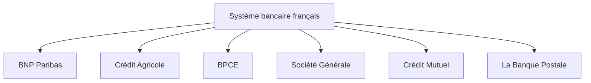

---

# 3. Qui possède ces banques ?

Toutes les banques ne sont pas détenues de la même manière.

## BNP Paribas

Entreprise cotée en bourse.

Les actionnaires sont principalement :

* investisseurs institutionnels
* fonds internationaux
* investisseurs particuliers
* salariés

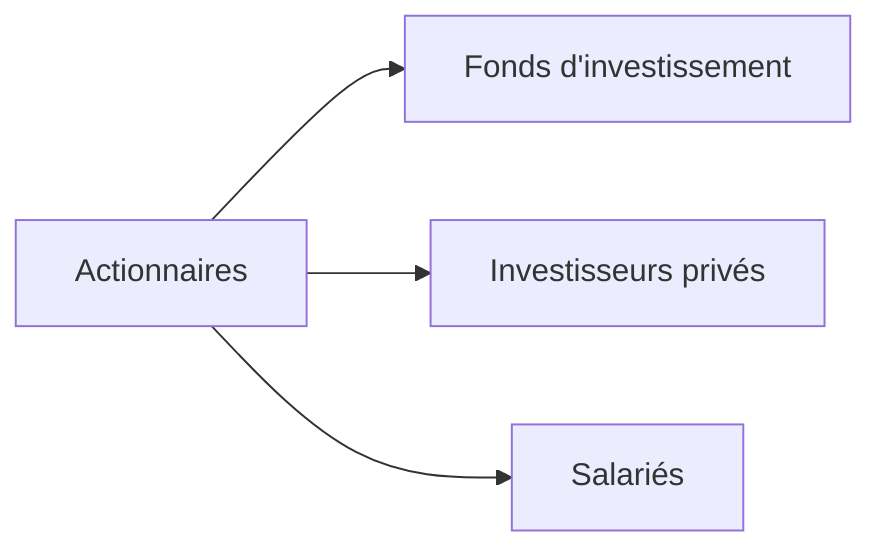

---

## Société Générale

Même modèle :

* cotée en bourse
* capital réparti entre investisseurs mondiaux

---

## Crédit Agricole

Le fonctionnement est très différent.

Les clients sociétaires possèdent les caisses locales.

Les caisses locales possèdent les caisses régionales.

Les caisses régionales contrôlent Crédit Agricole SA.

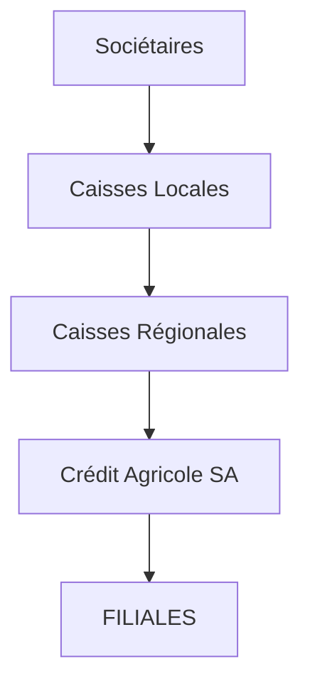

---

## BPCE

Fusion de deux réseaux :

* Banques Populaires
* Caisses d'Épargne

Les sociétaires possèdent leurs banques.

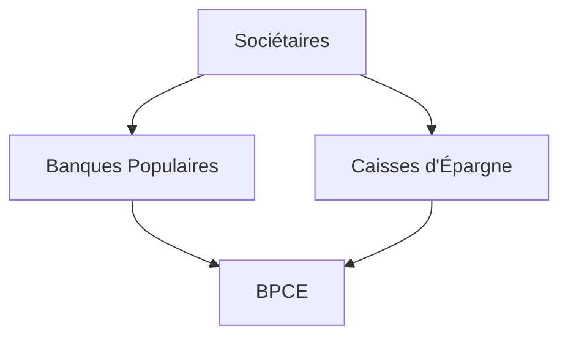

---

## Crédit Mutuel

Même logique mutualiste.

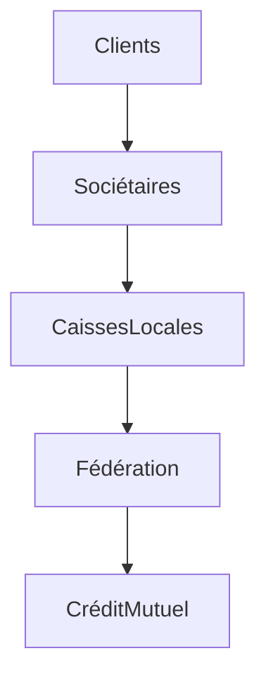

---

## La Banque Postale

Elle est détenue par :

```text
État Français
        │
        ▼
Caisse des Dépôts
        │
        ▼
La Poste
        │
        ▼
La Banque Postale
```

---

# 4. Les grandes filiales

## BNP Paribas

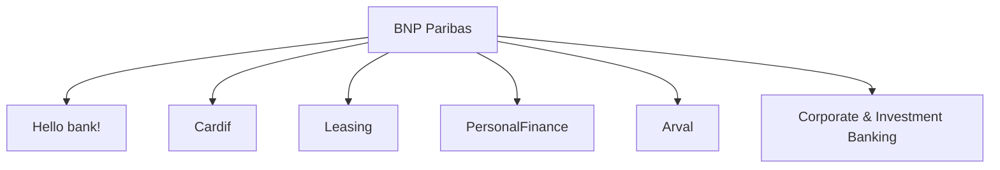

### Description

* Hello bank! → banque en ligne
* Cardif → assurance
* Arval → location automobile
* Personal Finance → crédit à la consommation
* CIB → banque d'investissement

---

## Crédit Agricole

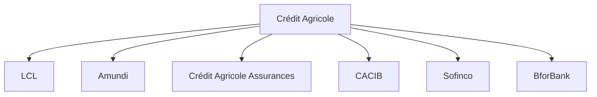

---

## BPCE

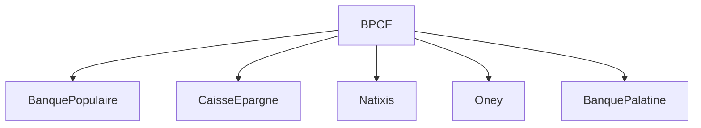

---

## Société Générale

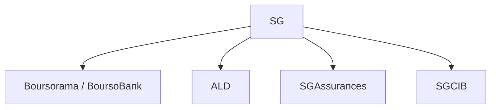

---

## Crédit Mutuel

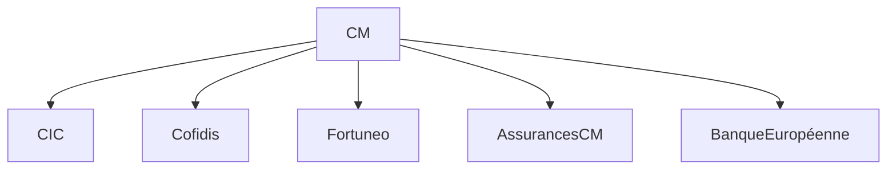

---

## La Banque Postale

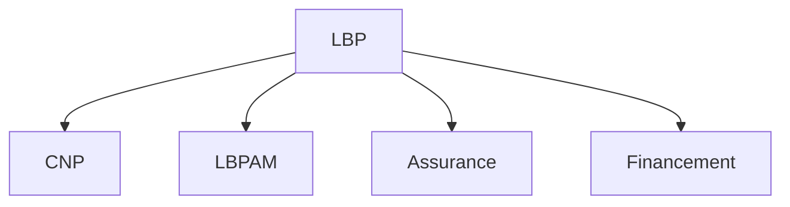

---

# 5. Les métiers d'un groupe bancaire

Une banque moderne est souvent organisée comme un conglomérat.

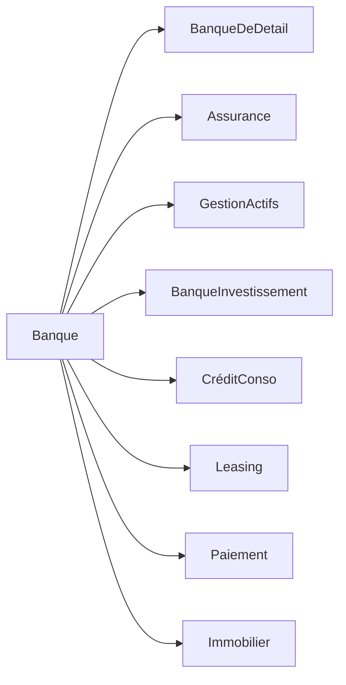

---

# 6. Exemple : Crédit Agricole

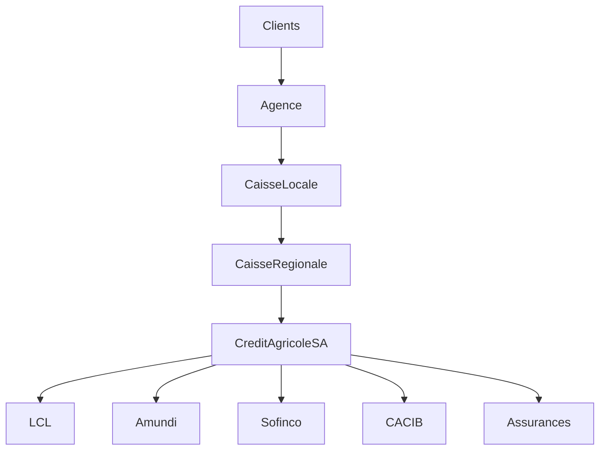

---

# 7. Exemple : BNP Paribas

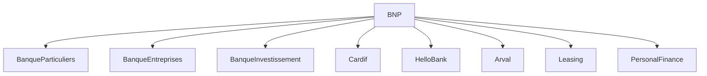

---

# 8. Comparaison des principaux groupes

| Groupe            | Coté en bourse | Mutualiste | Banque en ligne | Assurance | Gestion d'actifs | Banque d'investissement |
| ----------------- | -------------- | ---------- | --------------- | --------- | ---------------- | ----------------------- |
| BNP Paribas       | ✅              | ❌          | Hello bank!     | Cardif    | Oui              | Oui                     |
| Société Générale  | ✅              | ❌          | BoursoBank      | Oui       | Oui              | Oui                     |
| Crédit Agricole   | ✅ (holding)    | ✅          | BforBank        | Oui       | Amundi           | Oui                     |
| BPCE              | ❌              | ✅          | Oui             | Oui       | Oui              | Oui                     |
| Crédit Mutuel     | ❌              | ✅          | Fortuneo        | Oui       | Oui              | Oui                     |
| La Banque Postale | ❌              | Public     | Oui             | Oui       | Oui              | Limité                  |

---

# 9. Les participations croisées

Les grands groupes possèdent souvent plusieurs sociétés spécialisées.

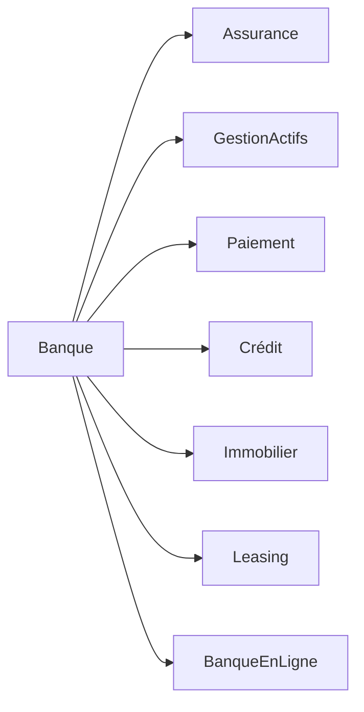

---

# 10. Résumé

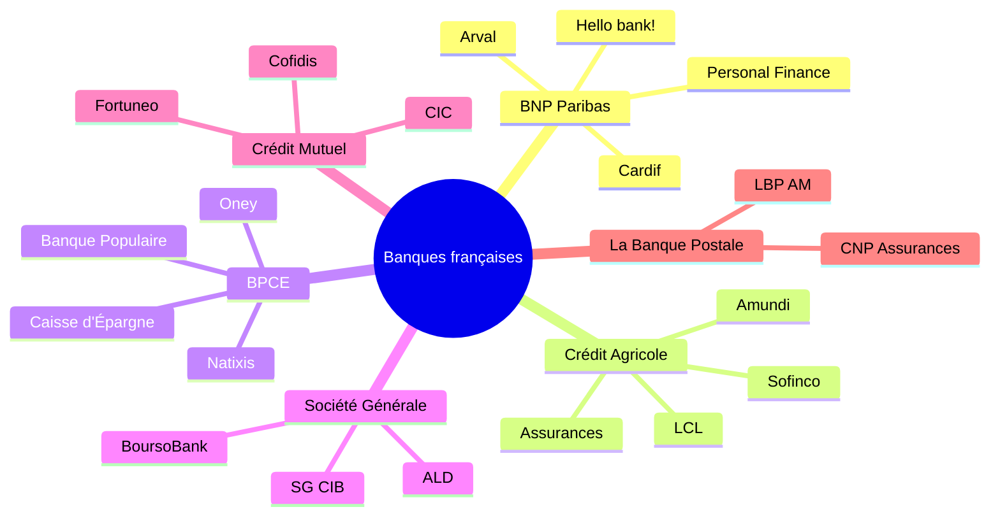

## À retenir

* Les **banques commerciales** (BNP Paribas, Société Générale) sont principalement détenues par des actionnaires via les marchés financiers.
* Les **banques mutualistes** (Crédit Agricole, BPCE, Crédit Mutuel) appartiennent indirectement à leurs **sociétaires**, selon une structure en caisses locales et régionales.
* **La Banque Postale** est un groupe public, contrôlé via La Poste et la Caisse des Dépôts.
* Chaque grand groupe est organisé autour de nombreuses **filiales spécialisées** : banque de détail, assurance, crédit à la consommation, gestion d'actifs, banque d'investissement, leasing, paiements et banque en ligne.
* Les grands groupes français sont devenus des **conglomérats financiers**, capables de couvrir presque tous les besoins des particuliers, des entreprises et des investisseurs.
