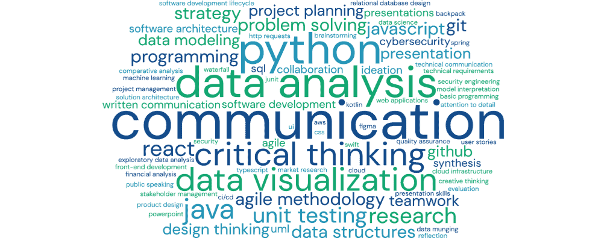
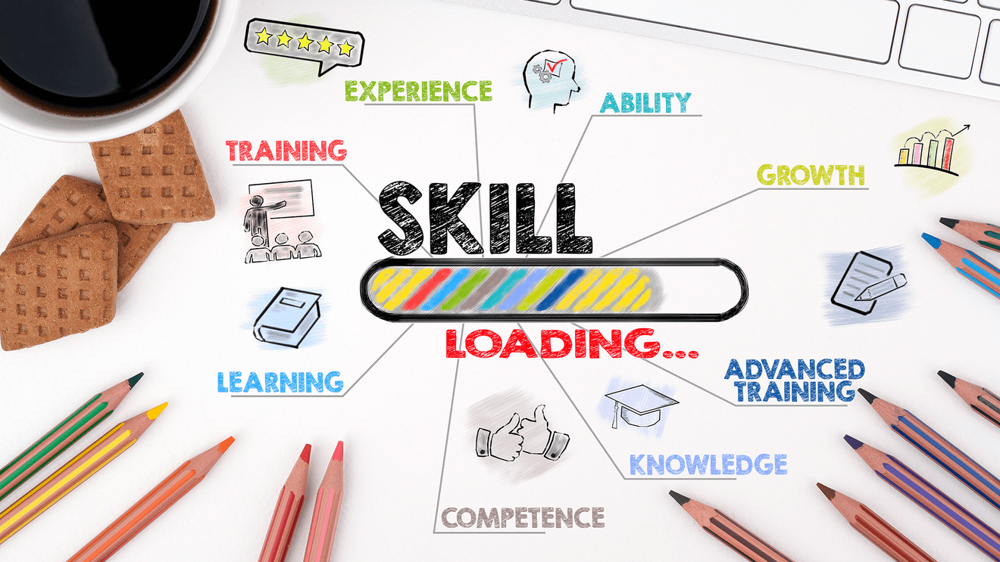

# SKILLS TO IMROVE (Compétences à acquerir ou à améliorer)
<div align="left">
	
	
	
</div>


# <ins>TECHNIQUES</ins>

## LANGAGES & FRAMEWORKS
- JAVA   (frameworks : SpringBoot, Spark, JUnit, Apache SHIRO)
- PYTHON (frameworks : Django, FastAPI)
- ANGULAR


## DEVOPS
- GIT, GITLAB, GITHUB, CI/CD (Gitlab CI, Jenkins, Github Actions)
- DOCKER (docker-compose, docker swarm)
- KUBERNETES (Helm)
- ANSIBLE
- TERRAFORM
- AWS (EC2, S3, RDS, IAM, Lambda)
- Prometheus, Grafana, ELK Stack (Elasticsearch + Logstash + Kibana)
- Gestion des secrets (Vault)


## Dev Mobile (iOS et Android)
**Natif Android**
- langage Kotlin (ou Java legacy Android)
- frameworks (Android SDK, Jetpack(Navigation, ViewModel, LiveData), Jetpack Compose(UI moderne)

**Natif iOS**
- langage Swift (ou Objective-C legacy iOS)
- frameworks (UIKit, SwiftUI)

**Cross Platform**
- Flutter (Dart) -> plus simple + performant
- Capacitor (créé par Ionic qui permet de transformer une app web (Angular, React, Vue…) en app mobile native)
- React Native -> si tu fais déjà du React

# <ins>IA (L'intelligence artificielle dans le dev)</ins>

## IA génératives (très utile au quotidien)
- ChatGPT
- Claude
- Gemini

## Assistant de code
- Github Copilot (Autocomplétion intelligente, payante)
- Codeium (Alternative gratuite à Copilot, Bon pour autocomplétion rapide)

## IDE avec IA intégrée
- Cursor
- Antigravity

## Agents
- Claude Code, Claude Cowork
- Codex

## Tests & Qualité de code
- Diffblue Cover (Génère automatiquement des tests JUnit pour Java, Très utile sur projets legacy)

## Outils
- v0 (Génère des interfaces UI à partir de texte)
- Figma + IA (Génère des maquettes rapidement, Convertissable en Angular)
- LangChain (Créer tes propres apps IA (chatbots, agents) )
- Ollama (Lancer des modèles IA en local, Utile pour confidentialité)

# <ins>Compétences Transverses</ins>

## 🚀 1. Les compétences pour se démarquer avec l’IA

🧠 **1.Pensée systémique (voir “le système complet”)**<br>
Un dev moyen code une feature.<br>
Un excellent dev comprend tout l’écosystème.<br>
👉 Exemple :
- Impact d’une API sur le frontend Angular
- Performance globale (DB + backend + UI)
- Scalabilité

💡 Avec l’IA :
```
Tout le monde peut générer du code → peu de gens comprennent comment tout s’assemble
```

🧩 **2.Architecture logicielle**<br>
👉 Savoir structurer une app proprement :
- Clean Architecture
- Microservices vs monolithe
- Découpage en modules

💡 L’IA peut écrire du code…<br>
👉 mais elle ne prend pas les bonnes décisions d’architecture à ta place

🤖 **3.Maîtrise de l’IA (pas juste l’utiliser)**<br>
Utiliser ChatGPT ou GitHub Copilot, c’est la base.<br>
Mais se démarquer = savoir :
- écrire de bons prompts (prompt engineering)
- vérifier le code généré
- intégrer l’IA dans son workflow

👉 Exemple :
```
“Génère un service Angular optimisé avec RxJS et gestion d’erreurs”
```

🔍 **4.Esprit critique (ultra important)**<br>
L’IA se trompe. Souvent.<br>
👉 Tu dois savoir :
- détecter les bugs
- remettre en question une solution
- comprendre le code généré

💡 Différence clé :
```
Dev junior + IA = danger
Dev expérimenté + IA = x10 productivité
```

⚡ **5.Productivité & automatisation**<br>
Un bon dev aujourd’hui :
- automatise (scripts, CI/CD)
- optimise son temps

👉 Exemple :
- génération automatique de tests
- scripts de déploiement

🧠 **6.Compréhension métier (business)**<br>
👉 Très sous-estimé<br>
Un dev qui comprend :
- le besoin utilisateur
- les enjeux business

➡️ devient irremplaçable<br>
💡 L’IA ne comprend pas vraiment ton métier.

💬 **7.Communication technique**<br>
Savoir expliquer clairement :
- une architecture
- un bug
- une décision

👉 Exemple :
- parler avec un PO
- expliquer à un junior

## 🧠 2. Les compétences transverses fondamentales

🧩 **1.Résolution de problèmes**<br>
C’est LA compétence clé.<br>
👉 Peu importe l’outil ou le langage :
```
tu es payé pour résoudre des problèmes
```

📚 **2.Apprendre à apprendre**<br>
Les technos changent vite (Angular, Java, IA…)<br>
👉 Tu dois :
- apprendre rapidement
- t’adapter

🧠 **3.Pensée logique & algorithmique**<br>
Même avec l’IA :
- comprendre la complexité
- optimiser

🔎 **4.Debugging avancé**<br>
👉 Savoir :
- lire des logs
- comprendre une stacktrace
- isoler un problème

💡 L’IA aide… mais ne remplace pas ça

🛠️ **5.Culture technique large**<br>
Un bon dev fullstack doit connaître :
- backend (Java, Spring)
- frontend (Angular)
- base de données
- réseau / HTTP
- un peu de DevOps

🔐 **6.Sécurité (de plus en plus important)**<br>
👉 Exemples :
- injections SQL
- auth / JWT
- gestion des données

🤝 **7.Travail en équipe**<br>
- code review
- pair programming
- collaboration

## 3. La Communication - Les compétences de communication clés pour un développeur

🎯 **1.Vulgarisation (ultra importante)**<br>
👉 Savoir expliquer simplement quelque chose de complexe<br>
Exemple :<br>
Tu dois expliquer une API Spring Boot :
- ❌ Mauvais :
```
“C’est une architecture REST avec injection de dépendances…”
```
- ✅ Bon :
```
“C’est un service qui permet à l’application Angular de récupérer les utilisateurs”
```

🧩 **2.Communication avec les non-tech (PO, client, métier)**<br>
👉 Traduire le technique en business<br>
Exemple :
- ❌ “Il y a un problème de latence réseau”
- ✅ “Les utilisateurs attendent trop longtemps, on risque de les perdre”

💡 Compétence rare → énorme valeur

🗣️ **3.Clarté dans les explications techniques**<br>
👉 Être structuré quand tu expliques :
- le problème
- la cause
- la solution

Exemple simple :
```
“Le bug vient de l’API (cause),
elle ne renvoie pas les bons champs (problème),
je propose de corriger le mapping (solution)”
```

🤝 **4.Communication en équipe**<br>
Essentiel en fullstack
- code review claire
- feedback constructif
- poser des questions intelligentes

Exemple :
- ❌ “Ton code est pas bon”
- ✅ “On pourrait simplifier cette logique avec une fonction réutilisable”

🧠 **5.Savoir poser les bonnes questions**<br>
👉 Un dev senior ne sait pas tout
👉 il sait poser les bonnes questions

Exemple :
- “Quel est le besoin utilisateur derrière cette feature ?”
- “Quelle est la priorité ?”
- “Quel est l’impact si on ne le fait pas ?”

⚡ **6.Communication écrite (très sous-estimée)**<br>
👉 Aujourd’hui, beaucoup passe par :
- Slack
- Jira
- documentation

Bon message :
- clair
- court
- structuré

Exemple :
```
Problème :
L’API /users renvoie une erreur 500

Cause :
NullPointerException côté backend

Solution :
Correction en cours + test ajouté
```

🧭 **7.Argumentation & prise de décision**<br>
👉 Savoir défendre une idée sans être rigide<br>
Exemple :
```
“Je propose de rester sur un monolithe pour l’instant, 
car notre trafic est faible et ça réduit la complexité”
```
💡 Tu expliques le pourquoi, pas juste le choix

🤖 **8.Communication avec l’IA (nouvelle compétence clé)**<br>
Oui, c’est une vraie compétence.<br>
Avec des outils comme ChatGPT ou GitHub Copilot :<br>
👉 La qualité de ton résultat dépend de :
- comment tu formules
- la précision
- le contexte

Exemple :
- ❌ “corrige ce code”
- ✅ “corrige ce service Angular, optimise les observables et ajoute une gestion d’erreur”
