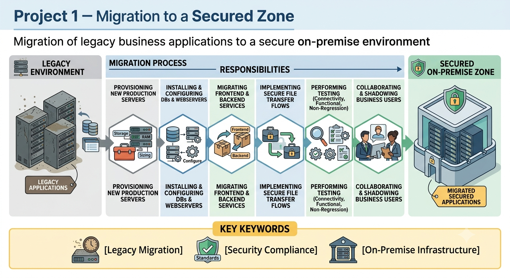

# <ins>Projects done</ins>

## 🔷 Global Context (Introduction)

I worked for seven years as a Full Stack Java developer on several internal business applications related to billing, roaming, special numbers, and international routing.

These applications were originally developed by business teams and operated on legacy, non-secure infrastructures.

The IT department later took ownership of these systems in order to bring them into compliance with Bouygues security standards.

## 🔹 Project 1 – Migration to a Secured Zone

This project involved migrating legacy business applications to a secure on-premise environment.

	

### Responsibilities

* Provisioning new production servers (storage, RAM, and infrastructure sizing)
* Installing and configuring databases, application servers, and web servers
* Migrating frontend applications and backend processing services
* Implementing secure file transfer flows between systems
* Performing connectivity, functional, and non-regression testing
* Collaborating closely with business users during testing phases
* Shadowing end users to better understand their workflows and tool usage

### Key Keywords

`legacy migration`, `security compliance`, `on-premise infrastructure`

---

## 🔹 Project 2 – AWS Cloud Migration

This project focused on migrating existing applications to the AWS cloud platform.

### Responsibilities

* Cloud migration of applications, databases, and file storage systems
* Use of AWS services: EC2, RDS, S3, and Lambda
* Collaboration with multiple teams: Cloud, DevOps, DBAs, SSO, Operations, and Business stakeholders
* Implementation of CI/CD pipelines using GitLab CI/CD, Artifactory, and iDeploy
* Cost estimation and optimization of cloud resources
* Agile development environment with daily stand-ups
* Setup and validation of test environments
* Regular coordination with operations and business teams during UAT phases

### Key Keywords

`cloud migration`, `CI/CD`, `DevOps`, `cross-team collaboration`

---

## 🔹 Project 3 – Spring Boot Batch Processing for Data Warehouse (SHELTER)

Development of a batch processing system using Spring Boot for a data warehouse based on four Oracle schemas.

### Responsibilities

* Design and implementation of Spring Boot batch jobs for:

  * Database-to-database data loading
  * File-to-database ingestion processes
* Refactoring legacy Talend jobs into pure Java implementations using Apache Spark
* Development of batch processing modules, including:

  * File comparison module
  * Rejected ticket reprocessing module from RabbitMQ queues

# <ins>Vocabulaire clé à utiliser (indispensable)</ins>

## 🔹 Général / Contexte
- Business tools / Internal business applications
- Legacy applications
- Originally developed by business teams
- Lack of security compliance
- Non-compliant with security standards
- Maintenance (corrective and evolutive)
- Change requests (au lieu de EB → Evolutionary Requests / Change Requests)
- Stakeholders (business, operations, cloud team, DBA…)

## 🔹 Front / Back
- Frontend UI / Web interfaces
- Backend processing
- Batch processing
- Business logic
- Data processing pipelines

## 🔹 Infrastructure & Sécurité
- On-premise servers
- Dedicated servers
- Low Storage / insufficient RAM
- Outdated operating systems
- Secure zone / secured network
- Security compliance
- File transfer flows
- Secure file transfer (SFTP / STF)

## 🔹 Tests
- Connectivity testing
- Functional testing
- Non-regression testing
- User Acceptance Testing (UAT)
- Test environments

## 🔹 Agile / Organisation
- Agile methodology
- Daily stand-ups
- Estimation and planning
- Challenging estimates
- Cross-team collaboration

## 🔹 Cloud & DevOps
- Cloud migration
- Cloud-native architecture
- AWS services (EC2, RDS, S3, Lambda)
- CI/CD pipelines
- DevOps toolchain
- Automation
- Deployment pipelines

## 🔹 Data / Batch
- Data warehouse
- Batch jobs
- Data ingestion
- File-to-database / database-to-database
- Data aggregation
- Stored procedures
- Message queue (RabbitMQ)
- Rejected messages recycling

---

# <ins>Phrases types pour l’oral (très utiles)</ins>

## 🔹 Présenter son rôle

* "I was responsible for the end-to-end implementation of several features."
* "I was involved in both development and production deployment."
* "I worked as a Full Stack Java developer."
* "My role covered both technical implementation and business support."
* "I participated in all phases of the project, from design to production."
* "I mainly worked on backend development, but I also contributed to the frontend."
* "I was in charge of maintaining and evolving several internal business applications."

---

## 🔹 Décrire un projet

* "The objective of this project was to migrate legacy applications to a secure infrastructure."
* "The application was originally developed by business teams."
* "Later, the IT department took ownership of the application."
* "The main goal was to improve security, reliability, and maintainability."
* "This application was used internally by different business departments."
* "It was a critical application because it handled billing and roaming data."

---

## 🔹 Expliquer ses missions

* "I developed new business features."
* "I fixed production issues and investigated incidents."
* "I implemented change requests from business users."
* "I migrated applications to new environments."
* "I configured application servers and databases."
* "I created and maintained batch processing jobs."
* "I implemented secure file transfer mechanisms."
* "I performed database optimization when needed."
* "I monitored application performance after deployment."

---

## 🔹 Collaboration

* "I worked closely with business stakeholders to understand their needs."
* "I collaborated with the Cloud team during the migration."
* "I coordinated with DevOps engineers for deployments."
* "I regularly interacted with DBAs regarding database migrations."
* "I worked with the Operations team during production releases."
* "We organized daily stand-up meetings."
* "We worked in an Agile environment."

---

## 🔹 Tests

* "I performed connectivity testing before production deployment."
* "I executed functional and non-regression tests."
* "I prepared test environments."
* "I supported User Acceptance Testing (UAT)."
* "I validated the application with business users before production."

---

## 🔹 Migration

* "We migrated several legacy applications to a secured on-premise environment."
* "Later, we migrated these applications to AWS."
* "The migration included databases, application servers, and file storage."
* "One of the biggest challenges was ensuring service continuity during the migration."
* "We had to minimize downtime during production deployment."

---

## 🔹 AWS / Cloud

* "We migrated the application to AWS."
* "We used EC2 for virtual machines."
* "RDS was used to host Oracle databases."
* "Files were stored in Amazon S3."
* "AWS Lambda was used for lightweight processing."
* "We optimized cloud resource costs."
* "We automated deployments using CI/CD pipelines."

---

## 🔹 DevOps

* "We used GitLab CI/CD to automate deployments."
* "Artifacts were stored in Artifactory."
* "Deployments were managed with iDeploy."
* "Automation reduced deployment time and human errors."
* "The CI/CD pipeline improved delivery reliability."

---

## 🔹 Batch / Data

* "I developed Spring Boot batch jobs."
* "The application processed millions of records every day."
* "I implemented database-to-database synchronization."
* "I developed file-to-database ingestion processes."
* "I replaced legacy Talend jobs with Java and Apache Spark."
* "RabbitMQ was used to process asynchronous messages."
* "I developed a module to reprocess rejected messages."

---

## 🔹 Difficultés / Challenges

* "One of the biggest challenges was security compliance."
* "The legacy applications were running on outdated operating systems."
* "Some servers had limited storage and insufficient RAM."
* "Another challenge was understanding undocumented legacy code."
* "We had to ensure zero data loss during migration."
* "Coordinating multiple technical teams was also challenging."

---

## 🔹 Résultats / Impact

* "The migration improved security and system reliability."
* "Application performance was significantly improved."
* "Maintenance became much easier after the migration."
* "Deployment time was greatly reduced thanks to CI/CD."
* "The new architecture was more scalable."
* "The cloud migration reduced infrastructure costs."
* "The solution became easier to monitor and maintain."

---

## 🔹 Donner son avis

* "I really enjoyed working on this project because it involved many technologies."
* "It was technically challenging and very rewarding."
* "I learned a lot about cloud technologies and DevOps practices."
* "This project helped me improve my communication with business stakeholders."
* "It strengthened my experience in large-scale application migration."

---

## 🔹 Pour gagner du temps à l'oral

* "To give you a bit more context..."
* "Basically..."
* "From a technical perspective..."
* "From a business perspective..."
* "The main objective was..."
* "One important point is that..."
* "What was particularly interesting was..."
* "If I had to summarize the project..."
* "The key challenge was..."
* "In the end..."
* "Overall, the project was a success."

---

## 🔹 Répondre aux questions classiques

### **Can you describe your role?**

> "I was responsible for developing and maintaining several internal business applications. I worked on both frontend and backend development, participated in production deployments, and collaborated closely with business stakeholders, DevOps engineers, DBAs, and operations teams."

### **What was the biggest challenge?**

> "The biggest challenge was migrating legacy applications while ensuring business continuity. We had to modernize the infrastructure without impacting production users or losing any data."

### **What technologies did you use?**

> "The main technologies were Java, Spring Boot, Oracle Database, Apache Spark, RabbitMQ, GitLab CI/CD, AWS EC2, RDS, S3, Lambda, Artifactory, and iDeploy."

### **How did you work with the business team?**

> "We organized regular meetings with business stakeholders to clarify requirements, validate new features, and support User Acceptance Testing before each production release."

### **What are you most proud of?**

> "I'm particularly proud of contributing to the successful migration of several critical legacy applications to secure infrastructures and later to AWS, while improving security, maintainability, and deployment automation."

