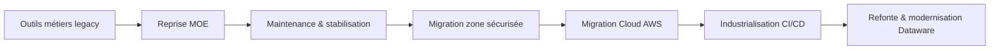
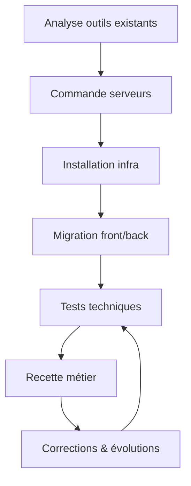
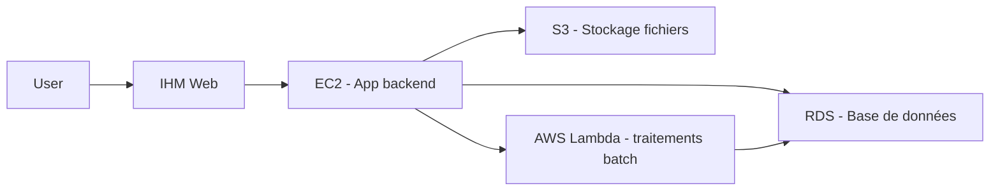
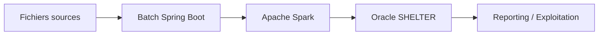
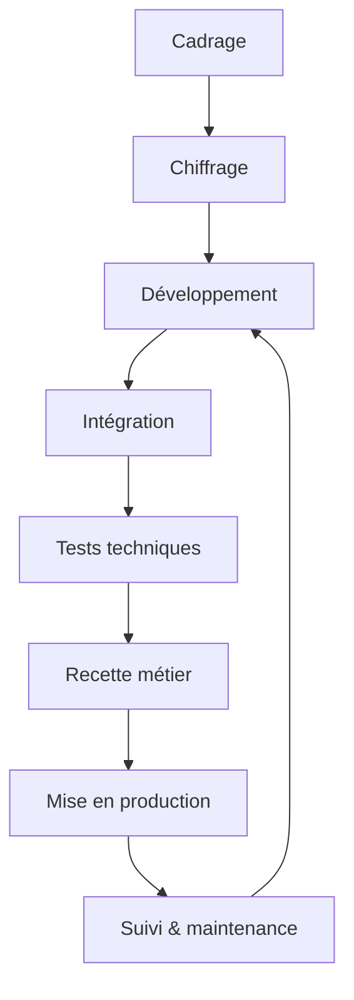

Voici une version **structurée, enrichie et mise en Markdown**, avec des **diagrammes Mermaid** pour clarifier les enchaînements projets et l’organisation globale.

---

# 🧭 Projets & Expériences

## 1. Contexte général

Les projets portent sur des **outils métiers IHM critiques** liés à :

* Facturation
* Roaming
* Numéros spéciaux
* Routage international

### Contexte initial

Ces outils ont été :

* développés directement par le métier (prototypage “coin de table”)
* hébergés sur des serveurs obsolètes :

  * faible stockage
  * RAM insuffisante
  * OS anciens
  * accès non contrôlé aux bases de production

### Reprise par la MOE

La MOE a repris ces outils afin de :

* sécuriser les applications
* mettre en conformité avec les normes de sécurité (Bouygues)
* industrialiser l’hébergement et les déploiements

---

## 🔄 Vue globale de transformation

---

# 🧩 Phase initiale : Prise en main

* Analyse des outils existants
* Maintenance corrective
* Maintenance évolutive (EBs métiers)
* Stabilisation des environnements

---

# 🚧 Projet 1 — Migration vers zone sécurisée

## Objectifs

* Sécurisation des applications
* Mise en conformité infrastructure
* Modernisation des serveurs

## Réalisations

* Commande de nouveaux serveurs de production
* Installation des briques techniques :

  * SGBD
  * serveurs web
  * outils métiers
* Migration des IHM front et traitements back
* Mise en place de flux sécurisés (STF)
* Tests :

  * connectivité
  * non-régression
  * fonctionnels
* Interaction forte avec le métier :

  * échanges réguliers
  * retours de recette
  * observation terrain

---

## 🔁 Cycle projet (Projet 1)

---

## Activités continues

* Correction de bugs
* Évolutions fonctionnelles (front & back)
* Intégration progressive des EB métiers

---

# ☁️ Projet 2 — Migration Cloud AWS

## Objectifs

* Cloudification complète des outils
* Mise en place d’une architecture scalable
* Industrialisation DevOps

## Stack AWS utilisée

* EC2
* RDS
* S3
* Lambda

---

## Activités principales

* Migration des composants :

  * IHM
  * bases de données
  * stockage fichiers
* Mise en place CI/CD :

  * GitLab CI/CD
  * Artifactory
  * iDeploy
* Coordination multi-équipes :

  * Dev
  * Cloud
  * DBA
  * SSO
  * STF
  * Exploitation
  * Métier
* Méthode agile :

  * daily meeting quotidien
  * suivi sprint
* Chiffrage & planification :

  * estimation initiale
  * challenge des charges
  * optimisation continue
* Recette métier :

  * 2 points/semaine
  * ajustements continus

---

## ☁️ Architecture cible AWS

---

## Optimisations spécifiques

* Amélioration traitements Talend
* Optimisation procédures stockées
* Traitement fichiers roaming
* Préparation JO 2024 (charge critique)

---

# ⚙️ Projet 3 — Datawarehouse SHELTER (Oracle)

## Objectif

Construire et moderniser un Datawarehouse multi-schémas (4 schémas Oracle)

---

## Réalisations

* Développement de batchs Spring Boot :

  * chargement base à base
  * chargement fichier à base
* Refonte Talend → Java pur
* Utilisation Apache Spark
* Modules développés :

  * comparaison de fichiers
  * recyclage de tickets RabbitMQ
  * traitements batch avancés

---

## 🧱 Architecture logique

---

# 🔁 Processus projet (organisation)

## Gouvernance

* Daily DEV → suivi avancement & blocages
* Point Exploitation → lancement projet
* Weekly manager → suivi global
* Recette métier → 1 à 2 fois/semaine
* Reporting projet → hebdomadaire ou bi-hebdo

---

## 📊 Cycle de vie projet

---

# 👔 Rôle du Chef de Projet

## Missions principales

* Pilotage global projet
* Respect coûts / délais / qualité
* Coordination multi-équipes
* Communication transverse
* Gestion des risques

---

## Compétences clés

* Techniques
* Analyse fonctionnelle
* Leadership
* Résolution de problèmes
* Adaptabilité

---

## Questions de pilotage

* Comment anticiper les risques ?
* Comment chiffrer efficacement ?
* Comment planifier les charges ?
* Comment gérer les parties prenantes ?
* Comment communiquer efficacement ?
* Comment motiver les équipes techniques ?
* Comment assurer la qualité des livrables ?
* Comment documenter correctement ?

---

# ❓ Questions entretien

## 🔍 Compréhension du poste

* Qu’est-ce qu’une réussite à 3–6 mois ?
* Quels sont les principaux défis ?
* Quels projets sont typiques de réussite ?
* Quelle stack est critique dès le départ ?

---

## 🧠 Technique & organisation

* Comment sont prises les décisions techniques ?
* Gestion de la dette technique ?
* Importance des tests et des revues de code ?
* Historique de refactoring important ?

---

## 🤝 Équipe

* Organisation front/back ?
* Gestion des désaccords techniques ?
* Niveau d’autonomie attendu ?
* Processus d’onboarding ?

---

## 🚀 Évolution

* Opportunités d’évolution ?
* Formation et montée en compétences ?
* Parcours récents dans l’équipe ?

---

## 📈 Produit

* Mesure de la performance développeur ?
* Vision produit 1–2 ans ?
* Implication des devs dans les décisions produit ?

---

## ⚠️ Questions critiques

* Pourquoi certains recrutements ont échoué ?
* Qu’est-ce qui est le plus difficile ici ?
* Pourquoi hésiteriez-vous à recruter ce profil ?

---

# 🧰 Outils Chef de Projet

## Planification

* Microsoft Project
* Jira
* Trello

## Communication

* Microsoft Teams
* Confluence

## Documentation

* Notion
* Google Docs / Office 365
* Draw.io / Lucidchart
* Figma

## Tests

* Postman

## DevOps

* Git / GitLab
* CI/CD (GitLab, Jenkins)
* Docker / Kubernetes

## Reporting

* Power BI
* Tableau
* Excel

## Risques & ITSM

* ServiceNow
* GLPI
* iTop

---

Si tu veux, je peux aussi :

* te le transformer en **CV ultra impactant**
* ou en **présentation PowerPoint (slides entretien)**
* ou en **version “storytelling entretien” beaucoup plus orale et fluide**
