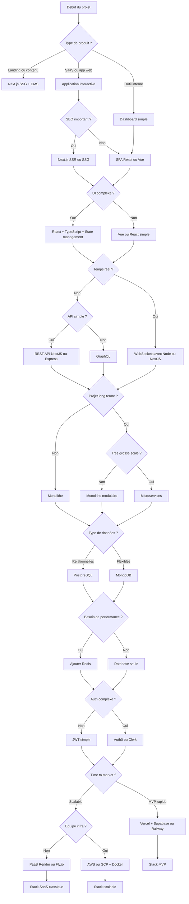

# Critères pour choisir sa stack technique (avec choix recommandés)

## 1. FRONTEND

### Type d'application
- SPA simple → React (Vite), Vue
- SEO important → Next.js (SSR/SSG), Nuxt
- Temps réel → React + WebSockets (Socket.io)

### Complexité UI
- UI simple → Vue ou React sans framework lourd
- UI complexe (dashboard) → React + TypeScript + Zustand/Redux
- Design system → React + Storybook + Tailwind / MUI

### Performance
- App publique → Next.js (SSR/SSG)
- App interne → SPA classique (moins critique)

### Écosystème
- Très mature → React
- Plus simple/rapide → Vue
- Performance pure → Svelte

### Maintenabilité
- Projet long terme → TypeScript obligatoire
- Petite app → JS possible

---

## 2. BACKEND

### Type d'API
- CRUD classique → REST (Express, NestJS, Django)
- Front riche / flexible → GraphQL (Apollo, Hasura)
- Microservices → gRPC

### Temps réel
- Chat / live → WebSockets (Socket.io, NestJS Gateway)
- Notifications simples → SSE

### Architecture
- MVP → Monolithe (NestJS, Django)
- Grande scale → Microservices (Node/NestJS, Go)

### Runtime
- Rapid dev → Node.js (NestJS)
- Performance → Go / Rust
- Écosystème riche → Python (Django/FastAPI)

### Sécurité
- SaaS classique → JWT + refresh tokens
- Produit B2B → OAuth + SSO

---

## 3. DATABASE

### Type
- Données relationnelles → PostgreSQL (choix par défaut)
- Données flexibles → MongoDB
- Cache / sessions → Redis

### Cas typiques
- SaaS → PostgreSQL
- Temps réel → Redis + PostgreSQL
- Analytics massif → BigQuery / ClickHouse

### Scalabilité
- Début → PostgreSQL simple
- Scale → Read replicas + partitionnement

---

## 4. INFRASTRUCTURE & DEPLOYMENT

### Hébergement
- MVP → Vercel / Railway / Render
- Production scalable → AWS / GCP
- Simplicité → PaaS (Railway, Fly.io)

### CI/CD
- Standard → GitHub Actions
- Enterprise → GitLab CI

### Conteneurisation
- Petit projet → pas obligatoire
- Projet sérieux → Docker
- Scale → Kubernetes (souvent overkill au début)

---

## 5. AUTHENTIFICATION & AUTHORIZATION

### Authentification
- Simple → NextAuth / Auth.js
- Custom → JWT + bcrypt
- Enterprise → Auth0 / Clerk / Firebase Auth

### Authorization
- Simple → RBAC (roles)
- Complexe → ABAC

---

## 6. PERFORMANCE & CACHING

### Cache
- Front → CDN (Cloudflare, Vercel Edge)
- Backend → Redis
- API → HTTP cache

### Cas typiques
- Blog → CDN + SSG
- SaaS → Redis cache + DB optimisée

---

## 7. OBSERVABILITÉ & MONITORING

### Logs
- Simple → console + fichiers
- Prod → Datadog / ELK

### Monitoring
- Infra → Prometheus + Grafana
- SaaS simple → Sentry (errors)

### Tracing
- Microservices → OpenTelemetry

---

## 8. TESTING

### Choix
- Unit → Jest / Vitest
- E2E → Playwright (meilleur choix actuel)
- API → Supertest

### Stratégie
- MVP → peu de tests
- Scale → pyramide de tests complète

---

## 9. SÉCURITÉ

### Basique
- HTTPS obligatoire
- Validation inputs → Zod / Joi

### Avancé
- Rate limiting → Redis
- WAF → Cloudflare

---

## 10. DX (DEVELOPER EXPERIENCE)

### Outils
- Lint → ESLint
- Format → Prettier
- Git hooks → Husky

### Stack idéale
- TypeScript + monorepo (Turborepo / Nx)

---

## 11. ÉQUIPE & CONTEXTE PROJET

### Cas typiques
- Solo dev → Next.js + Supabase
- Startup → Next.js + PostgreSQL + Node
- Grande équipe → microservices + CI/CD avancé

---

## 12. ÉVOLUTIVITÉ & MAINTENANCE

### Bon choix par défaut
- Backend → NestJS (structure scalable)
- DB → PostgreSQL
- Front → React + TypeScript

### Anti-patterns
- Sur-engineering trop tôt (microservices)
- Mauvais découpage dès le début

---

## 13. INTÉGRATIONS & ÉCOSYSTÈME

### Paiement
- Stripe (standard)

### Email
- Resend / SendGrid

### Notifications
- Firebase / OneSignal

---

## 14. ARCHITECTURE GLOBALE

### Patterns
- Simple → MVC
- Scalable → Clean Architecture / Hexagonal

### Organisation
- Fullstack → Monorepo (Turborepo)
- Microservices → Multirepo

---

## 15. DATA & ANALYTICS

### Tracking
- Produit simple → Google Analytics
- Produit SaaS → PostHog (très bon choix)

---

## 16. INTERNATIONALISATION (i18n)

### Solutions
- Next.js i18n
- i18next

---

## 17. ACCESSIBILITÉ

### Outils
- Lighthouse
- axe DevTools

---

# STACKS TYPES (résumé rapide)

## MVP rapide
- Front → Next.js
- Back → API routes Next.js
- DB → PostgreSQL (Supabase)
- Auth → Supabase/Auth.js
- Deploy → Vercel

## SaaS classique
- Front → Next.js + TS
- Back → NestJS
- DB → PostgreSQL + Redis
- Auth → JWT
- Infra → Docker + AWS

## Scale / entreprise
- Front → React + design system
- Back → microservices (Node/Go)
- DB → PostgreSQL + Redis + event bus (Kafka)
- Infra → Kubernetes

# Flowchart de décision - Choix de stack technique

---

## 🧠 Comment l’utiliser concrètement

Tu pars du haut et tu suis **sans réfléchir trop longtemps** :

### Exemple 1 (startup classique)
- SaaS → UI complexe → pas SEO → React SPA  
- API simple → REST → monolithe  
- DB relationnelle → PostgreSQL  
- MVP → Vercel  

👉 **Stack finale :**
- Next.js / React
- NestJS
- PostgreSQL
- Vercel

---

### Exemple 2 (produit temps réel type chat)
- App interactive → temps réel → WebSockets  
- Backend Node  
- Redis + PostgreSQL  

👉 **Stack finale :**
- React
- NestJS + Socket.io
- PostgreSQL + Redis

---

### Exemple 3 (grosse scale)
- App complexe → microservices  
- Haute perf → Go + Node  
- Infra → Kubernetes  

👉 **Stack finale :**
- React + design system
- Microservices (Node/Go)
- PostgreSQL + Redis + Kafka
- Kubernetes

---

## ⚠️ Règles importantes (issues de l’expérience)

- Commence **toujours monolithe sauf preuve du contraire**
- PostgreSQL est le **default choice 80% du temps**
- Redis devient utile **très vite dès que ça scale**
- Next.js est souvent le **meilleur compromis frontend**
- Kubernetes est **inutile au début dans 90% des cas**

---

Si tu veux, je peux te transformer ce flowchart en :
- :contentReference[oaicite:0]{index=0}
- ou en **:contentReference[oaicite:1]{index=1}**

Ou même te dire directement : *“voici ta stack optimale”* si tu me décris ton projet 👍