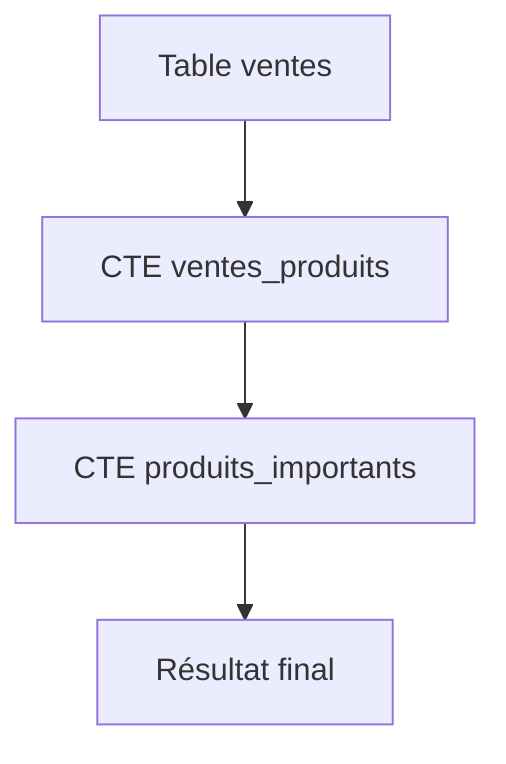
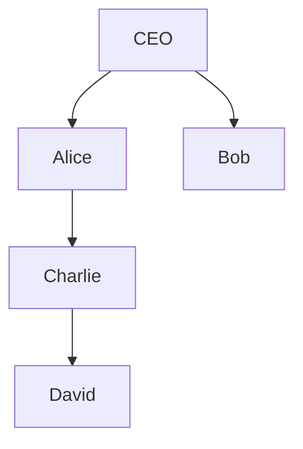
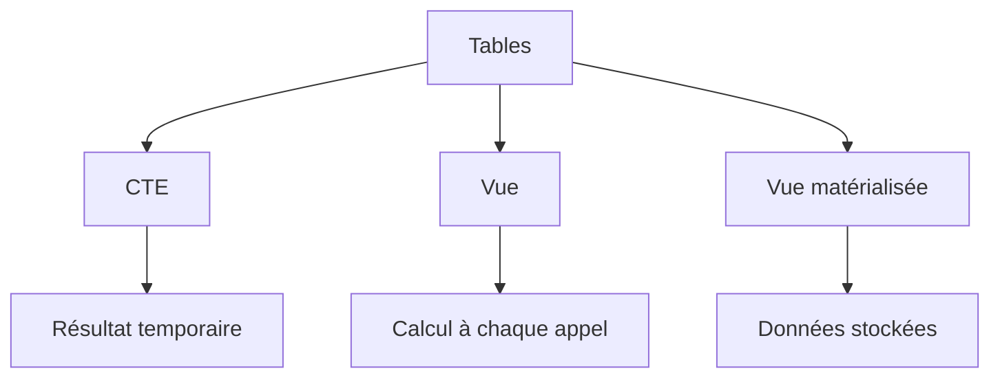
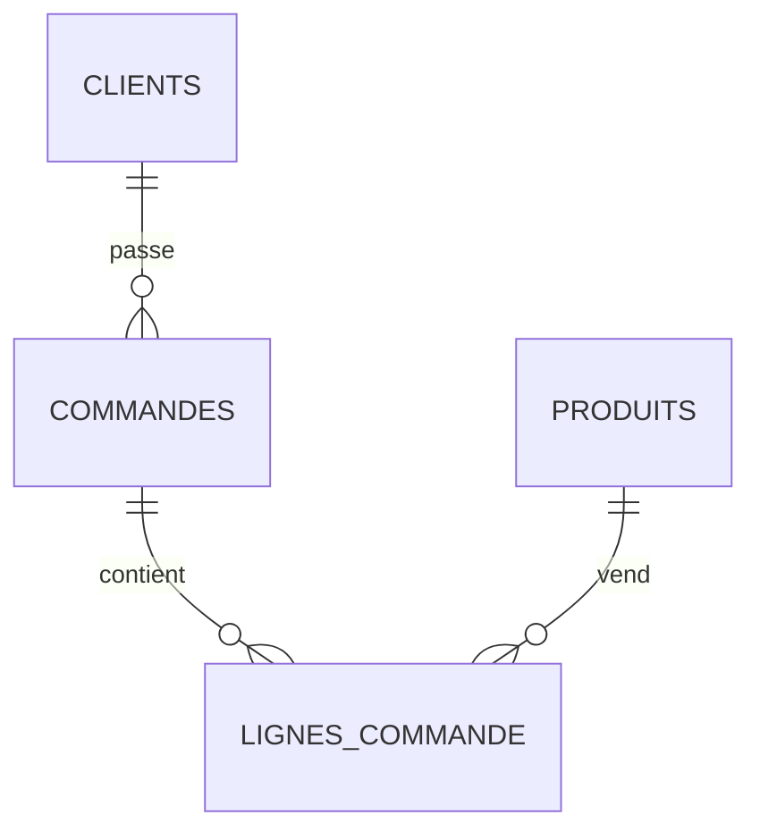

# CTE, vues et vues matérialisées en SQL

Ces trois concepts servent à **structurer, simplifier et optimiser les requêtes SQL**, mais ils ont des usages très différents :

| Concept                              | Stocke les données ? | Durée de vie      | Cas d'usage                     |
| ------------------------------------ | -------------------- | ----------------- | ------------------------------- |
| CTE (Common Table Expression)        | ❌ Non                | Une seule requête | Décomposer une requête complexe |
| Vue (View)                           | ❌ Non                | Permanente        | Abstraction et réutilisation    |
| Vue matérialisée (Materialized View) | ✅ Oui                | Permanente        | Performance et pré-calcul       |

---

# 1. Les CTE (Common Table Expressions)

Une CTE est une **table temporaire nommée** créée uniquement pour l'exécution d'une requête.

Syntaxe :

```sql
WITH nom_cte AS (
    SELECT ...
)
SELECT *
FROM nom_cte;
```

---

## Exemple de base

Supposons la table :

```sql
CREATE TABLE ventes (
    id INT,
    produit VARCHAR(50),
    montant DECIMAL(10,2)
);
```

Données :

| id | produit | montant |
| -- | ------- | ------- |
| 1  | PC      | 1200    |
| 2  | Souris  | 30      |
| 3  | PC      | 1500    |
| 4  | Clavier | 80      |

---

### Sans CTE

```sql
SELECT *
FROM (
    SELECT produit,
           SUM(montant) AS total
    FROM ventes
    GROUP BY produit
) t
WHERE total > 1000;
```

---

### Avec CTE

```sql
WITH total_produits AS (
    SELECT produit,
           SUM(montant) AS total
    FROM ventes
    GROUP BY produit
)
SELECT *
FROM total_produits
WHERE total > 1000;
```

Résultat :

| produit | total |
| ------- | ----- |
| PC      | 2700  |

---

## Plusieurs CTE

Une CTE peut dépendre d'une autre.

```sql
WITH ventes_produits AS (
    SELECT produit,
           SUM(montant) AS total
    FROM ventes
    GROUP BY produit
),
produits_importants AS (
    SELECT *
    FROM ventes_produits
    WHERE total > 1000
)
SELECT *
FROM produits_importants;
```

---

## Diagramme de flux



---

# CTE récursives

Très utilisées pour :

* arbres
* hiérarchies
* catégories
* organigrammes

---

## Exemple : employés

```sql
CREATE TABLE employes (
    id INT,
    nom VARCHAR(50),
    manager_id INT
);
```

| id | nom     | manager_id |
| -- | ------- | ---------- |
| 1  | CEO     | NULL       |
| 2  | Alice   | 1          |
| 3  | Bob     | 1          |
| 4  | Charlie | 2          |
| 5  | David   | 4          |

---

## Trouver toute la hiérarchie

```sql
WITH RECURSIVE hierarchie AS (

    SELECT
        id,
        nom,
        manager_id,
        1 AS niveau
    FROM employes
    WHERE manager_id IS NULL

    UNION ALL

    SELECT
        e.id,
        e.nom,
        e.manager_id,
        h.niveau + 1
    FROM employes e
    JOIN hierarchie h
        ON e.manager_id = h.id
)
SELECT *
FROM hierarchie;
```

Résultat :

| id | nom     | niveau |
| -- | ------- | ------ |
| 1  | CEO     | 1      |
| 2  | Alice   | 2      |
| 3  | Bob     | 2      |
| 4  | Charlie | 3      |
| 5  | David   | 4      |

---

## Fonctionnement



La CTE :

1. récupère la racine (CEO)
2. récupère ses enfants
3. récupère les enfants des enfants
4. continue jusqu'à épuisement

---

# 2. Les vues (Views)

Une vue est une **requête sauvegardée**.

Elle ne stocke pas les données.

---

## Création

```sql
CREATE VIEW vue_ventes AS
SELECT
    produit,
    SUM(montant) AS total
FROM ventes
GROUP BY produit;
```

---

## Utilisation

```sql
SELECT *
FROM vue_ventes;
```

SQL exécute en réalité :

```sql
SELECT
    produit,
    SUM(montant) AS total
FROM ventes
GROUP BY produit;
```

à chaque appel.

---

## Diagramme


---

## Avantages

### Simplification

Au lieu de :

```sql
SELECT
    c.nom,
    SUM(v.montant)
FROM clients c
JOIN ventes v
    ON c.id = v.client_id
GROUP BY c.nom;
```

On crée :

```sql
CREATE VIEW chiffre_affaires_clients AS
SELECT
    c.nom,
    SUM(v.montant) AS total
FROM clients c
JOIN ventes v
    ON c.id = v.client_id
GROUP BY c.nom;
```

Puis :

```sql
SELECT *
FROM chiffre_affaires_clients;
```

---

## Sécurité

Masquer certaines colonnes :

Table :

```sql
employes
```

| id | nom   | salaire |
| -- | ----- | ------- |
| 1  | Alice | 4000    |

---

Vue :

```sql
CREATE VIEW vue_employes AS
SELECT
    id,
    nom
FROM employes;
```

L'utilisateur ne voit jamais :

```sql
salaire
```

---

## Vue modifiable

Certaines vues permettent :

```sql
INSERT
UPDATE
DELETE
```

Exemple :

```sql
CREATE VIEW vue_clients AS
SELECT *
FROM clients;
```

Puis :

```sql
INSERT INTO vue_clients
VALUES (1,'Dupont');
```

La donnée est insérée dans la table réelle.

---

## Limites

Les vues deviennent souvent non modifiables lorsqu'elles contiennent :

```sql
GROUP BY
DISTINCT
UNION
JOIN complexes
fonctions d'agrégation
```

Par exemple :

```sql
CREATE VIEW ventes_totales AS
SELECT produit,
       SUM(montant)
FROM ventes
GROUP BY produit;
```

Cette vue est généralement en lecture seule.

---

# 3. Les vues matérialisées

Une vue matérialisée stocke physiquement le résultat.

C'est une sorte de :

> "table générée automatiquement à partir d'une requête"

---

## Création (PostgreSQL)

```sql
CREATE MATERIALIZED VIEW mv_ventes AS
SELECT
    produit,
    SUM(montant) AS total
FROM ventes
GROUP BY produit;
```

---

## Ce qui se passe


Contrairement à une vue classique :


---

# Exemple concret

Table :

```sql
ventes
```

10 millions de lignes.

Requête :

```sql
SELECT produit,
       SUM(montant)
FROM ventes
GROUP BY produit;
```

Temps :

```text
5 secondes
```

---

Création :

```sql
CREATE MATERIALIZED VIEW mv_ventes AS
SELECT produit,
       SUM(montant) AS total
FROM ventes
GROUP BY produit;
```

---

Consultation :

```sql
SELECT *
FROM mv_ventes;
```

Temps :

```text
10 ms
```

car les résultats sont déjà calculés.

---

# Le problème : les données vieillissent

Supposons :

```sql
INSERT INTO ventes
VALUES (5,'PC',2000);
```

La vue matérialisée n'est PAS mise à jour automatiquement.

Elle contient encore :

| produit | total |
| ------- | ----- |
| PC      | 2700  |

au lieu de :

| produit | total |
| ------- | ----- |
| PC      | 4700  |

---

# Rafraîchissement

PostgreSQL :

```sql
REFRESH MATERIALIZED VIEW mv_ventes;
```

Après :

| produit | total |
| ------- | ----- |
| PC      | 4700  |

---

# Refresh concurrent

Pour éviter de bloquer les lectures :

```sql
REFRESH MATERIALIZED VIEW CONCURRENTLY mv_ventes;
```

Nécessite généralement un index unique.

---

# Comparaison complète

## Architecture



---

## Tableau récapitulatif

| Critère                 | CTE              | Vue              | Vue matérialisée |
| ----------------------- | ---------------- | ---------------- | ---------------- |
| Réutilisable            | Non              | Oui              | Oui              |
| Stockage physique       | Non              | Non              | Oui              |
| Persistante             | Non              | Oui              | Oui              |
| Performance lecture     | Moyenne          | Moyenne          | Très élevée      |
| Données toujours à jour | Oui              | Oui              | Non              |
| Recalcul nécessaire     | À chaque requête | À chaque requête | Au refresh       |
| Support de récursion    | Oui              | Non              | Non              |

---

# Quand utiliser quoi ?

## Utiliser une CTE lorsque

✅ la requête est complexe

✅ plusieurs étapes de calcul

✅ hiérarchies et récursion

```sql
WITH ...
```

---

## Utiliser une vue lorsque

✅ plusieurs développeurs utilisent la même requête

✅ besoin d'abstraction

✅ besoin de masquer certaines colonnes

```sql
CREATE VIEW ...
```

---

## Utiliser une vue matérialisée lorsque

✅ agrégations coûteuses

✅ dashboards

✅ reporting

✅ entrepôts de données (Data Warehouse)

```sql
CREATE MATERIALIZED VIEW ...
```

---

# Exemple professionnel complet

Imaginons un site e-commerce :



### Étape 1 : CTE

Calcul du CA du mois :

```sql
WITH ventes_mois AS (
    SELECT
        produit_id,
        SUM(montant) AS ca
    FROM lignes_commande
    WHERE date_commande >= DATE_TRUNC('month', CURRENT_DATE)
    GROUP BY produit_id
)
SELECT *
FROM ventes_mois;
```

### Étape 2 : Vue

Création d'une vue métier :

```sql
CREATE VIEW chiffre_affaires_produits AS
SELECT
    p.nom,
    SUM(lc.montant) AS ca
FROM produits p
JOIN lignes_commande lc
    ON p.id = lc.produit_id
GROUP BY p.nom;
```

### Étape 3 : Vue matérialisée

Pour un dashboard consulté toute la journée :

```sql
CREATE MATERIALIZED VIEW dashboard_ca AS
SELECT
    p.nom,
    SUM(lc.montant) AS ca
FROM produits p
JOIN lignes_commande lc
    ON p.id = lc.produit_id
GROUP BY p.nom;
```

Refresh chaque nuit :

```sql
REFRESH MATERIALIZED VIEW dashboard_ca;
```

Cette combinaison **CTE + vues + vues matérialisées** est très courante dans les architectures SQL professionnelles (PostgreSQL, Oracle, SQL Server, Snowflake, Redshift, BigQuery, etc.), car elle permet de séparer clairement :

* la logique de calcul (CTE),
* la couche métier (vues),
* la couche performance (vues matérialisées).
