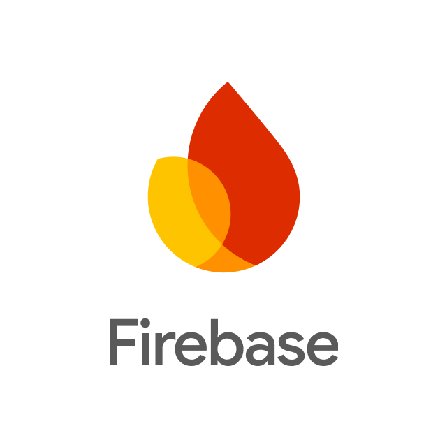

# Firebase
<div align="center">
	
</div>

## 🔥 <ins>Qu’est-ce que Firebase ?</ins>
Firebase est une plateforme de développement d’applications créée par Google qui fournit tout le backend prêt à l’emploi<br>
pour construire des applications web, mobile et parfois desktop rapidement.

```👉 Au lieu de créer toi-même un serveur, une base de données, l’authentification, etc.,
Firebase te fournit tous ces services directement dans le cloud.
```
Il fait partie de l’écosystème de Google.

## 🧠 <ins>L’idée principale de Firebase</ins>
Firebase sert à créer des applications sans gérer le backend complexe.

Normalement une app nécessite :
- un serveur
- une base de données
- un système d’authentification
- un hébergement
- des notifications
- de la sécurité

Firebase regroupe tout ça dans une seule plateforme.

## ⚙️ <ins>Les services principaux de Firebase</ins>

### 1. Base de données temps réel
Firebase propose deux bases de données :

📦 **Cloud Firestore**<br>
La base de données moderne de Firebase.<br>
Caractéristiques :
- NoSQL
- données stockées en documents et collections
- synchronisation en temps réel
- fonctionne offline
- très scalable

Exemple structure :
```
users
   └── user1
        ├── name: "Jean"
        └── age: 22
```

⚡ **Firebase Realtime Database**<br>
L’ancienne base Firebase.<br>
Caractéristiques :
- données stockées en JSON
- synchronisation en temps réel
- moins flexible que Firestore

### 2. Authentification

🔐 **Firebase Authentication**<br>
Permet de gérer les comptes utilisateurs facilement :<br>
Connexion avec :
- email / mot de passe
- Google
- Facebook
- Apple
- GitHub
- téléphone (SMS)

Exemple :
```
signInWithEmailAndPassword()
```

Firebase gère :
- les tokens
- la sécurité
- les sessions

### 3. Hébergement 

🌐 **Firebase Hosting**<br>
Permet de mettre ton site en ligne.

Caractéristiques :
- HTTPS automatique
- CDN rapide
- déploiement simple

Commande typique :
```
firebase deploy
```

Très utilisé pour :
- apps React
- apps Angular
- sites statiques

### 4. Fonctions backend

⚙️ **Cloud Functions for Firebase**<br>
Permet d’exécuter du code backend sans serveur.

Exemple :
```
Quand un utilisateur s’inscrit
→ envoyer un email automatique
```

Exemple de code :
```javascript
exports.newUser = functions.auth.user().onCreate((user) => {
   console.log("Nouvel utilisateur :", user.email);
});
```

### 5. Stockage de fichiers

📁 **Cloud Storage for Firebase**<br>
Permet de stocker :
- images
- vidéos
- documents
- fichiers utilisateurs

Très utilisé pour :
- photos de profil
- images uploadées
- vidéos

### 6. Analytics

📈 **Google Analytics for Firebase**<br>
Permet de suivre :
- nombre d’utilisateurs
- durée d’utilisation
- actions dans l’app
- conversions

### 7. Notifications push

📩 **Firebase Cloud Messaging**<br>
Permet d’envoyer des notifications :<br>
Exemple :
```
"Nouveau message reçu"
"Promotion disponible"
```

Fonctionne sur :
- Android
- iOS
- Web

### 8. Test et monitoring

Firebase propose aussi :
- Firebase Crashlytics → détecte les crashs
- Firebase Performance Monitoring → analyse la vitesse de l’app

🧱 **Architecture Firebase**<br>
Application utilisateur :
```
App (React / Flutter / Android / iOS)
        │
        ▼
     Firebase SDK
        │
        ▼
Firebase services
(auth, database, storage...)
        │
        ▼
Google Cloud
```
Firebase fonctionne sur l’infrastructure de Google Cloud Platform.

## 🚀 <ins>Pourquoi les développeurs utilisent Firebase</ins>

**Avantages**<br>
✅ Très rapide à mettre en place<br>
✅ Pas besoin de gérer serveur<br>
✅ scalable automatiquement<br>
✅ authentification facile<br>
✅ temps réel<br>
✅ parfait pour startups et MVP<br>

**Inconvénients**<br>
❌ peut devenir cher à grande échelle<br>
❌ dépendance forte à Google (vendor lock-in)<br>
❌ moins flexible qu’un backend custom<br>


## 🧑‍💻 <ins>Technologies souvent utilisées avec Firebase</ins>

Firebase est souvent utilisé avec :
- React
- Next.js
- Flutter
- Angular
- Vue.js

## 📱 <ins>Exemple concret d’app avec Firebase</ins>

**Application de chat :**<br>
Fonctions Firebase :
- Authentification → login utilisateurs
- Firestore → messages
- Storage → images envoyées
- Cloud Messaging → notifications
- Hosting → site web

Tout le backend est géré par Firebase.

## 💰 <ins>Prix</ins>

Firebase fonctionne avec 2 plans :

🟢 **Spark (gratuit)**
- Firestore limité
- Hosting limité
- Auth gratuit

🔵 **Blaze (pay as you go)**<br>
Tu paies selon :
- requêtes base de données
- stockage
- bande passante

# 🧠 En résumé

**Firebase** = Backend complet prêt à l’emploi

Il fournit :
- base de données
- authentification
- backend
- hébergement
- stockage
- analytics
- notifications

Le tout sans gérer de serveur.