Oui. Voici un **tutoriel complet et orienté pratique** sur **Flyway et Liquibase**, avec des exemples **Spring Boot**, des diagrammes Mermaid et surtout une comparaison pour savoir **lequel choisir et pourquoi**.

---

# 1. Le problème que Flyway et Liquibase résolvent

Imaginons ton application Spring Boot avec PostgreSQL.

Au début, ta base contient :

```text
users
 ├── id
 ├── username
 └── email
```

Puis tu développes une nouvelle fonctionnalité et tu dois ajouter :

```text
users
 ├── id
 ├── username
 ├── email
 └── phone_number
```

Tu pourrais simplement faire :

```sql
ALTER TABLE users ADD COLUMN phone_number VARCHAR(20);
```

Mais en équipe, plusieurs problèmes apparaissent :

* Qui a exécuté le SQL ?
* Sur quel environnement ?
* Est-ce que DEV possède la même structure que RECETTE ?
* Est-ce que la PROD a déjà reçu cette modification ?
* Dans quel ordre appliquer les scripts ?
* Que se passe-t-il si Jenkins déploie une nouvelle version ?
* Comment savoir exactement quelle version du schéma est installée ?
* Comment reproduire une base depuis zéro ?
* Que faire si deux développeurs modifient la base ?

C'est précisément là qu'interviennent **Flyway** et **Liquibase**.

---

# 2. Migration de base de données : le concept

L'idée fondamentale est :

> **Les modifications de la base deviennent du code versionné dans Git.**

Au lieu de modifier manuellement PostgreSQL :

```text
Développeur
    │
    │ ALTER TABLE...
    ▼
PostgreSQL
```

on fait :

```text
Développeur
    │
    │ crée migration
    ▼
Git
    │
    │ Jenkins
    ▼
Flyway / Liquibase
    │
    ▼
PostgreSQL
```

### Architecture générale

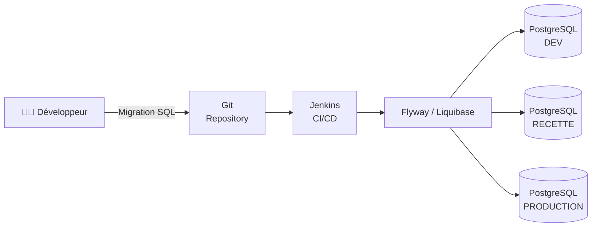

L'objectif est donc que **le schéma de la base soit versionné au même titre que le code applicatif**.

---

# 3. Qu'est-ce qu'une migration ?

Une migration est simplement une modification versionnée de la base.

Par exemple :

```text
V1__create_users.sql
V2__add_phone_number.sql
V3__create_orders.sql
V4__add_index_users_email.sql
```

On peut voir ça comme une histoire :

```text
Base vide
   │
   ▼
V1
   │
   ▼
V2
   │
   ▼
V3
   │
   ▼
V4
   │
   ▼
Base actuelle
```

Chaque migration représente une **évolution du schéma**.

---

# 4. Flyway


## 4.1 Qu'est-ce que Flyway ?

**Flyway** est un outil de **database migration**.

Son principe est volontairement simple :

> Tu écris des migrations, Flyway les exécute dans le bon ordre et mémorise celles qui ont déjà été exécutées.

Par exemple :

```text
db/
└── migration/
    ├── V1__create_users.sql
    ├── V2__add_phone_number.sql
    └── V3__create_orders.sql
```

---

# 5. Première migration Flyway

Supposons :

```text
src/main/resources/db/migration/V1__create_users.sql
```

Contenu :

```sql
CREATE TABLE users (
    id BIGSERIAL PRIMARY KEY,
    username VARCHAR(100) NOT NULL,
    email VARCHAR(255) NOT NULL
);
```

Flyway démarre.

Il voit :

```text
V1
```

et exécute :

```sql
CREATE TABLE users ...
```

Puis il enregistre :

```text
V1 = exécutée
```

---

# 6. Deuxième migration

Tu ajoutes :

```text
V2__add_phone_number.sql
```

avec :

```sql
ALTER TABLE users
ADD COLUMN phone_number VARCHAR(20);
```

Flyway constate :

```text
V1 → déjà exécutée
V2 → nouvelle
```

Il exécute donc uniquement :

```text
V2
```

---

# 7. La table Flyway

Flyway maintient une table dans la base, historiquement appelée :

```text
flyway_schema_history
```

Elle contient notamment des informations comme :

```text
installed_rank
version
description
type
script
checksum
installed_on
success
```

Exemple conceptuel :

```text
flyway_schema_history

+-------+---------+-----------------------+---------+
| rank  | version | description           | success |
+-------+---------+-----------------------+---------+
| 1     | 1       | create users          | true    |
| 2     | 2       | add phone number      | true    |
| 3     | 3       | create orders         | true    |
+-------+---------+-----------------------+---------+
```

C'est ce mécanisme qui permet à Flyway de savoir :

> "Quelles migrations ont déjà été exécutées ?"

---

# 8. Le checksum Flyway

C'est un point **très important en production**.

Supposons que tu aies :

```text
V2__add_phone_number.sql
```

avec :

```sql
ALTER TABLE users
ADD COLUMN phone_number VARCHAR(20);
```

Tu l'exécutes en DEV.

Puis quelqu'un modifie le fichier :

```sql
ALTER TABLE users
ADD COLUMN phone_number VARCHAR(30);
```

Flyway détecte que le contenu de la migration a changé.

Pourquoi ?

Parce que Flyway stocke un **checksum**.

```text
Git
 │
 │ V2 original
 ▼
Flyway
 │
 ▼
checksum = ABC123
```

Si le fichier devient :

```text
V2 modifié
```

alors :

```text
checksum = XYZ789
```

Flyway peut donc dire :

```text
❌ Checksum mismatch
```

C'est volontaire.

### Bonne pratique

Une migration déjà exécutée doit généralement être considérée comme **immuable**.

❌ Mauvais :

```text
V2__add_phone.sql
```

modifier le contenu après déploiement.

✅ Bon :

```text
V2__add_phone.sql
V3__modify_phone_length.sql
```

---

# 9. Configuration Flyway avec Spring Boot

Avec Spring Boot, l'intégration est très simple.

Dépendance Maven :

```xml
<dependency>
    <groupId>org.flywaydb</groupId>
    <artifactId>flyway-core</artifactId>
</dependency>
```

Pour PostgreSQL, selon la version de Flyway utilisée, il peut également être nécessaire d'ajouter le module database correspondant.

Exemple :

```xml
<dependency>
    <groupId>org.flywaydb</groupId>
    <artifactId>flyway-database-postgresql</artifactId>
</dependency>
```

Puis :

```yaml
spring:
  datasource:
    url: jdbc:postgresql://localhost:5432/payment_messages
    username: postgres
    password: postgres

  flyway:
    enabled: true
    locations: classpath:db/migration
```

Et tes migrations :

```text
src/
└── main/
    └── resources/
        └── db/
            └── migration/
                ├── V1__create_payment_message.sql
                ├── V2__add_retry_count.sql
                └── V3__add_indexes.sql
```

---

# 10. Que se passe-t-il au démarrage de Spring Boot ?

Le processus ressemble à ceci :

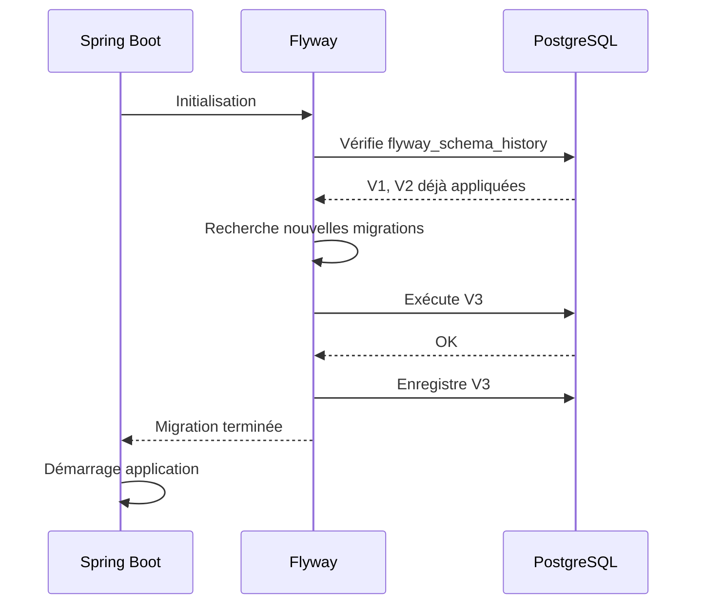

C'est extrêmement pratique.

---

# 11. Exemple concret avec ton projet Spring Boot

Prenons ton projet **Payment Messages**.

Tu pourrais avoir :

```text
backend/
├── src/
│   └── main/
│       ├── java/
│       └── resources/
│           ├── application.yaml
│           └── db/
│               └── migration/
│                   ├── V1__create_payment_message.sql
│                   ├── V2__add_indexes.sql
│                   └── V3__add_error_message.sql
└── pom.xml
```

Migration V1 :

```sql
CREATE TABLE payment_message (
    id BIGSERIAL PRIMARY KEY,
    message_id UUID NOT NULL UNIQUE,
    reference VARCHAR(100) NOT NULL,
    message_type VARCHAR(50),
    status VARCHAR(30) NOT NULL,
    payload TEXT,
    retry_count INTEGER NOT NULL DEFAULT 0,
    error_message TEXT,
    received_at TIMESTAMP,
    processed_at TIMESTAMP,
    updated_at TIMESTAMP
);
```

V2 :

```sql
CREATE INDEX idx_payment_message_status
ON payment_message(status);
```

V3 :

```sql
CREATE INDEX idx_payment_message_received_at
ON payment_message(received_at);
```

---

# 12. Flyway dans une CI/CD Jenkins

C'est là que ça devient particulièrement intéressant.

Imagine :

```text
Developer
   │
   │ git push
   ▼
Git
   │
   ▼
Jenkins
   │
   ├── Build
   ├── Unit tests
   ├── Integration tests
   ├── Package
   │
   ▼
Deploy
   │
   ▼
Spring Boot
   │
   ▼
Flyway
   │
   ▼
PostgreSQL
```

Dans ton contexte bancaire, tu peux avoir :

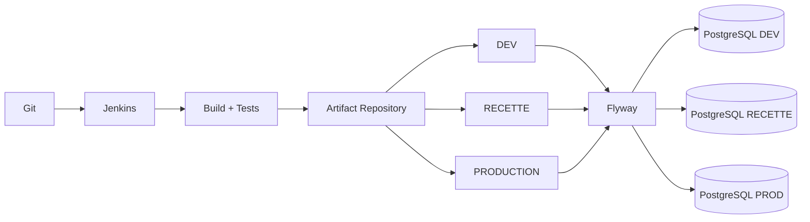

---

# 13. Très important : Flyway n'est pas un outil de backup

Il ne faut pas confondre :

```text
Flyway
```

et :

```text
Backup PostgreSQL
```

Flyway sert à gérer :

> **l'évolution du schéma**

PostgreSQL backup sert à gérer :

> **la restauration des données**

Exemple :

```text
Flyway
 ├── CREATE TABLE
 ├── ALTER TABLE
 ├── CREATE INDEX
 └── ADD COLUMN

Backup
 ├── données
 ├── tables
 ├── contenu
 └── restauration
```

Les deux sont complémentaires.

---

# 14. Liquibase


Liquibase répond au **même problème général** que Flyway :

> gérer les changements de schéma de base de données de manière versionnée et automatisée.

Mais son approche est différente.

Liquibase fonctionne autour du concept de :

```text
CHANGELOG
```

et de :

```text
CHANGESET
```

---

# 15. Exemple Liquibase

Structure :

```text
src/main/resources/db/
├── changelog/
│   ├── db.changelog-master.yaml
│   ├── changes/
│   │   ├── 001-create-users.yaml
│   │   └── 002-add-phone.yaml
```

Master :

```yaml
databaseChangeLog:

  - include:
      file: db/changelog/changes/001-create-users.yaml

  - include:
      file: db/changelog/changes/002-add-phone.yaml
```

Puis :

```yaml
databaseChangeLog:

  - changeSet:
      id: 001
      author: developer
      changes:

        - createTable:
            tableName: users

            columns:
              - column:
                  name: id
                  type: BIGINT
                  autoIncrement: true
                  constraints:
                    primaryKey: true

              - column:
                  name: username
                  type: VARCHAR(100)

              - column:
                  name: email
                  type: VARCHAR(255)
```

---

# 16. Liquibase peut aussi utiliser du SQL

C'est important.

Liquibase ne signifie pas nécessairement :

```text
YAML uniquement
```

Tu peux utiliser :

```text
YAML
XML
JSON
SQL
```

Par exemple :

```yaml
databaseChangeLog:

  - changeSet:
      id: 002
      author: developer

      changes:

        - sql:
            sql: |
              CREATE INDEX idx_users_email
              ON users(email);
```

Ou directement avec un fichier SQL.

---

# 17. Le concept de ChangeSet

Un `changeSet` est une unité de changement.

Exemple :

```yaml
- changeSet:
    id: 001
    author: mouhamadou
    changes:
      - createTable:
          tableName: users
```

Liquibase garde une trace des changesets exécutés.

Il utilise notamment une table :

```text
DATABASECHANGELOG
```

et une table :

```text
DATABASECHANGELOGLOCK
```

La première permet de savoir ce qui a été exécuté.

La seconde permet d'éviter que plusieurs instances exécutent simultanément les migrations.

---

# 18. Liquibase : exemple d'évolution

Supposons :

```text
001-create-users
```

Puis :

```text
002-add-phone
```

Puis :

```text
003-create-orders
```

On obtient :

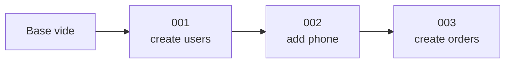

Liquibase sait donc exactement où en est la base.

---

# 19. Rollback : une grosse différence

C'est une des différences importantes entre les deux outils.

Avec Liquibase, tu peux définir explicitement un rollback.

Exemple :

```yaml
databaseChangeLog:

  - changeSet:
      id: 002
      author: developer

      changes:
        - addColumn:
            tableName: users
            columns:
              - column:
                  name: phone
                  type: VARCHAR(20)

      rollback:
        - dropColumn:
            tableName: users
            columnName: phone
```

Tu peux donc avoir :

```text
Migration

001
 ↓
002
 ↓
003
```

et potentiellement :

```text
003
 ↓ rollback
002
```

---

# 20. Flyway et rollback

Il faut nuancer.

Flyway a historiquement privilégié une approche :

> migrations versionnées + nouvelles migrations correctives.

Donc au lieu de modifier :

```text
V2
```

ou de compter systématiquement sur un rollback automatique, on fait :

```text
V1
V2
V3
V4
```

Par exemple :

```text
V2 → ajoute colonne phone
```

Puis erreur métier.

On peut faire :

```text
V3 → supprime colonne phone
```

ou une migration corrective adaptée.

Les capacités de rollback de Flyway ont évolué selon les éditions et versions, mais **la philosophie classique de Flyway reste très orientée migrations versionnées et forward-only**.

---

# 21. Comparaison Flyway vs Liquibase

Voici le résumé le plus important :

|                           | Flyway                            | Liquibase   |
| ------------------------- | --------------------------------- | ----------- |
| Philosophie               | Simple                            | Plus riche  |
| SQL natif                 | ⭐⭐⭐⭐⭐                             | ⭐⭐⭐⭐        |
| YAML/XML/JSON             | Limité / selon fonctionnalités    | ⭐⭐⭐⭐⭐       |
| Simplicité                | ⭐⭐⭐⭐⭐                             | ⭐⭐⭐         |
| Courbe d'apprentissage    | Faible                            | Plus élevée |
| Rollback                  | Plus limité / dépend de l'édition | ⭐⭐⭐⭐⭐       |
| ChangeSet                 | Non                               | Oui         |
| Changelog                 | Non au même sens                  | Oui         |
| Contrôle avancé           | ⭐⭐⭐                               | ⭐⭐⭐⭐⭐       |
| Lisibilité SQL            | ⭐⭐⭐⭐⭐                             | ⭐⭐⭐         |
| Très gros projet          | ⭐⭐⭐⭐                              | ⭐⭐⭐⭐⭐       |
| Projet Spring Boot simple | ⭐⭐⭐⭐⭐                             | ⭐⭐⭐⭐        |

---

# 22. Exemple concret : même changement avec Flyway et Liquibase

Supposons qu'on veuille :

```text
Ajouter phone_number à users
```

### Flyway

```text
V2__add_phone_number.sql
```

```sql
ALTER TABLE users
ADD COLUMN phone_number VARCHAR(20);
```

C'est tout.

---

### Liquibase

```yaml
databaseChangeLog:

  - changeSet:
      id: 002
      author: developer

      changes:
        - addColumn:
            tableName: users
            columns:
              - column:
                  name: phone_number
                  type: VARCHAR(20)
```

Plus verbeux.

Mais Liquibase apporte davantage de métadonnées et de mécanismes autour du changement.

---

# 23. Flyway : organisation recommandée

Pour un projet Spring Boot :

```text
src/main/resources/
└── db/
    └── migration/
        ├── V1__create_payment_message.sql
        ├── V2__create_indexes.sql
        ├── V3__add_status_column.sql
        └── V4__create_audit_table.sql
```

Convention :

```text
V<version>__<description>.sql
```

Exemple :

```text
V1__create_users.sql
V2__create_orders.sql
V3__add_user_index.sql
```

Attention aux deux `_` :

```text
V1__create_users.sql
   ^^
```

---

# 24. Versioning Flyway

Tu peux avoir :

```text
V1
V2
V3
V4
```

Mais aussi des versions plus structurées :

```text
V1.0
V1.1
V2.0
```

ou :

```text
V2026.09.01.01
V2026.09.02.01
```

Cependant, dans une équipe, je recommande généralement une convention **simple et strictement définie**.

Par exemple :

```text
V001__create_users.sql
V002__create_orders.sql
V003__add_status.sql
```

C'est très lisible.

---

# 25. Les migrations repeatable de Flyway

Flyway possède également le concept de migration :

```text
R__
```

Exemple :

```text
R__create_user_view.sql
```

Contrairement à :

```text
V1__
```

une migration `R__` est rejouée lorsque son contenu change.

Très utile notamment pour :

* views
* procedures
* functions
* certains objets SQL

Exemple :

```text
R__user_statistics_view.sql
```

Tu modifies la vue.

Flyway détecte le changement et la migration repeatable peut être rejouée.

---

# 26. Liquibase : organisation

Une organisation classique :

```text
src/main/resources/
└── db/
    └── changelog/
        ├── db.changelog-master.yaml
        ├── changes/
        │   ├── 001-create-users.yaml
        │   ├── 002-create-orders.yaml
        │   └── 003-add-index.yaml
        └── rollback/
```

Master :

```yaml
databaseChangeLog:

  - include:
      file: db/changelog/changes/001-create-users.yaml

  - include:
      file: db/changelog/changes/002-create-orders.yaml

  - include:
      file: db/changelog/changes/003-add-index.yaml
```

---

# 27. Liquibase avec Spring Boot

Maven :

```xml
<dependency>
    <groupId>org.liquibase</groupId>
    <artifactId>liquibase-core</artifactId>
</dependency>
```

Puis :

```yaml
spring:
  datasource:
    url: jdbc:postgresql://localhost:5432/payment_messages
    username: postgres
    password: postgres

  liquibase:
    enabled: true
    change-log: classpath:db/changelog/db.changelog-master.yaml
```

Au démarrage :

```text
Spring Boot
     │
     ▼
Liquibase
     │
     ├── DATABASECHANGELOG
     ├── DATABASECHANGELOGLOCK
     │
     ▼
PostgreSQL
```

---

# 28. Où placer Flyway/Liquibase dans l'architecture ?

C'est important dans une architecture moderne.

Je recommande de visualiser les responsabilités comme ceci :

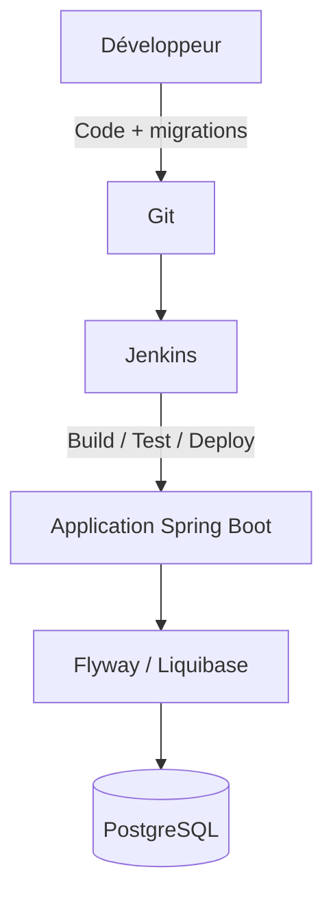

Mais il y a une question d'architecture importante :

> **Doit-on lancer les migrations depuis l'application ou depuis le pipeline CI/CD ?**

---

# 29. Option A — Migration au démarrage de Spring Boot

```text
Spring Boot
    │
    ├── Flyway
    │
    ▼
PostgreSQL
```

Avantages :

* très simple
* idéal en développement
* très peu de configuration
* migration automatiquement liée au démarrage

Inconvénient :

si tu as :

```text
10 pods
```

qui démarrent simultanément :

```text
Pod 1 ──┐
Pod 2 ──┤
Pod 3 ──┤── PostgreSQL
Pod 4 ──┤
Pod 5 ──┘
```

tu dois être particulièrement attentif à la gestion de concurrence et au mode de déploiement.

Les outils ont des mécanismes de verrouillage/historique, mais **séparer migration et démarrage applicatif peut être préférable dans des environnements critiques**.

---

# 30. Option B — Migration dans Jenkins

Architecture :

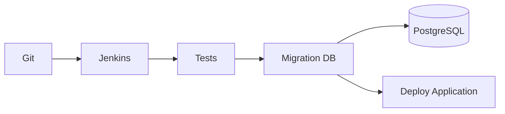

Ici :

```text
Jenkins
   │
   ▼
Flyway/Liquibase
   │
   ▼
Database
   │
   ▼
Deployment application
```

C'est souvent plus intéressant pour une architecture d'entreprise.

---

# 31. Mais attention au problème de compatibilité

C'est l'un des concepts **les plus importants** à comprendre avec les migrations.

Imaginons :

### Version actuelle

```text
Application V1
DB V1
```

Tu veux ajouter :

```text
phone_number
```

Tu pourrais faire :

```text
DB V2
Application V2
```

Mais pendant un rolling deployment, tu peux temporairement avoir :

```text
Pod V1
Pod V1
Pod V2
Pod V2
```

avec :

```text
DB V2
```

Il faut donc que :

```text
Application V1
```

puisse fonctionner avec :

```text
DB V2
```

C'est pourquoi on utilise souvent le pattern :

# Expand → Migrate → Contract

---

# 32. Expand / Migrate / Contract

Exemple :

On veut renommer :

```text
username
```

en :

```text
login
```

### Mauvaise approche

```text
ALTER TABLE users
RENAME COLUMN username TO login;
```

Puis déploiement application.

Risque :

```text
Ancienne application
       ↓
cherche username
       ↓
❌ colonne inexistante
```

---

### Bonne approche

### Étape 1 — Expand

Ajouter :

```text
login
```

sans supprimer :

```text
username
```

```text
users
├── username
└── login
```

---

### Étape 2 — Migrate

L'application commence à écrire les deux :

```text
username ──┐
           ├── même valeur
login ─────┘
```

Puis tu migres les anciennes données.

---

### Étape 3 — Contract

Une fois toutes les anciennes versions retirées :

```text
DROP COLUMN username
```

Résultat :

```text
users
└── login
```

Diagramme :

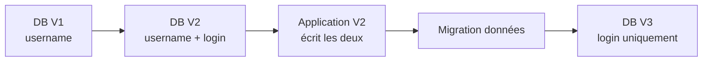

C'est extrêmement utile avec Kubernetes/OpenShift et les déploiements rolling.

---

# 33. Flyway ou Liquibase dans un contexte bancaire ?

Pour ton contexte **Spring Boot + PostgreSQL + Jenkins + OpenShift + environnement bancaire**, les deux sont parfaitement envisageables.

Je regarderais surtout :

### Flyway

Très intéressant si vous privilégiez :

```text
SQL
+
simplicité
+
lisibilité
+
convention stricte
```

Exemple :

```text
V001__create_payment_message.sql
V002__create_indexes.sql
V003__add_retry_count.sql
```

C'est très facile à comprendre par un développeur, un DBA et une équipe DevOps.

---

### Liquibase

Très intéressant si vous avez besoin de :

```text
changeSets
rollback
changelog
contrôle avancé
abstraction SQL
multi-environnements
gouvernance importante
```

Dans des environnements avec beaucoup de contraintes DBA/gouvernance, Liquibase peut être particulièrement intéressant.

---

# 34. Ce que je choisirais pour ton projet Payment Messages

Pour ton projet :

```text
Angular
    │
    ▼
Spring Boot
    │
    ├── IBM MQ
    │
    ├── REST API
    │
    └── PostgreSQL
```

avec :

```text
Git
Jenkins
OpenShift
Artifactory/Nexus
```

je partirais probablement sur :

# **Flyway**

Pourquoi ?

Parce que ton modèle de données semble relativement classique :

```text
payment_message
```

avec quelques :

```text
tables
indexes
constraints
```

Et tu peux garder les migrations extrêmement lisibles :

```text
db/migration/

V001__create_payment_message.sql
V002__create_payment_message_indexes.sql
V003__add_processing_status.sql
V004__create_audit_table.sql
```

Pour une équipe Java/Spring Boot, c'est très naturel.

---

# 35. Exemple d'architecture cible

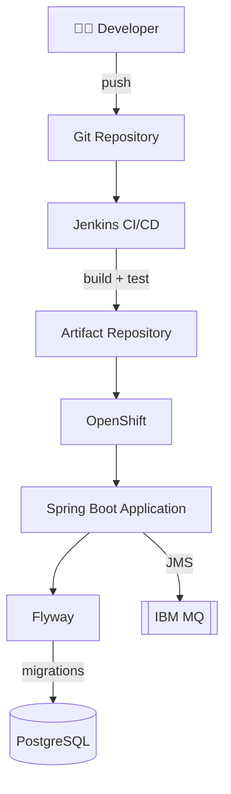

---

# 36. Où mettre les scripts SQL ?

Je recommande :

```text
backend/
│
├── src/
│   └── main/
│       └── resources/
│           └── db/
│               └── migration/
│                   ├── V001__create_payment_message.sql
│                   ├── V002__create_indexes.sql
│                   └── V003__create_audit_table.sql
│
├── pom.xml
└── application.yaml
```

Les fichiers sont donc :

```text
dans Git
```

et sont embarqués avec l'application.

---

# 37. Ce qu'il ne faut surtout pas faire

### ❌ Modifier manuellement la PROD

```sql
ALTER TABLE ...
```

sans passer par le processus de migration.

---

### ❌ Modifier une migration déjà exécutée

```text
V002__create_index.sql
```

puis changer son contenu.

---

### ❌ Supprimer une migration

```text
V002__...
```

après qu'elle a été exécutée dans un environnement partagé.

---

### ❌ Mélanger migrations et données métier sans réflexion

Une migration peut insérer des données de référence :

```sql
INSERT INTO status (...)
```

mais il faut distinguer soigneusement :

```text
schema migration
```

et :

```text
business data
```

---

# 38. Et les données initiales ?

Par exemple :

```text
status
------
RECEIVED
PROCESSING
PROCESSED
FAILED
```

Tu peux avoir :

```text
V004__insert_payment_statuses.sql
```

avec :

```sql
INSERT INTO payment_status(code, label)
VALUES
    ('RECEIVED', 'Message received'),
    ('PROCESSING', 'Message processing'),
    ('PROCESSED', 'Message processed'),
    ('FAILED', 'Message processing failed');
```

Mais il faut réfléchir à l'idempotence et à l'évolution de ces données.

---

# 39. Les tests d'intégration

Un énorme avantage des migrations est que tu peux recréer une base propre :

```text
PostgreSQL vide
       │
       ▼
V001
       │
       ▼
V002
       │
       ▼
V003
       │
       ▼
Base complète
```

Donc Jenkins peut faire :

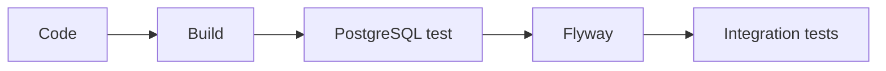

Cela permet de détecter des problèmes comme :

```text
Entity Java
    ≠
Database schema
```

---

# 40. Migration vs Hibernate `ddl-auto`

C'est un point très important avec Spring Boot.

Tu peux avoir :

```yaml
spring:
  jpa:
    hibernate:
      ddl-auto: update
```

Hibernate va alors essayer de modifier la base.

Mais en environnement sérieux, je recommande plutôt :

```yaml
spring:
  jpa:
    hibernate:
      ddl-auto: validate
```

et :

```text
Flyway → responsable du schéma
Hibernate → vérifie que les entités correspondent
```

Architecture :

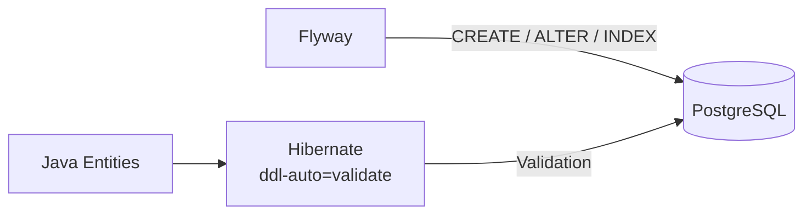

C'est beaucoup plus propre.

---

# 41. Pourquoi éviter `ddl-auto=update` en production ?

Parce que tu veux contrôler précisément :

```text
QUOI
QUAND
COMMENT
PAR QUI
```

est modifié dans la base.

Avec :

```yaml
ddl-auto: update
```

Hibernate peut faire évoluer le schéma implicitement.

Avec Flyway :

```text
V001
V002
V003
```

tu sais exactement ce qui a été appliqué.

---

# 42. Le cycle complet

Au final, ton cycle de développement devient :

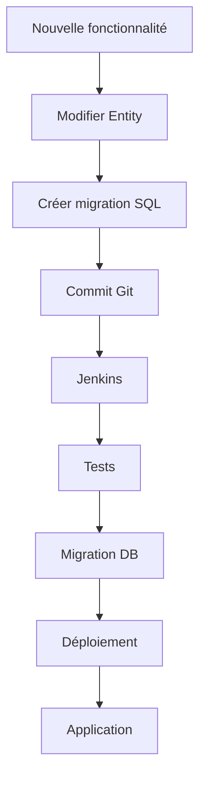

Exemple :

```text
Feature : ajouter retry_count
```

Tu modifies :

```java
private Integer retryCount;
```

et crées :

```text
V005__add_retry_count.sql
```

```sql
ALTER TABLE payment_message
ADD COLUMN retry_count INTEGER NOT NULL DEFAULT 0;
```

Puis :

```text
git commit
   ↓
Jenkins
   ↓
tests
   ↓
migration
   ↓
OpenShift
```

---

# 43. Résumé mental à retenir

Si tu dois retenir seulement ça :

### Sans Flyway/Liquibase

```text
Code
 │
 ├── modification Java
 │
 └── modification DB manuelle ❌
```

### Avec Flyway

```text
Code
 │
 ├── Java
 │
 └── Migration SQL
        │
        ▼
       Git
        │
        ▼
     Jenkins
        │
        ▼
    PostgreSQL
```

### Avec Liquibase

```text
Code
 │
 ├── Java
 │
 └── Changelog
       │
       ├── ChangeSet 001
       ├── ChangeSet 002
       └── ChangeSet 003
              │
              ▼
           Jenkins
              │
              ▼
          PostgreSQL
```

---

# 44. Flyway vs Liquibase : ma règle simple

Je te donnerais cette règle :

> **Si ton équipe veut principalement versionner et exécuter du SQL de manière simple → Flyway.**

> **Si ton organisation a besoin d'un framework de changement de schéma plus riche, avec changelogs, changesets, rollback et davantage de contrôle → Liquibase.**

Pour un projet :

```text
Spring Boot
+
PostgreSQL
+
Jenkins
+
OpenShift
+
IBM MQ
```

**Flyway est probablement le choix le plus simple et naturel**, sauf si les standards de ton entreprise/DBA imposent Liquibase.

---

## 🧠 La vision "entreprise" à retenir

Dans ton contexte, je te conseille de penser à la chaîne suivante :

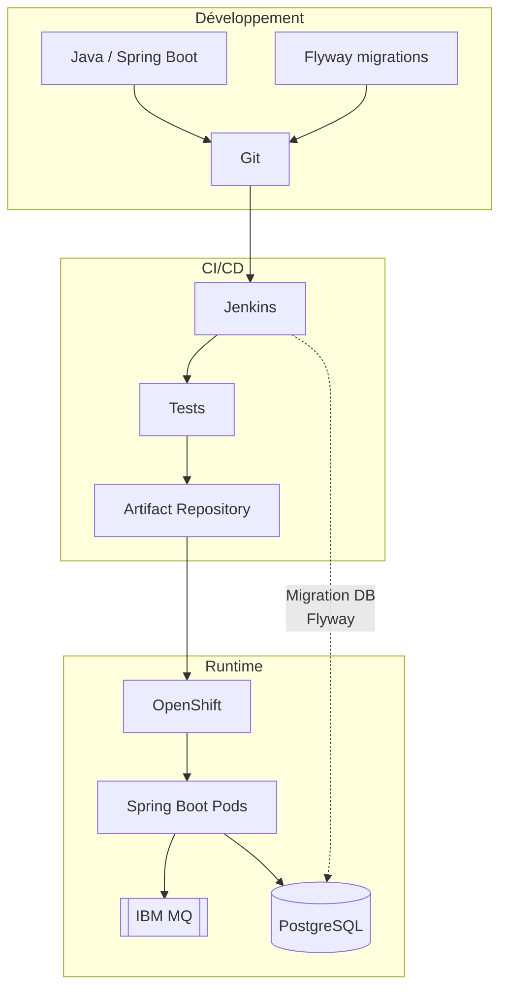

Et surtout :

**Git est la source de vérité pour les migrations.**

**Flyway/Liquibase est le mécanisme d'application.**

**PostgreSQL est la cible.**

**Jenkins orchestre le déploiement.**

**Hibernate ne doit idéalement pas être responsable de faire évoluer la structure en production.**

Si tu veux aller plus loin, l'étape la plus intéressante serait de faire un **TP complet Flyway avec ton projet `payment-messages`** : installation Maven, `application.yaml`, `V1__...sql`, création de la table `payment_message`, ajout d'un index en V2, modification en V3, lancement avec Docker/PostgreSQL, puis **pipeline Jenkins + déploiement OpenShift**, avec gestion DEV/RECETTE/PROD.
