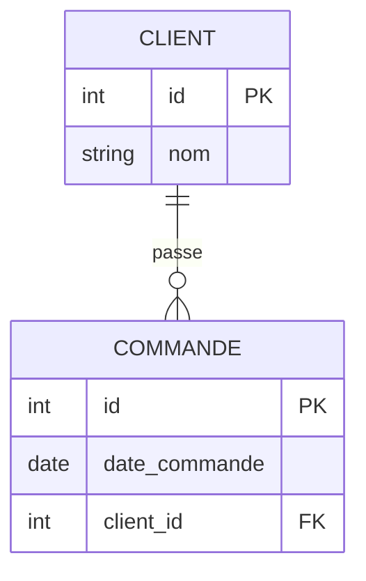
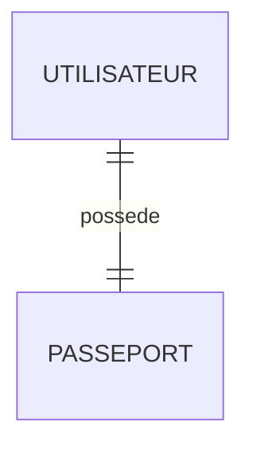
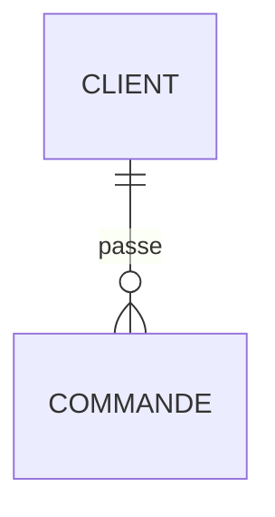
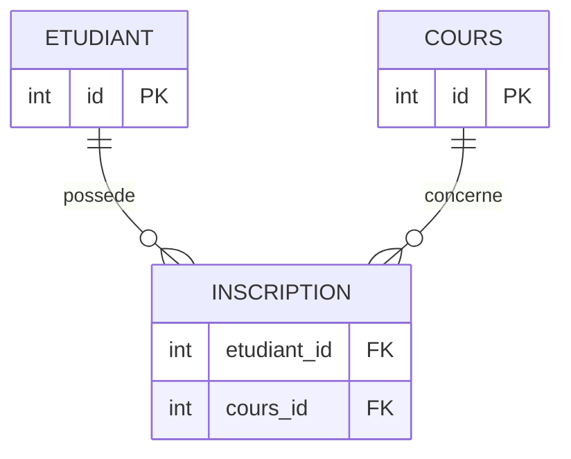
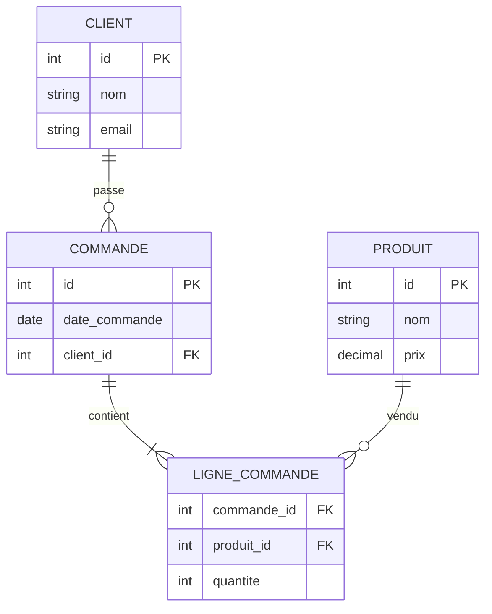
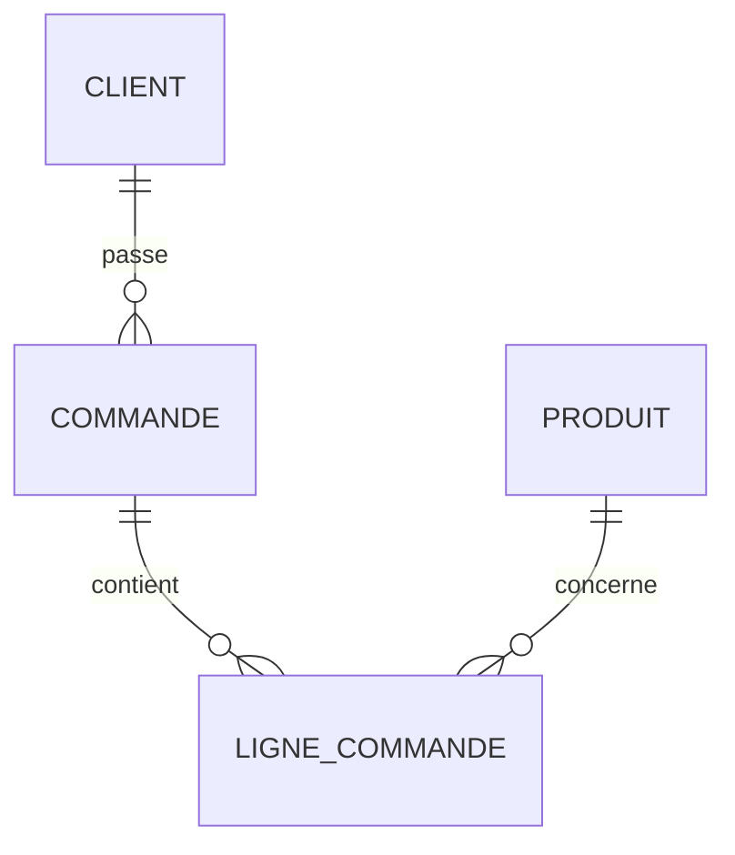
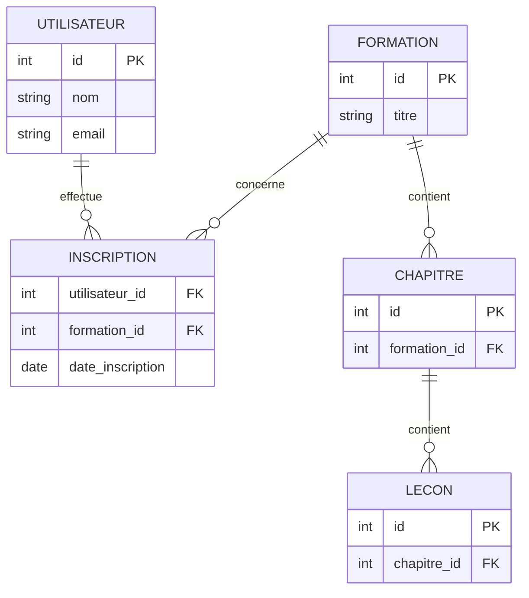
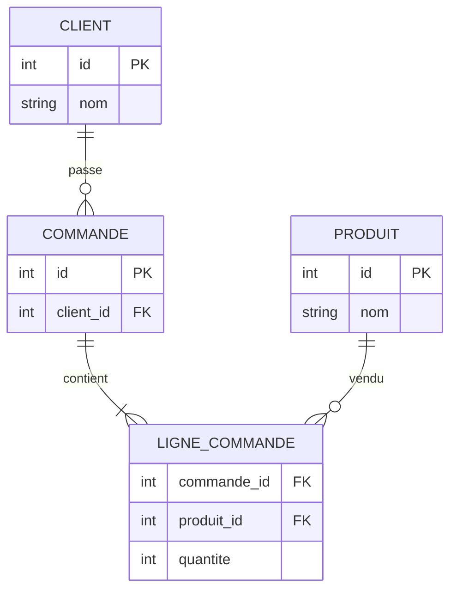

# La Modélisation Relationnelle en SQL

La modélisation relationnelle est la base de presque toutes les bases de données SQL modernes : **MySQL**, PostgreSQL, Microsoft SQL Server, Oracle Database, etc.

L'objectif est de représenter correctement les données et leurs relations afin de :

* éviter les duplications inutiles ;
* garantir la cohérence des données ;
* faciliter les requêtes SQL ;
* améliorer les performances.

---

# 1. Les concepts fondamentaux

## Table

Une table représente une entité.

Exemple :

```text
Client
```

| id | nom    | email                                   |
| -- | ------ | --------------------------------------- |
| 1  | Dupont | [dupont@mail.fr](mailto:dupont@mail.fr) |
| 2  | Martin | [martin@mail.fr](mailto:martin@mail.fr) |

---

## Ligne (Tuple)

Chaque ligne représente un enregistrement.

```text
(1, Dupont, dupont@mail.fr)
```

---

## Colonne (Attribut)

Chaque colonne décrit une propriété.

```text
id
nom
email
```

---

# 2. Clé primaire (Primary Key)

Une clé primaire identifie de manière unique chaque ligne.

```sql
CREATE TABLE client (
    id INT PRIMARY KEY,
    nom VARCHAR(100),
    email VARCHAR(100)
);
```

Exemple :

| id | nom    |
| -- | ------ |
| 1  | Dupont |
| 2  | Martin |

Impossible d'avoir :

| id | nom     |
| -- | ------- |
| 1  | Bernard |

car l'id 1 existe déjà.

---

# 3. Clé étrangère (Foreign Key)

Une clé étrangère crée un lien entre deux tables.

Exemple :

* un client passe des commandes.

## Diagramme



---

## Création SQL

```sql
CREATE TABLE client (
    id INT PRIMARY KEY,
    nom VARCHAR(100)
);

CREATE TABLE commande (
    id INT PRIMARY KEY,
    date_commande DATE,
    client_id INT,

    FOREIGN KEY (client_id)
        REFERENCES client(id)
);
```

---

## Insertion

```sql
INSERT INTO client
VALUES (1, 'Dupont');

INSERT INTO commande
VALUES (101, '2025-01-10', 1);
```

La commande appartient au client 1.

---

# 4. Les cardinalités

Les cardinalités décrivent le nombre de relations possibles.

---

## 1 à 1 (One To One)

Exemple :

* un utilisateur possède un seul passeport
* un passeport appartient à un seul utilisateur



SQL :

```sql
CREATE TABLE utilisateur (
    id INT PRIMARY KEY,
    nom VARCHAR(100)
);

CREATE TABLE passeport (
    id INT PRIMARY KEY,
    numero VARCHAR(50) UNIQUE,
    utilisateur_id INT UNIQUE,

    FOREIGN KEY (utilisateur_id)
        REFERENCES utilisateur(id)
);
```

Le mot-clé `UNIQUE` garantit qu'un utilisateur ne possède qu'un seul passeport.

---

## 1 à N (One To Many)

Le cas le plus fréquent.

Exemple :

* un client possède plusieurs commandes.



SQL :

```sql
CREATE TABLE client (
    id INT PRIMARY KEY,
    nom VARCHAR(100)
);

CREATE TABLE commande (
    id INT PRIMARY KEY,
    client_id INT NOT NULL,

    FOREIGN KEY (client_id)
        REFERENCES client(id)
);
```

---

### Exemple de données

Client :

| id | nom    |
| -- | ------ |
| 1  | Dupont |

Commande :

| id  | client_id |
| --- | --------- |
| 101 | 1         |
| 102 | 1         |
| 103 | 1         |

Le client 1 possède 3 commandes.

---

## N à N (Many To Many)

Exemple :

* un étudiant suit plusieurs cours
* un cours est suivi par plusieurs étudiants

Impossible de représenter cela directement.

On crée une table d'association.

---

## Diagramme



---

## SQL

```sql
CREATE TABLE etudiant (
    id INT PRIMARY KEY,
    nom VARCHAR(100)
);

CREATE TABLE cours (
    id INT PRIMARY KEY,
    titre VARCHAR(100)
);

CREATE TABLE inscription (
    etudiant_id INT,
    cours_id INT,

    PRIMARY KEY (etudiant_id, cours_id),

    FOREIGN KEY (etudiant_id)
        REFERENCES etudiant(id),

    FOREIGN KEY (cours_id)
        REFERENCES cours(id)
);
```

---

# 5. Exemple complet : site e-commerce

Supposons que nous devions modéliser :

* clients
* produits
* commandes
* lignes de commande

---

## Étape 1 : identifier les entités

```text
Client
Produit
Commande
LigneCommande
```

---

## Diagramme MER



---

# 6. Traduction SQL

## Table Client

```sql
CREATE TABLE client (
    id INT PRIMARY KEY,
    nom VARCHAR(100),
    email VARCHAR(150)
);
```

---

## Table Produit

```sql
CREATE TABLE produit (
    id INT PRIMARY KEY,
    nom VARCHAR(100),
    prix DECIMAL(10,2)
);
```

---

## Table Commande

```sql
CREATE TABLE commande (
    id INT PRIMARY KEY,
    date_commande DATE,

    client_id INT NOT NULL,

    FOREIGN KEY (client_id)
        REFERENCES client(id)
);
```

---

## Table Ligne_Commande

```sql
CREATE TABLE ligne_commande (
    commande_id INT,
    produit_id INT,
    quantite INT NOT NULL,

    PRIMARY KEY (commande_id, produit_id),

    FOREIGN KEY (commande_id)
        REFERENCES commande(id),

    FOREIGN KEY (produit_id)
        REFERENCES produit(id)
);
```

---

# 7. Jeu de données complet

```sql
INSERT INTO client VALUES
(1,'Dupont','dupont@mail.fr');

INSERT INTO produit VALUES
(1,'PC Portable',1200),
(2,'Souris',30),
(3,'Ecran',250);

INSERT INTO commande VALUES
(100,'2025-01-15',1);

INSERT INTO ligne_commande VALUES
(100,1,1),
(100,2,2),
(100,3,1);
```

---

# 8. Les jointures (JOIN)

Une base relationnelle prend tout son sens grâce aux jointures.

---

## INNER JOIN

Afficher les commandes avec le nom du client :

```sql
SELECT
    c.id,
    c.date_commande,
    cl.nom
FROM commande c
INNER JOIN client cl
    ON c.client_id = cl.id;
```

Résultat :

| id  | date       | client |
| --- | ---------- | ------ |
| 100 | 2025-01-15 | Dupont |

---

## Plusieurs jointures

Afficher les produits commandés :

```sql
SELECT
    c.id,
    p.nom,
    lc.quantite
FROM commande c

JOIN ligne_commande lc
    ON c.id = lc.commande_id

JOIN produit p
    ON p.id = lc.produit_id;
```

Résultat :

| commande | produit     | quantité |
| -------- | ----------- | -------- |
| 100      | PC Portable | 1        |
| 100      | Souris      | 2        |
| 100      | Ecran       | 1        |

---

# 9. La normalisation

La normalisation consiste à éliminer les redondances.

---

## Mauvaise conception

```text
COMMANDE
```

| id | client | produit | prix |
| -- | ------ | ------- | ---- |
| 1  | Dupont | Souris  | 30   |
| 2  | Dupont | Ecran   | 250  |

Problèmes :

* Dupont est répété partout.
* Si son nom change il faut modifier plusieurs lignes.
* Risque d'incohérence.

---

## Bonne conception



Chaque information est stockée une seule fois.

---

# 10. Les formes normales

## 1FN (Première Forme Normale)

Pas de liste dans une colonne.

❌

| id | produits        |
| -- | --------------- |
| 1  | PC,Souris,Ecran |

✔

Créer une table dédiée.

---

## 2FN

Chaque attribut dépend de toute la clé primaire.

---

## 3FN

Pas de dépendance transitive.

❌

```text
client
---------
id
nom
ville
code_postal
```

Si le code postal détermine la ville.

✔

```text
client
---------
id
nom
code_postal

ville
---------
code_postal
nom_ville
```

---

# 11. Contraintes d'intégrité

## NOT NULL

```sql
nom VARCHAR(100) NOT NULL
```

---

## UNIQUE

```sql
email VARCHAR(100) UNIQUE
```

---

## CHECK

```sql
age INT CHECK(age >= 18)
```

---

## DEFAULT

```sql
date_creation DATE DEFAULT CURRENT_DATE
```

---

# 12. Suppression en cascade

Suppression automatique des enfants.

```sql
CREATE TABLE commande (
    id INT PRIMARY KEY,
    client_id INT,

    FOREIGN KEY (client_id)
    REFERENCES client(id)
    ON DELETE CASCADE
);
```

---

### Exemple

```sql
DELETE FROM client
WHERE id = 1;
```

Toutes ses commandes sont supprimées automatiquement.

---

# 13. Modélisation d'un projet réel

Prenons une plateforme de formation.



---

# 14. Méthode professionnelle de conception

Quand tu modélises une base :

### Étape 1

Lister les objets métier.

```text
Client
Produit
Commande
Paiement
Facture
```

### Étape 2

Lister les attributs.

```text
Client
- id
- nom
- email
```

### Étape 3

Identifier les relations.

```text
Client → Commande
Commande → Produit
```

### Étape 4

Déterminer les cardinalités.

```text
1-1
1-N
N-N
```

### Étape 5

Créer le diagramme MER.

### Étape 6

Transformer en SQL.

### Étape 7

Ajouter :

* PK
* FK
* UNIQUE
* CHECK
* INDEX

---

# Schéma récapitulatif



## À retenir

1. Une **table** représente une entité.
2. Une **clé primaire** identifie une ligne.
3. Une **clé étrangère** relie deux tables.
4. Les cardinalités principales sont **1-1**, **1-N** et **N-N**.
5. Les relations N-N nécessitent une **table d'association**.
6. La **normalisation** évite les duplications.
7. Les **JOIN** permettent de reconstruire les relations entre les données.
8. Une bonne modélisation est souvent plus importante que l'écriture des requêtes SQL elles-mêmes.

Une fois ces bases maîtrisées, tu peux aborder des sujets plus avancés comme la modélisation UML/MERISE, les index, les vues, les procédures stockées, l'optimisation des requêtes et les architectures de bases de données à grande échelle.
