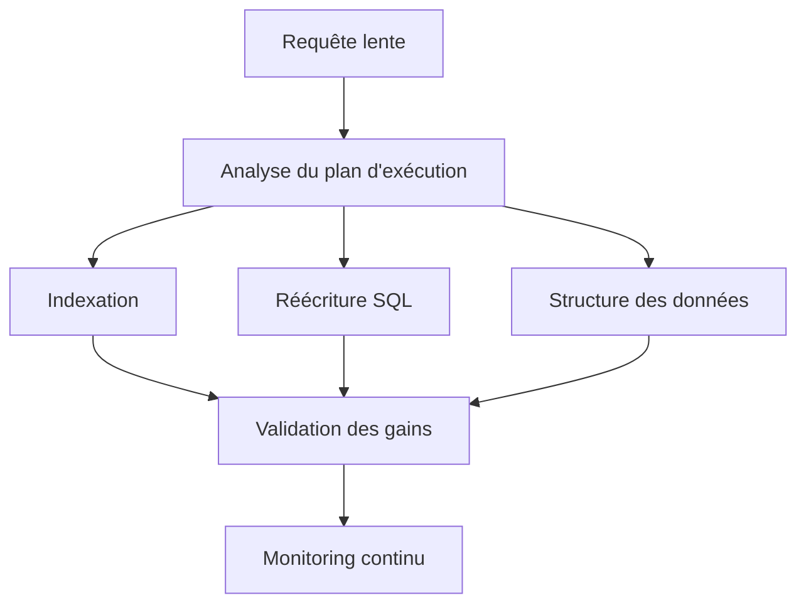
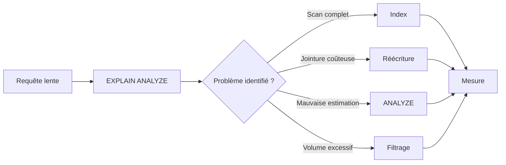
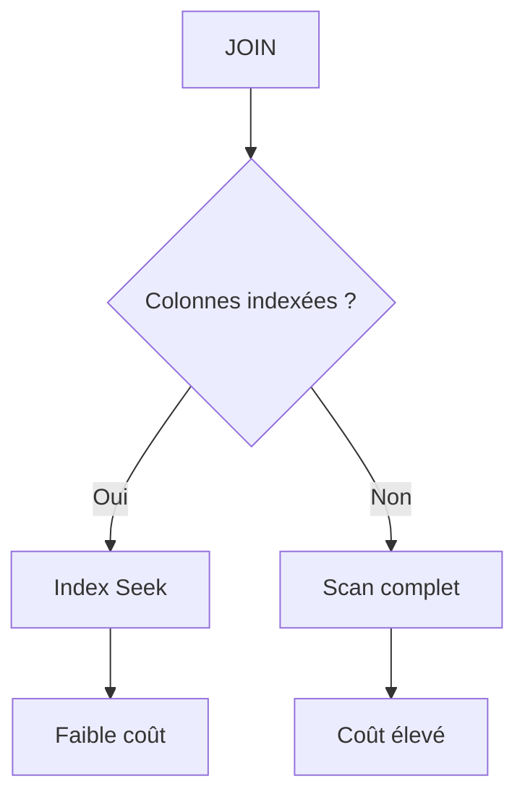
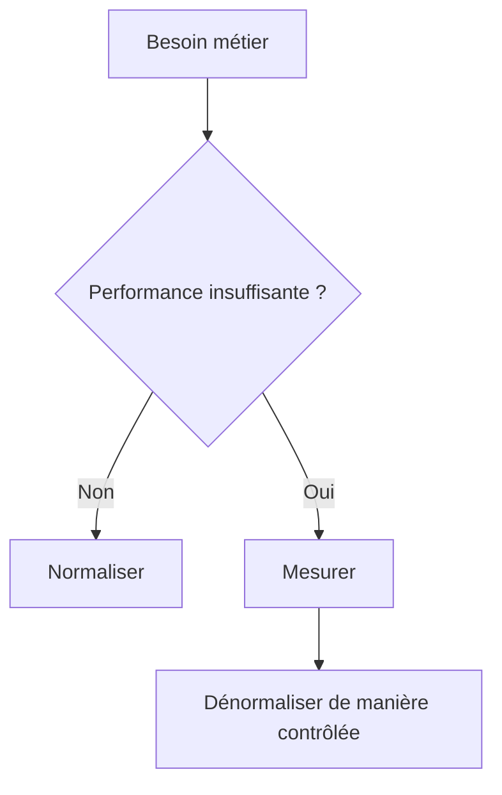
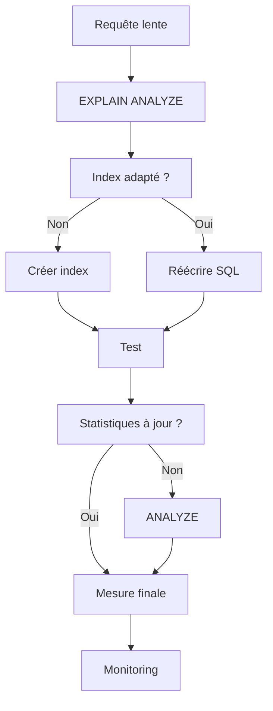

# Optimisation des requêtes SQL sur bases relationnelles

> Applicable dans la majorité des cas pour **PostgreSQL**, **MySQL**, **Oracle**, **SQL Server** et la plupart des SGBDR relationnels.

## Vue d'ensemble

L'optimisation SQL repose généralement sur quatre leviers principaux :



---

# 1. Analyser avant d’optimiser

## Principe fondamental

> Ne jamais optimiser à l’aveugle.

Une requête lente n'est pas forcément un problème d'index. Il peut s'agir :

* d'une mauvaise estimation du moteur ;
* d'une jointure coûteuse ;
* d'un volume de données excessif ;
* d'une contention (locks) ;
* d'un problème d'I/O disque.

## Outils d'analyse

### PostgreSQL

```sql
EXPLAIN (ANALYZE, BUFFERS)
SELECT ...
```

### MySQL

```sql
EXPLAIN ANALYZE
SELECT ...
```

### Oracle

```sql
EXPLAIN PLAN FOR
SELECT ...;

SELECT *
FROM TABLE(DBMS_XPLAN.DISPLAY);
```

## Ce qu'il faut rechercher

| Élément                      | Impact                         |
| ---------------------------- | ------------------------------ |
| Seq Scan / Full Table Scan   | Lecture complète de table      |
| Nested Loop coûteux          | Mauvaise stratégie de jointure |
| Sort                         | Tri potentiellement lourd      |
| Hash Join volumineux         | Consommation mémoire           |
| Rows estimées ≠ Rows réelles | Statistiques obsolètes         |

### Processus recommandé



---

# 2. Créer les bons index

L'indexation est généralement le levier offrant le meilleur retour sur investissement.

## A. Indexer les colonnes critiques

Priorité aux colonnes utilisées dans :

* `WHERE`
* `JOIN`
* `ORDER BY`
* `GROUP BY`

```sql
CREATE INDEX idx_user_email
ON users(email);
```

---

## B. Utiliser les index composites

Très souvent sous-utilisés.

### Exemple

```sql
SELECT *
FROM orders
WHERE status = 'ACTIVE'
  AND created_at > CURRENT_DATE - INTERVAL '30 days';
```

Index recommandé :

```sql
CREATE INDEX idx_orders_status_created
ON orders(status, created_at);
```

### Règle du préfixe gauche

Un index :

```text
(status, created_at)
```

peut être utilisé pour :

```sql
WHERE status = ?
```

ou :

```sql
WHERE status = ?
AND created_at > ?
```

mais rarement pour :

```sql
WHERE created_at > ?
```

seul.

---

## C. Éviter la sur-indexation

Chaque index supplémentaire implique :

* plus d'espace disque ;
* plus de maintenance ;
* des INSERT/UPDATE/DELETE plus lents.

### Vérifications à effectuer

* Identifier les index jamais utilisés.
* Supprimer les doublons.
* Vérifier les index redondants.

Exemple :

```text
(status, created_at)
(status)
```

Le second peut être inutile.

---

# 3. Écrire des requêtes efficaces

## A. Éviter `SELECT *`

### Mauvais

```sql
SELECT *
FROM users;
```

### Meilleur

```sql
SELECT id, name
FROM users;
```

Avantages :

* moins d'I/O ;
* moins de mémoire ;
* meilleure utilisation des index couvrants.

---

## B. Éviter les fonctions sur les colonnes filtrées

### Mauvais

```sql
WHERE LOWER(email) = 'test@mail.com'
```

L'index sur `email` devient inutilisable.

### Meilleur

```sql
WHERE email = 'test@mail.com'
```

### Alternative

Créer un index fonctionnel :

PostgreSQL :

```sql
CREATE INDEX idx_email_lower
ON users(LOWER(email));
```

---

## C. Éviter les sous-requêtes inutiles

### Exemple

```sql
SELECT *
FROM orders
WHERE customer_id IN (
    SELECT id
    FROM customers
    WHERE active = true
);
```

Peut souvent être remplacé par :

```sql
SELECT o.*
FROM orders o
JOIN customers c
    ON c.id = o.customer_id
WHERE c.active = true;
```

---

## D. Limiter les résultats

```sql
SELECT *
FROM orders
LIMIT 50;
```

Pour les interfaces utilisateur :

```sql
LIMIT 50 OFFSET 0;
```

Attention :

```sql
OFFSET 100000
```

devient coûteux.

Privilégier le **keyset pagination** :

```sql
WHERE id > ?
ORDER BY id
LIMIT 50
```

---

# 4. Optimiser les jointures

## Bonnes pratiques

### Colonnes indexées

```sql
orders.customer_id
customers.id
```

doivent généralement être indexées.

---

### Types compatibles

Mauvais :

```sql
INT = VARCHAR
```

Le moteur doit convertir les données.

Préférer :

```sql
INT = INT
```

---

### Éviter les expressions dans les JOIN

Mauvais :

```sql
ON LOWER(a.email) = LOWER(b.email)
```

Préférer :

```sql
ON a.email = b.email
```

---

## Stratégie de jointure



---

# 5. Réduire le volume de données traité

Le meilleur traitement est souvent celui qui n'a jamais lieu.

## Filtrer le plus tôt possible

### Mauvais

```sql
SELECT *
FROM orders o
JOIN customers c ON c.id = o.customer_id;
```

### Meilleur

```sql
SELECT *
FROM orders o
JOIN customers c ON c.id = o.customer_id
WHERE o.status = 'ACTIVE';
```

---

## Archiver les données historiques

Exemple :

```text
orders
```

contient 10 ans d'historique.

Créer :

```text
orders_active
orders_archive
```

permet souvent de réduire drastiquement les volumes analysés.

---

## Utiliser des tables de référence

Remplacer les chaînes répétées par des identifiants.

### Exemple

```text
ACTIVE
PENDING
CANCELLED
```

deviennent :

```text
status_id
```

référencé dans une table de lookup.

---

# 6. Adapter la structure des tables

## A. Choisir les bons types

### Éviter le surdimensionnement

| Mauvais        | Préférable     |
| -------------- | -------------- |
| BIGINT         | INT            |
| TEXT           | VARCHAR(50)    |
| NUMERIC(38,10) | DECIMAL adapté |

---

### Limiter les NULL inutiles

Les colonnes NULLables :

* compliquent les statistiques ;
* augmentent parfois le coût des index.

---

## B. Normalisation vs dénormalisation

### Normalisation

Avantages :

* cohérence ;
* intégrité ;
* maintenance facilitée.

### Dénormalisation

Avantages :

* moins de JOIN ;
* lecture plus rapide.

### Décision



---

# 7. Maintenir les statistiques à jour

Les optimisateurs prennent leurs décisions à partir des statistiques.

Des statistiques obsolètes produisent souvent de mauvais plans.

## PostgreSQL

```sql
ANALYZE;
```

```sql
VACUUM ANALYZE;
```

---

## MySQL

```sql
ANALYZE TABLE table_name;
```

---

## Oracle

```sql
BEGIN
    DBMS_STATS.GATHER_TABLE_STATS(
        ownname => 'SCHEMA',
        tabname => 'TABLE_NAME'
    );
END;
/
```

---

# 8. Utiliser le cache intelligemment

Le cache est souvent plus efficace qu'une optimisation SQL complexe.

## Cache applicatif

Solutions courantes :

* Redis
* Memcached

Utilisation typique :

```text
Requête SQL
      ↓
Résultat
      ↓
Cache Redis
```

---

## Pool de connexions

Évite :

* les ouvertures de connexion répétées ;
* les coûts réseau inutiles.

Exemples :

* HikariCP
* PgBouncer
* Oracle UCP

---

## Requêtes préparées

```sql
SELECT *
FROM users
WHERE id = ?
```

Avantages :

* réutilisation du plan ;
* sécurité contre les injections SQL.

---

# 9. Surveiller en production

L'optimisation n'est jamais terminée.

## Indicateurs clés

### Requêtes lentes

Activer :

* PostgreSQL : `log_min_duration_statement`
* MySQL : `slow_query_log`
* Oracle : AWR / ASH

---

### Ressources système

Surveiller :

* CPU
* Mémoire
* I/O disque
* Réseau

---

### Verrous et contentions

Identifier :

* locks longs ;
* deadlocks ;
* transactions ouvertes trop longtemps.

---

# Checklist rapide d'optimisation



## Résumé

Dans la majorité des cas, les gains de performance proviennent de :

1. **L'analyse du plan d'exécution** (`EXPLAIN ANALYZE`).
2. **La création d'index adaptés**, notamment composites.
3. **La réduction du volume de données traité**.
4. **La suppression des opérations empêchant l'utilisation des index** (fonctions, conversions implicites).
5. **La mise à jour régulière des statistiques**.
6. **La surveillance continue en production**.

> Règle empirique : dans plus de 80 % des problèmes de performance SQL, la combinaison **EXPLAIN + indexation correcte + réduction du volume lu** permet d'obtenir les gains les plus significatifs.
