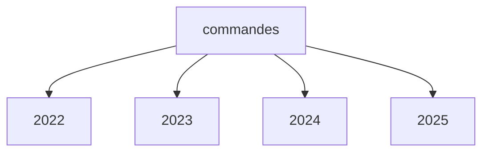
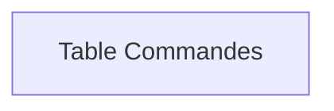
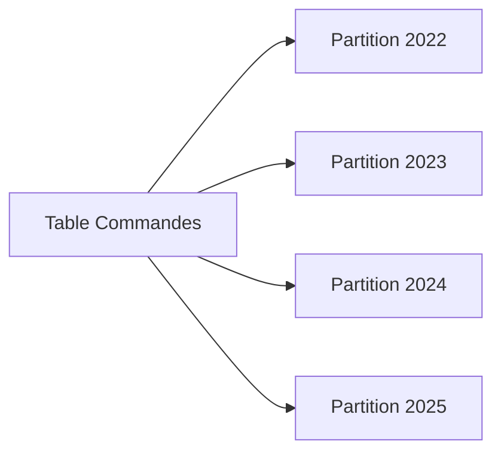
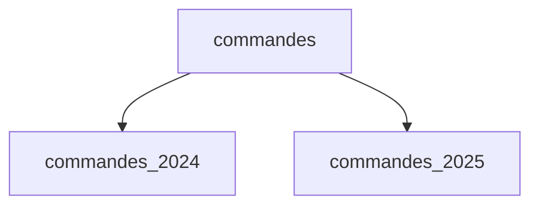
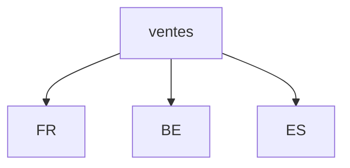
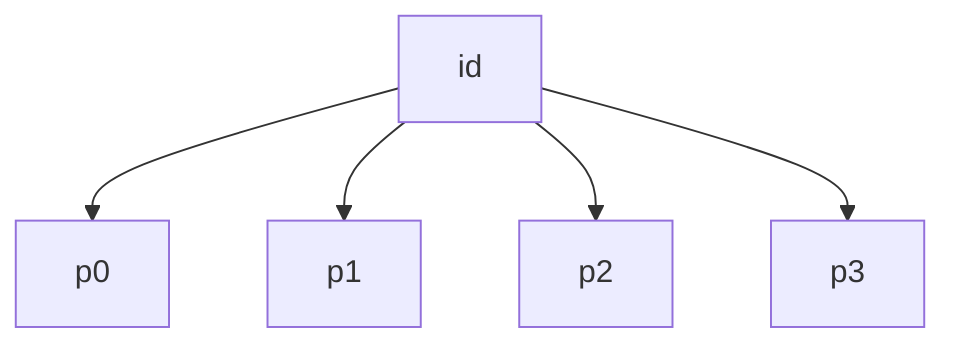
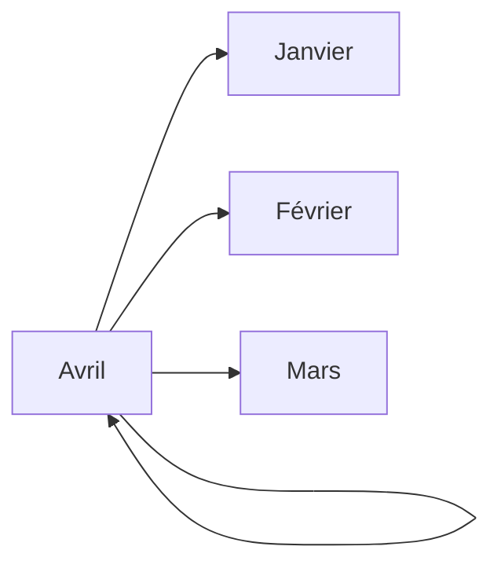
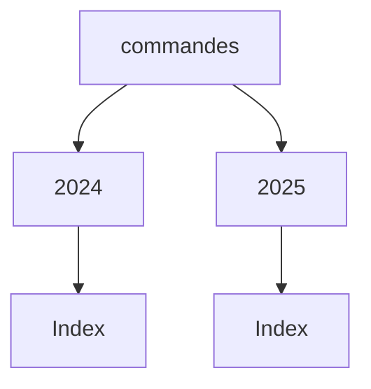
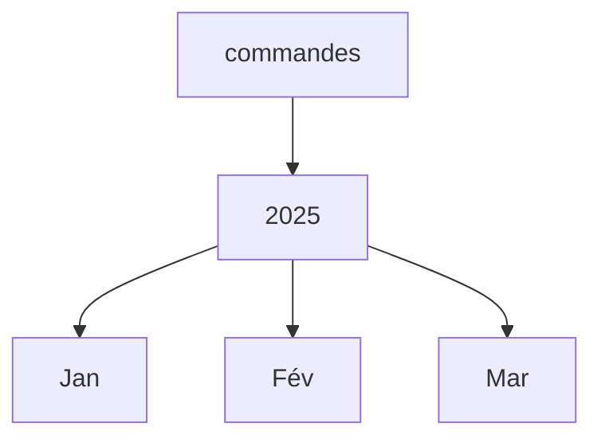
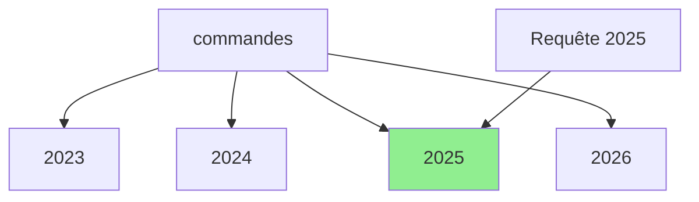

# Tutoriel complet : les partitions en SQL

Les **partitions** permettent de découper une grande table en plusieurs sous-ensembles physiques tout en conservant une seule table logique pour les requêtes.

L'objectif principal est :

* améliorer les performances ;
* faciliter la maintenance ;
* accélérer les suppressions massives ;
* optimiser les chargements de données ;
* mieux gérer les très gros volumes (millions ou milliards de lignes).

---

# 1. Pourquoi partitionner une table ?

Imaginons une table de commandes :

```sql
CREATE TABLE commandes (
    id BIGINT,
    date_commande DATE,
    client_id INT,
    montant DECIMAL(10,2)
);
```

Après plusieurs années :

| Année | Nombre de lignes |
| ----- | ---------------- |
| 2022  | 20 millions      |
| 2023  | 25 millions      |
| 2024  | 30 millions      |
| 2025  | 35 millions      |

Total :

```text
110 millions de lignes
```

Une requête :

```sql
SELECT *
FROM commandes
WHERE date_commande BETWEEN '2025-01-01'
                        AND '2025-12-31';
```

Sans partition :

```text
commande
 ├───────────────────────────────┤
 110 millions de lignes
```

Le moteur doit parcourir un énorme volume.

Avec partitionnement annuel :



Le moteur peut directement accéder à :

```text
partition 2025 uniquement
```

C'est ce qu'on appelle :

> **Partition Pruning**

---

# 2. Table partitionnée vs table normale

## Table normale



Toutes les données sont stockées ensemble.

---

## Table partitionnée



Pour l'application :

```sql
SELECT * FROM commandes;
```

reste identique.

La partition est transparente.

---

# 3. Les principaux types de partitionnement

## Range Partitioning

Découpage par intervalle.

Exemple :

```text
2022
2023
2024
2025
```

Très utilisé pour les dates.

---

## List Partitioning

Découpage selon une liste de valeurs.

Exemple :

```text
France
Belgique
Espagne
```

---

## Hash Partitioning

Répartition automatique.

```text
client_id % 4
```

Les lignes sont distribuées uniformément.

---

## Composite Partitioning

Combinaison de plusieurs méthodes.

Exemple :

```text
Année
   ↓
Pays
```

---

# 4. Partition RANGE (cas réel)

Exemple PostgreSQL.

## Création de la table mère

```sql
CREATE TABLE commandes (
    id BIGINT,
    date_commande DATE NOT NULL,
    client_id INT,
    montant NUMERIC(10,2)
)
PARTITION BY RANGE (date_commande);
```

La table ne contient aucune donnée.

---

## Création des partitions

### 2024

```sql
CREATE TABLE commandes_2024
PARTITION OF commandes
FOR VALUES FROM ('2024-01-01')
TO ('2025-01-01');
```

---

### 2025

```sql
CREATE TABLE commandes_2025
PARTITION OF commandes
FOR VALUES FROM ('2025-01-01')
TO ('2026-01-01');
```

---

Structure :



---

# 5. Insertion dans une table partitionnée

On insère dans la table mère :

```sql
INSERT INTO commandes
VALUES
(
 1,
 '2025-03-15',
 100,
 250.00
);
```

PostgreSQL détermine automatiquement :

```text
2025-03-15
↓
commandes_2025
```

La ligne est stockée dans :

```sql
commandes_2025
```

---

# 6. Vérification

```sql
SELECT tableoid::regclass, *
FROM commandes;
```

Résultat :

| partition      | id |
| -------------- | -- |
| commandes_2025 | 1  |

---

# 7. Partition Pruning

Considérons :

```sql
SELECT *
FROM commandes
WHERE date_commande =
      '2025-03-15';
```

Le moteur sait immédiatement :

```text
2025
↓
partition commandes_2025
```

et ignore :

```text
commandes_2024
```

Diagramme :


Les autres partitions ne sont jamais consultées.

---

# 8. Partition LIST

Très utile pour les pays.

```sql
CREATE TABLE ventes (
    id BIGINT,
    pays VARCHAR(20),
    montant NUMERIC
)
PARTITION BY LIST (pays);
```

---

## France

```sql
CREATE TABLE ventes_fr
PARTITION OF ventes
FOR VALUES IN ('FR');
```

---

## Belgique

```sql
CREATE TABLE ventes_be
PARTITION OF ventes
FOR VALUES IN ('BE');
```

---

## Espagne

```sql
CREATE TABLE ventes_es
PARTITION OF ventes
FOR VALUES IN ('ES');
```

---

Structure :



---

# 9. Partition HASH

Utilisée quand aucune colonne temporelle n'existe.

Exemple :

```sql
CREATE TABLE clients (
    id BIGINT,
    nom VARCHAR(100)
)
PARTITION BY HASH (id);
```

---

Création de 4 partitions :

```sql
CREATE TABLE clients_p0
PARTITION OF clients
FOR VALUES WITH (MODULUS 4, REMAINDER 0);

CREATE TABLE clients_p1
PARTITION OF clients
FOR VALUES WITH (MODULUS 4, REMAINDER 1);

CREATE TABLE clients_p2
PARTITION OF clients
FOR VALUES WITH (MODULUS 4, REMAINDER 2);

CREATE TABLE clients_p3
PARTITION OF clients
FOR VALUES WITH (MODULUS 4, REMAINDER 3);
```

---

Répartition :

```text
id=10 → p2
id=11 → p3
id=12 → p0
id=13 → p1
```

Diagramme :



---

# 10. Partition par mois

Très fréquent dans les systèmes transactionnels.



---

Exemple :

```sql
CREATE TABLE commandes_2025_01
PARTITION OF commandes
FOR VALUES FROM ('2025-01-01')
TO ('2025-02-01');
```

```sql
CREATE TABLE commandes_2025_02
PARTITION OF commandes
FOR VALUES FROM ('2025-02-01')
TO ('2025-03-01');
```

etc.

---

# 11. Suppression ultra rapide

Sans partition :

```sql
DELETE FROM commandes
WHERE date_commande <
      '2023-01-01';
```

Sur 100 millions de lignes :

```text
très coûteux
```

---

Avec partition :

```sql
DROP TABLE commandes_2022;
```

ou

```sql
ALTER TABLE commandes
DETACH PARTITION commandes_2022;
```

Temps :

```text
quelques millisecondes
```

au lieu de plusieurs heures.

---

# 12. Index et partitions

Chaque partition possède ses propres index.

Exemple :

```sql
CREATE INDEX idx_cmd_date
ON commandes(date_commande);
```

PostgreSQL crée automatiquement :

```text
idx sur commandes_2024
idx sur commandes_2025
...
```

Architecture :



---

# 13. Partition par année + sous-partition par mois

Partition composite.



---

Exemple PostgreSQL :

```sql
CREATE TABLE commandes (
   id BIGINT,
   date_commande DATE
)
PARTITION BY RANGE(date_commande);
```

Partition annuelle :

```sql
CREATE TABLE commandes_2025
PARTITION OF commandes
FOR VALUES FROM ('2025-01-01')
TO ('2026-01-01')
PARTITION BY RANGE(date_commande);
```

Puis sous-partitions mensuelles.

---

# 14. Quand utiliser les partitions ?

Utiliser lorsque :

✅ table > plusieurs millions de lignes

✅ données historiques

✅ filtrage fréquent sur date

✅ archivage régulier

✅ suppression massive périodique

---

Exemples :

| Cas               | Partition      |
| ----------------- | -------------- |
| Logs              | Date           |
| Factures          | Année          |
| Commandes         | Mois           |
| Événements IoT    | Jour           |
| Données bancaires | Date opération |

---

# 15. Quand NE PAS partitionner ?

Éviter si :

❌ table de 10 000 lignes

❌ faible croissance

❌ pas de filtre sur la clé de partition

❌ trop de partitions (plusieurs milliers)

---

# 16. Exemple complet de production

```sql
CREATE TABLE commandes (
    id BIGSERIAL,
    date_commande DATE NOT NULL,
    client_id INT NOT NULL,
    montant NUMERIC(10,2)
)
PARTITION BY RANGE(date_commande);
```

Partition 2025 :

```sql
CREATE TABLE commandes_2025
PARTITION OF commandes
FOR VALUES FROM ('2025-01-01')
TO ('2026-01-01');
```

Partition 2026 :

```sql
CREATE TABLE commandes_2026
PARTITION OF commandes
FOR VALUES FROM ('2026-01-01')
TO ('2027-01-01');
```

Index :

```sql
CREATE INDEX idx_client
ON commandes(client_id);
```

Insertion :

```sql
INSERT INTO commandes
(date_commande, client_id, montant)
VALUES
('2025-06-15', 100, 350);
```

Recherche :

```sql
SELECT *
FROM commandes
WHERE date_commande
BETWEEN '2025-06-01'
AND '2025-06-30';
```

Le moteur ne lit que :

```text
commandes_2025
```

et ignore toutes les autres partitions.

---

# Résumé visuel



La grande idée à retenir :

> **Une partition n'est pas un index.**
>
> Un index accélère la recherche *dans une table*.
>
> Une partition réduit la quantité de données que le moteur doit consulter avant même de commencer la recherche.

Dans les systèmes à fort volume, les meilleures performances viennent souvent de la combinaison :

```text
Partitionnement
        +
Index adaptés
        +
Requêtes optimisées
```

qui permet de passer de tables contenant des centaines de millions de lignes à des temps de réponse de quelques millisecondes.
