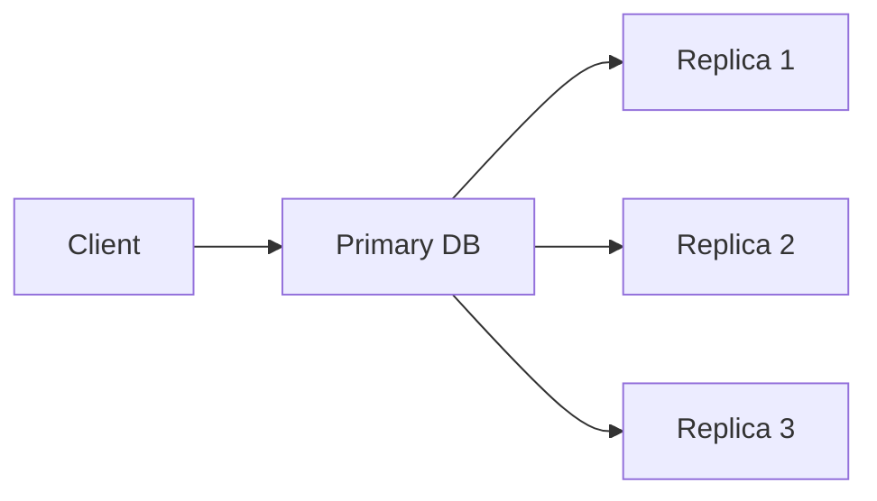
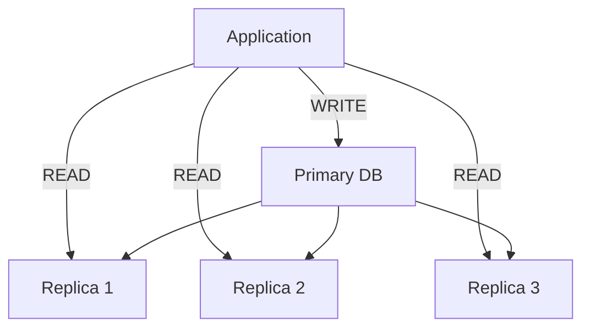
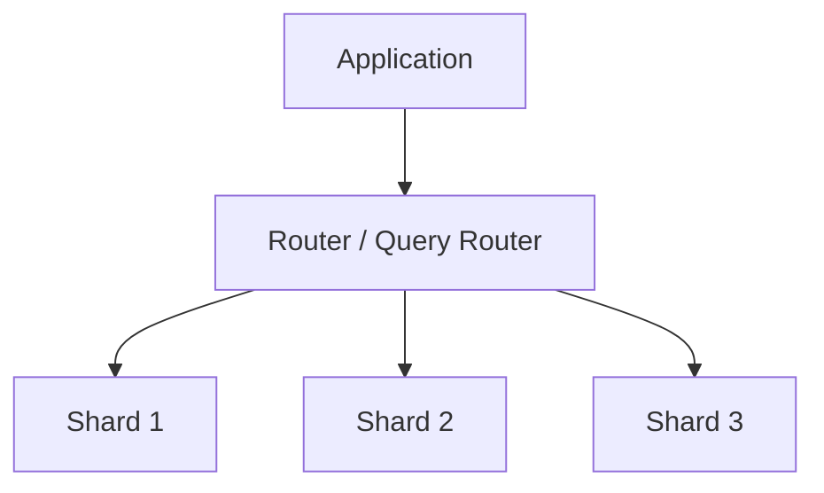
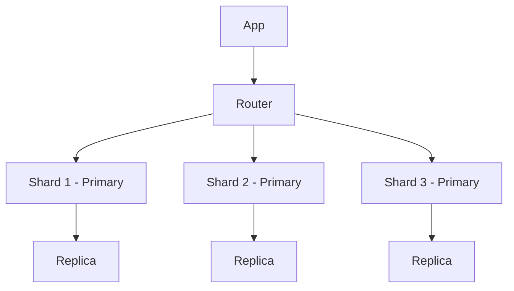
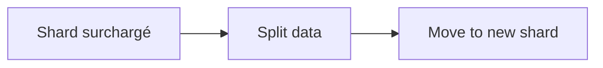

Voici un **tutoriel complet et structuré** sur le **sharding** et la **réplication des bases de données**, avec des exemples concrets et des diagrammes Mermaid.

---

# 1. Concepts fondamentaux

## 1.1 Réplication (Replication)

La **réplication** consiste à **copier les données sur plusieurs serveurs**.

👉 Objectifs :

* Haute disponibilité (HA)
* Tolérance aux pannes
* Scalabilité en lecture

### Types principaux

### 1. Master → Replica (Primary → Replica)

* 1 serveur écrit (primary)
* N serveurs lisent (replicas)



---

## 1.2 Sharding

Le **sharding** consiste à **découper une base en plusieurs morceaux horizontaux**.

👉 Objectifs :

* Scalabilité horizontale (très grandes données)
* Répartition de charge

### Exemple :

* Shard 1 : utilisateurs A–F
* Shard 2 : utilisateurs G–M
* Shard 3 : utilisateurs N–Z

```mermaid
flowchart LR
    A[App] --> S1[Shard 1 (A-F)]
    A --> S2[Shard 2 (G-M)]
    A --> S3[Shard 3 (N-Z)]
```

---

# 2. Réplication en détail

## 2.1 Mode lecture / écriture

### Architecture classique



---

## 2.2 Exemple MySQL (réplication)

### 1. Configuration du master

```ini
# my.cnf (master)
server-id=1
log_bin=mysql-bin
binlog_format=ROW
```

### Création d’un utilisateur replication

```sql
CREATE USER 'repl'@'%' IDENTIFIED BY 'password';
GRANT REPLICATION SLAVE ON *.* TO 'repl'@'%';
FLUSH PRIVILEGES;
```

### Vérifier l’état master

```sql
SHOW MASTER STATUS;
```

---

### 2. Configuration du slave

```ini
# my.cnf (slave)
server-id=2
relay_log=relay-bin
```

### Connexion au master

```sql
CHANGE MASTER TO
MASTER_HOST='192.168.1.10',
MASTER_USER='repl',
MASTER_PASSWORD='password',
MASTER_LOG_FILE='mysql-bin.000001',
MASTER_LOG_POS=  107;
```

### Démarrer la réplication

```sql
START SLAVE;
SHOW SLAVE STATUS\G;
```

---

## 2.3 Cas MongoDB Replica Set

```javascript
rs.initiate({
  _id: "rs0",
  members: [
    { _id: 0, host: "mongo1:27017" },
    { _id: 1, host: "mongo2:27017" },
    { _id: 2, host: "mongo3:27017" }
  ]
})
```

---

# 3. Sharding en détail

## 3.1 Principe

On découpe les données selon une **clé de sharding**.

Exemple :

```text
user_id % 3
```

---

## 3.2 Architecture globale



---

## 3.3 Exemple MongoDB Sharding

### 1. Activer le sharding

```javascript
sh.enableSharding("mydb")
```

---

### 2. Choisir une clé de shard

```javascript
sh.shardCollection("mydb.users", { user_id: 1 })
```

---

### 3. Ajout de shards

```javascript
sh.addShard("shard1/mongo1:27017")
sh.addShard("shard2/mongo2:27017")
sh.addShard("shard3/mongo3:27017")
```

---

## 3.4 Exemple logique de distribution

```python
def get_shard(user_id):
    return user_id % 3

shard = get_shard(42)

print(f"User 42 goes to shard {shard}")
```

---

# 4. Différences clés

| Critère    | Réplication         | Sharding    |
| ---------- | ------------------- | ----------- |
| But        | Haute disponibilité | Scalabilité |
| Données    | Identiques          | Découpées   |
| Complexité | Faible              | Élevée      |
| Écriture   | Centralisée         | Distribuée  |

---

# 5. Combiner sharding + réplication (architecture moderne)

C’est ce qu’utilisent les systèmes à grande échelle (Netflix, Uber, etc.)



👉 Chaque shard a ses replicas.

---

# 6. Stratégies de sharding

## 6.1 Hash-based sharding

```python
shard = hash(user_id) % num_shards
```

✔ Avantages :

* Répartition uniforme

❌ Inconvénient :

* Pas de range queries efficaces

---

## 6.2 Range-based sharding

```text
Shard 1 : 0–1000
Shard 2 : 1001–2000
Shard 3 : 2001–3000
```

✔ Avantages :

* Requêtes par intervalle efficaces

❌ Inconvénient :

* Hotspots possibles

---

## 6.3 Directory-based sharding

Une table centrale stocke où se trouve chaque donnée.

```text
user_id → shard_id
```

---

# 7. Problèmes courants

## 7.1 Rebalancing (rééquilibrage)

Quand un shard devient trop chargé :



---

## 7.2 Cross-shard queries

Exemple :

```sql
SELECT * FROM orders WHERE user_id BETWEEN 1000 AND 5000;
```

👉 Problème : plusieurs shards concernés → lenteur

---

## 7.3 Consistency

* Réplication → éventuelle cohérence
* Sharding → cohérence distribuée difficile

---

# 8. Cas d’usage réels

| Système   | Stratégie                |
| --------- | ------------------------ |
| Instagram | Sharding + réplication   |
| Netflix   | Multi-region replication |
| Uber      | Sharding géographique    |
| Amazon    | Hybrid architecture      |

---

# 9. Résumé simple

* **Réplication** = copier les données (HA + lecture)
* **Sharding** = découper les données (scalabilité)
* **Les deux combinés** = architecture scalable moderne

---

# 10. Si tu veux aller plus loin

Je peux aussi te faire :

* un **mini projet Node.js + MongoDB sharding simulé**
* un **cluster Docker complet (MySQL ou MongoDB)**
* une **architecture type Netflix expliquée en profondeur**
* ou un **exercice pratique corrigé**

Dis-moi 👍
