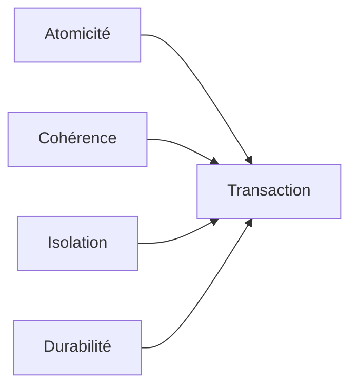
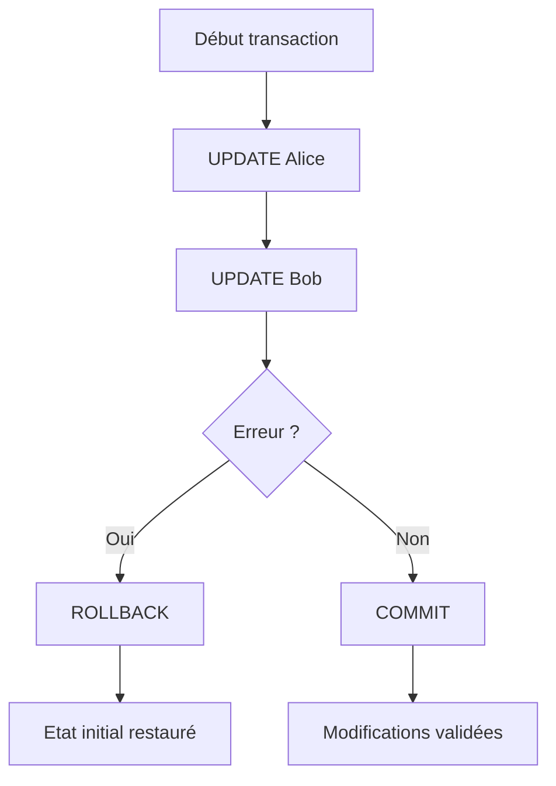
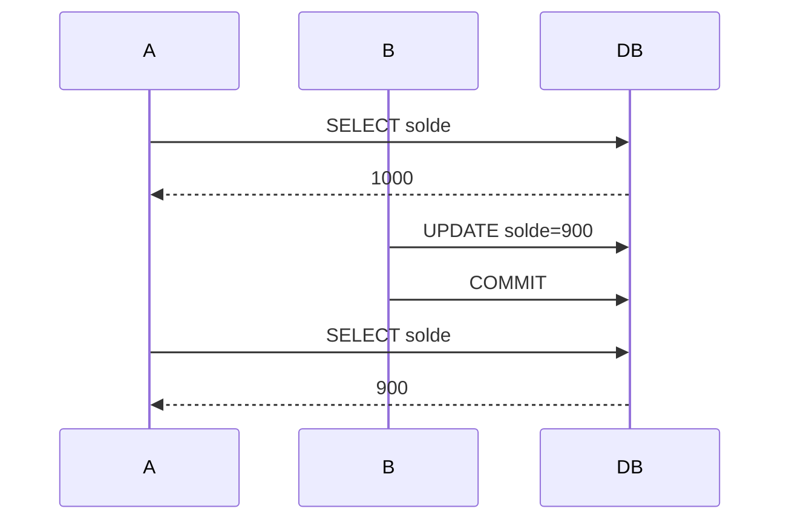
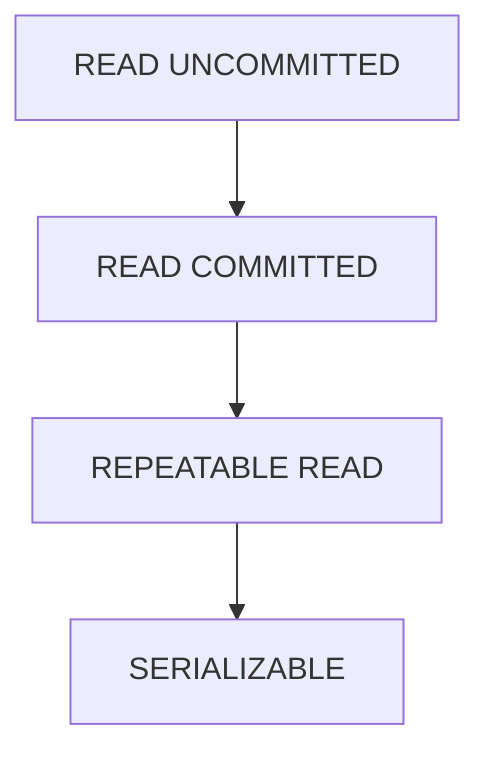
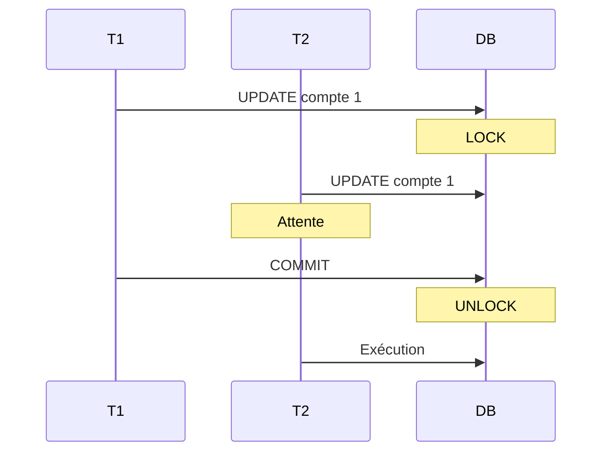
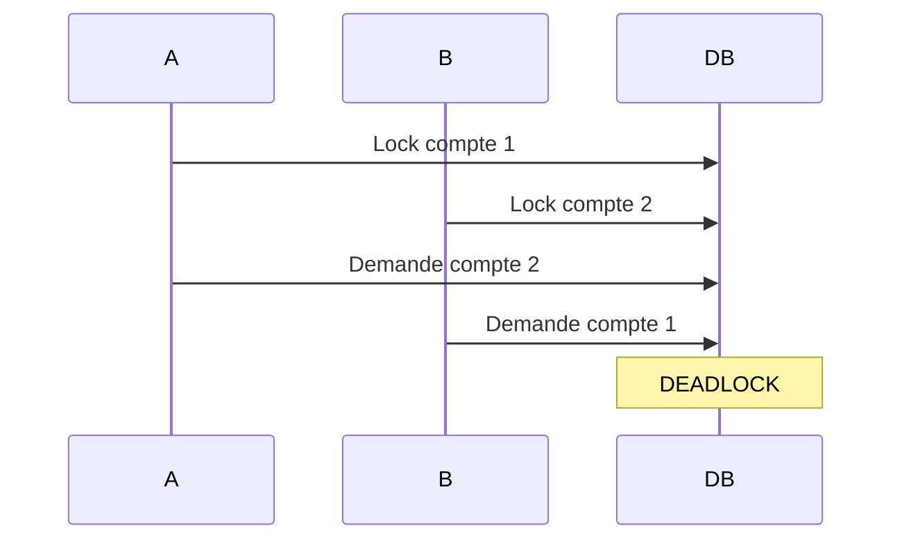
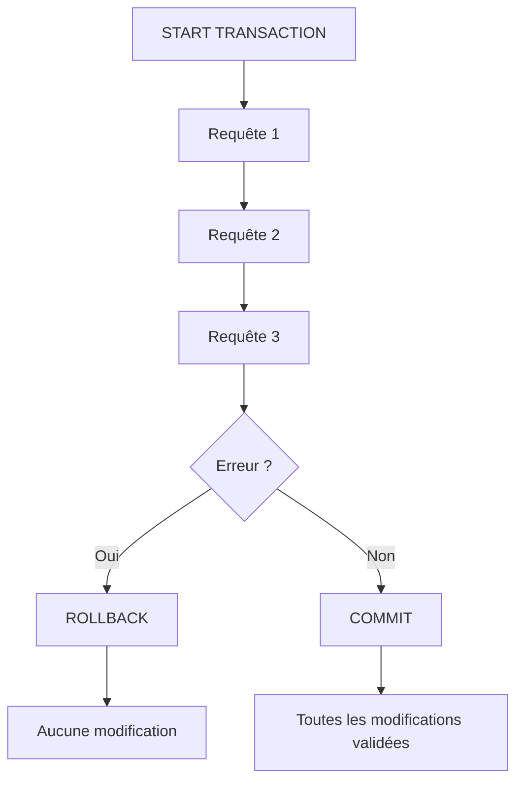

# Les transactions SQL

Les **transactions SQL** sont un mécanisme fondamental des bases de données relationnelles. Elles permettent de regrouper plusieurs opérations SQL en une seule unité logique de travail.

L'objectif principal est de garantir que les données restent **cohérentes**, même en cas d'erreur, de panne ou d'accès concurrent.

---

# 1. Pourquoi utiliser une transaction ?

Prenons un exemple bancaire :

* Alice possède 1000 €
* Bob possède 500 €
* Alice envoie 200 € à Bob

Cette opération nécessite :

1. Retirer 200 € du compte d'Alice
2. Ajouter 200 € au compte de Bob

Si la base tombe en panne après l'étape 1 mais avant l'étape 2 :

| Compte | Solde |
| ------ | ----- |
| Alice  | 800 € |
| Bob    | 500 € |

👉 200 € ont disparu.

Une transaction garantit que :

* soit les deux opérations réussissent ;
* soit aucune n'est appliquée.

---

# 2. Les propriétés ACID

Toute transaction respecte les propriétés **ACID**.



## Atomicité (Atomicity)

> Tout ou rien.

Si une étape échoue :

```sql
ROLLBACK;
```

Tout est annulé.

---

## Cohérence (Consistency)

La base passe toujours d'un état valide à un autre état valide.

Exemple :

```sql
solde >= 0
```

Une transaction ne doit jamais violer cette règle.

---

## Isolation (Isolation)

Les transactions simultanées ne doivent pas se perturber.

---

## Durabilité (Durability)

Une fois validée :

```sql
COMMIT;
```

La transaction est enregistrée définitivement.

Même en cas de coupure électrique.

---

# 3. Syntaxe de base

## Début de transaction

Selon le SGBD :

```sql
START TRANSACTION;
```

ou

```sql
BEGIN;
```

---

## Validation

```sql
COMMIT;
```

Les modifications deviennent permanentes.

---

## Annulation

```sql
ROLLBACK;
```

Toutes les modifications sont annulées.

---

# 4. Premier exemple complet

Créons une table.

```sql
CREATE TABLE comptes (
    id INT PRIMARY KEY,
    titulaire VARCHAR(100),
    solde DECIMAL(10,2)
);
```

Données :

```sql
INSERT INTO comptes VALUES
(1, 'Alice', 1000),
(2, 'Bob', 500);
```

---

## Virement bancaire

```sql
START TRANSACTION;

UPDATE comptes
SET solde = solde - 200
WHERE id = 1;

UPDATE comptes
SET solde = solde + 200
WHERE id = 2;

COMMIT;
```

Résultat :

| Compte | Solde |
| ------ | ----- |
| Alice  | 800   |
| Bob    | 700   |

---

# 5. Gestion des erreurs

Supposons :

```sql
START TRANSACTION;

UPDATE comptes
SET solde = solde - 200
WHERE id = 1;

UPDATE comptes
SET solde = solde + 200
WHERE id = 999;

COMMIT;
```

Le compte 999 n'existe pas.

Selon le moteur SQL, la transaction peut être annulée :

```sql
ROLLBACK;
```

Résultat :

| Compte | Solde |
| ------ | ----- |
| Alice  | 1000  |
| Bob    | 500   |

---

# 6. Diagramme d'une transaction



---

# 7. Savepoints

Un **savepoint** est un point de sauvegarde intermédiaire.

---

## Exemple

```sql
START TRANSACTION;

INSERT INTO commandes VALUES (1, 100);

SAVEPOINT apres_commande;

INSERT INTO paiements VALUES (1, 100);

ROLLBACK TO apres_commande;

COMMIT;
```

Résultat :

* commande conservée
* paiement annulé

---

## Schéma


---

# 8. Transactions automatiques (Autocommit)

La plupart des SGBD fonctionnent en mode :

```text
AUTOCOMMIT = ON
```

Chaque requête est validée automatiquement.

Exemple :

```sql
UPDATE comptes
SET solde = 900
WHERE id = 1;
```

Validation immédiate.

---

## Désactivation

MySQL :

```sql
SET autocommit = 0;
```

Puis :

```sql
COMMIT;
```

ou

```sql
ROLLBACK;
```

---

# 9. Isolation des transactions

Le problème apparaît lorsque plusieurs utilisateurs travaillent simultanément.

---

## Exemple

Utilisateur A :

```sql
START TRANSACTION;

UPDATE comptes
SET solde = 500
WHERE id = 1;
```

Sans commit.

Utilisateur B :

```sql
SELECT * FROM comptes;
```

Que doit-il voir ?

* 1000 ?
* 500 ?

Cela dépend du niveau d'isolation.

---

# 10. Les anomalies de concurrence

## Dirty Read

Lecture d'une donnée non validée.

### Transaction A

```sql
START TRANSACTION;

UPDATE comptes
SET solde = 500
WHERE id = 1;
```

Pas encore validé.

---

### Transaction B

```sql
SELECT solde
FROM comptes;
```

Lit :

```text
500
```

Puis A fait :

```sql
ROLLBACK;
```

La valeur revient à :

```text
1000
```

B a lu une donnée qui n'a jamais existé officiellement.

---

## Non Repeatable Read

La même requête retourne deux résultats différents.



---

## Phantom Read

Une requête retourne de nouvelles lignes.

Transaction A :

```sql
SELECT *
FROM clients
WHERE ville = 'Paris';
```

Retour :

```text
10 lignes
```

---

Transaction B :

```sql
INSERT INTO clients
VALUES (...,'Paris');
COMMIT;
```

---

Transaction A relance :

```sql
SELECT *
FROM clients
WHERE ville = 'Paris';
```

Retour :

```text
11 lignes
```

Un "fantôme" est apparu.

---

# 11. Niveaux d'isolation SQL



Plus on monte :

* plus la sécurité augmente
* plus les performances diminuent

---

## READ UNCOMMITTED

Autorise :

* Dirty Read
* Non Repeatable Read
* Phantom Read

```sql
SET TRANSACTION ISOLATION LEVEL READ UNCOMMITTED;
```

---

## READ COMMITTED

Empêche :

* Dirty Read

Autorise :

* Non Repeatable Read
* Phantom Read

```sql
SET TRANSACTION ISOLATION LEVEL READ COMMITTED;
```

C'est le niveau par défaut de nombreux SGBD.

---

## REPEATABLE READ

Empêche :

* Dirty Read
* Non Repeatable Read

Autorise :

* Phantom Read (selon le moteur)

```sql
SET TRANSACTION ISOLATION LEVEL REPEATABLE READ;
```

---

## SERIALIZABLE

Le niveau maximal.

Empêche :

* Dirty Read
* Non Repeatable Read
* Phantom Read

```sql
SET TRANSACTION ISOLATION LEVEL SERIALIZABLE;
```

Les transactions sont exécutées comme si elles étaient séquentielles.

---

# 12. Verrouillage (Locking)

Lorsqu'une transaction modifie une ligne :

```sql
UPDATE comptes
SET solde = 800
WHERE id = 1;
```

Le SGBD place un verrou.



---

# 13. SELECT ... FOR UPDATE

Permet de verrouiller une ligne avant modification.

```sql
START TRANSACTION;

SELECT *
FROM comptes
WHERE id = 1
FOR UPDATE;
```

La ligne est verrouillée.

---

Puis :

```sql
UPDATE comptes
SET solde = solde - 100
WHERE id = 1;

COMMIT;
```

---

# 14. Deadlock

Deux transactions attendent mutuellement leurs verrous.

## Exemple

Transaction A :

```sql
UPDATE comptes
SET solde = 100
WHERE id = 1;
```

---

Transaction B :

```sql
UPDATE comptes
SET solde = 200
WHERE id = 2;
```

---

Puis :

A veut :

```sql
UPDATE comptes
SET solde = 300
WHERE id = 2;
```

B veut :

```sql
UPDATE comptes
SET solde = 400
WHERE id = 1;
```

---

Diagramme :



Le SGBD choisit généralement une transaction victime :

```sql
ROLLBACK;
```

---

# 15. Exemple réel : création d'une commande

Supposons :

* création de commande
* décrément du stock
* création du paiement

Toutes les opérations doivent réussir ensemble.

```sql
START TRANSACTION;

INSERT INTO commandes(
    client_id,
    date_commande
)
VALUES (
    1,
    NOW()
);

UPDATE produits
SET stock = stock - 1
WHERE id = 5;

INSERT INTO paiements(
    commande_id,
    montant
)
VALUES (
    LAST_INSERT_ID(),
    49.99
);

COMMIT;
```

---

# 16. Bonnes pratiques

## Toujours utiliser les transactions pour

* virements bancaires
* commandes e-commerce
* facturation
* gestion des stocks
* workflows métiers critiques

---

## Garder les transactions courtes

❌ Mauvais :

```sql
START TRANSACTION;

SELECT * FROM gros_table;

-- traitement de 2 minutes

UPDATE ...
COMMIT;
```

---

✅ Mieux :

```sql
SELECT * FROM gros_table;

-- traitement applicatif

START TRANSACTION;

UPDATE ...
COMMIT;
```

---

## Toujours gérer les erreurs

Pseudo-code :

```sql
BEGIN;

TRY
    UPDATE ...
    INSERT ...
    COMMIT;
CATCH
    ROLLBACK;
END
```

---

# Résumé visuel



## À retenir

Les 5 commandes les plus importantes sont :

```sql
START TRANSACTION;
COMMIT;
ROLLBACK;
SAVEPOINT mon_point;
ROLLBACK TO mon_point;
```

Une transaction est indispensable dès qu'une opération métier nécessite plusieurs requêtes SQL qui doivent être exécutées comme un tout cohérent. Sans transactions, il est très facile de créer des incohérences de données, surtout dans les applications multi-utilisateurs.
