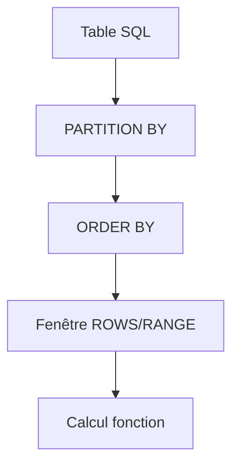
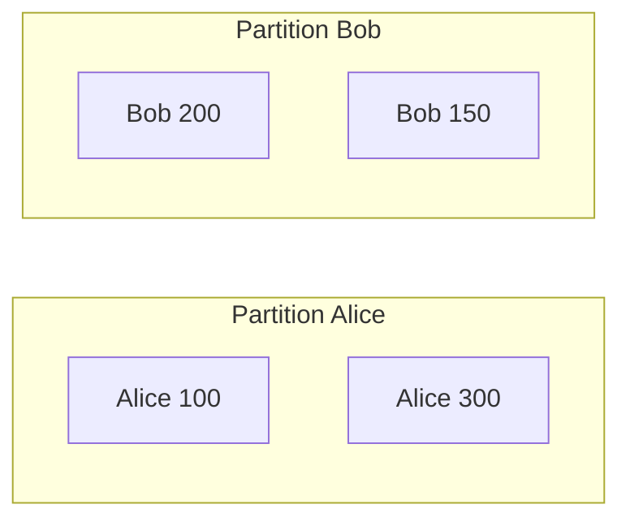
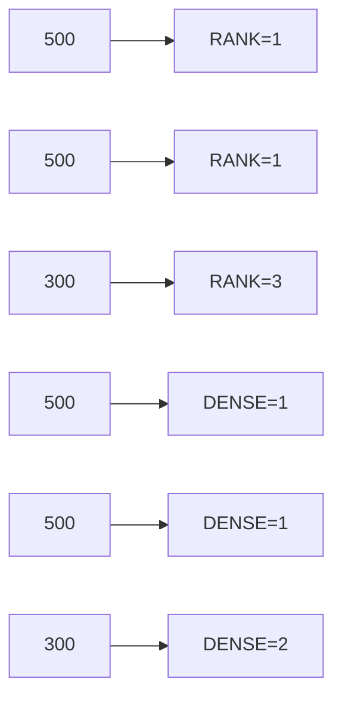
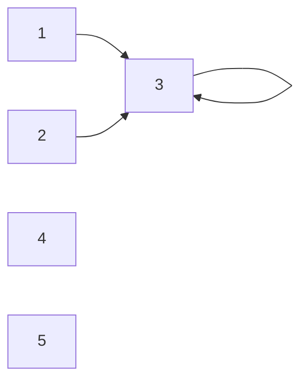
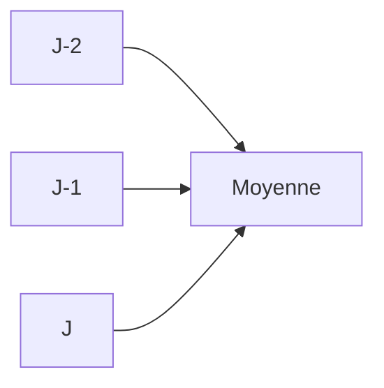
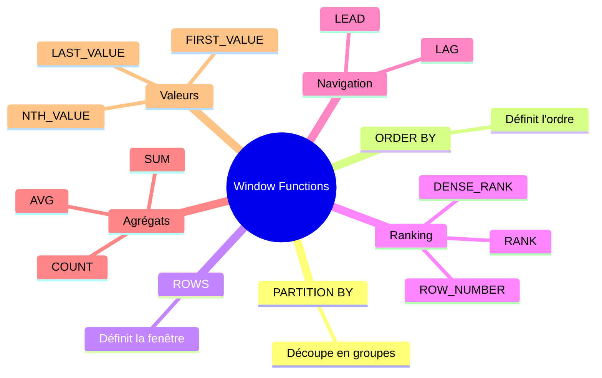

# Tutoriel complet : Les fonctions de fenêtre (Window Functions) en SQL

Les **fonctions de fenêtre** sont parmi les fonctionnalités les plus puissantes du SQL moderne.

Elles permettent de :

* calculer des agrégats sans perdre le détail des lignes ;
* faire des classements ;
* comparer une ligne avec les lignes précédentes ou suivantes ;
* calculer des totaux cumulés ;
* calculer des moyennes mobiles ;
* analyser des séries temporelles.

---

# 1. Pourquoi les fonctions de fenêtre existent ?

Supposons une table des ventes :

```sql
CREATE TABLE ventes (
    id INT,
    vendeur VARCHAR(50),
    montant DECIMAL(10,2)
);
```

| id | vendeur | montant |
| -- | ------- | ------: |
| 1  | Alice   |     100 |
| 2  | Bob     |     200 |
| 3  | Alice   |     300 |
| 4  | Bob     |     150 |

---

## Avec GROUP BY

Si on veut le total par vendeur :

```sql
SELECT vendeur, SUM(montant)
FROM ventes
GROUP BY vendeur;
```

Résultat :

| vendeur | total |
| ------- | ----: |
| Alice   |   400 |
| Bob     |   350 |

Le problème :

➡️ on a perdu les lignes individuelles.

---

## Avec une fonction de fenêtre

```sql
SELECT
    id,
    vendeur,
    montant,
    SUM(montant) OVER(PARTITION BY vendeur) AS total_vendeur
FROM ventes;
```

Résultat :

| id | vendeur | montant | total_vendeur |
| -- | ------- | ------: | ------------: |
| 1  | Alice   |     100 |           400 |
| 3  | Alice   |     300 |           400 |
| 2  | Bob     |     200 |           350 |
| 4  | Bob     |     150 |           350 |

Chaque ligne est conservée.

---

# 2. Structure générale

Toutes les fonctions de fenêtre utilisent :

```sql
fonction() OVER (...)
```

Syntaxe complète :

```sql
fonction() OVER (
    PARTITION BY ...
    ORDER BY ...
    ROWS ...
)
```

---

## Diagramme général



---

# 3. PARTITION BY

`PARTITION BY` découpe les données en groupes.

Imagine :



---

Exemple :

```sql
SELECT
    vendeur,
    montant,
    AVG(montant) OVER (
        PARTITION BY vendeur
    ) AS moyenne_vendeur
FROM ventes;
```

Résultat :

| vendeur | montant | moyenne |
| ------- | ------: | ------: |
| Alice   |     100 |     200 |
| Alice   |     300 |     200 |
| Bob     |     200 |     175 |
| Bob     |     150 |     175 |

---

# 4. ORDER BY dans OVER()

Très important :

```sql
ORDER BY
```

définit l'ordre logique utilisé par la fonction.

---

Exemple :

```sql
SELECT
    vendeur,
    montant,
    SUM(montant) OVER (
        ORDER BY montant
    ) AS cumul
FROM ventes;
```

Tri :

```
100
150
200
300
```

Calcul :

```
100
100+150=250
250+200=450
450+300=750
```

Résultat :

| montant | cumul |
| ------: | ----: |
|     100 |   100 |
|     150 |   250 |
|     200 |   450 |
|     300 |   750 |

---

# 5. ROW_NUMBER()

Numérote chaque ligne.

```sql
SELECT
    vendeur,
    montant,
    ROW_NUMBER() OVER(
        ORDER BY montant DESC
    ) AS rang
FROM ventes;
```

Résultat :

| montant | rang |
| ------: | ---: |
|     300 |    1 |
|     200 |    2 |
|     150 |    3 |
|     100 |    4 |

---

## Top N

Trouver les 3 meilleures ventes :

```sql
WITH classement AS (
    SELECT
        *,
        ROW_NUMBER() OVER(
            ORDER BY montant DESC
        ) AS rn
    FROM ventes
)
SELECT *
FROM classement
WHERE rn <= 3;
```

---

# 6. RANK()

Gestion des égalités.

Données :

| montant |
| ------: |
|     500 |
|     500 |
|     300 |
|     100 |

```sql
SELECT
    montant,
    RANK() OVER(
        ORDER BY montant DESC
    ) AS rang
FROM ventes;
```

Résultat :

| montant | rang |
| ------: | ---: |
|     500 |    1 |
|     500 |    1 |
|     300 |    3 |
|     100 |    4 |

Le rang 2 est sauté.

---

# 7. DENSE_RANK()

Ne saute pas les rangs.

```sql
SELECT
    montant,
    DENSE_RANK() OVER(
        ORDER BY montant DESC
    ) AS rang
FROM ventes;
```

Résultat :

| montant | rang |
| ------: | ---: |
|     500 |    1 |
|     500 |    1 |
|     300 |    2 |
|     100 |    3 |

---

## Différence visuelle



---

# 8. NTILE()

Découpe les lignes en groupes.

Exemple :

```sql
SELECT
    montant,
    NTILE(4) OVER(
        ORDER BY montant
    ) AS quartile
FROM ventes;
```

Résultat :

```
Q1
Q2
Q3
Q4
```

Très utilisé en data science.

---

# 9. LAG()

Accède à la ligne précédente.

Table :

| mois |   CA |
| ---- | ---: |
| Jan  | 1000 |
| Fév  | 1200 |
| Mar  |  900 |

---

```sql
SELECT
    mois,
    ca,
    LAG(ca) OVER(
        ORDER BY mois
    ) AS mois_prec
FROM chiffre_affaires;
```

Résultat :

| mois |   ca | mois_prec |
| ---- | ---: | --------: |
| Jan  | 1000 |      NULL |
| Fév  | 1200 |      1000 |
| Mar  |  900 |      1200 |

---

## Variation

```sql
SELECT
    mois,
    ca,
    ca - LAG(ca) OVER(
        ORDER BY mois
    ) AS variation
FROM chiffre_affaires;
```

Résultat :

| mois | variation |
| ---- | --------: |
| Jan  |      NULL |
| Fév  |      +200 |
| Mar  |      -300 |

---

# 10. LEAD()

Inverse de LAG.

```sql
SELECT
    mois,
    ca,
    LEAD(ca) OVER(
        ORDER BY mois
    ) AS mois_suivant
FROM chiffre_affaires;
```

Résultat :

| mois | suivant |
| ---- | ------: |
| Jan  |    1200 |
| Fév  |     900 |
| Mar  |    NULL |

---

# 11. FIRST_VALUE()

Première valeur de la fenêtre.

```sql
SELECT
    vendeur,
    montant,
    FIRST_VALUE(montant) OVER(
        PARTITION BY vendeur
        ORDER BY montant
    ) AS minimum
FROM ventes;
```

---

# 12. LAST_VALUE()

Attention au piège classique.

```sql
LAST_VALUE()
```

Par défaut, SQL regarde jusqu'à la ligne courante.

On préfère souvent :

```sql
LAST_VALUE(montant) OVER(
    PARTITION BY vendeur
    ORDER BY montant
    ROWS BETWEEN UNBOUNDED PRECEDING
    AND UNBOUNDED FOLLOWING
)
```

Ainsi on récupère réellement la dernière valeur du groupe.

---

# 13. NTH_VALUE()

Récupère la N-ième valeur.

```sql
NTH_VALUE(montant, 3)
```

→ troisième valeur de la fenêtre.

---

# 14. Fenêtres explicites (ROWS)

C'est ici que les fonctions deviennent extrêmement puissantes.

---

## Fenêtre cumulative

```sql
ROWS BETWEEN UNBOUNDED PRECEDING
AND CURRENT ROW
```

Signifie :

```
Début partition -> ligne courante
```

Diagramme :



---

Exemple :

```sql
SELECT
    date_vente,
    montant,
    SUM(montant) OVER(
        ORDER BY date_vente
        ROWS BETWEEN UNBOUNDED PRECEDING
        AND CURRENT ROW
    ) AS cumul
FROM ventes;
```

---

# 15. Moyenne mobile

Très utilisée en finance.

```sql
SELECT
    date_vente,
    montant,
    AVG(montant) OVER(
        ORDER BY date_vente
        ROWS BETWEEN 2 PRECEDING
        AND CURRENT ROW
    ) AS moyenne_mobile
FROM ventes;
```

Fenêtre :



---

# 16. Exemple réel : classement par vendeur

Table :

```sql
ventes
```

| vendeur | montant |
| ------- | ------: |
| Alice   |     100 |
| Alice   |     400 |
| Alice   |     200 |
| Bob     |     300 |
| Bob     |     150 |

---

```sql
SELECT
    vendeur,
    montant,
    RANK() OVER(
        PARTITION BY vendeur
        ORDER BY montant DESC
    ) AS rang
FROM ventes;
```

Résultat :

| vendeur | montant | rang |
| ------- | ------: | ---: |
| Alice   |     400 |    1 |
| Alice   |     200 |    2 |
| Alice   |     100 |    3 |
| Bob     |     300 |    1 |
| Bob     |     150 |    2 |

---

# 17. Exemple réel : détecter les doublons

```sql
SELECT *
FROM (
    SELECT
        *,
        ROW_NUMBER() OVER(
            PARTITION BY email
            ORDER BY id
        ) AS rn
    FROM utilisateurs
) t
WHERE rn > 1;
```

Très utilisé en nettoyage de données.

---

# 18. Exemple réel : Top 3 produits par catégorie

```sql
WITH ranked AS (
    SELECT
        categorie,
        produit,
        chiffre_affaires,
        ROW_NUMBER() OVER(
            PARTITION BY categorie
            ORDER BY chiffre_affaires DESC
        ) AS rn
    FROM produits
)
SELECT *
FROM ranked
WHERE rn <= 3;
```

---

# 19. Exemple réel : calcul de part de marché

```sql
SELECT
    produit,
    ventes,
    ROUND(
        ventes * 100.0 /
        SUM(ventes) OVER(),
        2
    ) AS part_marche
FROM produits;
```

Résultat :

| produit | ventes | part |
| ------- | -----: | ---: |
| A       |    100 |  25% |
| B       |    300 |  75% |

---

# 20. Les fonctions de fenêtre les plus utilisées en entreprise

| Fonction    | Usage                               |
| ----------- | ----------------------------------- |
| ROW_NUMBER  | Déduplication                       |
| RANK        | Classement                          |
| DENSE_RANK  | Classement sans trous               |
| LAG         | Comparaison avec période précédente |
| LEAD        | Prévision / comparaison future      |
| SUM OVER    | Cumul                               |
| AVG OVER    | Moyenne mobile                      |
| COUNT OVER  | Statistiques                        |
| FIRST_VALUE | Première valeur                     |
| LAST_VALUE  | Dernière valeur                     |
| NTILE       | Quartiles / déciles                 |

---

# Résumé mental à retenir



### La formule à retenir

```sql
fonction() OVER (
    PARTITION BY groupe
    ORDER BY ordre
    ROWS BETWEEN ...
)
```

Quand tu maîtrises cette structure, tu maîtrises environ **80 à 90 % des analyses SQL avancées utilisées en BI, Data Engineering, Analytics et Reporting**.
