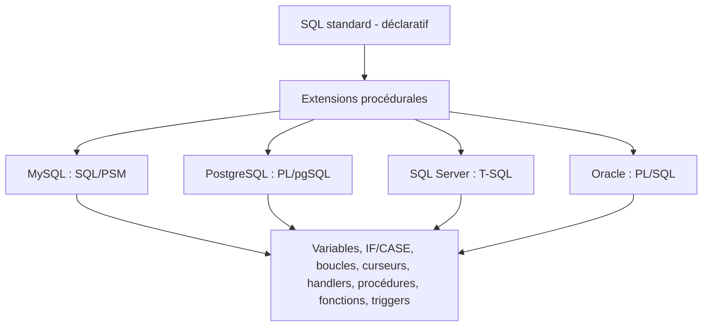
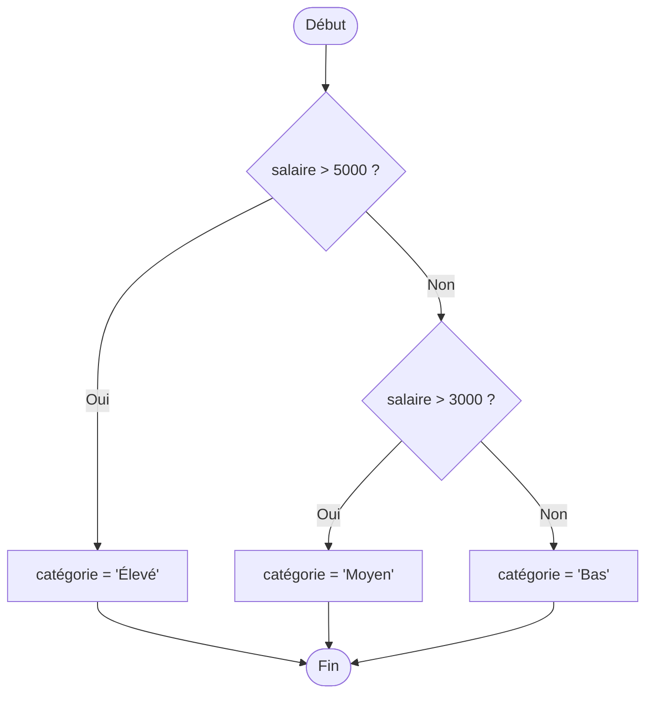
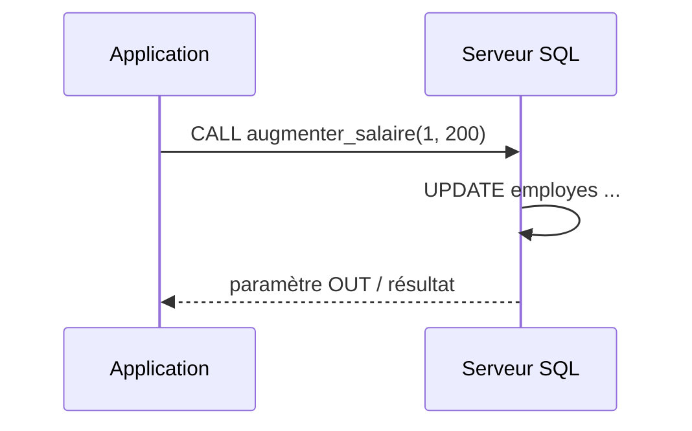
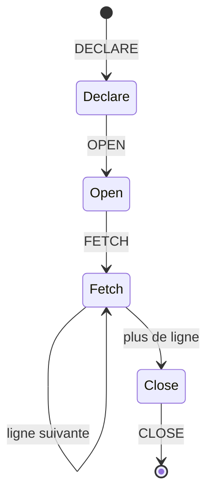
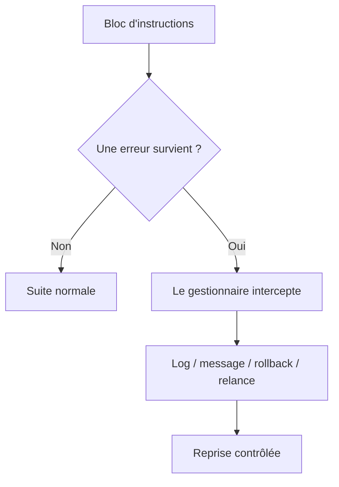
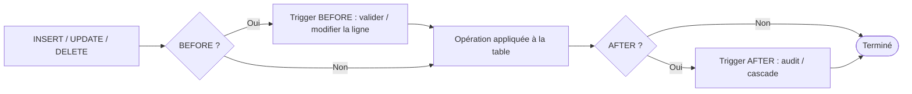

# Le SQL procédural (MySQL, PostgreSQL, SQL Server, Oracle)

## 1. Introduction

Le SQL « classique » est **déclaratif** : on décrit *quoi* obtenir (un `SELECT`, un `UPDATE`), et le moteur décide *comment*. Le SQL **procédural** ajoute par-dessus une vraie logique de programmation : variables, conditions, boucles, gestion d'erreurs, procédures et fonctions stockées exécutées **directement dans le serveur de base de données**.

On l'utilise pour :

- Encapsuler une logique métier réutilisable côté serveur (procédures/fonctions stockées).
- Réduire les allers-retours réseau entre l'application et la base.
- Réagir automatiquement à des évènements via les déclencheurs (*triggers*).
- Traiter des données ligne à ligne avec des curseurs quand l'ensemblisme ne suffit pas.

Chaque SGBD possède son propre **dialecte procédural** :

| SGBD | Dialecte | Norme/origine |
|------|----------|---------------|
| MySQL / MariaDB | SQL/PSM | Norme SQL:2003 (Persistent Stored Modules) |
| PostgreSQL | PL/pgSQL | Inspiré de PL/SQL d'Oracle |
| SQL Server | T-SQL (Transact-SQL) | Microsoft/Sybase |
| Oracle | PL/SQL | Oracle |



> **Bonne nouvelle :** les concepts (variables, conditions, boucles, exceptions…) sont les mêmes partout. Seule la **syntaxe** change. Ce tutoriel présente chaque concept côte à côte sur les 4 moteurs.

### Schéma d'exemple utilisé tout au long du tutoriel

```sql
-- Deux tables réutilisées dans tous les exemples
CREATE TABLE departements (
    dept_id   INT PRIMARY KEY,
    nom_dept  VARCHAR(50),
    budget    DECIMAL(12,2)
);

CREATE TABLE employes (
    emp_id    INT PRIMARY KEY,
    nom       VARCHAR(50),
    salaire   DECIMAL(10,2),
    dept_id   INT
);
```

---

## 2. Structure d'un bloc procédural

Tout langage procédural repose sur la notion de **bloc** : une zone qui contient des déclarations puis des instructions. La différence majeure entre les moteurs est la façon de délimiter ce bloc et de le faire exécuter.

### 2.1 MySQL — le problème du délimiteur

Le point-virgule sépare les instructions *à l'intérieur* du bloc, mais il marque aussi la fin d'une commande pour le client. On change donc temporairement le délimiteur avec `DELIMITER`.

```sql
DELIMITER $$          -- on dit au client : « la commande se termine désormais par $$ »

BEGIN
    DECLARE message VARCHAR(50) DEFAULT 'Bonjour';
    SELECT message;
END $$                -- fin réelle du bloc

DELIMITER ;           -- on rétablit le délimiteur normal
```

> `DELIMITER` est une commande **du client** (mysql, Workbench), pas du serveur. Sans elle, le premier `;` interne couperait le bloc et provoquerait une erreur.

### 2.2 PostgreSQL — le bloc anonyme `DO`

PostgreSQL exécute un bloc anonyme avec `DO`. Le corps est passé sous forme de chaîne, encadrée par des *dollar-quotes* (`$$ ... $$`) pour éviter d'avoir à échapper les apostrophes.

```sql
DO $$
DECLARE
    message TEXT := 'Bonjour';
BEGIN
    RAISE NOTICE '%', message;   -- affiche un message côté serveur
END $$;
```

> `$$` est un délimiteur de chaîne. On peut nommer la balise (`$corps$ ... $corps$`) pour imbriquer plusieurs blocs.

### 2.3 SQL Server — pas de délimiteur, des *batches*

T-SQL n'a pas besoin de `DELIMITER`. Les instructions s'enchaînent ; le mot-clé `GO` (commande du client) sépare des lots (*batches*). Les variables se déclarent avec `@`.

```sql
BEGIN
    DECLARE @message VARCHAR(50) = 'Bonjour';
    PRINT @message;
END;
GO
```

### 2.4 Oracle — le bloc anonyme PL/SQL

La structure canonique de PL/SQL : section `DECLARE` (facultative), `BEGIN`, et `EXCEPTION` (facultative). Le `/` final, sur sa propre ligne, demande à SQL\*Plus / SQL Developer d'exécuter le bloc.

```sql
DECLARE
    message VARCHAR2(50) := 'Bonjour';
BEGIN
    DBMS_OUTPUT.PUT_LINE(message);   -- nécessite SET SERVEROUTPUT ON
END;
/
```


---

## 3. Variables et types de données

### 3.1 Déclaration et affectation

| Concept | MySQL | PostgreSQL | SQL Server | Oracle |
|---------|-------|-----------|------------|--------|
| Déclaration | `DECLARE v INT DEFAULT 0;` | `v INT := 0;` (zone DECLARE) | `DECLARE @v INT = 0;` | `v NUMBER := 0;` (zone DECLARE) |
| Affectation | `SET v = 1;` | `v := 1;` | `SET @v = 1;` | `v := 1;` |
| Depuis une requête | `SELECT col INTO v FROM t;` | `SELECT col INTO v FROM t;` | `SELECT @v = col FROM t;` | `SELECT col INTO v FROM t;` |

### 3.2 Exemple complet — calcul d'une prime (10 % du salaire)

**MySQL**

```sql
DELIMITER $$
CREATE PROCEDURE demo_variables()
BEGIN
    DECLARE v_salaire DECIMAL(10,2);
    DECLARE v_prime   DECIMAL(10,2);

    -- on récupère le salaire de l'employé 1 dans une variable
    SELECT salaire INTO v_salaire FROM employes WHERE emp_id = 1;

    SET v_prime = v_salaire * 0.10;   -- calcul en mémoire
    SELECT v_salaire AS salaire, v_prime AS prime;
END $$
DELIMITER ;
```

**PostgreSQL**

```sql
DO $$
DECLARE
    v_salaire NUMERIC(10,2);
    v_prime   NUMERIC(10,2);
BEGIN
    SELECT salaire INTO v_salaire FROM employes WHERE emp_id = 1;
    v_prime := v_salaire * 0.10;
    RAISE NOTICE 'Salaire % / Prime %', v_salaire, v_prime;
END $$;
```

**SQL Server**

```sql
DECLARE @v_salaire DECIMAL(10,2);
DECLARE @v_prime   DECIMAL(10,2);

SELECT @v_salaire = salaire FROM employes WHERE emp_id = 1;
SET @v_prime = @v_salaire * 0.10;
PRINT CONCAT('Salaire ', @v_salaire, ' / Prime ', @v_prime);
```

**Oracle**

```sql
DECLARE
    v_salaire employes.salaire%TYPE;   -- %TYPE : hérite du type de la colonne
    v_prime   NUMBER(10,2);
BEGIN
    SELECT salaire INTO v_salaire FROM employes WHERE emp_id = 1;
    v_prime := v_salaire * 0.10;
    DBMS_OUTPUT.PUT_LINE('Salaire ' || v_salaire || ' / Prime ' || v_prime);
END;
/
```

> **Astuce Oracle / PostgreSQL : `%TYPE`.** Déclarer `v_salaire employes.salaire%TYPE` lie automatiquement la variable au type réel de la colonne. Si la colonne change de type, le code n'a pas besoin d'être modifié. Oracle propose aussi `%ROWTYPE` pour une ligne entière.

---

## 4. Structures de contrôle

### 4.1 Conditions : `IF` et `CASE`



**MySQL** — `ELSEIF` en un seul mot, bloc fermé par `END IF`.

```sql
IF v_salaire > 5000 THEN
    SET v_categorie = 'Élevé';
ELSEIF v_salaire > 3000 THEN
    SET v_categorie = 'Moyen';
ELSE
    SET v_categorie = 'Bas';
END IF;
```

**PostgreSQL** — identique mais `ELSIF` (sans deuxième E).

```sql
IF v_salaire > 5000 THEN
    v_categorie := 'Élevé';
ELSIF v_salaire > 3000 THEN
    v_categorie := 'Moyen';
ELSE
    v_categorie := 'Bas';
END IF;
```

**SQL Server** — pas de `ELSIF` : on imbrique, ou on utilise un bloc `BEGIN...END`.

```sql
IF @v_salaire > 5000
    SET @v_categorie = 'Élevé';
ELSE IF @v_salaire > 3000
    SET @v_categorie = 'Moyen';
ELSE
    SET @v_categorie = 'Bas';
```

**Oracle** — comme PostgreSQL : `ELSIF`.

```sql
IF v_salaire > 5000 THEN
    v_categorie := 'Élevé';
ELSIF v_salaire > 3000 THEN
    v_categorie := 'Moyen';
ELSE
    v_categorie := 'Bas';
END IF;
```

Le `CASE` procédural existe dans les quatre moteurs (MySQL, PostgreSQL, Oracle ont un `CASE ... END CASE` procédural ; SQL Server utilise l'expression `CASE ... END`) :

```sql
-- Forme commune (PL/pgSQL, PL/SQL, MySQL)
CASE
    WHEN v_salaire > 5000 THEN v_categorie := 'Élevé';
    WHEN v_salaire > 3000 THEN v_categorie := 'Moyen';
    ELSE                       v_categorie := 'Bas';
END CASE;
```

### 4.2 Les boucles

Récapitulatif des types de boucles disponibles :

| Boucle | MySQL | PostgreSQL | SQL Server | Oracle |
|--------|:-----:|:----------:|:----------:|:------:|
| `WHILE` (test avant) | ✅ | ✅ | ✅ | ✅ |
| `LOOP` + sortie manuelle | ✅ (`LEAVE`) | ✅ (`EXIT`) | ❌ | ✅ (`EXIT`) |
| `REPEAT` / `UNTIL` (test après) | ✅ | ❌ | ❌ | ❌ |
| `FOR` numérique (`1..N`) | ❌ | ✅ | ❌ | ✅ |
| `FOR` sur curseur/requête | ❌ | ✅ | ❌ | ✅ |

**Exemple : sommer les entiers de 1 à 5.**

**MySQL** — `WHILE ... DO ... END WHILE`.

```sql
DECLARE i INT DEFAULT 1;
DECLARE total INT DEFAULT 0;
WHILE i <= 5 DO
    SET total = total + i;
    SET i = i + 1;
END WHILE;
```

**PostgreSQL** — boucle `FOR` numérique, très concise.

```sql
DECLARE total INT := 0;
BEGIN
    FOR i IN 1..5 LOOP        -- i est déclaré implicitement
        total := total + i;
    END LOOP;
END;
```

**SQL Server** — uniquement `WHILE` ; `BREAK` et `CONTINUE` contrôlent la boucle.

```sql
DECLARE @i INT = 1, @total INT = 0;
WHILE @i <= 5
BEGIN
    SET @total = @total + @i;
    SET @i = @i + 1;
END;
```

**Oracle** — boucle `FOR` numérique.

```sql
v_total NUMBER := 0;
BEGIN
    FOR i IN 1..5 LOOP
        v_total := v_total + i;
    END LOOP;
END;
```

> **`LOOP` infinie contrôlée.** En PL/pgSQL et PL/SQL on écrit souvent `LOOP ... EXIT WHEN condition; ... END LOOP;`. En MySQL on étiquette la boucle pour la quitter : `boucle: LOOP ... IF ... THEN LEAVE boucle; END IF; END LOOP boucle;`.

---

## 5. Les procédures stockées

Une procédure est un programme nommé, stocké dans la base, qu'on **appelle** explicitement. Elle peut recevoir des paramètres en **entrée** (`IN`), en **sortie** (`OUT`) ou les deux (`INOUT`).



### 5.1 MySQL

```sql
DELIMITER $$
CREATE PROCEDURE augmenter_salaire(
    IN  p_emp_id  INT,
    IN  p_montant DECIMAL(10,2),
    OUT p_nouveau DECIMAL(10,2)   -- renvoie le nouveau salaire
)
BEGIN
    UPDATE employes
    SET    salaire = salaire + p_montant
    WHERE  emp_id = p_emp_id;

    SELECT salaire INTO p_nouveau FROM employes WHERE emp_id = p_emp_id;
END $$
DELIMITER ;

-- Appel
CALL augmenter_salaire(1, 200, @resultat);
SELECT @resultat;
```

### 5.2 PostgreSQL (procédures depuis la version 11)

```sql
CREATE OR REPLACE PROCEDURE augmenter_salaire(
    IN  p_emp_id  INT,
    IN  p_montant NUMERIC,
    INOUT p_nouveau NUMERIC DEFAULT NULL   -- PostgreSQL utilise INOUT pour renvoyer une valeur
)
LANGUAGE plpgsql
AS $$
BEGIN
    UPDATE employes
    SET    salaire = salaire + p_montant
    WHERE  emp_id = p_emp_id;

    SELECT salaire INTO p_nouveau FROM employes WHERE emp_id = p_emp_id;
END $$;

-- Appel
CALL augmenter_salaire(1, 200, NULL);
```

> En PostgreSQL, une procédure ne renvoie pas via `OUT` seul comme une fonction ; on utilise `INOUT`, et `CALL` affiche la valeur retournée. Contrairement aux fonctions, une procédure peut gérer ses propres transactions (`COMMIT` / `ROLLBACK`).

### 5.3 SQL Server

```sql
CREATE OR ALTER PROCEDURE augmenter_salaire
    @p_emp_id  INT,
    @p_montant DECIMAL(10,2),
    @p_nouveau DECIMAL(10,2) OUTPUT     -- OUTPUT = paramètre de sortie
AS
BEGIN
    SET NOCOUNT ON;     -- évite les messages « N rows affected »

    UPDATE employes
    SET    salaire = salaire + @p_montant
    WHERE  emp_id = @p_emp_id;

    SELECT @p_nouveau = salaire FROM employes WHERE emp_id = @p_emp_id;
END;
GO

-- Appel
DECLARE @res DECIMAL(10,2);
EXEC augmenter_salaire @p_emp_id = 1, @p_montant = 200, @p_nouveau = @res OUTPUT;
PRINT @res;
```

### 5.4 Oracle

```sql
CREATE OR REPLACE PROCEDURE augmenter_salaire(
    p_emp_id  IN  NUMBER,
    p_montant IN  NUMBER,
    p_nouveau OUT NUMBER
) AS
BEGIN
    UPDATE employes
    SET    salaire = salaire + p_montant
    WHERE  emp_id = p_emp_id;

    SELECT salaire INTO p_nouveau FROM employes WHERE emp_id = p_emp_id;
END;
/

-- Appel
DECLARE
    v_res NUMBER;
BEGIN
    augmenter_salaire(1, 200, v_res);
    DBMS_OUTPUT.PUT_LINE('Nouveau salaire : ' || v_res);
END;
/
```

**Comparatif des modes de paramètres**

| Mode | MySQL | PostgreSQL | SQL Server | Oracle |
|------|-------|-----------|------------|--------|
| Entrée | `IN` | `IN` | (défaut) | `IN` |
| Sortie | `OUT` | `OUT` / `INOUT` | `OUTPUT` | `OUT` |
| Entrée+sortie | `INOUT` | `INOUT` | `OUTPUT` | `IN OUT` |

---

## 6. Les fonctions stockées

Une fonction **retourne obligatoirement une valeur** et s'utilise à l'intérieur d'une requête SQL (`SELECT ma_fonction(...)`). C'est la différence clé avec une procédure.

### 6.1 MySQL

```sql
DELIMITER $$
CREATE FUNCTION calcul_prime(p_salaire DECIMAL(10,2))
RETURNS DECIMAL(10,2)
DETERMINISTIC          -- même entrée => même sortie (utile pour l'optimiseur/réplication)
BEGIN
    RETURN p_salaire * 0.10;
END $$
DELIMITER ;

SELECT nom, calcul_prime(salaire) AS prime FROM employes;
```

### 6.2 PostgreSQL

```sql
CREATE OR REPLACE FUNCTION calcul_prime(p_salaire NUMERIC)
RETURNS NUMERIC
LANGUAGE plpgsql
AS $$
BEGIN
    RETURN p_salaire * 0.10;
END $$;

SELECT nom, calcul_prime(salaire) AS prime FROM employes;
```

### 6.3 SQL Server (fonction scalaire)

```sql
CREATE OR ALTER FUNCTION calcul_prime(@p_salaire DECIMAL(10,2))
RETURNS DECIMAL(10,2)
AS
BEGIN
    RETURN @p_salaire * 0.10;
END;
GO

-- Le schéma (dbo) est requis pour appeler une fonction scalaire
SELECT nom, dbo.calcul_prime(salaire) AS prime FROM employes;
```

### 6.4 Oracle

```sql
CREATE OR REPLACE FUNCTION calcul_prime(p_salaire NUMBER)
RETURN NUMBER
IS
BEGIN
    RETURN p_salaire * 0.10;
END;
/

SELECT nom, calcul_prime(salaire) AS prime FROM employes;
```

> **Procédure ou fonction ?** Une fonction *calcule et renvoie* une valeur, et s'intègre dans une requête. Une procédure *exécute une action* (modifie des données, gère des transactions) et s'appelle avec `CALL`/`EXEC`. En règle générale : éviter les effets de bord (UPDATE/DELETE) dans les fonctions.

---

## 7. Les curseurs

Un curseur permet de **parcourir un jeu de résultats ligne par ligne**. À réserver aux cas où une opération ensembliste (`UPDATE`/`INSERT ... SELECT`) ne suffit pas, car c'est plus lent.



### 7.1 MySQL — le `HANDLER` détecte la fin

MySQL n'a pas d'attribut « fin de curseur ». On déclare un *handler* `NOT FOUND` qui bascule un drapeau.

```sql
DELIMITER $$
CREATE PROCEDURE cumul_salaires()
BEGIN
    DECLARE v_fin   INT DEFAULT 0;
    DECLARE v_sal   DECIMAL(10,2);
    DECLARE v_total DECIMAL(12,2) DEFAULT 0;

    DECLARE cur CURSOR FOR SELECT salaire FROM employes;
    -- quand FETCH ne trouve plus rien, v_fin passe à 1
    DECLARE CONTINUE HANDLER FOR NOT FOUND SET v_fin = 1;

    OPEN cur;
    boucle: LOOP
        FETCH cur INTO v_sal;
        IF v_fin = 1 THEN
            LEAVE boucle;
        END IF;
        SET v_total = v_total + v_sal;
    END LOOP;
    CLOSE cur;

    SELECT v_total AS masse_salariale;
END $$
DELIMITER ;
```

### 7.2 PostgreSQL — la boucle `FOR` ouvre/ferme automatiquement

```sql
DO $$
DECLARE
    rec     RECORD;
    v_total NUMERIC := 0;
BEGIN
    -- pas besoin de OPEN/FETCH/CLOSE : la boucle FOR gère tout
    FOR rec IN SELECT salaire FROM employes LOOP
        v_total := v_total + rec.salaire;
    END LOOP;
    RAISE NOTICE 'Masse salariale : %', v_total;
END $$;
```

### 7.3 SQL Server — `@@FETCH_STATUS` et `DEALLOCATE`

```sql
DECLARE @v_sal DECIMAL(10,2), @v_total DECIMAL(12,2) = 0;

DECLARE cur CURSOR FOR SELECT salaire FROM employes;
OPEN cur;
FETCH NEXT FROM cur INTO @v_sal;          -- premier FETCH

WHILE @@FETCH_STATUS = 0                    -- 0 = ligne lue avec succès
BEGIN
    SET @v_total = @v_total + @v_sal;
    FETCH NEXT FROM cur INTO @v_sal;        -- FETCH suivant
END;

CLOSE cur;
DEALLOCATE cur;     -- libère le curseur (spécifique à SQL Server)
PRINT @v_total;
```

### 7.4 Oracle — boucle `FOR` sur curseur (la plus idiomatique)

```sql
DECLARE
    v_total NUMBER := 0;
BEGIN
    FOR rec IN (SELECT salaire FROM employes) LOOP   -- curseur implicite
        v_total := v_total + rec.salaire;
    END LOOP;
    DBMS_OUTPUT.PUT_LINE('Masse salariale : ' || v_total);
END;
/
```

Version Oracle avec curseur **explicite** et attributs (`%NOTFOUND`, `%ROWCOUNT`) :

```sql
DECLARE
    CURSOR c IS SELECT salaire FROM employes;
    v_sal   employes.salaire%TYPE;
    v_total NUMBER := 0;
BEGIN
    OPEN c;
    LOOP
        FETCH c INTO v_sal;
        EXIT WHEN c%NOTFOUND;          -- sort dès qu'il n'y a plus de ligne
        v_total := v_total + v_sal;
    END LOOP;
    DBMS_OUTPUT.PUT_LINE('Lignes lues : ' || c%ROWCOUNT);
    CLOSE c;
END;
/
```

> **À retenir :** PostgreSQL et Oracle offrent une boucle `FOR ... IN` qui ouvre, lit et ferme le curseur automatiquement — c'est plus sûr et plus lisible. MySQL et SQL Server imposent la gestion manuelle (drapeau ou `@@FETCH_STATUS`).

---

## 8. Gestion des erreurs et des exceptions

C'est le domaine où les dialectes divergent le plus.



### 8.1 MySQL — `DECLARE ... HANDLER` et `SIGNAL`

```sql
DELIMITER $$
CREATE PROCEDURE division_sure(IN a INT, IN b INT)
BEGIN
    DECLARE v_res INT;

    -- gestionnaire générique : intercepte toute exception SQL
    DECLARE EXIT HANDLER FOR SQLEXCEPTION
    BEGIN
        SELECT 'Erreur capturée, opération annulée' AS message;
        ROLLBACK;
    END;

    START TRANSACTION;
    IF b = 0 THEN
        -- on lève une erreur applicative personnalisée
        SIGNAL SQLSTATE '45000'
            SET MESSAGE_TEXT = 'Division par zéro interdite';
    END IF;
    SET v_res = a / b;
    SELECT v_res;
    COMMIT;
END $$
DELIMITER ;
```

> `EXIT HANDLER` quitte le bloc après traitement ; `CONTINUE HANDLER` reprend après l'instruction fautive. `SIGNAL SQLSTATE '45000'` est la convention pour une erreur définie par l'utilisateur.

### 8.2 PostgreSQL — section `EXCEPTION` et `RAISE`

```sql
CREATE OR REPLACE PROCEDURE division_sure(a INT, b INT)
LANGUAGE plpgsql
AS $$
DECLARE
    v_res INT;
BEGIN
    IF b = 0 THEN
        RAISE EXCEPTION 'Division par zéro interdite'
            USING ERRCODE = '22012';
    END IF;
    v_res := a / b;
    RAISE NOTICE 'Résultat : %', v_res;
EXCEPTION
    WHEN division_by_zero THEN          -- nom de condition prédéfini
        RAISE NOTICE 'Erreur : division par zéro';
    WHEN OTHERS THEN                    -- attrape tout le reste
        RAISE NOTICE 'Erreur inattendue : %', SQLERRM;
END $$;
```

### 8.3 SQL Server — `TRY ... CATCH` et `THROW`

```sql
CREATE OR ALTER PROCEDURE division_sure @a INT, @b INT
AS
BEGIN
    BEGIN TRY
        IF @b = 0
            THROW 50000, 'Division par zéro interdite', 1;  -- erreur personnalisée

        DECLARE @v_res INT = @a / @b;
        PRINT @v_res;
    END TRY
    BEGIN CATCH
        -- fonctions de diagnostic disponibles dans le bloc CATCH
        PRINT 'Erreur n° '  + CAST(ERROR_NUMBER()  AS VARCHAR);
        PRINT 'Message : '  + ERROR_MESSAGE();
        PRINT 'Ligne : '    + CAST(ERROR_LINE()    AS VARCHAR);
    END CATCH;
END;
GO
```

> `THROW` (SQL Server 2012+) est la méthode recommandée pour lever une erreur ; l'ancien `RAISERROR` reste disponible mais moins strict.

### 8.4 Oracle — `EXCEPTION` riche en exceptions prédéfinies

```sql
CREATE OR REPLACE PROCEDURE division_sure(a NUMBER, b NUMBER) AS
    v_res NUMBER;
    e_invalide EXCEPTION;        -- exception nommée par l'utilisateur
BEGIN
    IF b = 0 THEN
        RAISE e_invalide;
    END IF;
    v_res := a / b;
    DBMS_OUTPUT.PUT_LINE('Résultat : ' || v_res);
EXCEPTION
    WHEN e_invalide THEN
        -- erreur applicative numérotée entre -20000 et -20999
        RAISE_APPLICATION_ERROR(-20001, 'Division par zéro interdite');
    WHEN ZERO_DIVIDE THEN
        DBMS_OUTPUT.PUT_LINE('Division par zéro système');
    WHEN OTHERS THEN
        DBMS_OUTPUT.PUT_LINE('Erreur : ' || SQLERRM);
END;
/
```

**Synthèse de la gestion d'erreurs**

| Mécanisme | MySQL | PostgreSQL | SQL Server | Oracle |
|-----------|-------|-----------|------------|--------|
| Bloc de capture | `DECLARE ... HANDLER` | `EXCEPTION WHEN` | `BEGIN TRY/CATCH` | `EXCEPTION WHEN` |
| Lever une erreur | `SIGNAL SQLSTATE` | `RAISE EXCEPTION` | `THROW` | `RAISE` / `RAISE_APPLICATION_ERROR` |
| « Attrape-tout » | `FOR SQLEXCEPTION` | `WHEN OTHERS` | `BEGIN CATCH` | `WHEN OTHERS` |
| Message d'erreur courant | `GET DIAGNOSTICS` | `SQLERRM` | `ERROR_MESSAGE()` | `SQLERRM` |

---

## 9. Les déclencheurs (triggers)

Un déclencheur est une procédure exécutée **automatiquement** lors d'un `INSERT`, `UPDATE` ou `DELETE`. Il sert à auditer, valider ou maintenir des données dérivées.



Deux choses varient entre moteurs :

- **Le moment** : `BEFORE` / `AFTER` (et `INSTEAD OF` pour SQL Server/Oracle sur les vues).
- **L'accès aux données** : `NEW`/`OLD` (ligne par ligne) ou des pseudo-tables `inserted`/`deleted` (ensemblistes, SQL Server).

### 9.1 MySQL — `FOR EACH ROW`, pseudo-lignes `NEW` / `OLD`

```sql
-- Table d'audit
CREATE TABLE audit_salaire (
    emp_id     INT,
    ancien_sal DECIMAL(10,2),
    nouveau_sal DECIMAL(10,2),
    modifie_le DATETIME
);

DELIMITER $$
CREATE TRIGGER trg_audit_salaire
AFTER UPDATE ON employes
FOR EACH ROW
BEGIN
    IF OLD.salaire <> NEW.salaire THEN
        INSERT INTO audit_salaire
        VALUES (NEW.emp_id, OLD.salaire, NEW.salaire, NOW());
    END IF;
END $$
DELIMITER ;
```

### 9.2 PostgreSQL — fonction trigger + `CREATE TRIGGER`

PostgreSQL sépare la **logique** (une fonction qui renvoie `trigger`) de l'**attachement** (le `CREATE TRIGGER`).

```sql
CREATE OR REPLACE FUNCTION fn_audit_salaire()
RETURNS trigger
LANGUAGE plpgsql
AS $$
BEGIN
    IF OLD.salaire <> NEW.salaire THEN
        INSERT INTO audit_salaire
        VALUES (NEW.emp_id, OLD.salaire, NEW.salaire, NOW());
    END IF;
    RETURN NEW;     -- un trigger BEFORE peut modifier NEW ; AFTER ignore la valeur
END $$;

CREATE TRIGGER trg_audit_salaire
AFTER UPDATE ON employes
FOR EACH ROW
EXECUTE FUNCTION fn_audit_salaire();
```

### 9.3 SQL Server — pseudo-tables ensemblistes `inserted` / `deleted`

Important : en T-SQL le trigger se déclenche **une fois par instruction**, pas par ligne. On travaille donc avec les tables virtuelles `inserted` (nouvelles valeurs) et `deleted` (anciennes valeurs).

```sql
CREATE OR ALTER TRIGGER trg_audit_salaire
ON employes
AFTER UPDATE
AS
BEGIN
    SET NOCOUNT ON;
    INSERT INTO audit_salaire (emp_id, ancien_sal, nouveau_sal, modifie_le)
    SELECT i.emp_id, d.salaire, i.salaire, GETDATE()
    FROM   inserted i
    JOIN   deleted  d ON i.emp_id = d.emp_id
    WHERE  i.salaire <> d.salaire;   -- jointure inserted/deleted = traitement ensembliste
END;
GO
```

### 9.4 Oracle — `:NEW` / `:OLD`, déclenchement `FOR EACH ROW`

```sql
CREATE OR REPLACE TRIGGER trg_audit_salaire
AFTER UPDATE ON employes
FOR EACH ROW
WHEN (OLD.salaire != NEW.salaire)      -- condition de déclenchement au niveau ligne
BEGIN
    INSERT INTO audit_salaire (emp_id, ancien_sal, nouveau_sal, modifie_le)
    VALUES (:NEW.emp_id, :OLD.salaire, :NEW.salaire, SYSDATE);
END;
/
```

> **Le piège à connaître :** SQL Server traite les triggers **par lot** (ensemble de lignes) ; un trigger écrit comme si une seule ligne était modifiée produira des bugs sur un `UPDATE` multi-lignes. MySQL, PostgreSQL et Oracle utilisent `FOR EACH ROW`, donc un déclenchement par ligne (sauf triggers `STATEMENT` explicites en PostgreSQL/Oracle).

---

## 10. Les packages (spécifique à Oracle)

Oracle permet de regrouper procédures, fonctions, variables et curseurs dans un **package** : une *spécification* publique (l'interface) et un *corps* (l'implémentation). C'est un atout majeur de modularité absent des trois autres moteurs (PostgreSQL approche cela avec les *schemas* et les *extensions*).

```sql
-- 1) Spécification : ce qui est visible de l'extérieur
CREATE OR REPLACE PACKAGE pkg_rh AS
    FUNCTION  prime(p_salaire NUMBER) RETURN NUMBER;
    PROCEDURE augmenter(p_emp_id NUMBER, p_montant NUMBER);
END pkg_rh;
/

-- 2) Corps : l'implémentation réelle
CREATE OR REPLACE PACKAGE BODY pkg_rh AS

    FUNCTION prime(p_salaire NUMBER) RETURN NUMBER IS
    BEGIN
        RETURN p_salaire * 0.10;
    END prime;

    PROCEDURE augmenter(p_emp_id NUMBER, p_montant NUMBER) IS
    BEGIN
        UPDATE employes SET salaire = salaire + p_montant
        WHERE emp_id = p_emp_id;
    END augmenter;

END pkg_rh;
/

-- Utilisation : notation pointée package.objet
SELECT pkg_rh.prime(salaire) FROM employes;
BEGIN
    pkg_rh.augmenter(1, 300);
END;
/
```

---

## 11. Tableau de synthèse comparatif

| Caractéristique | MySQL | PostgreSQL | SQL Server | Oracle |
|-----------------|-------|-----------|------------|--------|
| Langage | SQL/PSM | PL/pgSQL | T-SQL | PL/SQL |
| Délimiteur de bloc | `DELIMITER $$` | `$$ ... $$` (`DO`) | `GO` (batch) | `/` |
| Préfixe variable | aucun | aucun | `@` | aucun |
| Affectation | `SET v =` | `v :=` | `SET @v =` | `v :=` |
| `IF` multi-branches | `ELSEIF` | `ELSIF` | `ELSE IF` imbriqué | `ELSIF` |
| `FOR` numérique | ❌ | ✅ | ❌ | ✅ |
| `REPEAT/UNTIL` | ✅ | ❌ | ❌ | ❌ |
| Sortie de procédure | `OUT` | `OUT`/`INOUT` | `OUTPUT` | `OUT` |
| Détection fin curseur | handler `NOT FOUND` | boucle `FOR` | `@@FETCH_STATUS` | `%NOTFOUND` |
| Gestion d'erreurs | `HANDLER` + `SIGNAL` | `EXCEPTION` + `RAISE` | `TRY/CATCH` + `THROW` | `EXCEPTION` + `RAISE` |
| Accès trigger | `NEW`/`OLD` (ligne) | `NEW`/`OLD` (ligne) | `inserted`/`deleted` (lot) | `:NEW`/`:OLD` (ligne) |
| Packages | ❌ | ❌ (schemas) | ❌ (schemas) | ✅ |
| Transactions dans procédure | ✅ | ✅ (procédures) | ✅ | ✅ |

---

## 12. Bonnes pratiques

1. **Préférer l'ensembliste au procédural.** Un `UPDATE ... WHERE` traite des milliers de lignes plus vite qu'une boucle avec curseur. Réserver les curseurs aux traitements impossibles à exprimer en une requête.
2. **Nommer et préfixer.** Conventions claires : `p_` pour les paramètres, `v_` pour les variables locales, `trg_` pour les triggers. Cela évite les collisions avec les noms de colonnes (source classique de bugs).
3. **Toujours gérer les erreurs.** Encapsuler la logique critique dans un gestionnaire d'exceptions et accompagner d'un `ROLLBACK` quand une transaction est en cours.
4. **Garder les triggers légers et déterministes.** Un trigger lourd ralentit chaque écriture. Sous SQL Server, toujours coder en pensant « plusieurs lignes » (jointures sur `inserted`/`deleted`).
5. **Éviter les effets de bord dans les fonctions.** Une fonction doit calculer et renvoyer, pas modifier les données — sinon son usage dans un `SELECT` devient imprévisible.
6. **Utiliser `%TYPE` / `%ROWTYPE`** (Oracle, PostgreSQL) pour lier les variables aux types réels des colonnes et rendre le code robuste aux changements de schéma.
7. **Versionner le code procédural** comme n'importe quel code source (fichiers `.sql` dans un dépôt Git), et tester procédures et fonctions de façon isolée.

> **En résumé :** maîtriser un seul dialecte procédural rend l'apprentissage des autres rapide, car la structure (déclarations → instructions → gestion d'erreurs), les concepts (variables, conditions, boucles, curseurs, exceptions, triggers) et la finalité sont identiques. Seuls la syntaxe et quelques mécanismes propres (le `DELIMITER` de MySQL, les pseudo-tables ensemblistes de SQL Server, les packages d'Oracle, la séparation fonction/trigger de PostgreSQL) demandent une attention particulière.
