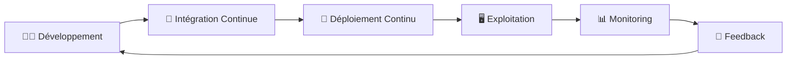
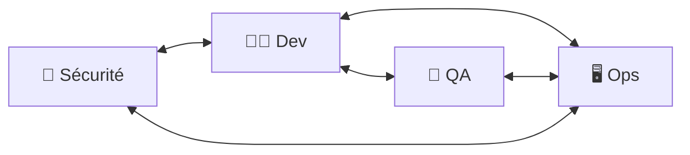
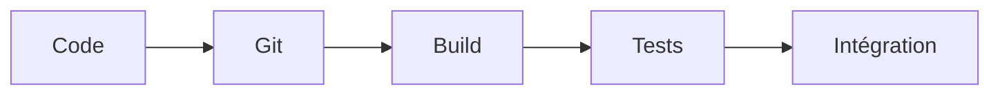
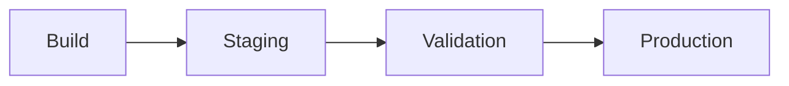
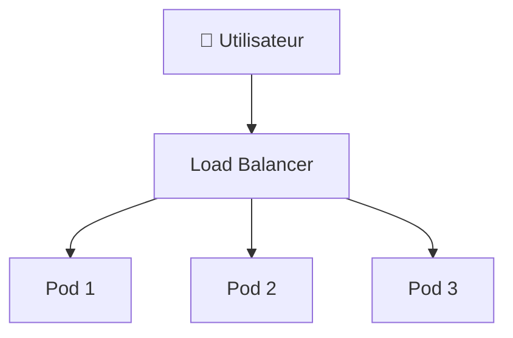
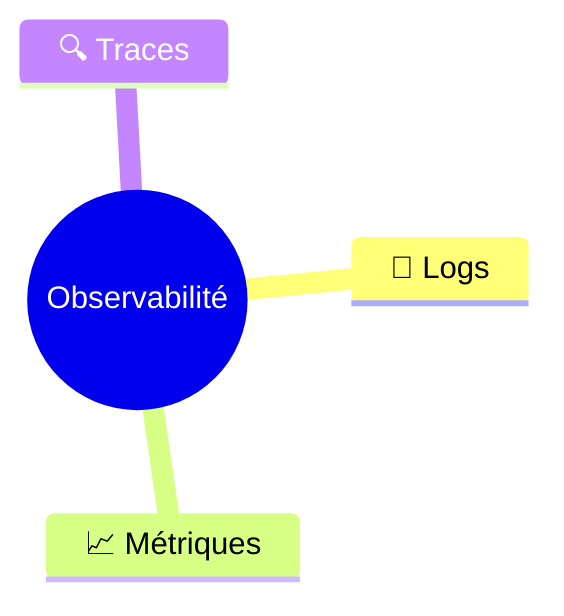
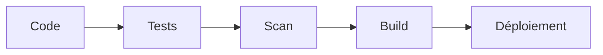
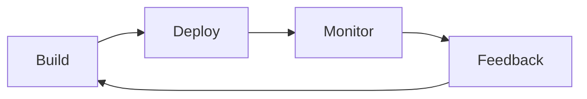
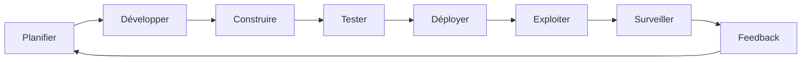
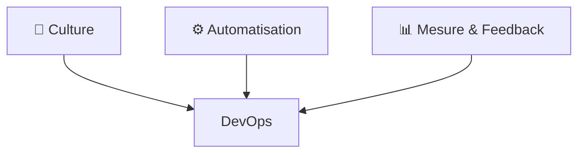

# 🚀 Concepts Clés du DevOps

> **DevOps** est une culture, un ensemble de pratiques et d'outils visant à rapprocher les équipes de développement (**Dev**) et d'exploitation (**Ops**) afin de livrer des applications plus rapidement, plus fiablement et avec une meilleure qualité.

---

# 🌍 Vue d'ensemble du DevOps



Le DevOps repose sur une **boucle d'amélioration continue** :

- Développer
- Tester
- Déployer
- Surveiller
- Apprendre
- Recommencer

---

# 🔁 Collaboration & Culture

L'objectif principal du DevOps est de **supprimer les silos** entre les équipes.

## Avant DevOps

```text
Développeurs  --->  Exploitation

"Ça marche chez moi."
               ↓
        "Ça ne marche pas en production."
```

Les équipes travaillent séparément.

- Les développeurs créent l'application.
- Les équipes Ops la déploient.
- Les problèmes sont souvent rejetés sur l'autre équipe.

## Avec DevOps



Tout le monde travaille ensemble.

### Principes

- Responsabilité partagée
- Communication permanente
- Automatisation
- Amélioration continue
- Pas de recherche de coupable mais recherche de solutions

---

# 🚀 CI / CD

## CI : Continuous Integration

À chaque modification du code :

1. Le développeur pousse son code.
2. Le serveur CI compile le projet.
3. Les tests sont exécutés automatiquement.
4. Si tout est valide, le code est intégré.



### Avantages

- Détection rapide des erreurs
- Intégration fréquente
- Code toujours fonctionnel

---

## CD : Continuous Delivery / Deployment

Une fois la CI terminée :



Selon l'organisation :

### Continuous Delivery

Le déploiement en production nécessite une validation humaine.

```
Tests ✔
     ↓
Validation humaine
     ↓
Production
```

### Continuous Deployment

Aucune intervention humaine.

```
Tests ✔
     ↓
Production automatique
```

---

# ⚙️ Automatisation

Le DevOps cherche à automatiser toutes les tâches répétitives.

Exemples :

- Build
- Tests
- Déploiement
- Création des serveurs
- Sauvegardes
- Surveillance

## Pourquoi ?

- Moins d'erreurs humaines
- Plus rapide
- Plus fiable
- Reproductible

---

# 🏗️ Infrastructure as Code (IaC)

L'infrastructure est écrite sous forme de code.

Au lieu de créer un serveur manuellement :

```
Créer VM
Installer Linux
Installer Docker
Configurer réseau
```

On écrit :

```terraform
resource "aws_instance" "web" {
    ami = "ami-xxxx"
    instance_type = "t2.micro"
}
```

Puis :

```
terraform apply
```

Le serveur est créé automatiquement.

## Avantages

- Versionnable avec Git
- Reproductible
- Documentation automatique
- Déploiement rapide

### Outils

- Terraform
- CloudFormation
- Pulumi
- Ansible

---

# 📦 Conteneurs & Orchestration

## Docker

Un conteneur embarque :

- l'application
- les dépendances
- la configuration

Ainsi :

```
Mon PC
      ✔ fonctionne

Serveur
      ✔ fonctionne

Cloud
      ✔ fonctionne
```

> **"Build once, run anywhere."**

---

## Kubernetes

Lorsque l'on possède plusieurs conteneurs, Kubernetes permet de les gérer automatiquement.



Fonctionnalités :

- Répartition de charge
- Haute disponibilité
- Auto-scaling
- Auto-healing
- Déploiement progressif

---

# 📊 Monitoring & Observabilité

Une application doit être surveillée.

Le monitoring répond à la question :

> **"Est-ce que mon application fonctionne ?"**

L'observabilité répond à :

> **"Pourquoi ne fonctionne-t-elle pas ?"**

## Les trois piliers



### Logs

Historique des événements.

Exemple :

```
Erreur SQL
Utilisateur connecté
Paiement effectué
```

---

### Métriques

Valeurs numériques.

- CPU
- RAM
- Nombre de requêtes
- Temps de réponse

---

### Traces

Suivi complet d'une requête.

```
Client

↓

API

↓

Service

↓

Base de données
```

---

# 🔐 DevSecOps

La sécurité est intégrée dans toute la chaîne.



Les analyses automatiques recherchent :

- vulnérabilités
- dépendances obsolètes
- secrets exposés
- mauvaises configurations

Exemples d'outils :

- Trivy
- SonarQube
- Snyk
- Dependabot

---

# 📈 Feedback Rapide

Le cycle DevOps repose sur une amélioration permanente.



Les informations proviennent :

- des utilisateurs
- des métriques
- des alertes
- des incidents
- des performances

Objectif :

**Build → Measure → Learn**

---

# 🎯 Les objectifs du DevOps

| Objectif | Bénéfice |
|----------|----------|
| 🚀 Déployer plus souvent | Livraison rapide des nouvelles fonctionnalités |
| ⚡ Réduire le temps de mise en production | Plus de réactivité |
| ✅ Diminuer les erreurs | Meilleure qualité |
| 🔧 Réparer rapidement | MTTR réduit |
| 📈 Améliorer la satisfaction client | Logiciel plus fiable |
| 🤝 Renforcer la collaboration | Équipes plus efficaces |

---

# 🔄 Le cycle DevOps complet



Chaque boucle permet d'améliorer :

- la qualité
- la rapidité
- la sécurité
- la stabilité
- la satisfaction utilisateur

---

# 🛠️ Les principaux outils DevOps

| Domaine | Outils populaires |
|----------|-------------------|
| Gestion de versions | Git, GitHub, GitLab |
| CI/CD | Jenkins, GitHub Actions, GitLab CI, Azure DevOps |
| Conteneurs | Docker |
| Orchestration | Kubernetes, OpenShift |
| Infrastructure as Code | Terraform, Ansible, CloudFormation |
| Monitoring | Prometheus, Grafana, Zabbix |
| Logs | ELK Stack, Loki |
| Sécurité | Trivy, SonarQube, Snyk |

---

# 💡 Les 3 piliers du DevOps



Le DevOps ne se résume pas à des outils.

Il repose avant tout sur :

- 🤝 une culture de collaboration,
- ⚙️ une automatisation maximale,
- 📊 une mesure continue des performances afin d'améliorer constamment les processus.
