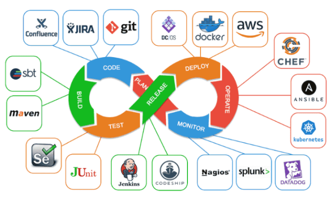

# CI/CD
<div align="center">
	
</div>

## 1. Qu’est-ce que le CI/CD ?
Le terme CI/CD signifie :
- CI : Continuous Integration (Intégration Continue)
- CD : Continuous Delivery / Continuous Deployment (Livraison / Déploiement Continu)

C’est un ensemble de pratiques DevOps visant à automatiser :
- la construction du code
- les tests
- la livraison applicative
- le déploiement (optionnellement automatique)

## 2. CI – Continuous Integration (Intégration Continue)
La CI consiste à :
- intégrer fréquemment le code dans un dépôt partagé
- lancer automatiquement tests et analyses qualité
- détecter rapidement les bugs
- éviter les conflits lors des merges
```
Quand un développeur push son code → une pipeline CI démarre automatiquement
```
Exemples d’actions CI :
- compilation / build
- tests unitaires
- tests d’intégration
- lint (qualité du code)
- analyse SAST (sécurité)
- génération d’artefacts (binaires, images Docker)

## 3. CD – Continuous Delivery / Deployment
- Continuous Delivery (Livraison Continue)
```
L’application est prête à être déployée à tout moment.
Le déploiement nécessite une validation humaine.
```

- Continuous Deployment (Déploiement Continu)
```
Le déploiement est entièrement automatique après les tests réussis.
Pas d’intervention humaine.
```

## 4. Chaîne complète CI/CD : Étapes et outils
Voici la chaîne complète du développement au déploiement, avec les outils les plus utilisés.

### 1.Gestion du code source (SCM)
**Outils :**
- GitHub 
- GitLab
- Bitbucket
- Azure DevOps Repos
- Gitea

### 2.Intégration continue (CI)
**Outils CI :**
- GitHub Actions
- GitLab CI/CD
- Jenkins
- Azure Pipelines
- CircleCI
- Drone CI
- TeamCity

### 3.Analyse de qualité/sécurité
- SonarQube (qualité du code)
- Checkmarx, Snyk, GitGuardian (sécurité)
- ESLint, Pylint, flake8, Prettier (lint & format)

### 4.Build & Packaging
- Maven, Gradle (Java)
- npm, yarn, npm (JavaScript)
- Docker (images conteneurs)
- Podman (images conteneurs)
- Webpack, Vite, Rollup (front-end)

### 5.Registry (dépôt d’artefacts)
- Docker Hub
- GitHub Container Registry
- GitLab Registry
- Harbor
- JFrog Artifactory

### 6.Tests automatisés
- Tests unitaires : JUnit, pytest, Jest, Mocha, NUnit
- Tests end-to-end : Cypress, Playwright, Selenium
- Tests de charge : k6, JMeter, Locust

### 7.Livraison continue (CD)
Pour préparer les artefacts au déploiement :
- GitLab CD
- GitHub Actions
- Azure Pipelines
- ArgoCD (GitOps)
- Spinnaker

### 8.Déploiement & Orchestration
Déploiement dans les serveurs, VMs, conteneurs ou cloud.

**✔ Outils d’automatisation / provisioning**
- Ansible
- Terraform
- Puppet
- Chef
- SaltStack

**✔ Orchestration de conteneurs**
- Kubernetes
- Docker Swarm
- Nomad (HashiCorp)

**✔ Outils GitOps pour Kubernetes**
- ArgoCD
- FluxCD

### 9.Monitoring & Observabilité
- Prometheus (metrics)
- Grafana (dashboards)
- ELK Stack (Elasticsearch + Logstash + Kibana) (logs)
- Datadog
- New Relic
- Zabbix

### 10.Alerting
- PagerDuty
- OpsGenie
- Alertmanager
- VictorOps
