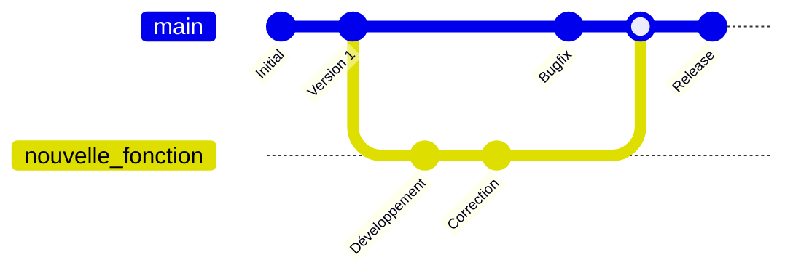
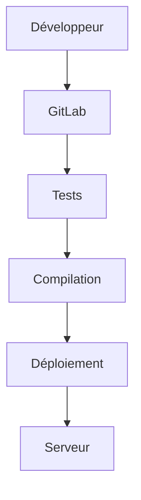
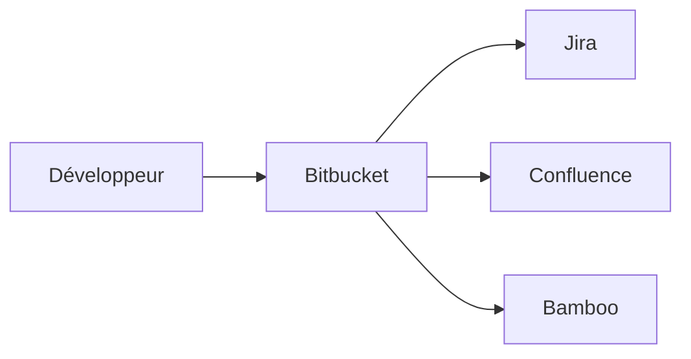
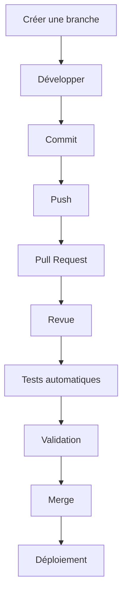
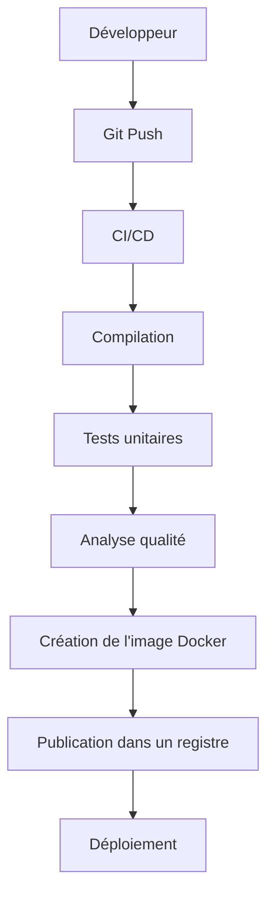

# Comprendre l'intérêt de GitHub, GitLab et Bitbucket

## Introduction

Lorsque plusieurs développeurs travaillent sur un même projet, il devient rapidement difficile de :

* conserver un historique des modifications ;
* revenir à une version précédente ;
* travailler à plusieurs sans écraser le travail des autres ;
* automatiser les tests et les déploiements.

C'est précisément le rôle des plateformes comme **GitHub**, **GitLab** et **Bitbucket**.

> **Important :**
>
> * **Git** est l'outil de gestion de versions.
> * **GitHub**, **GitLab** et **Bitbucket** sont des plateformes qui hébergent des dépôts Git et ajoutent de nombreuses fonctionnalités collaboratives.

---

# 1. Git : la base

Git est un logiciel de gestion de versions.

Chaque modification est enregistrée dans un historique.

Sans Git :

```
Projet/
    projet_final.zip
    projet_final_v2.zip
    projet_final_v2_OK.zip
    projet_final_v2_OK_BON.zip
```

Avec Git :

```
Projet
 │
 ├── Commit 1
 ├── Commit 2
 ├── Commit 3
 └── Commit 4
```

On peut revenir à n'importe quel commit.

---

# 2. Le fonctionnement général


Chaque développeur possède une copie complète du projet.

---

# 3. Pourquoi utiliser Git ?

## Historique complet

Chaque modification est sauvegardée.

```
Ajout connexion utilisateur

↓

Correction bug authentification

↓

Ajout gestion des rôles

↓

Optimisation performances
```

On peut revenir en arrière à tout moment.

---

## Travail collaboratif

Sans Git :

```
Alice modifie fichier.py

Bob modifie fichier.py

↓

Le dernier qui enregistre écrase l'autre.
```

Avec Git :

```
Alice
      \
       \
        Projet Git
       /
Bob   /
```

Les modifications sont fusionnées.

---

## Sauvegarde distante

Le projet est stocké sur un serveur.

```
Ordinateur
      │
      ▼
GitHub
```

Si l'ordinateur tombe en panne, le code reste disponible.

---

# 4. Les branches

Les branches permettent de développer une fonctionnalité sans casser la version principale.



La branche **main** reste stable.

---

# 5. Les Pull Requests / Merge Requests

Avant d'ajouter du code dans la branche principale, une revue est réalisée.


Cela permet :

* d'éviter les erreurs ;
* de vérifier la qualité ;
* de discuter des modifications.

---

# 6. GitHub

GitHub est la plateforme la plus populaire.

Elle est particulièrement adaptée pour :

* les projets open source ;
* les équipes de développement ;
* les portfolios de développeurs.

Fonctionnalités principales :

* hébergement Git ;
* Pull Requests ;
* gestion des Issues ;
* Wiki ;
* GitHub Actions (CI/CD) ;
* gestion des projets.

Exemple :

```
Projet Java

├── Code
├── Wiki
├── Issues
├── Pull Requests
└── Actions
```

---

# 7. GitLab

GitLab va plus loin en proposant une plateforme DevOps complète.

Elle inclut :

* Git ;
* CI/CD intégré ;
* registre Docker ;
* sécurité ;
* gestion Agile ;
* monitoring.

Architecture simplifiée :



Tout est centralisé.

---

# 8. Bitbucket

Bitbucket est souvent utilisé avec les produits Atlassian.

Il s'intègre parfaitement avec :

* Jira
* Confluence
* Bamboo

Schéma :



Très utilisé en entreprise.

---

# 9. Comparaison

| Fonction         | GitHub         | GitLab       | Bitbucket   |
| ---------------- | -------------- | ------------ | ----------- |
| Hébergement Git  | ✅              | ✅            | ✅           |
| Open Source      | ⭐⭐⭐⭐⭐          | ⭐⭐⭐⭐         | ⭐⭐⭐         |
| CI/CD intégré    | GitHub Actions | Très complet | Pipelines   |
| Intégration Jira | Moyenne        | Bonne        | Excellente  |
| DevOps complet   | Moyen          | Excellent    | Bon         |
| Popularité       | Très forte     | Forte        | Entreprises |

---

# 10. Workflow complet



---

# 11. Exemple concret

Une équipe développe un site e-commerce.

## Alice

Travaille sur :

```
feature/paiement
```

## Bob

Travaille sur :

```
feature/panier
```

## Charlie

Corrige un bug :

```
hotfix/login
```

Tous travaillent en parallèle.

Lorsque les fonctionnalités sont terminées :

```
main

├── Paiement
├── Panier
└── Login
```

Les modifications sont fusionnées proprement.

---

# 12. CI/CD : l'automatisation

L'un des grands avantages de ces plateformes est l'automatisation.

À chaque `git push` :



Le développeur n'a plus besoin d'exécuter ces étapes manuellement.

---

# 13. Sécurité

Les plateformes permettent :

* la gestion des droits d'accès ;
* les branches protégées ;
* la revue obligatoire avant fusion ;
* la détection de vulnérabilités ;
* les sauvegardes distantes.

---

# 14. Cas d'utilisation

## Étudiant

* Sauvegarder ses projets.
* Présenter son portfolio.
* Collaborer sur des travaux de groupe.

## Développeur freelance

* Historique des versions.
* Sauvegarde du code.
* Livraison sécurisée.

## Entreprise

* Travail collaboratif.
* Gestion des équipes.
* Déploiement automatique.
* Suivi des bugs.
* Revue de code.
* Intégration continue.

---

# 15. Quel outil choisir ?

| Besoin                    | Outil recommandé |
| ------------------------- | ---------------- |
| Apprendre Git             | GitHub           |
| Projet Open Source        | GitHub           |
| DevOps complet            | GitLab           |
| Entreprise utilisant Jira | Bitbucket        |
| CI/CD très avancé         | GitLab           |
| Portfolio développeur     | GitHub           |

---

# Conclusion

**Git** est le moteur de gestion des versions, tandis que **GitHub**, **GitLab** et **Bitbucket** sont des plateformes qui enrichissent Git avec des fonctionnalités de collaboration, d'automatisation et de gestion de projet.

En résumé :

* **Git** : versionner et suivre les modifications.
* **GitHub** : collaborer et partager du code, particulièrement dans l'open source.
* **GitLab** : centraliser le cycle de vie DevOps (développement, tests, déploiement).
* **Bitbucket** : s'intégrer efficacement à l'écosystème Atlassian (Jira, Confluence).

Maîtriser ces outils permet de travailler plus efficacement, de réduire les risques d'erreurs et de mettre en place des processus professionnels de développement logiciel.
