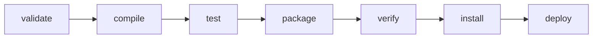
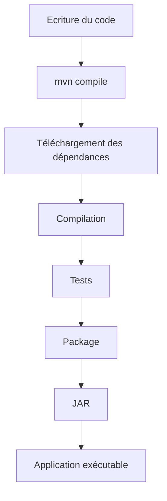

# Les bases de Maven avec un mini projet Spring Boot

> **Objectif** : À la fin de ce cours, tu comprendras le fonctionnement de Maven, tu sauras lire un fichier `pom.xml`, gérer les dépendances, lancer un build et créer une application Spring Boot exécutable.

---

# 1. Qu'est-ce que Maven ?

**Maven** est un outil d'automatisation de build pour les projets Java.

Comme Gradle, il permet de :

* compiler le code Java
* télécharger les bibliothèques nécessaires
* exécuter les tests
* générer un JAR ou un WAR
* lancer l'application
* publier un artefact dans un dépôt Maven

La grande différence est que **Maven est basé sur une convention de projet et une configuration XML**, tandis que Gradle utilise un langage de script (Groovy ou Kotlin).

---

## Le rôle de Maven

```text
Code Java
    │
    ▼
 Maven
    │
    ├── Télécharge les dépendances
    ├── Compile le code
    ├── Exécute les tests
    ├── Génère le JAR
    └── Produit une application exécutable
```

---

# 2. Notre projet fil rouge

Nous allons construire une petite API Spring Boot qui gère des livres.

```text
Book API

GET     /books
GET     /books/{id}
POST    /books
DELETE  /books/{id}
```

Le code métier sera identique à celui utilisé avec Gradle. Seul le système de build change.

---

# 3. Structure du projet

```text
book-api
│
├── pom.xml
│
└── src
    ├── main
    │    ├── java
    │    │     └── com/example/bookapi
    │    │              │
    │    │              ├── BookApiApplication.java
    │    │              ├── controller
    │    │              ├── service
    │    │              └── model
    │    │
    │    └── resources
    │          └── application.properties
    │
    └── test
```

La structure des dossiers est **imposée par Maven**.

---

# 4. Le fichier pom.xml

Le fichier **POM (Project Object Model)** est le cœur d'un projet Maven.

Voici un exemple minimal pour Spring Boot :

```xml
<project xmlns="http://maven.apache.org/POM/4.0.0">

    <modelVersion>4.0.0</modelVersion>

    <parent>
        <groupId>org.springframework.boot</groupId>
        <artifactId>spring-boot-starter-parent</artifactId>
        <version>3.5.0</version>
    </parent>

    <groupId>com.example</groupId>
    <artifactId>book-api</artifactId>
    <version>1.0.0</version>

    <properties>
        <java.version>21</java.version>
    </properties>

    <dependencies>

        <dependency>
            <groupId>org.springframework.boot</groupId>
            <artifactId>spring-boot-starter-web</artifactId>
        </dependency>

        <dependency>
            <groupId>org.springframework.boot</groupId>
            <artifactId>spring-boot-starter-test</artifactId>
            <scope>test</scope>
        </dependency>

    </dependencies>

</project>
```

---

# 5. Comprendre le POM

Chaque section a un rôle précis.

```text
project
│
├── parent
├── groupId
├── artifactId
├── version
├── properties
├── dependencies
└── build
```

---

# 6. Le parent Spring Boot

```xml
<parent>

    <groupId>org.springframework.boot</groupId>

    <artifactId>spring-boot-starter-parent</artifactId>

    <version>3.5.0</version>

</parent>
```

Le parent fournit :

* les versions compatibles des dépendances Spring Boot
* la configuration des plugins Maven
* les bonnes pratiques de configuration

Grâce à lui, il n'est généralement **pas nécessaire de préciser la version** des starters Spring Boot.

---

# 7. Les coordonnées Maven

Chaque projet Maven est identifié par trois éléments :

```xml
<groupId>com.example</groupId>

<artifactId>book-api</artifactId>

<version>1.0.0</version>
```

Ils constituent les coordonnées uniques de l'artefact.

Exemple :

```text
com.example:book-api:1.0.0
```

---

# 8. Les repositories

Par défaut, Maven télécharge les dépendances depuis **Maven Central**.

```text
Votre projet

      │

      ▼

 Maven Central

      │

      ▼

Spring Boot

JUnit

Jackson

Hibernate

Tomcat
```

Dans la majorité des projets Spring Boot, il n'est pas nécessaire de déclarer explicitement le dépôt.

---

# 9. Les dépendances

Une dépendance est une bibliothèque externe utilisée par le projet.

Exemple :

```xml
<dependency>

    <groupId>org.springframework.boot</groupId>

    <artifactId>spring-boot-starter-web</artifactId>

</dependency>
```

Ce starter apporte automatiquement :

* Spring MVC
* Tomcat embarqué
* Jackson
* Validation
* Configuration Spring

---

# 10. Les scopes

Le scope indique **à quel moment une dépendance est utilisée**.

## compile

Scope par défaut.

Disponible :

* pendant la compilation
* pendant l'exécution
* pour les tests

---

## test

```xml
<scope>test</scope>
```

Disponible uniquement lors des tests.

Exemple :

```xml
<dependency>

    <groupId>org.springframework.boot</groupId>

    <artifactId>spring-boot-starter-test</artifactId>

    <scope>test</scope>

</dependency>
```

---

## provided

Utilisé lorsque la bibliothèque est fournie par le serveur d'application.

Exemple classique :

```xml
<scope>provided</scope>
```

---

## runtime

Disponible uniquement à l'exécution.

---

# 11. Première classe Spring Boot

```java
@SpringBootApplication
public class BookApiApplication {

    public static void main(String[] args) {

        SpringApplication.run(BookApiApplication.class, args);

    }

}
```

---

# 12. Premier contrôleur

```java
@RestController
@RequestMapping("/books")
public class BookController {

    @GetMapping
    public List<String> getBooks() {

        return List.of(
                "Clean Code",
                "Spring in Action",
                "Effective Java"
        );

    }

}
```

---

# 13. Compiler le projet

Commande :

```bash
mvn compile
```

Cette commande :

* télécharge les dépendances
* compile le code
* produit les fichiers `.class`

---

# 14. Le cycle de vie Maven

Maven repose sur un **cycle de vie standard** composé de phases.



Chaque phase exécute automatiquement toutes les phases précédentes.

Exemple :

```bash
mvn package
```

équivaut à :

```text
validate

↓

compile

↓

test

↓

package
```

---

# 15. Les principales commandes Maven

## Nettoyer le projet

```bash
mvn clean
```

Supprime le dossier :

```text
target/
```

---

## Compiler

```bash
mvn compile
```

Compile le code Java.

---

## Tester

```bash
mvn test
```

Exécute les tests JUnit.

---

## Générer le JAR

```bash
mvn package
```

Produit :

```text
target/book-api-1.0.0.jar
```

---

## Installer dans le dépôt local

```bash
mvn install
```

Copie le JAR dans le dépôt Maven local (`~/.m2/repository`) afin qu'il puisse être utilisé par d'autres projets.

---

# 16. Le dossier target

Après un build, Maven génère :

```text
target/

    classes/

    test-classes/

    surefire-reports/

    book-api-1.0.0.jar
```

Le dossier `target/` est l'équivalent du dossier `build/` de Gradle.

---

# 17. Les plugins Maven

Maven utilise des plugins pour exécuter les différentes étapes du build.

Exemple :

```xml
<build>

    <plugins>

        <plugin>

            <groupId>org.springframework.boot</groupId>

            <artifactId>spring-boot-maven-plugin</artifactId>

        </plugin>

    </plugins>

</build>
```

Ce plugin permet notamment de créer un JAR exécutable et d'utiliser la commande `spring-boot:run`.

---

# 18. Lancer l'application

```bash
mvn spring-boot:run
```

Résultat :

```text
Tomcat started on port 8080
```

Requête :

```text
GET http://localhost:8080/books
```

Réponse :

```json
[
  "Clean Code",
  "Spring in Action",
  "Effective Java"
]
```

---

# 19. Ajouter une dépendance

Ajoutons Lombok.

```xml
<dependency>

    <groupId>org.projectlombok</groupId>

    <artifactId>lombok</artifactId>

    <optional>true</optional>

</dependency>
```

Après modification :

```bash
mvn compile
```

Maven télécharge automatiquement la bibliothèque.

---

# 20. Dépendances transitives

Une dépendance peut en apporter d'autres automatiquement.

```text
spring-boot-starter-web

        │

        ├── spring-web

        ├── spring-context

        ├── jackson

        ├── tomcat

        └── spring-core
```

Tu n'as pas besoin de déclarer chacune de ces bibliothèques individuellement.

---

# 21. Dépôt local Maven

Toutes les dépendances téléchargées sont stockées dans le dépôt local.

```text
~/.m2/repository
```

Fonctionnement :

```text
Maven

     │

     ▼

Cherche dans ~/.m2

     │

     ├── Trouvé → utilisation

     │

     └── Non trouvé

            │

            ▼

     Téléchargement depuis Maven Central

            │

            ▼

     Stockage dans ~/.m2
```

Grâce à ce mécanisme, une dépendance n'est téléchargée qu'une seule fois.

---

# 22. Cycle complet du projet



---

# 23. Les commandes indispensables à retenir

| Commande                 | Description                                                             |
| ------------------------ | ----------------------------------------------------------------------- |
| `mvn clean`              | Supprime le dossier `target`                                            |
| `mvn compile`            | Compile le projet                                                       |
| `mvn test`               | Exécute les tests                                                       |
| `mvn package`            | Génère le JAR                                                           |
| `mvn install`            | Installe le JAR dans le dépôt local                                     |
| `mvn spring-boot:run`    | Lance l'application Spring Boot                                         |
| `mvn dependency:tree`    | Affiche l'arbre des dépendances                                         |
| `mvn help:effective-pom` | Affiche le POM effectif après héritage et résolution des configurations |

---

# Maven vs Gradle : les notions à retenir

| Maven                          | Gradle                                                       |
| ------------------------------ | ------------------------------------------------------------ |
| Configuration XML (`pom.xml`)  | DSL Groovy ou Kotlin (`build.gradle`, `build.gradle.kts`)    |
| Convention forte               | Configuration plus flexible                                  |
| Cycle de vie fixe (phases)     | Tâches (`tasks`) personnalisables                            |
| Dépendances via `<dependency>` | Dépendances via `implementation`, `testImplementation`, etc. |
| Dossier de build : `target/`   | Dossier de build : `build/`                                  |
| Commande : `mvn package`       | Commande : `gradlew build`                                   |

---

# Les notions essentielles à retenir

* **Maven** automatise le cycle de build d'un projet Java.
* Le fichier **`pom.xml`** décrit entièrement le projet (coordonnées, dépendances, plugins, propriétés...).
* Chaque projet est identifié par un **`groupId`**, un **`artifactId`** et une **`version`**.
* Les **dépendances** sont téléchargées automatiquement depuis **Maven Central** et mises en cache dans le dépôt local (`~/.m2/repository`).
* Le **cycle de vie Maven** est organisé en phases (`validate`, `compile`, `test`, `package`, `install`, `deploy`) qui s'enchaînent automatiquement.
* Les **plugins** ajoutent des fonctionnalités, comme le plugin Spring Boot qui permet de créer un JAR exécutable et de lancer l'application.
* Le dossier **`target/`** contient tous les fichiers générés pendant le build (classes compilées, rapports de tests, JAR, etc.).

Avec ces bases, tu peux comprendre la structure d'un projet Maven, exécuter les principales commandes et travailler efficacement sur une application Spring Boot. Tu seras ensuite prêt à explorer des sujets plus avancés comme les profils Maven, les projets multi-modules, la gestion fine des dépendances ou l'intégration dans une chaîne CI/CD.
