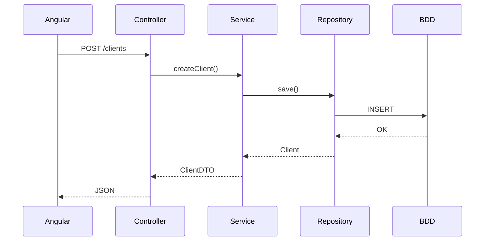
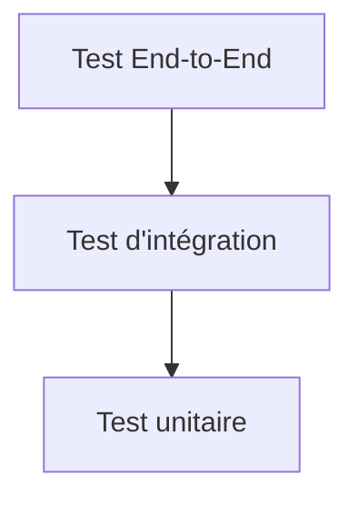
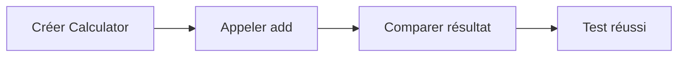
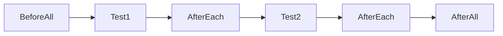
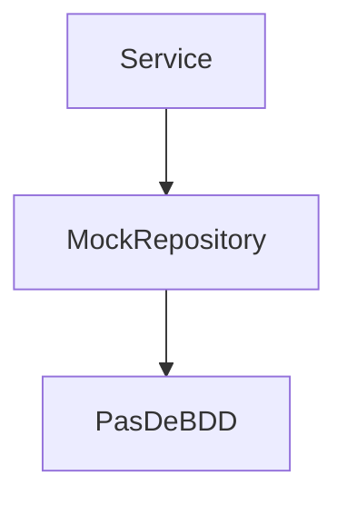
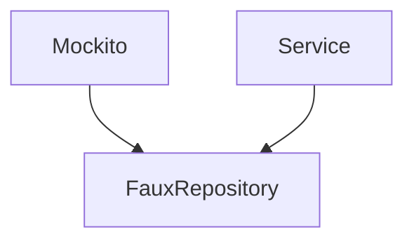
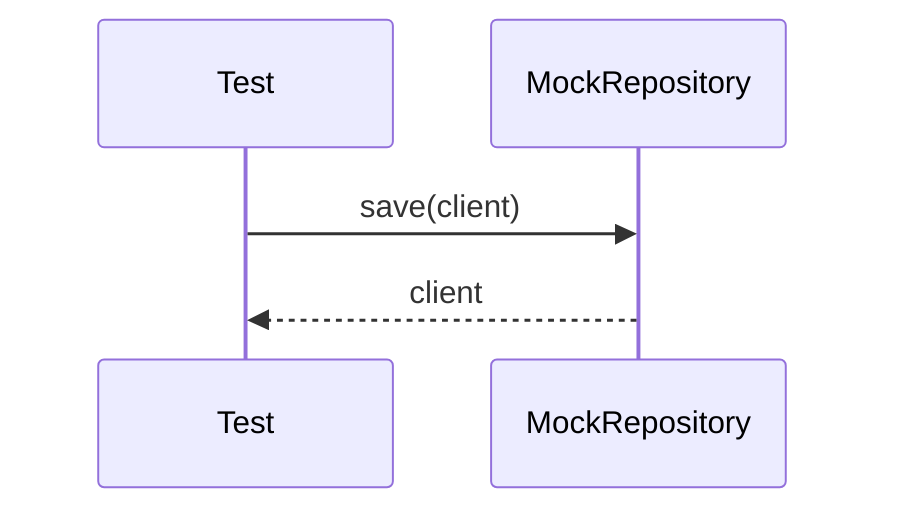
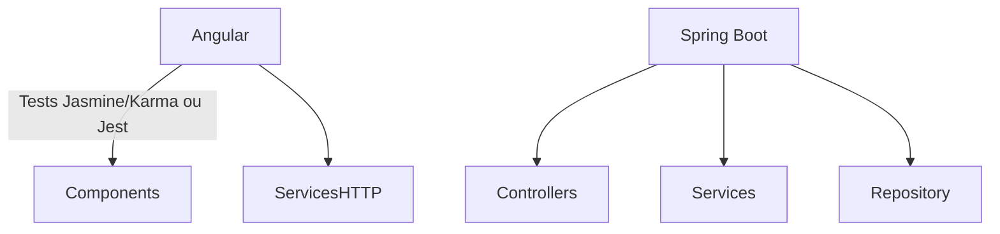

# Tutoriel complet : JUnit & Mockito dans un projet Java / Angular

> **Public visé :** développeurs Java débutants à intermédiaires travaillant sur une architecture **Angular + Spring Boot**.
>
> À la fin de ce tutoriel, vous saurez :
>
> * Comprendre les tests unitaires
> * Utiliser **JUnit 5**
> * Utiliser **Mockito**
> * Tester les Services, Controllers et Repositories
> * Éviter les erreurs classiques
> * Comprendre comment les tests s'intègrent dans une application Angular / Java

---

# Sommaire

1. Pourquoi tester ?
2. Architecture Java + Angular
3. Les différents types de tests
4. Découverte de JUnit 5
5. Premier test unitaire
6. Assertions
7. Cycle de vie des tests
8. Mockito
9. Mock vs Spy
10. Vérifier les appels
11. Capturer les arguments
12. Tester un Service Spring
13. Tester un Controller
14. Tester les Exceptions
15. Tests paramétrés
16. Les bonnes pratiques

---

# 1. Pourquoi faire des tests ?

Imaginons cette architecture :

```text
Angular
   │
HTTP REST
   │
Spring Boot
   │
Service
   │
Repository
   │
Base de données
```

Lorsqu'un utilisateur clique sur **"Créer un client"** :



Une erreur peut apparaître à n'importe quel niveau.

Les tests permettent de vérifier automatiquement que le code continue de fonctionner après chaque modification.

---

# 2. Les différents types de tests



## Test unitaire

Teste une seule classe.

Exemple :

```
ClientService
```

sans base de données,
sans API,
sans Angular.

---

## Test d'intégration

Teste plusieurs couches ensemble.

Par exemple :

```
Controller
↓
Service
↓
Repository
↓
Base H2
```

---

## Test End-to-End

Teste toute l'application :

```
Angular
↓
API
↓
BDD
```

---

# 3. JUnit 5

JUnit est le framework officiel de tests Java.

Exemple Maven :

```xml
<dependency>
    <groupId>org.junit.jupiter</groupId>
    <artifactId>junit-jupiter</artifactId>
    <scope>test</scope>
</dependency>
```

---

# 4. Premier test

Classe :

```java
public class Calculator {

    public int add(int a, int b){
        return a+b;
    }

}
```

Test :

```java
import org.junit.jupiter.api.Test;

import static org.junit.jupiter.api.Assertions.*;

class CalculatorTest {

    @Test
    void shouldAddTwoNumbers() {

        Calculator calculator = new Calculator();

        int result = calculator.add(2,3);

        assertEquals(5,result);

    }

}
```

---

Déroulement :



---

# 5. Les Assertions

Les assertions vérifient le résultat attendu.

```java
assertEquals(5, result);
```

signifie

```
Je m'attends à 5
```

---

Autres assertions :

```java
assertTrue(user.isAdmin());

assertFalse(list.isEmpty());

assertNull(client.getAddress());

assertNotNull(client);

assertThrows(RuntimeException.class,
        () -> service.delete(5));
```

---

# 6. Cycle de vie des tests

JUnit possède plusieurs annotations.

```java
@BeforeEach
void init(){

}
```

exécuté avant chaque test.

---

```java
@AfterEach
void clean(){

}
```

après chaque test.

---

```java
@BeforeAll
```

une seule fois.

---

```java
@AfterAll
```

une seule fois à la fin.

---

Schéma :



---

# 7. Exemple concret d'une application métier

Imaginons :

```java
Client

id

name

email
```

Service :

```java
public class ClientService {

    private ClientRepository repository;

    public Client create(Client client){

        return repository.save(client);

    }

}
```

Le problème :

Le repository appelle la base.

En test unitaire, on ne veut **pas** de base.

On va utiliser **Mockito**.

---

# 8. Mockito

Mockito crée des faux objets.

On appelle cela des **Mocks**.



---

Dépendance Maven :

```xml
<dependency>
    <groupId>org.mockito</groupId>
    <artifactId>mockito-core</artifactId>
</dependency>
```

---

# 9. Premier Mock

Repository :

```java
public interface ClientRepository{

    Client save(Client client);

}
```

Test :

```java
@ExtendWith(MockitoExtension.class)
class ClientServiceTest {

    @Mock
    ClientRepository repository;

    @InjectMocks
    ClientService service;

}
```

Que fait Mockito ?



Le vrai Repository n'existe plus.

---

# 10. Définir le comportement d'un Mock

Supposons :

```java
repository.save(client)
```

Mockito permet de dire :

> lorsque save est appelé,
> retourne ce client.

```java
when(repository.save(client))
        .thenReturn(client);
```

---

Test complet :

```java
@Test
void shouldCreateClient(){

    Client client = new Client();

    client.setName("Martin");

    when(repository.save(client))
            .thenReturn(client);

    Client result = service.create(client);

    assertEquals("Martin",result.getName());

}
```

Déroulement :



Aucune base n'a été utilisée.

---

# 11. Vérifier les appels

Mockito peut vérifier qu'une méthode a bien été appelée.

```java
verify(repository).save(client);
```

ou

```java
verify(repository, times(1))
        .save(client);
```

ou

```java
verify(repository, never())
        .delete(any());
```

---

# 12. Les Matchers

Au lieu d'un objet précis :

```java
when(repository.save(client))
```

on peut écrire :

```java
when(repository.save(any()))
```

ou

```java
any(Client.class)
```

Exemple :

```java
when(repository.save(any(Client.class)))
        .thenReturn(client);
```

---

# 13. Capturer les paramètres

Mockito permet de récupérer les arguments passés.

```java
ArgumentCaptor<Client> captor =
ArgumentCaptor.forClass(Client.class);

verify(repository).save(captor.capture());

Client saved =
captor.getValue();
```

On peut ensuite vérifier :

```java
assertEquals(
        "Martin",
        saved.getName()
);
```

Très utile lorsque le service transforme les données avant la sauvegarde.

---

# 14. Mock vs Spy

Mock :

```
Tout est faux
```

Spy :

```
Objet réel

+

quelques méthodes simulées
```

Exemple :

```java
List<String> list =
spy(new ArrayList<>());
```

La liste fonctionne normalement.

Mais on peut faire :

```java
doReturn(10)
.when(list)
.size();
```

---

# 15. Exemple complet Spring Boot

Service :

```java
@Service
public class ClientService {

    private final ClientRepository repository;

    public ClientService(ClientRepository repository){

        this.repository=repository;

    }

    public Client create(Client client){

        if(client.getName()==null){

            throw new IllegalArgumentException();

        }

        return repository.save(client);

    }

}
```

Test :

```java
@ExtendWith(MockitoExtension.class)
class ClientServiceTest {

    @Mock
    ClientRepository repository;

    @InjectMocks
    ClientService service;

    @Test
    void shouldSaveClient(){

        Client client = new Client();
        client.setName("Alice");

        when(repository.save(any()))
                .thenReturn(client);

        Client result =
                service.create(client);

        assertEquals("Alice",
                result.getName());

        verify(repository)
                .save(any());

    }

}
```

---

# 16. Tester une exception

```java
@Test
void shouldThrowException(){

    Client client = new Client();

    assertThrows(
        IllegalArgumentException.class,
        ()->service.create(client)
    );

}
```

---

# 17. Tester un Controller Spring

Controller :

```java
@RestController
@RequestMapping("/clients")
public class ClientController {

    private final ClientService service;

    @PostMapping
    public Client create(@RequestBody Client client){

        return service.create(client);

    }

}
```

On peut utiliser **MockMvc** :

```java
@WebMvcTest(ClientController.class)
class ClientControllerTest {

    @Autowired
    MockMvc mockMvc;

    @MockBean
    ClientService service;

    @Test
    void shouldReturn200() throws Exception {

        Client client =
            new Client(1L,"Alice");

        when(service.create(any()))
            .thenReturn(client);

        mockMvc.perform(post("/clients")
                .contentType(MediaType.APPLICATION_JSON)
                .content("""
                    {
                       "name":"Alice"
                    }
                """))
                .andExpect(status().isOk());

    }

}
```

Ici, seul le **Controller** est testé. Le `ClientService` est remplacé par un mock.

---

# 18. Angular et les tests Java

Dans une application Angular/Spring Boot, la responsabilité des tests est généralement répartie ainsi :



* **Angular** teste les composants, les formulaires et les appels HTTP simulés.
* **Spring Boot** teste la logique métier, les contrôleurs REST et l'accès aux données.
* Les tests Java ne remplacent pas les tests Angular, ils sont complémentaires.

---

# 19. Bonnes pratiques

## ✅ Une seule responsabilité par test

```java
@Test
void shouldCreateClient()
```

plutôt que

```java
@Test
void testEverything()
```

---

## ✅ Nommer les tests clairement

```java
shouldReturnClientWhenIdExists()

shouldThrowExceptionWhenNameIsNull()

shouldDeleteExistingClient()
```

---

## ✅ Structure AAA (Arrange / Act / Assert)

```java
@Test
void shouldCreateClient() {

    // Arrange
    Client client = new Client();
    client.setName("Alice");
    when(repository.save(any())).thenReturn(client);

    // Act
    Client result = service.create(client);

    // Assert
    assertEquals("Alice", result.getName());
    verify(repository).save(any());
}
```

Cette structure rend les tests plus lisibles et plus faciles à maintenir.

---

# 20. Erreurs fréquentes

| Erreur                                                  | Explication                                     | Solution                                   |
| ------------------------------------------------------- | ----------------------------------------------- | ------------------------------------------ |
| Tester plusieurs comportements dans un même test        | Les causes d'échec sont difficiles à identifier | Un comportement par test                   |
| Utiliser la vraie base de données dans un test unitaire | Les tests deviennent lents et fragiles          | Utiliser Mockito                           |
| Oublier `verify()` lorsque l'appel est important        | Impossible de vérifier les interactions         | Vérifier les appels essentiels             |
| Surutiliser les mocks                                   | Les tests deviennent artificiels                | Mocker uniquement les dépendances externes |
| Tester les getters/setters                              | Faible valeur ajoutée                           | Tester la logique métier uniquement        |

---

# Conclusion

**JUnit** permet de vérifier que votre code produit le résultat attendu, tandis que **Mockito** isole les dépendances (base de données, API, services externes) pour tester uniquement la logique métier.

Dans une architecture **Angular + Spring Boot**, une stratégie de tests efficace consiste à :

* **JUnit** : exécuter les tests unitaires.
* **Mockito** : simuler les dépendances (`Repository`, services externes, clients HTTP...).
* **MockMvc** : tester les contrôleurs REST sans démarrer toute l'application.
* **Tests Angular (Jasmine/Karma ou Jest)** : valider les composants, les services et l'interface utilisateur.

En combinant ces outils, vous obtenez des tests rapides, fiables et faciles à maintenir, tout en sécurisant les évolutions de votre application full-stack.
