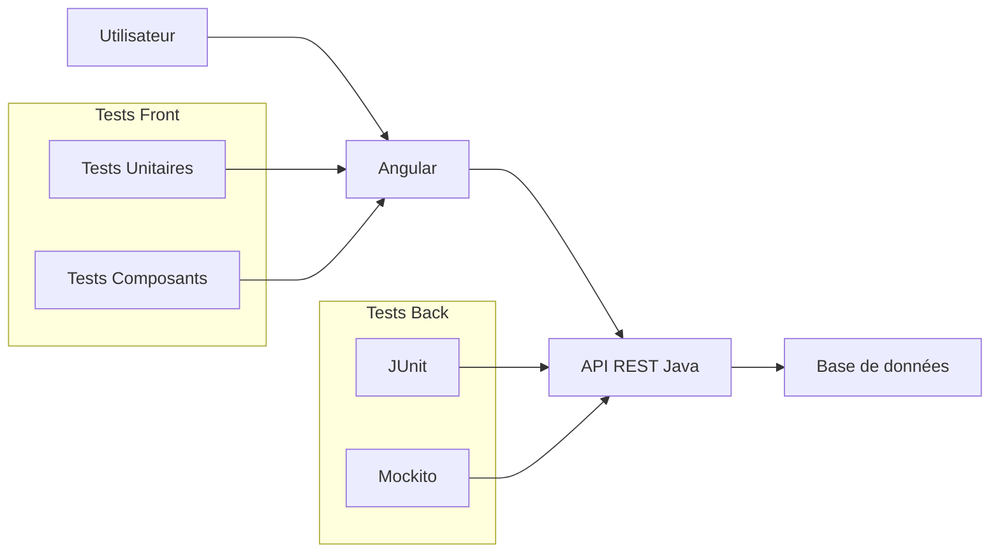
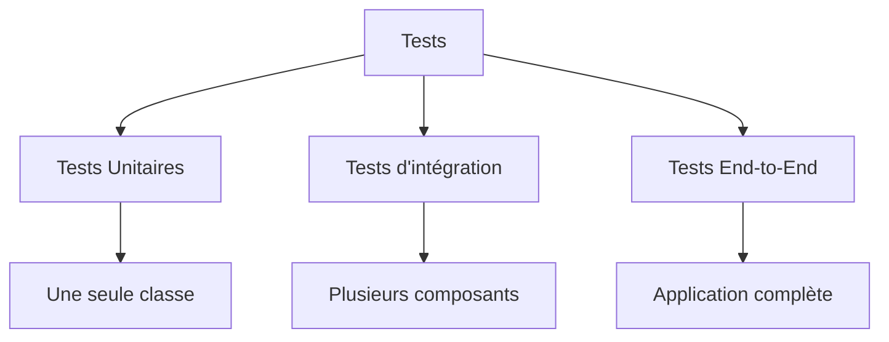
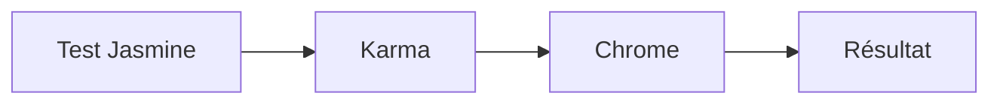
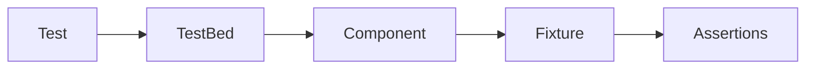
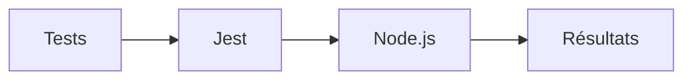
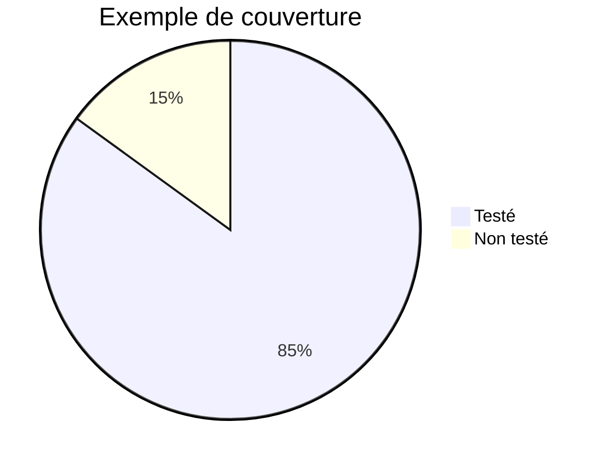

# Tutoriel complet : **Karma et Jest dans un projet Java + Angular**

> **Objectif :** comprendre à quoi servent Karma et Jest, comment les configurer, comment écrire des tests unitaires de qualité dans une architecture Java + Angular, et connaître les bonnes pratiques utilisées en entreprise.

---

# 1. Pourquoi faire des tests ?

Dans une application Java + Angular, les tests permettent de vérifier que le code fonctionne avant même de lancer l'application.

Une architecture classique ressemble à ceci :



Les tests sont répartis entre :

| Partie        | Outils                  |
| ------------- | ----------------------- |
| Front Angular | Karma + Jasmine ou Jest |
| Back Java     | JUnit + Mockito         |

---

# 2. Les différents types de tests



### Test unitaire

On teste une seule fonction.

Exemple :

```typescript
addition(a:number,b:number){
    return a+b;
}
```

Test :

```typescript
expect(addition(2,3)).toBe(5);
```

---

### Test d'intégration

On vérifie que plusieurs composants communiquent correctement.

Exemple :

```
Component
     ↓
Service
     ↓
HTTP
```

---

### Test End-to-End

On simule un véritable utilisateur.

Exemple :

```
Connexion
↓

Ajouter un produit

↓

Valider une commande
```

---

# 3. Karma : présentation

Karma est un **test runner**.

Son rôle est :

* lancer les tests
* ouvrir un navigateur
* afficher les résultats

Il **n'écrit pas les tests**.

Il exécute simplement ceux écrits avec Jasmine.

Architecture :



---

# 4. Jasmine

Jasmine est le framework de tests fourni par Angular.

Les mots-clés principaux sont :

```typescript
describe()
```

Définit une suite de tests.

```typescript
it()
```

Décrit un test.

```typescript
expect()
```

Vérifie le résultat.

---

Exemple :

```typescript
describe('Calculatrice',()=>{

    it('addition',()=>{

        expect(2+3).toBe(5);

    });

});
```

---

# 5. Création d'un projet Angular

```bash
ng new mon-projet
```

Angular installe automatiquement :

```
Karma

+

Jasmine
```

On trouve :

```
karma.conf.js

test.ts

angular.json
```

---

# 6. Premier test Karma

Classe :

```typescript
export class CalculService{

    addition(a:number,b:number){
        return a+b;
    }

}
```

Test :

```typescript
describe('CalculService',()=>{

    let service:CalculService;

    beforeEach(()=>{

        service=new CalculService();

    });

    it('additionne correctement',()=>{

        expect(service.addition(4,5)).toBe(9);

    });

});
```

---

# 7. beforeEach()

Avant chaque test :

```typescript
beforeEach(()=>{

    service=new CalculService();

});
```

Sans :

```
Test1

↓

Objet

↓

Test2

↓

Même objet
```

Avec :

```
Test1

↓

Nouvel objet

↓

Test2

↓

Nouvel objet
```

Les tests deviennent indépendants.

---

# 8. Tester un composant Angular

Composant :

```typescript
@Component({
 selector:'app-user'
})
export class UserComponent{

    nom="Lucas";

}
```

Test :

```typescript
describe('UserComponent',()=>{

 let component:UserComponent;

 beforeEach(()=>{

   component=new UserComponent();

 });

 it('doit créer le composant',()=>{

     expect(component).toBeTruthy();

 });

 it('nom correct',()=>{

     expect(component.nom).toBe("Lucas");

 });

});
```

---

# 9. Test avec TestBed

En pratique Angular utilise TestBed.

```typescript
beforeEach(async()=>{

await TestBed.configureTestingModule({

    declarations:[UserComponent]

}).compileComponents();

});
```

Puis :

```typescript
const fixture=TestBed.createComponent(UserComponent);

const component=fixture.componentInstance;
```

Schéma :



---

# 10. Tester un Service Angular

Service :

```typescript
@Injectable()
export class ProduitService{

    prix(){
        return 120;
    }

}
```

Test :

```typescript
describe('ProduitService',()=>{

 let service:ProduitService;

 beforeEach(()=>{

   TestBed.configureTestingModule({});

   service=TestBed.inject(ProduitService);

 });

 it('prix',()=>{

    expect(service.prix()).toBe(120);

 });

});
```

---

# 11. Tester un Observable

Service :

```typescript
getUtilisateur(){

   return of({

      nom:"Martin"

   });

}
```

Test :

```typescript
it('retourne un utilisateur',()=>{

 service.getUtilisateur()

.subscribe(user=>{

     expect(user.nom).toBe("Martin");

 });

});
```

---

# 12. Tester HttpClient

Angular fournit HttpTestingController.

```mermaid
flowchart LR

Component

-->

Service

-->

HttpTestingController

-->

Réponse simulée
```

Service :

```typescript
getUsers(){

 return this.http.get<User[]>("/api/users");

}
```

Test :

```typescript
it('charge les utilisateurs',()=>{

service.getUsers().subscribe(users=>{

    expect(users.length).toBe(2);

});

const req=httpMock.expectOne('/api/users');

req.flush([

 {id:1},

 {id:2}

]);

});
```

Aucun appel réseau réel n'est effectué.

---

# 13. Les spies Jasmine

Les spies permettent de remplacer une méthode.

Service :

```typescript
spyOn(service,'save').and.returnValue(true);
```

Puis :

```typescript
expect(service.save()).toBeTrue();
```

Très utilisé pour éviter :

* base de données
* API REST
* authentification

---

# 14. Les Matchers Jasmine

Quelques exemples :

```typescript
expect(x).toBe(5);

expect(x).toEqual(obj);

expect(x).toBeTrue();

expect(x).toContain("Angular");

expect(x).toBeNull();

expect(x).toBeUndefined();
```

---

# 15. Les limites de Karma

Karma ouvre un navigateur.

Cela implique :

* Chrome installé
* démarrage plus lent
* consommation mémoire

Sur de gros projets :

```
3000 tests

↓

Chrome

↓

Temps important
```

---

# 16. Pourquoi Jest ?

Jest a été créé par Facebook.

Contrairement à Karma :

* aucun navigateur
* exécution sous Node.js
* beaucoup plus rapide
* snapshots
* mocks très puissants

Architecture :



---

# 17. Comparaison Karma / Jest

| Critère        | Karma    | Jest         |
| -------------- | -------- | ------------ |
| Navigateur     | Oui      | Non          |
| Rapidité       | Moyenne  | Très rapide  |
| Configuration  | Moyenne  | Simple       |
| Mock           | Correct  | Excellent    |
| Snapshot       | Non      | Oui          |
| Angular récent | Possible | Très utilisé |

---

# 18. Installer Jest

On retire Karma :

```bash
npm uninstall karma karma-jasmine karma-chrome-launcher
```

Installation :

```bash
npm install -D jest jest-preset-angular @types/jest
```

---

# 19. Configuration Jest

Créer :

```
jest.config.js
```

```javascript
module.exports={

 preset:'jest-preset-angular',

 setupFilesAfterEnv:['<rootDir>/setup-jest.ts']

}
```

Puis :

```
setup-jest.ts
```

```typescript
import 'jest-preset-angular/setup-jest';
```

---

# 20. Premier test Jest

Classe :

```typescript
export class Calcul{

 addition(a:number,b:number){

     return a+b;

 }

}
```

Test :

```typescript
describe("Calcul",()=>{

 it("addition",()=>{

     const c=new Calcul();

     expect(c.addition(10,20)).toBe(30);

 });

});
```

La syntaxe est volontairement très proche de Jasmine.

---

# 21. Les mocks Jest

Supposons :

```typescript
class UserService{

 save(){

 }

}
```

Mock :

```typescript
const mockService={

 save:jest.fn()

};
```

Puis :

```typescript
mockService.save();

expect(mockService.save).toHaveBeenCalled();
```

---

# 22. Vérifier les appels

```typescript
expect(service.save)

.toHaveBeenCalledTimes(2);
```

ou

```typescript
expect(service.save)

.toHaveBeenCalledWith(15);
```

---

# 23. Les snapshots

Composant :

```html
<h1>Bienvenue</h1>
```

Test :

```typescript
expect(component)

.toMatchSnapshot();
```

Le premier lancement génère :

```
__snapshots__
```

Ensuite Jest compare automatiquement le rendu.

Schéma :

```mermaid
flowchart LR

Composant

-->

Snapshot

-->

Comparaison

-->

Succès ou Erreur
```

---

# 24. Exemple concret Java + Angular

Architecture :

```mermaid
flowchart LR

Angular

-->

Service

-->

Spring Boot

-->

Repository

-->

MySQL
```

Le frontend appelle :

```typescript
this.http.get<User[]>("/api/users");
```

Le backend :

```java
@GetMapping("/users")
public List<User> getUsers(){

    return repository.findAll();

}
```

Tests associés :

| Couche            | Outil   |
| ----------------- | ------- |
| Angular Component | Jest    |
| Angular Service   | Jest    |
| Spring Service    | JUnit   |
| Spring Repository | JUnit   |
| Mock API          | Mockito |

Ainsi, chaque couche est validée indépendamment.

---

# 25. Exemple complet : composant Angular

Composant :

```typescript
@Component({
 selector:'app-counter',
 template:`
 <button (click)="increment()">
 +
 </button>

 <span>{{count}}</span>
 `
})
export class CounterComponent{

 count=0;

 increment(){

   this.count++;

 }

}
```

Test Jest :

```typescript
describe('CounterComponent',()=>{

 let component:CounterComponent;

 beforeEach(()=>{

     component=new CounterComponent();

 });

 it('compteur initial',()=>{

     expect(component.count).toBe(0);

 });

 it('incrémentation',()=>{

     component.increment();

     expect(component.count).toBe(1);

 });

 it('plusieurs incréments',()=>{

     component.increment();
     component.increment();

     expect(component.count).toBe(2);

 });

});
```

---

# 26. Couverture de code (Code Coverage)

La couverture de code mesure la proportion du code exécutée par les tests.



Avec Jest :

```bash
npm test -- --coverage
```

Vous obtenez notamment :

* **Statements** : instructions exécutées.
* **Branches** : conditions `if/else` testées.
* **Functions** : fonctions couvertes.
* **Lines** : lignes exécutées.

Un objectif courant en entreprise est une couverture supérieure à **80 %**, mais une couverture élevée n'est utile que si les tests vérifient réellement le comportement attendu.

---

# 27. Bonnes pratiques

* Écrire des tests unitaires pour chaque service métier.
* Tester les cas nominaux **et** les cas d'erreur.
* Utiliser des mocks pour isoler les dépendances (API, base de données, etc.).
* Ne pas faire dépendre un test d'un autre.
* Donner des noms explicites aux tests (`it('doit retourner une erreur si le mot de passe est vide')`).
* Exécuter les tests automatiquement dans une chaîne d'intégration continue (CI/CD).

---

# 28. Résumé

| Sujet                | Karma                                              | Jest                                            |
| -------------------- | -------------------------------------------------- | ----------------------------------------------- |
| Rôle                 | Lance les tests dans un navigateur                 | Exécute les tests avec Node.js                  |
| Framework associé    | Jasmine                                            | Jest                                            |
| Vitesse              | Plus lente                                         | Très rapide                                     |
| Mocks                | Simples                                            | Très puissants                                  |
| Snapshots            | Non                                                | Oui                                             |
| Utilisation actuelle | Encore présent sur des projets Angular historiques | Très populaire sur les projets Angular modernes |

## Conclusion

Dans un projet **Java (Spring Boot) + Angular**, les responsabilités sont généralement réparties ainsi :

* **Backend Java** : tests unitaires avec **JUnit** et **Mockito**.
* **Frontend Angular** : tests unitaires avec **Karma + Jasmine** sur les projets historiques, ou **Jest** sur les projets plus récents.
* **Tests d'intégration** : validation des échanges entre Angular et l'API REST.
* **Tests End-to-End** : validation du parcours utilisateur complet avec des outils comme Cypress ou Playwright.

Aujourd'hui, **Jest est souvent privilégié** pour les nouveaux projets Angular grâce à sa rapidité, ses capacités de mock avancées et son excellente intégration avec les pipelines CI/CD. En revanche, **Karma reste très présent** dans de nombreux projets Angular existants, notamment ceux générés avec les versions précédentes de l'Angular CLI. Comprendre les deux outils est donc un véritable atout pour intervenir sur des applications d'entreprise, qu'elles soient en maintenance ou en développement.
