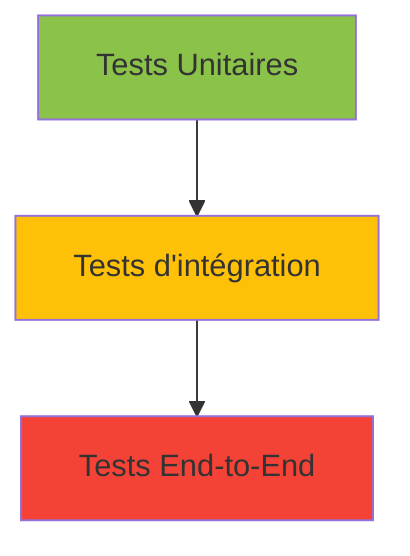
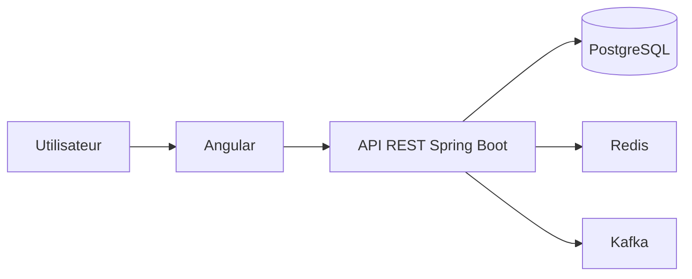
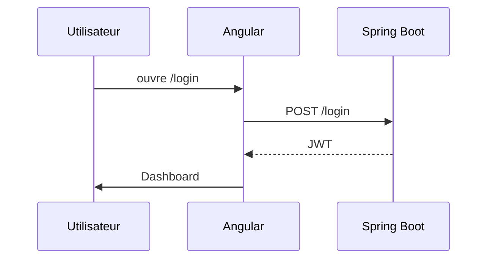
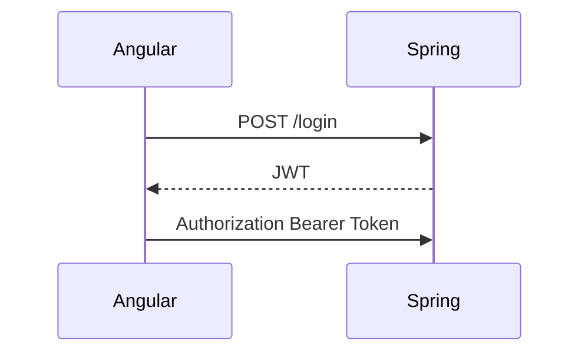
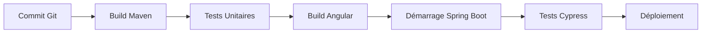
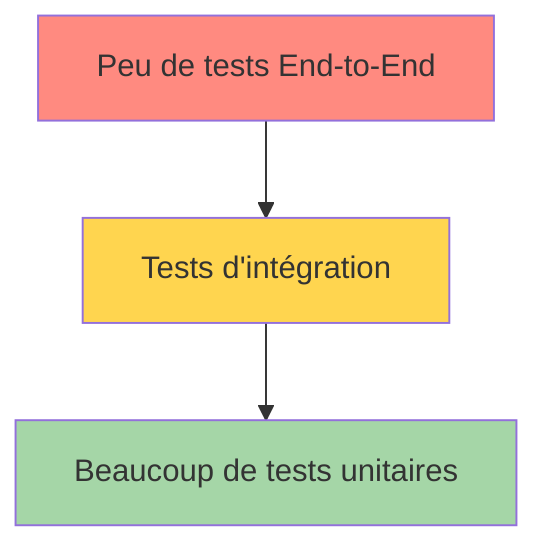

Un bon test End-to-End (E2E) ne consiste pas seulement à "cliquer sur des boutons". Il doit vérifier qu'un utilisateur peut réellement accomplir un scénario métier complet en faisant communiquer **Angular → API Java Spring Boot → Base de données**, exactement comme en production.

Dans ce tutoriel, nous allons construire progressivement une véritable stratégie de tests E2E sur une application Java/Angular moderne.

---

# Tutoriel complet : Les tests End-to-End (E2E) dans une application Java Spring Boot + Angular

## Sommaire

1. Qu'est-ce qu'un test End-to-End ?
2. Les différents types de tests
3. Architecture d'une application Java + Angular
4. Où se placent les tests E2E ?
5. Les outils modernes
6. Exemple d'application
7. Préparation du projet
8. Premier test E2E avec Cypress
9. Tester les appels REST
10. Tester la base de données
11. Mock ou vrai backend ?
12. Gestion des données de test
13. Authentification JWT
14. CI/CD
15. Bonnes pratiques
16. Les erreurs fréquentes

---

# 1. Qu'est-ce qu'un test End-to-End ?

Un test End-to-End vérifie le fonctionnement complet de l'application du point de vue de l'utilisateur.

Au lieu de tester une fonction Java ou un composant Angular isolément, il teste le parcours entier.

Exemple :

> Un utilisateur crée un compte → se connecte → ajoute un produit → valide une commande → reçoit une confirmation.

Le test vérifie que **tout fonctionne ensemble.**

---

# 2. Les différents niveaux de tests



| Type        | Vérifie              |
| ----------- | -------------------- |
| Unitaires   | Une méthode          |
| Intégration | Plusieurs composants |
| End-to-End  | Toute l'application  |

---

# 3. Architecture typique



Un test E2E parcourt toute cette chaîne.

---

# 4. Exemple de scénario

Notre application est une boutique.

L'utilisateur :

* ouvre le site
* se connecte
* ajoute un produit
* valide son panier

Le test devra vérifier :

✔ affichage Angular

✔ appel HTTP

✔ réponse Java

✔ insertion en base

✔ message de confirmation

---

# 5. Les outils

Aujourd'hui, Cypress est l'outil le plus populaire.

Alternatives :

* Cypress
* Playwright
* Selenium
* TestCafe

Pour Angular, Cypress et Playwright sont généralement privilégiés.

---

# 6. Notre application

Backend :

```
Spring Boot
```

Frontend :

```
Angular
```

API :

```
POST /login

GET /products

POST /orders
```

---

# 7. Préparer le projet

Installation :

```bash
npm install cypress --save-dev
```

Lancement :

```bash
npx cypress open
```

Arborescence :

```
cypress/

    e2e/

    fixtures/

    support/
```

---

# 8. Premier test

Supposons une page Login.

HTML Angular

```html
<input id="username">

<input id="password">

<button id="login">
Connexion
</button>
```

Premier test

```javascript
describe('Connexion', () => {

    it('Connexion utilisateur', () => {

        cy.visit('/login')

        cy.get('#username')
            .type('admin')

        cy.get('#password')
            .type('password')

        cy.get('#login')
            .click()

        cy.url()
            .should('include', '/dashboard')

    })

})
```

Déroulement :



---

# 9. Tester les appels REST

Cypress peut intercepter les requêtes.

```javascript
cy.intercept('POST', '/api/login').as('login')

cy.get('#login').click()

cy.wait('@login')
```

On peut vérifier la réponse.

```javascript
cy.wait('@login')
    .its('response.statusCode')
    .should('eq', 200)
```

On vérifie également le contenu.

```javascript
cy.wait('@login')
    .its('response.body.token')
    .should('exist')
```

Très pratique pour détecter les erreurs serveur.

---

# 10. Vérifier le contenu affiché

Après connexion :

```javascript
cy.contains("Bienvenue")
```

ou

```javascript
cy.get("h1")
.should("contain","Bienvenue")
```

---

# 11. Exemple complet

```javascript
describe("Commande", () => {

    it("Créer une commande", () => {

        cy.visit("/")

        cy.contains("Ordinateur").click()

        cy.contains("Ajouter au panier").click()

        cy.contains("Commander").click()

        cy.contains("Commande validée")

    })

})
```

---

# 12. Vérifier les appels backend

Lorsqu'on clique :

```
Commander
```

Angular appelle :

```
POST /orders
```

On vérifie :

```javascript
cy.intercept("POST","/orders").as("order")

cy.contains("Commander").click()

cy.wait("@order")

    .its("response.statusCode")

    .should("eq",201)
```

---

# 13. Le backend Java

Controller

```java
@RestController
@RequestMapping("/orders")
public class OrderController {

    @PostMapping
    public Order create(@RequestBody OrderDTO dto){

        return service.save(dto);

    }

}
```

Service

```java
@Service
public class OrderService {

    public Order save(OrderDTO dto){

        Order order = new Order();

        order.setProduct(dto.getProduct());

        repository.save(order);

        return order;

    }

}
```

Le test E2E vérifie que toute cette chaîne fonctionne correctement.

---

# 14. Tester la base de données

Une bonne pratique consiste à utiliser une base dédiée aux tests.

```mermaid
graph LR

Angular

--> SpringBoot

--> PostgreSQL Test
```

Le test crée réellement des données.

Puis on les supprime.

---

# 15. Réinitialiser les données

Avant chaque test :

```javascript
beforeEach(() => {

    cy.request("POST","/api/test/reset")

})
```

Côté Spring Boot

```java
@PostMapping("/test/reset")

public void reset(){

    repository.deleteAll();

}
```

Chaque test repart d'une base propre.

---

# 16. Authentification JWT

Connexion :



On peut directement injecter un token.

```javascript
cy.request("POST","/login",{

username:"admin",

password:"password"

})

.then(response=>{

localStorage.setItem(

"token",

response.body.token

)

})
```

Le test démarre connecté.

---

# 17. Mock ou vrai backend ?

Deux stratégies sont possibles.

## A. Mock du backend

Le frontend est testé seul.

```javascript
cy.intercept("GET","/products",{

fixture:"products.json"

})
```

Avantages :

* rapide
* stable
* indépendant

Inconvénient :

on ne teste pas Spring Boot.

---

## B. Backend réel

Angular dialogue avec une véritable API Spring Boot.

```text
Angular

↓

Spring Boot

↓

PostgreSQL
```

Plus lent, mais beaucoup plus représentatif de la production.

---

# 18. Les sélecteurs

Évitez :

```javascript
cy.get("button")
```

Préférez :

```html
<button data-cy="login">
```

Puis :

```javascript
cy.get("[data-cy=login]")
```

Ainsi, le test ne dépend pas de la structure HTML ou du style CSS.

---

# 19. Les attentes implicites

Évitez :

```javascript
cy.wait(5000)
```

Préférez :

```javascript
cy.contains("Bienvenue")
```

ou

```javascript
cy.wait("@login")
```

Cypress attendra automatiquement que la condition soit satisfaite, rendant les tests plus fiables.

---

# 20. Intégration dans une chaîne CI/CD

Un pipeline typique peut être représenté ainsi :



Exemple de commande dans un pipeline :

```bash
mvn clean verify

npm install

npm run build

npm run start &

npx cypress run
```

Les tests E2E s'exécutent uniquement si les étapes précédentes (compilation et tests unitaires) sont réussies.

---

# 21. Bonnes pratiques

* Écrire des scénarios orientés métier ("Créer une commande", "Modifier un profil") plutôt que des tests centrés sur l'interface.
* Utiliser des sélecteurs dédiés (`data-cy`) pour éviter les faux échecs liés aux changements de mise en page.
* Réinitialiser les données avant chaque test pour garantir leur indépendance.
* Éviter les `wait()` fixes au profit d'attentes basées sur des événements (réponses HTTP, affichage d'éléments).
* Limiter le nombre de tests E2E : ils sont plus coûteux que les tests unitaires ou d'intégration.
* Tester les parcours critiques (authentification, paiement, création de commande, etc.) plutôt que chaque détail de l'interface.

---

# 22. Les erreurs fréquentes

| Erreur                               | Conséquence                                    | Bonne pratique                                   |
| ------------------------------------ | ---------------------------------------------- | ------------------------------------------------ |
| Utiliser `cy.wait(5000)`             | Tests lents et instables                       | Attendre une requête ou un élément               |
| Dépendre de données existantes       | Résultats non reproductibles                   | Réinitialiser la base avant chaque test          |
| Utiliser des sélecteurs CSS fragiles | Casse lors d'une refonte graphique             | Utiliser `data-cy`                               |
| Tester uniquement avec des mocks     | Les interactions backend ne sont pas vérifiées | Combiner mocks et backend réel selon les besoins |
| Faire des scénarios trop longs       | Diagnostic difficile en cas d'échec            | Découper en scénarios métier indépendants        |

---

# Conclusion

Dans une architecture **Angular + Spring Boot**, les tests End-to-End constituent la dernière ligne de défense avant la mise en production. Ils valident que l'ensemble de la chaîne — interface utilisateur, API REST, logique métier et persistance des données — fonctionne comme attendu.

Une stratégie de tests équilibrée repose généralement sur une pyramide de tests :



* **Tests unitaires** : nombreux, rapides et ciblés.
* **Tests d'intégration** : vérifient la collaboration entre composants.
* **Tests End-to-End** : moins nombreux, mais couvrent les parcours métier essentiels.

Cette combinaison permet d'obtenir une excellente couverture fonctionnelle tout en conservant des temps d'exécution raisonnables et une maintenance simplifiée.
