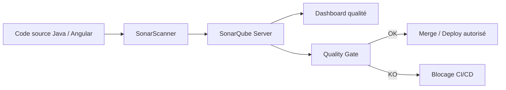
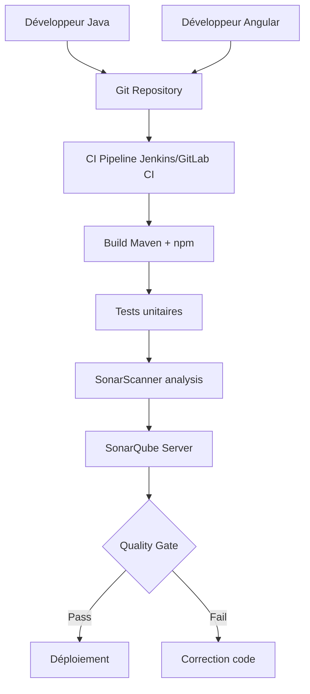
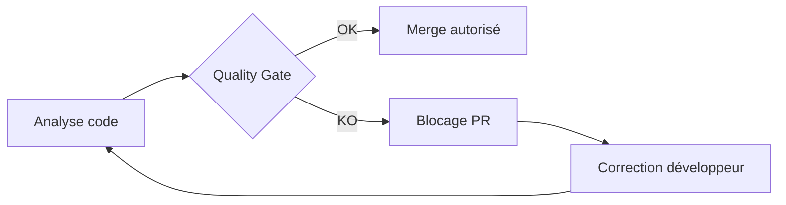
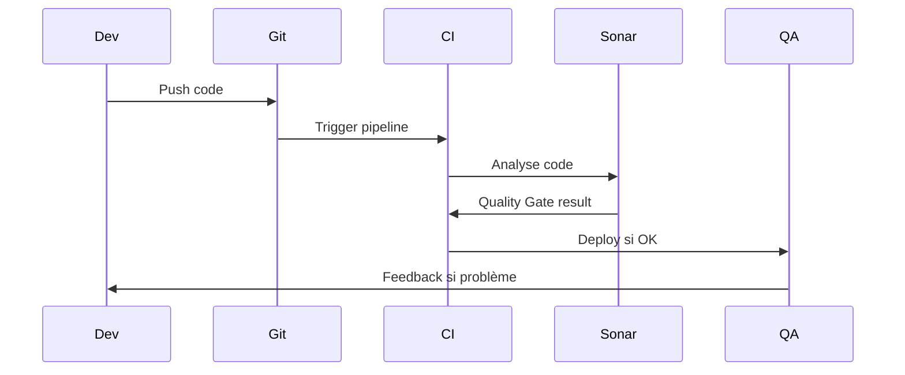

Voici un **tutoriel complet sur SonarQube** dans un contexte de développement **Java + Angular**, avec exemples concrets, configuration et diagrammes Mermaid.

---

# 1. À quoi sert SonarQube ?

SonarQube est un outil d’**inspection continue de la qualité du code**. Il analyse :

* Bugs potentiels
* Vulnérabilités de sécurité
* Code smells (mauvais design)
* Duplication
* Couverture de tests
* Complexité

Il fonctionne avec un modèle simple :



---

# 2. Architecture typique dans un projet Java + Angular



---

# 3. Installation rapide (Docker recommandé)

```bash
docker run -d --name sonarqube \
  -p 9000:9000 \
  sonarqube:lts
```

Accès :

```
http://localhost:9000
```

Login par défaut :

* admin / admin

---

# 4. Analyse d’un projet Java (Spring Boot ou autre)

## 4.1 Maven configuration

Dans `pom.xml` :

```xml
<plugin>
  <groupId>org.sonarsource.scanner.maven</groupId>
  <artifactId>sonar-maven-plugin</artifactId>
  <version>3.10.0.2594</version>
</plugin>
```

## 4.2 Lancer l’analyse

```bash
mvn clean verify sonar:sonar \
  -Dsonar.projectKey=my-java-app \
  -Dsonar.host.url=http://localhost:9000 \
  -Dsonar.login=YOUR_TOKEN
```

---

## 4.3 Exemple de code Java analysé

### Code problématique

```java
public class UserService {

    public String getUserRole(String role) {
        if (role == "ADMIN") {   // ❌ bug potentiel (mauvaise comparaison string)
            return "Administrator";
        }
        return "User";
    }
}
```

### Problèmes détectés par SonarQube

* Comparaison de String avec `==`
* Code smell (manque robustesse)

### Correction

```java
public class UserService {

    public String getUserRole(String role) {
        if ("ADMIN".equals(role)) {  // ✅ bonne pratique
            return "Administrator";
        }
        return "User";
    }
}
```

---

## 4.4 Exemple avec dette technique

```java
public void process() {
    if (true) {
        if (true) {
            if (true) { // ❌ complexité cyclomatique élevée
                System.out.println("Too deep");
            }
        }
    }
}
```

👉 SonarQube va signaler :

* Complexité cyclomatique trop élevée
* Refactoring recommandé

---

# 5. Analyse d’un projet Angular

## 5.1 Installation SonarScanner

```bash
npm install -g sonar-scanner
```

---

## 5.2 Fichier `sonar-project.properties`

```properties
sonar.projectKey=my-angular-app
sonar.projectName=Angular App
sonar.sources=src
sonar.host.url=http://localhost:9000
sonar.sourceEncoding=UTF-8
```

---

## 5.3 Lancer analyse Angular

```bash
sonar-scanner \
  -Dsonar.login=YOUR_TOKEN
```

---

## 5.4 Exemple de code Angular analysé

### Mauvais exemple

```typescript
export class UserComponent {

  users: any;

  getUserName(u: any) {
    return u.name.toUpperCase(); // ❌ risque si u ou name est undefined
  }
}
```

### Problèmes détectés

* Typage `any` (Angular anti-pattern)
* Risque de runtime error
* Absence de null safety

---

### Correction

```typescript
export interface User {
  name?: string;
}

export class UserComponent {

  users: User[] = [];

  getUserName(u?: User): string {
    return u?.name?.toUpperCase() ?? 'UNKNOWN';
  }
}
```

---

# 6. Quality Gate (le cœur de SonarQube)

Le Quality Gate décide si le code est acceptable.

Exemple de règles :

* 0 bug critique
* 0 vulnérabilité bloquante
* < 3% duplication
* couverture tests > 80%



---

# 7. Intégration CI/CD (GitLab CI exemple)

```yaml
sonarqube-check:
  image: maven:3.9
  script:
    - mvn clean verify sonar:sonar
      -Dsonar.projectKey=my-app
      -Dsonar.host.url=http://sonarqube:9000
      -Dsonar.login=$SONAR_TOKEN
```

---

# 8. Bonnes pratiques importantes

### Java

* Éviter `==` sur String
* Limiter la complexité cyclomatique
* Utiliser Optional proprement
* Écrire des tests unitaires

### Angular

* Éviter `any`
* Utiliser RxJS proprement
* Protéger les null/undefined
* Découper les composants

---

# 9. Ce que SonarQube apporte en équipe

* Standardisation du code
* Réduction des bugs en production
* Amélioration continue
* Aide au refactoring
* Suivi de dette technique

---

# 10. Vue globale du workflow réel



---

Si tu veux, je peux aller encore plus loin avec :

* une **archi complète Spring Boot + Angular + Sonar + Docker + Kubernetes**
* un **exemple de projet GitHub prêt à l’emploi**
* ou une **stratégie de Quality Gate adaptée entreprise (banque / startup / ESN)**
