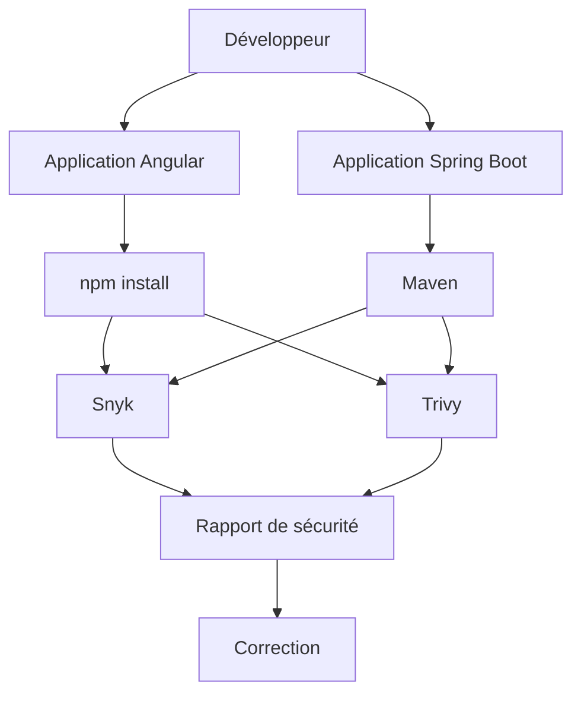
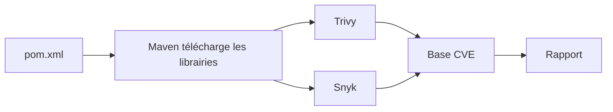
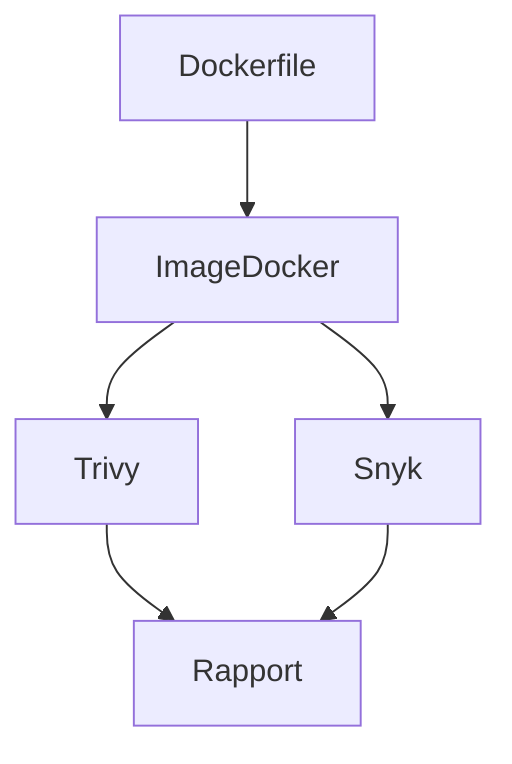
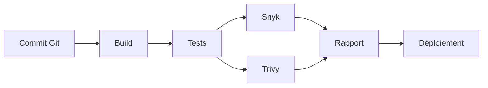

Excellente idée de sujet. Dans un contexte d'entreprise, **Snyk** et **Trivy** sont aujourd'hui deux des outils les plus utilisés pour sécuriser une chaîne de développement Java/Angular (DevSecOps). Ils sont souvent complémentaires :

* **Snyk** : analyse du code, des dépendances, des conteneurs et de l'Infrastructure as Code avec des conseils de correction.
* **Trivy** : scanner open-source extrêmement rapide pour les dépendances, les images Docker, Kubernetes, les secrets et les mauvaises configurations.

Un bon tutoriel pourrait suivre une approche très pratique, proche d'un projet réel.

---

# Tutoriel complet : Sécuriser une application Java Spring Boot + Angular avec Snyk et Trivy

## Objectifs

À la fin de ce tutoriel, vous saurez :

* comprendre les vulnérabilités des dépendances
* scanner une application Spring Boot
* scanner une application Angular
* scanner une image Docker
* détecter des secrets oubliés
* intégrer les scans dans GitLab CI ou GitHub Actions
* interpréter les rapports
* corriger les vulnérabilités

---

# Architecture du projet

Nous allons utiliser cette architecture.



---

# Notre application

```
mon-projet/

backend/
    pom.xml
    src/

frontend/
    package.json
    src/

Dockerfile

.gitlab-ci.yml
```

---

# Pourquoi utiliser deux outils ?

| Fonction                 | Snyk      | Trivy       |
| ------------------------ | --------- | ----------- |
| Scan dépendances Java    | ✅         | ✅           |
| Scan dépendances Angular | ✅         | ✅           |
| Scan Docker              | ✅         | ✅           |
| Scan Kubernetes          | Oui       | Oui         |
| Secrets                  | Oui       | Oui         |
| Conseils de correction   | Excellent | Bon         |
| Rapidité                 | Bonne     | Très rapide |

En entreprise, on utilise souvent **les deux**.

---

# Partie 1 — Scanner une application Spring Boot

Notre fichier Maven :

```xml
<dependencies>

    <dependency>
        <groupId>org.springframework.boot</groupId>
        <artifactId>spring-boot-starter-web</artifactId>
        <version>2.5.0</version>
    </dependency>

</dependencies>
```

Imaginons que cette version contienne plusieurs CVE.

---

## Analyse avec Snyk

Installation

```bash
npm install -g snyk
```

Authentification

```bash
snyk auth
```

Puis

```bash
cd backend

snyk test
```

Exemple de résultat

```
Testing backend...

✗ High severity vulnerability found

Package :

spring-boot-starter-web

Issue :

Remote Code Execution

Introduced through :

Spring Boot 2.5.0

Fixed in :

2.5.15
```

Snyk explique :

* la faille
* son impact
* le score CVSS
* la version corrigée

C'est l'un de ses principaux avantages.

---

# Corriger la vulnérabilité

Avant

```xml
<version>2.5.0</version>
```

Après

```xml
<version>2.5.15</version>
```

Puis

```bash
mvn clean install

snyk test
```

Résultat

```
✓ No known vulnerabilities
```

---

# Même analyse avec Trivy

Installation

Ubuntu

```bash
sudo apt install trivy
```

ou

```bash
brew install trivy
```

Analyse

```bash
cd backend

trivy fs .
```

Résultat

```
HIGH

commons-collections

CVE-2023-12345

Fixed Version :

4.4
```

---

# Comprendre le fonctionnement



---

# Partie 2 — Scanner une application Angular

Notre fichier package.json

```json
{
  "dependencies": {

    "lodash": "4.17.15",

    "rxjs": "6.5.3"

  }
}
```

Certaines versions sont vulnérables.

---

Analyse Snyk

```bash
cd frontend

snyk test
```

Résultat

```
lodash

Prototype Pollution

Severity :

HIGH

Upgrade to :

4.17.21
```

---

Correction

```bash
npm install lodash@4.17.21
```

Puis

```bash
npm audit
```

Puis

```bash
snyk test
```

---

Même analyse avec Trivy

```bash
trivy fs frontend/
```

Résultat

```
HIGH

lodash

CVE-2021-23337
```

---

# Partie 3 — Scanner une image Docker

Dockerfile

```dockerfile
FROM openjdk:17

COPY target/app.jar app.jar

ENTRYPOINT ["java","-jar","app.jar"]
```

Construction

```bash
docker build -t mon-api .
```

---

Analyse Trivy

```bash
trivy image mon-api
```

Résultat

```
Total : 18 vulnerabilities

HIGH : 5

CRITICAL : 2
```

---

Analyse Snyk

```bash
snyk container test mon-api
```

Exemple

```
Base image :

openjdk:17

Critical :

openssl

Upgrade base image :

openjdk:17-jdk-slim
```

---

Fonctionnement



---

# Partie 4 — Détection de secrets

Imaginons ce code.

```java
public class Config {

    private static final String PASSWORD = "admin123";

}
```

Ou

```properties
aws.secret=AKIA....
```

Trivy détecte cela.

```bash
trivy fs --scanners secret .
```

Résultat

```
AWS Secret Key detected

Severity : HIGH
```

Même chose avec

```bash
snyk code test
```

---

# Partie 5 — Mauvaises configurations Docker

Dockerfile

```dockerfile
FROM ubuntu

USER root
```

Trivy

```bash
trivy config .
```

Résultat

```
HIGH

Container runs as root
```

Correction

```dockerfile
FROM eclipse-temurin:17

RUN useradd app

USER app
```

---

# Partie 6 — Intégration GitLab CI

```yaml
stages:

- security

security_scan:

  stage: security

  image: aquasec/trivy

  script:

    - trivy fs .
```

---

Pour Snyk

```yaml
security:

  image: node:20

  script:

    - npm install -g snyk

    - snyk auth $SNYK_TOKEN

    - snyk test
```

---

Pipeline complète



---

# Partie 7 — Scanner Kubernetes

Trivy

```bash
trivy config k8s/
```

Exemple

```
deployment.yaml
```

```yaml
securityContext:

  privileged: true
```

Résultat

```
CRITICAL

Privileged container
```

Correction

```yaml
securityContext:

  runAsNonRoot: true

  allowPrivilegeEscalation: false
```

---

# Partie 8 — Génération de rapports

Trivy

```bash
trivy fs --format table .
```

ou

```bash
trivy fs --format json .
```

Snyk

```bash
snyk test --json
```

Très utile pour alimenter un tableau de bord ou intégrer les résultats dans des outils de qualité.

---

# Partie 9 — Bonnes pratiques

* Mettre à jour régulièrement les dépendances (`mvn versions:display-dependency-updates`, `npm outdated`).
* Scanner les dépendances à chaque *pull request*.
* Scanner les images Docker avant publication.
* Ne jamais stocker de secrets dans le dépôt Git.
* Bloquer le pipeline en présence de vulnérabilités critiques.
* Utiliser des images de base minimales (`eclipse-temurin`, `distroless`, `alpine` lorsque compatible).
* Combiner Snyk (remédiation et conseils) et Trivy (rapidité, couverture des images et configurations).

## Comparaison synthétique

| Critère                 | Snyk    | Trivy         |
| ----------------------- | ------- | ------------- |
| Dépendances Maven       | ⭐⭐⭐⭐⭐   | ⭐⭐⭐⭐☆         |
| Dépendances npm         | ⭐⭐⭐⭐⭐   | ⭐⭐⭐⭐☆         |
| Analyse de code (SAST)  | ⭐⭐⭐⭐⭐   | ⭐⭐☆☆☆         |
| Images Docker           | ⭐⭐⭐⭐☆   | ⭐⭐⭐⭐⭐         |
| Secrets                 | ⭐⭐⭐⭐☆   | ⭐⭐⭐⭐⭐         |
| Kubernetes / IaC        | ⭐⭐⭐⭐☆   | ⭐⭐⭐⭐⭐         |
| Conseils de remédiation | ⭐⭐⭐⭐⭐   | ⭐⭐⭐☆☆         |
| Vitesse d'exécution     | ⭐⭐⭐⭐☆   | ⭐⭐⭐⭐⭐         |
| Version open source     | Limitée | Très complète |

## Conclusion

Pour un projet **Java Spring Boot + Angular**, l'utilisation conjointe de **Snyk** et **Trivy** offre une couverture de sécurité très complète :

* **Pendant le développement** : Snyk identifie les vulnérabilités des dépendances et propose des versions corrigées, tandis que Trivy permet de détecter rapidement les vulnérabilités, les secrets exposés et les mauvaises configurations.
* **Lors de la conteneurisation** : Trivy excelle dans l'analyse des images Docker et des manifestes Kubernetes, alors que Snyk fournit des recommandations détaillées sur les composants vulnérables.
* **Dans une chaîne CI/CD** : l'exécution automatique des deux outils à chaque commit ou *merge request* permet de détecter les problèmes de sécurité avant le déploiement, contribuant ainsi à une démarche **DevSecOps** où la sécurité est intégrée dès les premières étapes du cycle de développement.

Cette combinaison est largement adoptée dans les environnements professionnels pour réduire les risques liés aux dépendances, aux conteneurs et aux erreurs de configuration, tout en facilitant la remédiation grâce à des rapports détaillés et exploitables.
