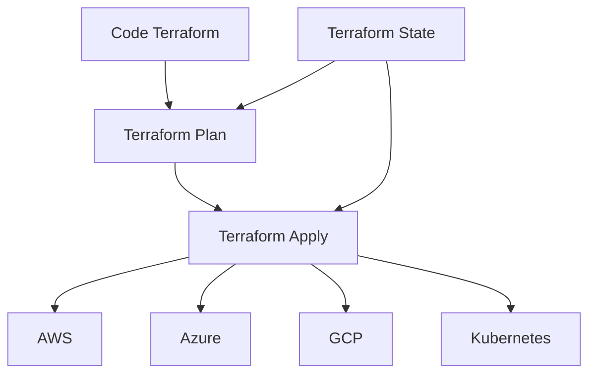
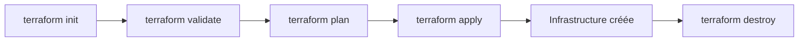
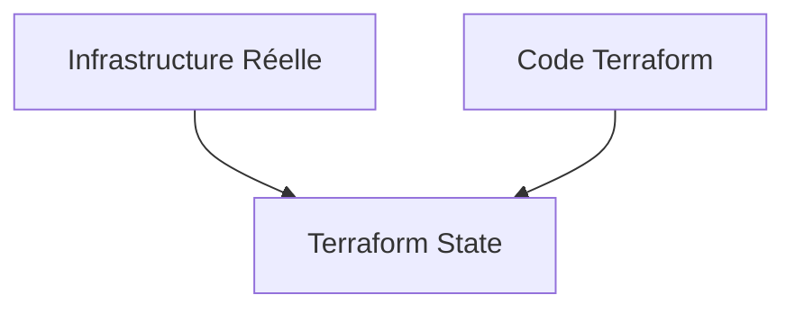
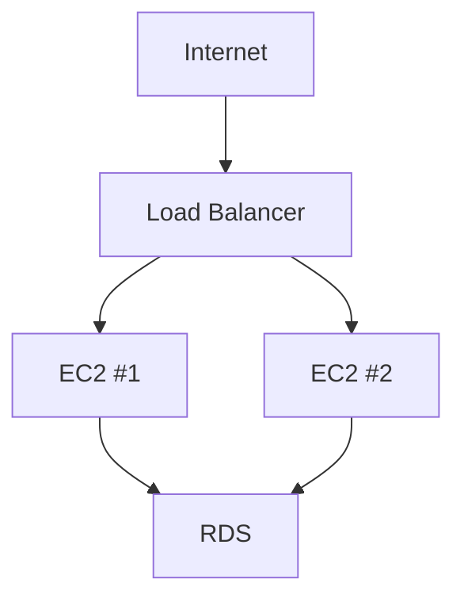
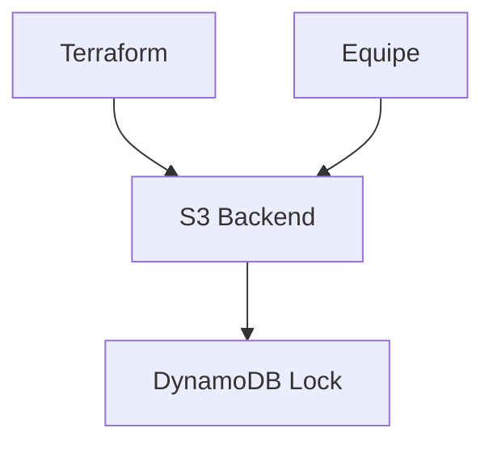
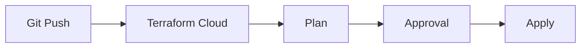
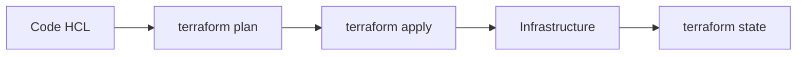

# Tutoriel Complet Terraform

## Introduction

**Terraform** est un outil d'Infrastructure as Code (IaC) développé par [HashiCorp](https://www.hashicorp.com?utm_source=chatgpt.com). Il permet de définir, provisionner et gérer une infrastructure cloud ou on-premise à l'aide de fichiers déclaratifs.

Au lieu de créer manuellement des ressources dans AWS, Azure ou GCP, vous décrivez l'état souhaité dans du code, puis Terraform applique les changements nécessaires.

### Pourquoi utiliser Terraform ?

* Infrastructure reproductible
* Versionnement avec Git
* Automatisation des déploiements
* Réduction des erreurs humaines
* Multi-cloud
* Gestion de l'état de l'infrastructure

---

# Architecture Générale



---

# Installation

## Linux

```bash
wget https://releases.hashicorp.com/terraform/1.8.5/terraform_1.8.5_linux_amd64.zip

unzip terraform_1.8.5_linux_amd64.zip

sudo mv terraform /usr/local/bin/
```

Vérification :

```bash
terraform version
```

---

# Concepts Fondamentaux

Terraform repose sur plusieurs concepts :

| Concept     | Description                                 |
| ----------- | ------------------------------------------- |
| Provider    | Plugin qui dialogue avec AWS, Azure, GCP... |
| Resource    | Objet créé (VM, réseau, base de données...) |
| State       | Fichier décrivant l'état réel               |
| Module      | Réutilisation de code                       |
| Variable    | Paramètre d'entrée                          |
| Output      | Valeur retournée                            |
| Data Source | Lecture d'une ressource existante           |

---

# Premier Projet Terraform

Structure :

```text
terraform-demo/
│
├── main.tf
├── variables.tf
├── outputs.tf
└── terraform.tfvars
```

---

# Comprendre le Workflow Terraform



---

# Étape 1 : Initialisation

```bash
terraform init
```

Terraform :

* télécharge les providers
* crée `.terraform/`
* prépare le projet

---

# Étape 2 : Déclaration du Provider

Exemple AWS :

```hcl
terraform {
  required_providers {
    aws = {
      source = "hashicorp/aws"
      version = "~> 5.0"
    }
  }
}

provider "aws" {
  region = "eu-west-3"
}
```

---

# Comprendre la Syntaxe HCL

Terraform utilise **HCL (Hashicorp Configuration Language)**.

Exemple :

```hcl
resource "aws_instance" "web" {
  ami           = "ami-123456"
  instance_type = "t2.micro"
}
```

Décomposition :

```text
resource
│
├── aws_instance
│       type
│
└── web
        nom logique
```

---

# Création d'une Machine Virtuelle AWS

```hcl
resource "aws_instance" "web" {
  ami           = "ami-0c02fb55956c7d316"
  instance_type = "t2.micro"

  tags = {
    Name = "serveur-web"
  }
}
```

---

# Générer un Plan

```bash
terraform plan
```

Exemple :

```text
Plan: 1 to add, 0 to change, 0 to destroy.
```

Terraform compare :

```text
Etat souhaité
      VS
Etat réel
```

---

# Appliquer les Changements

```bash
terraform apply
```

Validation :

```text
Do you want to perform these actions?
```

Répondre :

```text
yes
```

---

# Terraform State

Terraform crée :

```text
terraform.tfstate
```

Exemple simplifié :

```json
{
  "resources": [
    {
      "type": "aws_instance",
      "name": "web"
    }
  ]
}
```

---

# Pourquoi le State est Important ?

Terraform utilise le state pour savoir :



Sans state :

* Terraform ne sait pas ce qui existe
* Risque de recréation des ressources

---

# Variables

## Déclaration

```hcl
variable "instance_type" {
  type = string
}
```

---

## Utilisation

```hcl
resource "aws_instance" "web" {
  ami           = "ami-123456"
  instance_type = var.instance_type
}
```

---

## Valeur par défaut

```hcl
variable "instance_type" {
  default = "t2.micro"
}
```

---

# Fichier terraform.tfvars

```hcl
instance_type = "t3.medium"
```

---

# Variables Complexes

## Liste

```hcl
variable "subnets" {
  type = list(string)
}
```

Valeur :

```hcl
subnets = [
  "subnet-a",
  "subnet-b"
]
```

---

## Map

```hcl
variable "tags" {
  type = map(string)
}
```

Valeur :

```hcl
tags = {
  env  = "prod"
  team = "devops"
}
```

---

# Outputs

Permettent d'afficher des informations après le déploiement.

```hcl
output "instance_ip" {
  value = aws_instance.web.public_ip
}
```

Résultat :

```text
instance_ip = 52.12.34.56
```

---

# Références Entre Ressources

Création d'un Security Group :

```hcl
resource "aws_security_group" "web" {
  name = "web-sg"
}
```

Utilisation :

```hcl
resource "aws_instance" "web" {
  ami           = "ami-123456"
  instance_type = "t2.micro"

  vpc_security_group_ids = [
    aws_security_group.web.id
  ]
}
```

Terraform déduit automatiquement :

```text
Security Group
      ↓
Instance EC2
```

---

# Data Sources

Lire une ressource existante.

Exemple :

```hcl
data "aws_ami" "ubuntu" {
  most_recent = true

  owners = ["099720109477"]

  filter {
    name   = "name"
    values = ["ubuntu/images/*"]
  }
}
```

Utilisation :

```hcl
ami = data.aws_ami.ubuntu.id
```

---

# Boucles avec count

Créer plusieurs VM :

```hcl
resource "aws_instance" "web" {
  count = 3

  ami           = "ami-123456"
  instance_type = "t2.micro"
}
```

Résultat :

```text
web[0]
web[1]
web[2]
```

---

# Boucles avec for_each

```hcl
resource "aws_s3_bucket" "bucket" {
  for_each = toset([
    "logs",
    "images",
    "backup"
  ])

  bucket = each.value
}
```

Création :

```text
logs
images
backup
```

---

# Conditions

```hcl
variable "environment" {
  default = "dev"
}
```

```hcl
resource "aws_instance" "web" {
  instance_type =
    var.environment == "prod"
    ? "t3.large"
    : "t2.micro"
}
```

---

# Modules

Les modules permettent de factoriser le code.

## Structure

```text
modules/
└── ec2
    ├── main.tf
    ├── variables.tf
    └── outputs.tf
```

---

## Module

```hcl
resource "aws_instance" "this" {
  ami           = var.ami
  instance_type = var.type
}
```

---

## Appel du module

```hcl
module "web_server" {
  source = "./modules/ec2"

  ami  = "ami-123456"
  type = "t2.micro"
}
```

---

# Exemple Réel : Infrastructure Web

Architecture :



---

# Exemple Terraform Simplifié

## Load Balancer

```hcl
resource "aws_lb" "main" {
  name = "main-alb"
}
```

---

## Instances

```hcl
resource "aws_instance" "web" {
  count = 2

  ami           = "ami-123456"
  instance_type = "t2.micro"
}
```

---

## Base de données

```hcl
resource "aws_db_instance" "db" {
  allocated_storage = 20

  engine = "mysql"

  instance_class = "db.t3.micro"
}
```

---

# Backend Remote State

En équipe, ne jamais stocker le state localement.

Architecture :



---

## Configuration S3

```hcl
terraform {
  backend "s3" {
    bucket = "terraform-state-prod"
    key    = "infra.tfstate"
    region = "eu-west-3"

    dynamodb_table = "terraform-lock"
  }
}
```

---

# Workspaces

Permettent de gérer plusieurs environnements.

Créer :

```bash
terraform workspace new dev
```

```bash
terraform workspace new prod
```

Lister :

```bash
terraform workspace list
```

Changer :

```bash
terraform workspace select prod
```

---

# Terraform Import

Importer une ressource existante.

```bash
terraform import aws_instance.web i-123456789
```

Terraform ajoute ensuite la ressource dans le state.

---

# Lifecycle

Empêcher une suppression accidentelle.

```hcl
resource "aws_db_instance" "db" {

  lifecycle {
    prevent_destroy = true
  }
}
```

---

# Dépendances Explicites

```hcl
resource "aws_instance" "web" {

  depends_on = [
    aws_security_group.web
  ]
}
```

Utiliser uniquement si Terraform ne détecte pas déjà la dépendance.

---

# Bonnes Pratiques

## 1. Utiliser des modules

Mauvais :

```text
1000 lignes dans main.tf
```

Bon :

```text
modules/
├── network
├── compute
└── database
```

---

## 2. Séparer les environnements

```text
environments/
├── dev
├── staging
└── prod
```

---

## 3. Remote State

Toujours :

```text
S3 + DynamoDB
```

ou

```text
Terraform Cloud
```

---

## 4. Versionner les providers

```hcl
required_providers {
  aws = {
    version = "~> 5.0"
  }
}
```

---

## 5. Utiliser des variables

Éviter :

```hcl
instance_type = "t3.large"
```

Préférer :

```hcl
instance_type = var.instance_type
```

---

# Terraform Cloud

Fonctionnalités :

* Remote State
* Exécution distante
* Gestion des équipes
* Policy as Code
* Intégration GitHub/GitLab

Flux :



---

# Commandes Essentielles

## Initialiser

```bash
terraform init
```

## Valider

```bash
terraform validate
```

## Formatter

```bash
terraform fmt
```

## Planifier

```bash
terraform plan
```

## Appliquer

```bash
terraform apply
```

## Détruire

```bash
terraform destroy
```

## Afficher le state

```bash
terraform state list
```

---

# Projet Complet de Production

Structure recommandée :

```text
terraform-project/
│
├── environments/
│   ├── dev/
│   ├── stage/
│   └── prod/
│
├── modules/
│   ├── network/
│   ├── compute/
│   ├── database/
│   └── monitoring/
│
├── backend.tf
├── providers.tf
├── variables.tf
└── outputs.tf
```

---

# Résumé

Terraform repose sur un cycle simple :



Les notions indispensables à maîtriser sont :

1. Providers
2. Resources
3. State
4. Variables
5. Outputs
6. Data Sources
7. Modules
8. Workspaces
9. Backend distant
10. Lifecycle et dépendances

Une fois ces concepts acquis, il devient possible d'automatiser des infrastructures complètes sur AWS, Azure, GCP, Kubernetes ou des environnements hybrides avec une approche fiable, reproductible et maintenable.
